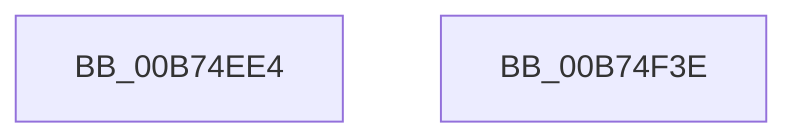

# MiReleaseEnclaveMetadataPage

- RVA: `0x00B74EE4`–`0x00B74F3F` (길이 `91` bytes)
- VA: `0x0000000140B74EE4`
- 실행 섹션: `PAGELK`
- PDB 이름 있음: `예`; PDB Function 태그: `아니요`
- unwind 정보 RVA: `0x0005CF00`
- 디코드: `20`개 명령, `91/91` bytes 표시
- 미해석 바이트: `0` (있으면 어셈블리에 `.byte`로 보존)

> 이 문서는 커널 이미지의 기계어와 PDB 기호를 분석해 생성했습니다. 4번과 5번은 함수 원형과 자료형을 바이너리 사용 방식에서 추정한 C 해석이며 원본 소스 복구 결과는 아닙니다.

## 1. Dependencies

- 직접 호출 지점: **4**; 고유 호출 대상: **4**
- 직접 호출자로 확인된 함수: **1**
- RIP 상대 이미지 참조: **3**

### Outgoing calls
- `0x00B74EF1` → [KeRemoveEnclavePage](../../text/36/KeRemoveEnclavePage_function_00368C90.md) (function, `0x00368C90`)
- `0x00B74EFD` → [MiGetPteAddress](../../text/43/MiGetPteAddress_function_0043E130.md) (function, `0x0043E130`)
- `0x00B74F1D` → [MiReleasePtes](../../text/24/MiReleasePtes_function_00247240.md) (function, `0x00247240`)
- `0x00B74F33` → [MiReturnEnclavePage](../../text/4D/MiReturnEnclavePage_function_004DEEF8.md) (function, `0x004DEEF8`)

### Direct callers
- [MiDeleteEnclavePages](MiDeleteEnclavePages_function_00B7E228.md) at `0x00B7E37F`

### Static image references
- `0x00B74EEA` → RVA `0x00E375C0` (`.data`; read)
- `0x00B74F02` → RVA `0x00E375C0` (`.data`; read/write)
- `0x00B74F0A` → RVA `0x00E37668` (`.data`; read)

## 2. Other-region calls and transfers

- 다른 실행 섹션으로 향하는 call: **4**
  - `0x00B74EF1` → [KeRemoveEnclavePage](../../text/36/KeRemoveEnclavePage_function_00368C90.md) (`PAGELK` → `.text`)
  - `0x00B74EFD` → [MiGetPteAddress](../../text/43/MiGetPteAddress_function_0043E130.md) (`PAGELK` → `.text`)
  - `0x00B74F1D` → [MiReleasePtes](../../text/24/MiReleasePtes_function_00247240.md) (`PAGELK` → `.text`)
  - `0x00B74F33` → [MiReturnEnclavePage](../../text/4D/MiReturnEnclavePage_function_004DEEF8.md) (`PAGELK` → `.text`)
- 별도 외부 분기/꼬리 이동을 확인하지 못했습니다.

## 3. Assembly (complete function range)

```asm
00B74EE4  40 53                           push rbx
00B74EE6  48 83 EC 20                     sub rsp, 0x20
00B74EEA  48 8B 0D CF 26 2C 00            mov rcx, qword ptr [rip + 0x2c26cf]
00B74EF1  E8 9A 3D 7F FF                  call 0x140368c90
00B74EF6  48 8B 0D C3 26 2C 00            mov rcx, qword ptr [rip + 0x2c26c3]
00B74EFD  E8 2E 92 8C FF                  call 0x14043e130
00B74F02  48 83 25 B6 26 2C 00 00         and qword ptr [rip + 0x2c26b6], 0
00B74F0A  48 8D 0D 57 27 2C 00            lea rcx, [rip + 0x2c2757]
00B74F11  41 B8 01 00 00 00               mov r8d, 1
00B74F17  48 8B D0                        mov rdx, rax
00B74F1A  48 8B 18                        mov rbx, qword ptr [rax]
00B74F1D  E8 1E 23 6D FF                  call 0x140247240
00B74F22  48 C1 EB 0C                     shr rbx, 0xc
00B74F26  48 B9 FF FF FF FF FF 00 00 00   movabs rcx, 0xffffffffff
00B74F30  48 23 CB                        and rcx, rbx
00B74F33  E8 C0 9F 96 FF                  call 0x1404deef8
00B74F38  48 83 C4 20                     add rsp, 0x20
00B74F3C  5B                              pop rbx
00B74F3D  C3                              ret
00B74F3E  CC                              int3
```

## 4. C-style interpretation (structured pseudocode)

```c
__int64 __fastcall MiReleaseEnclaveMetadataPage(void)
{
    __int64 result;
    __int64 v_rbx;
    __int64 v_rsp;

    v_rsp = (v_rsp) - (32);
    result = KeRemoveEnclavePage(*(unsigned __int64 *)(v_rip + 2893519), a2, a3, a4);
    result = MiGetPteAddress(*(unsigned __int64 *)(v_rip + 2893507), a2, a3, a4);
    result = MiReleasePtes(v_rip + 2893655, result, 1, a4);
    v_rbx = (*(unsigned __int64 *)(result)) >> (12);
    a1 = (v_rip + 2893655) & (v_rbx);
    result = MiReturnEnclavePage(a1, result, 1, a4);
    v_rsp = (v_rsp) + (32);
    return result;
}
```

## 5. (Beta) C Style

```c
void MiReleaseEnclaveMetadataPage(void)
{
    int64_t result;
    int64_t local_rbx;
    int64_t local_rsp;

    local_rsp = (local_rsp) - (32);
    result = KeRemoveEnclavePage(*(uint64_t *)(v_rip + 0x2C26CF), a2, a3, a4);
    result = MiGetPteAddress(*(uint64_t *)(v_rip + 0x2C26C3), a2, a3, a4);
    result = MiReleasePtes(v_rip + 2893655, result, 1, a4);
    local_rbx = (*(uint64_t *)(result)) >> (12);
    a1 = (v_rip + 2893655) & (local_rbx);
    result = MiReturnEnclavePage(a1, result, 1, a4);
    local_rsp = (local_rsp) + (32);
    return result;
}
```

## 6. Execution-region graph

[열기: 2D/3D 그래프와 함수 탐색 컨트롤 패널](../../../control-panel.html?section=pagelk&rva=0x00B74EE4&view=graph)

- 2D 그래프는 위에서 아래로 흐르고, 3D 그래프는 빈 공간을 드래그해 회전합니다. Shift+드래그는 이동, 휠은 확대·축소, 함수 노드 선택은 대상 보고서 이동입니다.

### Static fallback


