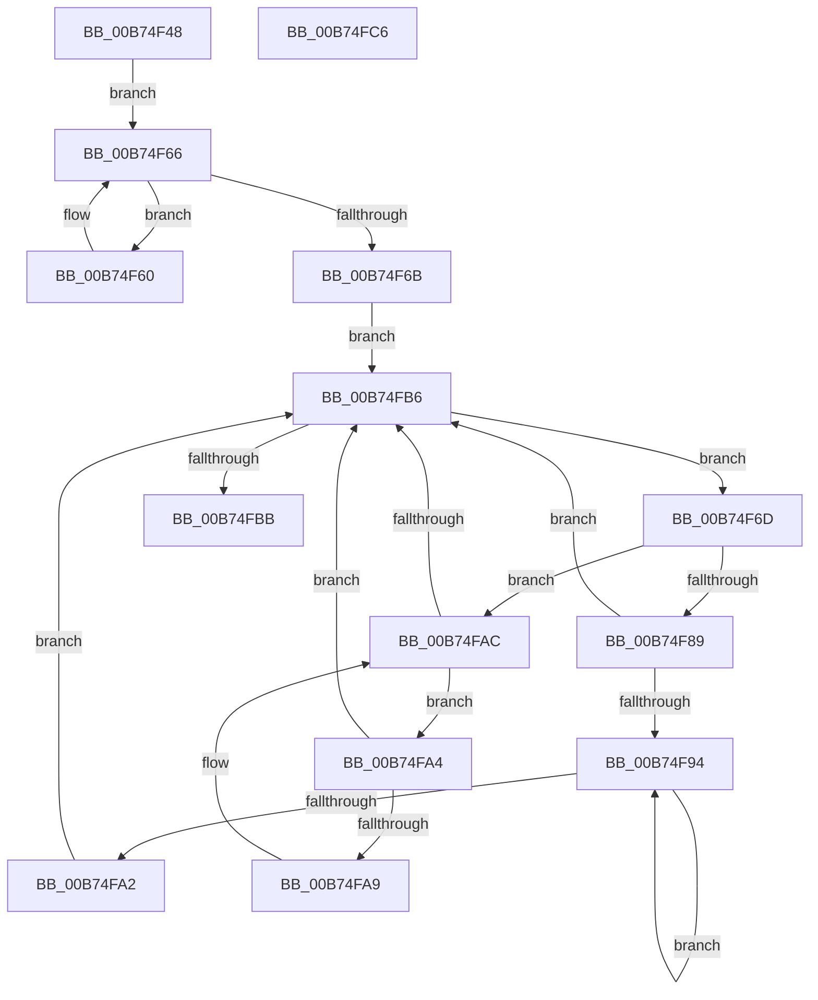

# MiRemoveEnclavePagesFromMirror

- RVA: `0x00B74F48`–`0x00B74FC7` (길이 `127` bytes)
- VA: `0x0000000140B74F48`
- 실행 섹션: `PAGELK`
- PDB 이름 있음: `예`; PDB Function 태그: `아니요`
- unwind 정보 RVA: `0x0005CAAC`
- 디코드: `43`개 명령, `127/127` bytes 표시
- 미해석 바이트: `0` (있으면 어셈블리에 `.byte`로 보존)

> 이 문서는 커널 이미지의 기계어와 PDB 기호를 분석해 생성했습니다. 4번과 5번은 함수 원형과 자료형을 바이너리 사용 방식에서 추정한 C 해석이며 원본 소스 복구 결과는 아닙니다.

## 1. Dependencies

- 직접 호출 지점: **1**; 고유 호출 대상: **1**
- 직접 호출자로 확인된 함수: **1**
- RIP 상대 이미지 참조: **1**

### Outgoing calls
- `0x00B74F78` → [MiMirrorOmitPagesFromCopy](../../text/2B/MiMirrorOmitPagesFromCopy_function_002B7AF0.md) (function, `0x002B7AF0`)

### Direct callers
- [MiMirrorBlackPhase](../../text/67/MiMirrorBlackPhase_function_00678B4C.md) at `0x00678B79`

### Static image references
- `0x00B74F52` → RVA `0x00E375B8` (`.data`; read)

## 2. Other-region calls and transfers

- 다른 실행 섹션으로 향하는 call: **1**
  - `0x00B74F78` → [MiMirrorOmitPagesFromCopy](../../text/2B/MiMirrorOmitPagesFromCopy_function_002B7AF0.md) (`PAGELK` → `.text`)
- 별도 외부 분기/꼬리 이동을 확인하지 못했습니다.

## 3. Assembly (complete function range)

```asm
00B74F48  48 89 5C 24 08                  mov qword ptr [rsp + 8], rbx
00B74F4D  57                              push rdi
00B74F4E  48 83 EC 20                     sub rsp, 0x20
00B74F52  48 8B 05 5F 26 2C 00            mov rax, qword ptr [rip + 0x2c265f]
00B74F59  48 8B F9                        mov rdi, rcx
00B74F5C  33 DB                           xor ebx, ebx
00B74F5E  EB 06                           jmp 0x140b74f66
00B74F60  48 8B D8                        mov rbx, rax
00B74F63  48 8B 00                        mov rax, qword ptr [rax]
00B74F66  48 85 C0                        test rax, rax
00B74F69  75 F5                           jne 0x140b74f60
00B74F6B  EB 49                           jmp 0x140b74fb6
00B74F6D  4C 8B 43 20                     mov r8, qword ptr [rbx + 0x20]
00B74F71  48 8B CF                        mov rcx, rdi
00B74F74  48 8B 53 18                     mov rdx, qword ptr [rbx + 0x18]
00B74F78  E8 73 2B 74 FF                  call 0x1402b7af0
00B74F7D  48 8B 43 08                     mov rax, qword ptr [rbx + 8]
00B74F81  48 8B CB                        mov rcx, rbx
00B74F84  48 85 C0                        test rax, rax
00B74F87  74 23                           je 0x140b74fac
00B74F89  48 8B 08                        mov rcx, qword ptr [rax]
00B74F8C  48 8B D8                        mov rbx, rax
00B74F8F  48 85 C9                        test rcx, rcx
00B74F92  74 22                           je 0x140b74fb6
00B74F94  48 8B 01                        mov rax, qword ptr [rcx]
00B74F97  48 8B D9                        mov rbx, rcx
00B74F9A  48 8B C8                        mov rcx, rax
00B74F9D  48 85 C0                        test rax, rax
00B74FA0  75 F2                           jne 0x140b74f94
00B74FA2  EB 12                           jmp 0x140b74fb6
00B74FA4  48 39 0B                        cmp qword ptr [rbx], rcx
00B74FA7  74 0D                           je 0x140b74fb6
00B74FA9  48 8B CB                        mov rcx, rbx
00B74FAC  48 8B 5B 10                     mov rbx, qword ptr [rbx + 0x10]
00B74FB0  48 83 E3 FC                     and rbx, 0xfffffffffffffffc
00B74FB4  75 EE                           jne 0x140b74fa4
00B74FB6  48 85 DB                        test rbx, rbx
00B74FB9  75 B2                           jne 0x140b74f6d
00B74FBB  48 8B 5C 24 30                  mov rbx, qword ptr [rsp + 0x30]
00B74FC0  48 83 C4 20                     add rsp, 0x20
00B74FC4  5F                              pop rdi
00B74FC5  C3                              ret
00B74FC6  CC                              int3
```

## 4. C-style interpretation (structured pseudocode)

```c
__int64 __fastcall MiRemoveEnclavePagesFromMirror(__int64 a1)
{
    __int64 result;
    __int64 v_rbx;
    __int64 v_rsp;
    unsigned __int64 v_stack_p8;

    v_stack_p8 = v_rbx;
    v_rsp = (v_rsp) - (32);
    v_rbx = 0;
    goto loc_00B74F66;
loc_00B74F60:
loc_00B74F66:
    if (*(unsigned __int64 *)(*(unsigned __int64 *)(v_rip + 2893407)) != 0) goto loc_00B74F60;
    goto loc_00B74FB6;
loc_00B74F6D:
    result = MiMirrorOmitPagesFromCopy(a1, *(unsigned __int64 *)(*(unsigned __int64 *)(v_rip + 2893407) + 24), *(unsigned __int64 *)(*(unsigned __int64 *)(v_rip + 2893407) + 32), a4);
    if (*(unsigned __int64 *)(*(unsigned __int64 *)(v_rip + 2893407) + 8) == 0) goto loc_00B74FAC;
    if (*(unsigned __int64 *)(*(unsigned __int64 *)(*(unsigned __int64 *)(v_rip + 2893407) + 8)) == 0) goto loc_00B74FB6;
loc_00B74F94:
    if (*(unsigned __int64 *)(*(unsigned __int64 *)(*(unsigned __int64 *)(*(unsigned __int64 *)(v_rip + 2893407) + 8))) != 0) goto loc_00B74F94;
    goto loc_00B74FB6;
loc_00B74FA4:
    if ((*(unsigned __int64 *)(*(unsigned __int64 *)(*(unsigned __int64 *)(*(unsigned __int64 *)(v_rip + 2893407) + 8)))) == (*(unsigned __int64 *)(*(unsigned __int64 *)(*(unsigned __int64 *)(*(unsigned __int64 *)(v_rip + 2893407) + 8))))) goto loc_00B74FB6;
loc_00B74FAC:
    v_rbx = (*(unsigned __int64 *)(*(unsigned __int64 *)(*(unsigned __int64 *)(*(unsigned __int64 *)(v_rip + 2893407) + 8)) + 16)) & (-4);
    if (condition_is_not_equal) goto loc_00B74FA4;
loc_00B74FB6:
    if (v_rbx != 0) goto loc_00B74F6D;
    v_rsp = (v_rsp) + (32);
    return *(unsigned __int64 *)(*(unsigned __int64 *)(*(unsigned __int64 *)(*(unsigned __int64 *)(v_rip + 2893407) + 8)));
}
```

## 5. (Beta) C Style

```c
int64_t MiRemoveEnclavePagesFromMirror(int64_t Arg1)
{
    int64_t result;
    int64_t local_rbx;
    int64_t local_rsp;
    uint64_t v_stack_p8;

    v_stack_p8 = local_rbx;
    local_rsp = (local_rsp) - (32);
    local_rbx = 0;
    goto loc_00B74F66;
loc_00B74F60:
loc_00B74F66:
    if (*(uint64_t *)(*(uint64_t *)(v_rip + 0x2C265F)) != 0) goto loc_00B74F60;
    goto loc_00B74FB6;
loc_00B74F6D:
    result = MiMirrorOmitPagesFromCopy(Arg1, *(uint64_t *)(*(uint64_t *)(v_rip + 0x2C265F) + 0x18), *(uint64_t *)(*(uint64_t *)(v_rip + 0x2C265F) + 0x20), a4);
    if (*(uint64_t *)(*(uint64_t *)(v_rip + 0x2C265F) + 0x8) == 0) goto loc_00B74FAC;
    if (*(uint64_t *)(*(uint64_t *)(*(uint64_t *)(v_rip + 0x2C265F) + 0x8)) == 0) goto loc_00B74FB6;
loc_00B74F94:
    if (*(uint64_t *)(*(uint64_t *)(*(uint64_t *)(*(uint64_t *)(v_rip + 0x2C265F) + 0x8))) != 0) goto loc_00B74F94;
    goto loc_00B74FB6;
loc_00B74FA4:
    if ((*(uint64_t *)(*(uint64_t *)(*(uint64_t *)(*(uint64_t *)(v_rip + 0x2C265F) + 0x8)))) == (*(uint64_t *)(*(uint64_t *)(*(uint64_t *)(*(uint64_t *)(v_rip + 0x2C265F) + 0x8))))) goto loc_00B74FB6;
loc_00B74FAC:
    local_rbx = (*(uint64_t *)(*(uint64_t *)(*(uint64_t *)(*(uint64_t *)(v_rip + 0x2C265F) + 0x8)) + 0x10)) & (-4);
    if (condition_is_not_equal) goto loc_00B74FA4;
loc_00B74FB6:
    if (local_rbx != 0) goto loc_00B74F6D;
    local_rsp = (local_rsp) + (32);
    return *(uint64_t *)(*(uint64_t *)(*(uint64_t *)(*(uint64_t *)(v_rip + 0x2C265F) + 0x8)));
}
```

## 6. Execution-region graph

[열기: 2D/3D 그래프와 함수 탐색 컨트롤 패널](../../../control-panel.html?section=pagelk&rva=0x00B74F48&view=graph)

- 2D 그래프는 위에서 아래로 흐르고, 3D 그래프는 빈 공간을 드래그해 회전합니다. Shift+드래그는 이동, 휠은 확대·축소, 함수 노드 선택은 대상 보고서 이동입니다.

### Static fallback


