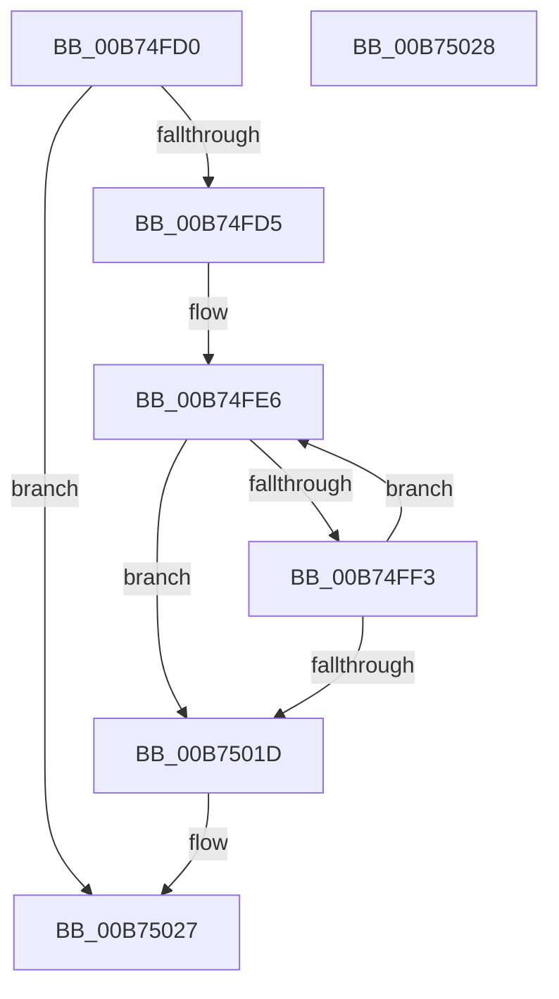

# MiReturnReservedEnclavePages

- RVA: `0x00B74FD0`–`0x00B75029` (길이 `89` bytes)
- VA: `0x0000000140B74FD0`
- 실행 섹션: `PAGELK`
- PDB 이름 있음: `예`; PDB Function 태그: `아니요`
- unwind 정보 RVA: `0x00084918`
- 디코드: `24`개 명령, `89/89` bytes 표시
- 미해석 바이트: `0` (있으면 어셈블리에 `.byte`로 보존)

> 이 문서는 커널 이미지의 기계어와 PDB 기호를 분석해 생성했습니다. 4번과 5번은 함수 원형과 자료형을 바이너리 사용 방식에서 추정한 C 해석이며 원본 소스 복구 결과는 아닙니다.

## 1. Dependencies

- 직접 호출 지점: **2**; 고유 호출 대상: **2**
- 직접 호출자로 확인된 함수: **3**
- RIP 상대 이미지 참조: **0**

### Outgoing calls
- `0x00B74FE9` → [MiUnlinkPageChainHead](../../text/36/MiUnlinkPageChainHead_function_00365C40.md) (function, `0x00365C40`)
- `0x00B75012` → [MiReturnEnclavePage](../../text/4D/MiReturnEnclavePage_function_004DEEF8.md) (function, `0x004DEEF8`)

### Direct callers
- [MiAddPagesToEnclave](../../text/36/MiAddPagesToEnclave_function_00367EEC.md) at `0x00368298`
- [MiInitializeEnclave](../../page/80/MiInitializeEnclave_function_008089D8.md) at `0x00808AAE`
- [MiDeleteEnclavePages](MiDeleteEnclavePages_function_00B7E228.md) at `0x00B7E305`

### Static image references
- 디코드된 RIP-relative 메모리 참조가 없습니다.

## 2. Other-region calls and transfers

- 다른 실행 섹션으로 향하는 call: **2**
  - `0x00B74FE9` → [MiUnlinkPageChainHead](../../text/36/MiUnlinkPageChainHead_function_00365C40.md) (`PAGELK` → `.text`)
  - `0x00B75012` → [MiReturnEnclavePage](../../text/4D/MiReturnEnclavePage_function_004DEEF8.md) (`PAGELK` → `.text`)
- 별도 외부 분기/꼬리 이동을 확인하지 못했습니다.

## 3. Assembly (complete function range)

```asm
00B74FD0  48 85 D2                        test rdx, rdx
00B74FD3  74 52                           je 0x140b75027
00B74FD5  48 89 5C 24 08                  mov qword ptr [rsp + 8], rbx
00B74FDA  57                              push rdi
00B74FDB  48 83 EC 20                     sub rsp, 0x20
00B74FDF  48 8B DA                        mov rbx, rdx
00B74FE2  48 8D 79 60                     lea rdi, [rcx + 0x60]
00B74FE6  48 8B CF                        mov rcx, rdi
00B74FE9  E8 52 0C 7F FF                  call 0x140365c40
00B74FEE  48 85 C0                        test rax, rax
00B74FF1  74 2A                           je 0x140b7501d
00B74FF3  48 B9 00 00 00 00 00 DE FF FF   movabs rcx, 0xffffde0000000000
00B74FFD  48 2B C1                        sub rax, rcx
00B75000  48 B9 AB AA AA AA AA AA AA AA   movabs rcx, 0xaaaaaaaaaaaaaaab
00B7500A  48 C1 F8 04                     sar rax, 4
00B7500E  48 0F AF C8                     imul rcx, rax
00B75012  E8 E1 9E 96 FF                  call 0x1404deef8
00B75017  48 83 EB 01                     sub rbx, 1
00B7501B  75 C9                           jne 0x140b74fe6
00B7501D  48 8B 5C 24 30                  mov rbx, qword ptr [rsp + 0x30]
00B75022  48 83 C4 20                     add rsp, 0x20
00B75026  5F                              pop rdi
00B75027  C3                              ret
00B75028  CC                              int3
```

## 4. C-style interpretation (structured pseudocode)

```c
__int64 __fastcall MiReturnReservedEnclavePages(__int64 a1, __int64 a2)
{
    __int64 result;
    __int64 v_rbx;
    __int64 v_rsp;
    unsigned __int64 v_stack_p8;

    if (a2 == 0) goto loc_00B75027;
    v_stack_p8 = v_rbx;
    v_rsp = (v_rsp) - (32);
loc_00B74FE6:
    result = MiUnlinkPageChainHead(a1 + 96, a2, a3, a4);
    if (result == 0) goto loc_00B7501D;
    result = (result) - (a1 + 96);
    result = (result) >> (4);
    a1 = (a1 + 96) * (result);
    result = MiReturnEnclavePage(a1, a2, a3, a4);
    v_rbx = (a2) - (1);
    if (condition_is_not_equal) goto loc_00B74FE6;
loc_00B7501D:
    v_rsp = (v_rsp) + (32);
loc_00B75027:
    return result;
}
```

## 5. (Beta) C Style

```c
int64_t MiReturnReservedEnclavePages(void *Arg1, int64_t Arg2)
{
    uint8_t *arg1 = (uint8_t *)Arg1;

    int64_t result;
    int64_t local_rbx;
    int64_t local_rsp;
    uint64_t v_stack_p8;

    if (Arg2 == 0) goto loc_00B75027;
    v_stack_p8 = local_rbx;
    local_rsp = (local_rsp) - (32);
loc_00B74FE6:
    result = MiUnlinkPageChainHead(Arg1 + 96, Arg2, a3, a4);
    if (result == 0) goto loc_00B7501D;
    result = (result) - (Arg1 + 96);
    result = (result) >> (4);
    Arg1 = (Arg1 + 96) * (result);
    result = MiReturnEnclavePage(Arg1, Arg2, a3, a4);
    local_rbx = (Arg2) - (1);
    if (condition_is_not_equal) goto loc_00B74FE6;
loc_00B7501D:
    local_rsp = (local_rsp) + (32);
loc_00B75027:
    return result;
}
```

### 관측된 메모리 오프셋

구조체 형식이 확인되지 않은 접근은 인자 기준의 오프셋으로만 기록했습니다.

| 기준 인자 | 오프셋 표현 | 폭 (bit) | 접근 |
|---|---:|---:|---|
| `Arg1` | `+ 0x60` | `64` | `R` |

## 6. Execution-region graph

[열기: 2D/3D 그래프와 함수 탐색 컨트롤 패널](../../../control-panel.html?section=pagelk&rva=0x00B74FD0&view=graph)

- 2D 그래프는 위에서 아래로 흐르고, 3D 그래프는 빈 공간을 드래그해 회전합니다. Shift+드래그는 이동, 휠은 확대·축소, 함수 노드 선택은 대상 보고서 이동입니다.

### Static fallback


