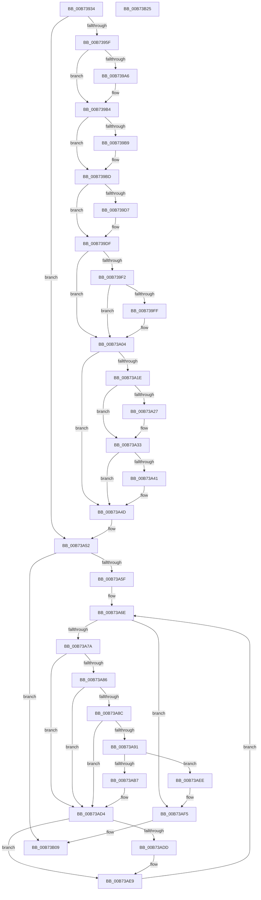

# MiShutdownSystem

- RVA: `0x00B73934`–`0x00B73B26` (길이 `498` bytes)
- VA: `0x0000000140B73934`
- 실행 섹션: `PAGELK`
- PDB 이름 있음: `예`; PDB Function 태그: `아니요`
- unwind 정보 RVA: `0x000A1FF8`
- 디코드: `122`개 명령, `498/498` bytes 표시
- 미해석 바이트: `0` (있으면 어셈블리에 `.byte`로 보존)

> 이 문서는 커널 이미지의 기계어와 PDB 기호를 분석해 생성했습니다. 4번과 5번은 함수 원형과 자료형을 바이너리 사용 방식에서 추정한 C 해석이며 원본 소스 복구 결과는 아닙니다.

## 1. Dependencies

- 직접 호출 지점: **20**; 고유 호출 대상: **20**
- 직접 호출자로 확인된 함수: **1**
- RIP 상대 이미지 참조: **12**

### Outgoing calls
- `0x00B73964` → [MiDeleteHardwareAccelerators](../../text/69/MiDeleteHardwareAccelerators_function_006972DC.md) (function, `0x006972DC`)
- `0x00B73969` → [CcNotifyWriteBehind](../../text/57/CcNotifyWriteBehind_function_0057BA4C.md) (function, `0x0057BA4C`)
- `0x00B73970` → [MiFlushAllFilesystemPages](../../text/4E/MiFlushAllFilesystemPages_function_004E141C.md) (function, `0x004E141C`)
- `0x00B73996` → [KeAbPreAcquire](../../text/21/KeAbPreAcquire_function_00210230.md) (function, `0x00210230`)
- `0x00B739AF` → [ExfAcquirePushLockExclusiveEx](../../text/20/ExfAcquirePushLockExclusiveEx_function_0020FC90.md) (function, `0x0020FC90`)
- `0x00B739DA` → [ExfTryToWakePushLock](../../text/26/ExfTryToWakePushLock_function_00265DD0.md) (function, `0x00265DD0`)
- `0x00B739E2` → [KeAbPostRelease](../../text/2E/KeAbPostRelease_function_002E1600.md) (function, `0x002E1600`)
- `0x00B739FF` → [KiCheckForKernelApcDelivery](../../text/2E/KiCheckForKernelApcDelivery_function_002E2C80.md) (function, `0x002E2C80`)
- `0x00B73A10` → [KeSetEvent](../../text/33/KeSetEvent_function_0033F310.md) (function, `0x0033F310`)
- `0x00B73A2E` → [MmLockPagableSectionByHandle](../../page/A4/MmLockPagableSectionByHandle_function_00A4D1E0.md) (function, `0x00A4D1E0`)
- `0x00B73A33` → [MiZeroAllPageFiles](MiZeroAllPageFiles_function_00B73B2C.md) (function, `0x00B73B2C`)
- `0x00B73A48` → [MmUnlockPagableImageSection](../../text/2A/MmUnlockPagableImageSection_function_002A39F0.md) (function, `0x002A39F0`)
- `0x00B73A4D` → [MiDeleteAllHardwareEnclaves](MiDeleteAllHardwareEnclaves_function_00B74CAC.md) (function, `0x00B74CAC`)
- `0x00B73A5F` → [MmAcquireLoadLock](../../text/4D/MmAcquireLoadLock_function_004DC2A0.md) (function, `0x004DC2A0`)
- `0x00B73AAA` → [MiAllocatePool](../../text/35/MiAllocatePool_function_0035B540.md) (function, `0x0035B540`)
- `0x00B73AC0` → [memcpy](../../text/6C/memcpy_function_006C6840.md) (function, `0x006C6840`)
- `0x00B73AC8` → [MiFreeLoadedImportList](../../page/AB/MiFreeLoadedImportList_function_00AB6380.md) (function, `0x00AB6380`)
- `0x00B73ADF` → [ExFreePoolWithTag](../../poolcode/B8/ExFreePoolWithTag_function_00B82870.md) (function, `0x00B82870`)
- `0x00B73AF8` → [MmReleaseLoadLock](../../text/4D/MmReleaseLoadLock_function_004D36D0.md) (function, `0x004D36D0`)
- `0x00B73B04` → [MiDeletePagingFiles](../../page/7F/MiDeletePagingFiles_function_007FFD34.md) (function, `0x007FFD34`)

### Direct callers
- [MmShutdownSystem](MmShutdownSystem_function_00B73D80.md) at `0x00B73D8E`

### Static image references
- `0x00B7394C` → RVA `0x00E30144` (`.data`; read)
- `0x00B7397E` → RVA `0x00E39140` (`.data`; read)
- `0x00B739BD` → RVA `0x00E30144` (`.data`; write)
- `0x00B739C8` → RVA `0x00E39140` (`.data`; read/write)
- `0x00B73A07` → RVA `0x00E38D58` (`.data`; read)
- `0x00B73A15` → RVA `0x00E30142` (`.data`; read)
- `0x00B73A1E` → RVA `0x00FC6A88` (`ALMOSTRO`; read)
- `0x00B73A27` → RVA `0x00FC6C00` (`ALMOSTRO`; read)
- `0x00B73A52` → RVA `0x00F0C8B0` (`.data`; read)
- `0x00B73A64` → RVA `0x00EF54C0` (`.data`; read)
- `0x00B73AEE` → RVA `0x00F0C8B0` (`.data`; read/write)
- `0x00B73AFD` → RVA `0x00E38D00` (`.data`; read)

## 2. Other-region calls and transfers

- 다른 실행 섹션으로 향하는 call: **18**
  - `0x00B73964` → [MiDeleteHardwareAccelerators](../../text/69/MiDeleteHardwareAccelerators_function_006972DC.md) (`PAGELK` → `.text`)
  - `0x00B73969` → [CcNotifyWriteBehind](../../text/57/CcNotifyWriteBehind_function_0057BA4C.md) (`PAGELK` → `.text`)
  - `0x00B73970` → [MiFlushAllFilesystemPages](../../text/4E/MiFlushAllFilesystemPages_function_004E141C.md) (`PAGELK` → `.text`)
  - `0x00B73996` → [KeAbPreAcquire](../../text/21/KeAbPreAcquire_function_00210230.md) (`PAGELK` → `.text`)
  - `0x00B739AF` → [ExfAcquirePushLockExclusiveEx](../../text/20/ExfAcquirePushLockExclusiveEx_function_0020FC90.md) (`PAGELK` → `.text`)
  - `0x00B739DA` → [ExfTryToWakePushLock](../../text/26/ExfTryToWakePushLock_function_00265DD0.md) (`PAGELK` → `.text`)
  - `0x00B739E2` → [KeAbPostRelease](../../text/2E/KeAbPostRelease_function_002E1600.md) (`PAGELK` → `.text`)
  - `0x00B739FF` → [KiCheckForKernelApcDelivery](../../text/2E/KiCheckForKernelApcDelivery_function_002E2C80.md) (`PAGELK` → `.text`)
  - `0x00B73A10` → [KeSetEvent](../../text/33/KeSetEvent_function_0033F310.md) (`PAGELK` → `.text`)
  - `0x00B73A2E` → [MmLockPagableSectionByHandle](../../page/A4/MmLockPagableSectionByHandle_function_00A4D1E0.md) (`PAGELK` → `PAGE`)
  - `0x00B73A48` → [MmUnlockPagableImageSection](../../text/2A/MmUnlockPagableImageSection_function_002A39F0.md) (`PAGELK` → `.text`)
  - `0x00B73A5F` → [MmAcquireLoadLock](../../text/4D/MmAcquireLoadLock_function_004DC2A0.md) (`PAGELK` → `.text`)
  - `0x00B73AAA` → [MiAllocatePool](../../text/35/MiAllocatePool_function_0035B540.md) (`PAGELK` → `.text`)
  - `0x00B73AC0` → [memcpy](../../text/6C/memcpy_function_006C6840.md) (`PAGELK` → `.text`)
  - `0x00B73AC8` → [MiFreeLoadedImportList](../../page/AB/MiFreeLoadedImportList_function_00AB6380.md) (`PAGELK` → `PAGE`)
  - `0x00B73ADF` → [ExFreePoolWithTag](../../poolcode/B8/ExFreePoolWithTag_function_00B82870.md) (`PAGELK` → `POOLCODE`)
  - `0x00B73AF8` → [MmReleaseLoadLock](../../text/4D/MmReleaseLoadLock_function_004D36D0.md) (`PAGELK` → `.text`)
  - `0x00B73B04` → [MiDeletePagingFiles](../../page/7F/MiDeletePagingFiles_function_007FFD34.md) (`PAGELK` → `PAGE`)
- 별도 외부 분기/꼬리 이동을 확인하지 못했습니다.

## 3. Assembly (complete function range)

```asm
00B73934  48 89 5C 24 08                  mov qword ptr [rsp + 8], rbx
00B73939  48 89 6C 24 10                  mov qword ptr [rsp + 0x10], rbp
00B7393E  48 89 74 24 18                  mov qword ptr [rsp + 0x18], rsi
00B73943  57                              push rdi
00B73944  41 54                           push r12
00B73946  41 56                           push r14
00B73948  48 83 EC 20                     sub rsp, 0x20
00B7394C  83 3D F1 C7 2B 00 00            cmp dword ptr [rip + 0x2bc7f1], 0
00B73953  41 BC 01 00 00 00               mov r12d, 1
00B73959  0F 85 F3 00 00 00               jne 0x140b73a52
00B7395F  41 8B D4                        mov edx, r12d
00B73962  33 C9                           xor ecx, ecx
00B73964  E8 73 39 B2 FF                  call 0x1406972dc
00B73969  E8 DE 80 A0 FF                  call 0x14057ba4c
00B7396E  33 C9                           xor ecx, ecx
00B73970  E8 A7 DA 96 FF                  call 0x1404e141c
00B73975  65 48 8B 1C 25 88 01 00 00      mov rbx, qword ptr gs:[0x188]
00B7397E  48 8D 35 BB 57 2C 00            lea rsi, [rip + 0x2c57bb]
00B73985  45 33 C0                        xor r8d, r8d
00B73988  33 D2                           xor edx, edx
00B7398A  48 8B CE                        mov rcx, rsi
00B7398D  66 44 29 A3 E6 01 00 00         sub word ptr [rbx + 0x1e6], r12w
00B73995  90                              nop
00B73996  E8 95 C8 69 FF                  call 0x140210230
00B7399B  F0 48 0F BA 2E 00               lock bts qword ptr [rsi], 0
00B739A1  48 8B F8                        mov rdi, rax
00B739A4  73 0E                           jae 0x140b739b4
00B739A6  4C 8B C6                        mov r8, rsi
00B739A9  48 8B D0                        mov rdx, rax
00B739AC  48 8B CE                        mov rcx, rsi
00B739AF  E8 DC C2 69 FF                  call 0x14020fc90
00B739B4  48 85 FF                        test rdi, rdi
00B739B7  74 04                           je 0x140b739bd
00B739B9  44 88 67 0A                     mov byte ptr [rdi + 0xa], r12b
00B739BD  44 89 25 80 C7 2B 00            mov dword ptr [rip + 0x2bc780], r12d
00B739C4  48 83 C8 FF                     or rax, 0xffffffffffffffff
00B739C8  F0 48 0F C1 05 6F 57 2C 00      lock xadd qword ptr [rip + 0x2c576f], rax
00B739D1  24 06                           and al, 6
00B739D3  3C 02                           cmp al, 2
00B739D5  75 08                           jne 0x140b739df
00B739D7  48 8B CE                        mov rcx, rsi
00B739DA  E8 F1 23 6F FF                  call 0x140265dd0
00B739DF  48 8B CE                        mov rcx, rsi
00B739E2  E8 19 DC 76 FF                  call 0x1402e1600
00B739E7  90                              nop
00B739E8  66 44 01 A3 E6 01 00 00         add word ptr [rbx + 0x1e6], r12w
00B739F0  75 12                           jne 0x140b73a04
00B739F2  48 8D 83 98 00 00 00            lea rax, [rbx + 0x98]
00B739F9  90                              nop
00B739FA  48 39 00                        cmp qword ptr [rax], rax
00B739FD  74 05                           je 0x140b73a04
00B739FF  E8 7C F2 76 FF                  call 0x1402e2c80
00B73A04  45 33 C0                        xor r8d, r8d
00B73A07  48 8D 0D 4A 53 2C 00            lea rcx, [rip + 0x2c534a]
00B73A0E  33 D2                           xor edx, edx
00B73A10  E8 FB B8 7C FF                  call 0x14033f310
00B73A15  80 3D 26 C7 2B 00 00            cmp byte ptr [rip + 0x2bc726], 0
00B73A1C  74 2F                           je 0x140b73a4d
00B73A1E  F6 05 63 30 45 00 04            test byte ptr [rip + 0x453063], 4
00B73A25  75 0C                           jne 0x140b73a33
00B73A27  48 8B 0D D2 31 45 00            mov rcx, qword ptr [rip + 0x4531d2]
00B73A2E  E8 AD 97 ED FF                  call 0x140a4d1e0
00B73A33  E8 F4 00 00 00                  call 0x140b73b2c
00B73A38  F6 05 49 30 45 00 04            test byte ptr [rip + 0x453049], 4
00B73A3F  75 0C                           jne 0x140b73a4d
00B73A41  48 8B 0D B8 31 45 00            mov rcx, qword ptr [rip + 0x4531b8]
00B73A48  E8 A3 FF 72 FF                  call 0x1402a39f0
00B73A4D  E8 5A 12 00 00                  call 0x140b74cac
00B73A52  83 3D 57 8E 39 00 00            cmp dword ptr [rip + 0x398e57], 0
00B73A59  0F 84 AA 00 00 00               je 0x140b73b09
00B73A5F  E8 3C 88 96 FF                  call 0x1404dc2a0
00B73A64  48 8B 1D 55 1A 38 00            mov rbx, qword ptr [rip + 0x381a55]
00B73A6B  4C 8B F0                        mov r14, rax
00B73A6E  48 8D 05 4B 1A 38 00            lea rax, [rip + 0x381a4b]
00B73A75  48 3B D8                        cmp rbx, rax
00B73A78  74 7B                           je 0x140b73af5
00B73A7A  48 8B BB 88 00 00 00            mov rdi, qword ptr [rbx + 0x88]
00B73A81  49 3B FC                        cmp rdi, r12
00B73A84  74 4E                           je 0x140b73ad4
00B73A86  48 83 FF FE                     cmp rdi, -2
00B73A8A  74 48                           je 0x140b73ad4
00B73A8C  41 84 FC                        test r12b, dil
00B73A8F  75 43                           jne 0x140b73ad4
00B73A91  48 8B 07                        mov rax, qword ptr [rdi]
00B73A94  41 B8 4D 6D 44 54               mov r8d, 0x54446d4d
00B73A9A  B9 40 00 00 00                  mov ecx, 0x40
00B73A9F  48 8D 2C C5 08 00 00 00         lea rbp, [rax*8 + 8]
00B73AA7  48 8B D5                        mov rdx, rbp
00B73AAA  E8 91 7A 7E FF                  call 0x14035b540
00B73AAF  48 8B F0                        mov rsi, rax
00B73AB2  48 85 C0                        test rax, rax
00B73AB5  74 37                           je 0x140b73aee
00B73AB7  4C 8B C5                        mov r8, rbp
00B73ABA  48 8B D7                        mov rdx, rdi
00B73ABD  48 8B C8                        mov rcx, rax
00B73AC0  E8 7B 2D B5 FF                  call 0x1406c6840
00B73AC5  48 8B CF                        mov rcx, rdi
00B73AC8  E8 B3 28 F4 FF                  call 0x140ab6380
00B73ACD  48 89 B3 88 00 00 00            mov qword ptr [rbx + 0x88], rsi
00B73AD4  48 8B 4B 50                     mov rcx, qword ptr [rbx + 0x50]
00B73AD8  48 85 C9                        test rcx, rcx
00B73ADB  74 0C                           je 0x140b73ae9
00B73ADD  33 D2                           xor edx, edx
00B73ADF  E8 8C ED 00 00                  call 0x140b82870
00B73AE4  48 83 63 50 00                  and qword ptr [rbx + 0x50], 0
00B73AE9  48 8B 1B                        mov rbx, qword ptr [rbx]
00B73AEC  EB 80                           jmp 0x140b73a6e
00B73AEE  83 25 BB 8D 39 00 00            and dword ptr [rip + 0x398dbb], 0
00B73AF5  49 8B CE                        mov rcx, r14
00B73AF8  E8 D3 FB 95 FF                  call 0x1404d36d0
00B73AFD  48 8D 0D FC 51 2C 00            lea rcx, [rip + 0x2c51fc]
00B73B04  E8 2B C2 C8 FF                  call 0x1407ffd34
00B73B09  48 8B 5C 24 40                  mov rbx, qword ptr [rsp + 0x40]
00B73B0E  41 8A C4                        mov al, r12b
00B73B11  48 8B 6C 24 48                  mov rbp, qword ptr [rsp + 0x48]
00B73B16  48 8B 74 24 50                  mov rsi, qword ptr [rsp + 0x50]
00B73B1B  48 83 C4 20                     add rsp, 0x20
00B73B1F  41 5E                           pop r14
00B73B21  41 5C                           pop r12
00B73B23  5F                              pop rdi
00B73B24  C3                              ret
00B73B25  CC                              int3
```

## 4. C-style interpretation (structured pseudocode)

```c
__int64 __fastcall MiShutdownSystem(int a1, __int64 a2, int a3)
{
    __int64 result;
    __int64 v_rsp;
    unsigned __int64 v_stack_p10;
    unsigned __int64 v_stack_p18;
    unsigned __int64 v_stack_p8;

    v_stack_p8 = v_rbx;
    v_stack_p10 = v_rbp;
    v_stack_p18 = v_rsi;
    v_rsp = (v_rsp) - (32);
    if ((*(unsigned int *)(v_rip + 2869233)) != 0) goto loc_00B73A52;
    a1 = 0;
    result = MiDeleteHardwareAccelerators(a1, 1, a3, a4);
    result = CcNotifyWriteBehind(a1, 1, a3, a4);
    a1 = 0;
    result = MiFlushAllFilesystemPages(a1, 1, a3, a4);
    a3 = 0;
    a2 = 0;
    result = KeAbPreAcquire(v_rip + 2906043, a2, a3, a4);
    if (!(condition_is_above_or_equal)) {
        a3 = v_rip + 2906043;
        a2 = result;
        a1 = v_rip + 2906043;
        result = ExfAcquirePushLockExclusiveEx(a1, a2, a3, a4);
    }
    if (result != 0) {
        *(unsigned __int8 *)(result + 10) = 1;
    }
    *(unsigned int *)(v_rip + 2869120) = 1;
    result = (result) | (-1);
    result = (unsigned __int8)((result) & (6));
    if (((unsigned __int8)(result)) == 2) {
        a1 = v_rip + 2906043;
        result = ExfTryToWakePushLock(a1, a2, a3, a4);
    }
    result = KeAbPostRelease(v_rip + 2906043, a2, a3, a4);
    if (((unsigned __int8)(result)) != 2) goto loc_00B73A04;
    result = *(unsigned __int64 *)(gs_base + (0 + 392)) + 152;
    if ((*(unsigned __int64 *)(*(unsigned __int64 *)(gs_base + (0 + 392)) + 152)) != (*(unsigned __int64 *)(gs_base + (0 + 392)) + 152)) {
        result = KiCheckForKernelApcDelivery(v_rip + 2906043, a2, a3, a4);
    }
    a3 = 0;
    a2 = 0;
    result = KeSetEvent(v_rip + 2904906, a2, a3, a4);
    if ((*(unsigned __int8 *)(v_rip + 2869030)) == 0) goto loc_00B73A4D;
    if (((*(unsigned __int8 *)(v_rip + 4534371)) & (4)) == 0) {
        a1 = *(unsigned __int64 *)(v_rip + 4534738);
        result = MmLockPagableSectionByHandle(a1, a2, a3, a4);
    }
    result = MiZeroAllPageFiles(a1, a2, a3, a4);
    if (((*(unsigned __int8 *)(v_rip + 4534345)) & (4)) == 0) {
        a1 = *(unsigned __int64 *)(v_rip + 4534712);
        result = MmUnlockPagableImageSection(a1, a2, a3, a4);
    }
    result = MiDeleteAllHardwareEnclaves(a1, a2, a3, a4);
loc_00B73A52:
    if ((*(unsigned int *)(v_rip + 3771991)) == 0) goto loc_00B73B09;
    result = MmAcquireLoadLock(a1, a2, a3, a4);
loc_00B73A6E:
    if ((*(unsigned __int64 *)(v_rip + 3676757)) == (v_rip + 3676747)) goto loc_00B73AF5;
    if ((*(unsigned __int64 *)(*(unsigned __int64 *)(v_rip + 3676757) + 136)) == 1) goto loc_00B73AD4;
    if ((*(unsigned __int64 *)(*(unsigned __int64 *)(v_rip + 3676757) + 136)) == -2) goto loc_00B73AD4;
    if (((1) & ((unsigned __int8)(*(unsigned __int64 *)(*(unsigned __int64 *)(v_rip + 3676757) + 136)))) != 0) goto loc_00B73AD4;
    result = MiAllocatePool(64, *(unsigned __int64 *)(*(unsigned __int64 *)(*(unsigned __int64 *)(v_rip + 3676757) + 136)) * 8 + 8, (unsigned int)(0x54446D4DULL), a4);
    if (result == 0) goto loc_00B73AEE;
    result = memcpy(result, *(unsigned __int64 *)(*(unsigned __int64 *)(v_rip + 3676757) + 136), *(unsigned __int64 *)(*(unsigned __int64 *)(*(unsigned __int64 *)(v_rip + 3676757) + 136)) * 8 + 8, a4);
    result = MiFreeLoadedImportList(*(unsigned __int64 *)(*(unsigned __int64 *)(v_rip + 3676757) + 136), *(unsigned __int64 *)(*(unsigned __int64 *)(v_rip + 3676757) + 136), *(unsigned __int64 *)(*(unsigned __int64 *)(*(unsigned __int64 *)(v_rip + 3676757) + 136)) * 8 + 8, a4);
    *(unsigned __int64 *)(*(unsigned __int64 *)(v_rip + 3676757) + 136) = result;
loc_00B73AD4:
    if (*(unsigned __int64 *)(*(unsigned __int64 *)(v_rip + 3676757) + 80) != 0) {
        a2 = 0;
        result = ExFreePoolWithTag(*(unsigned __int64 *)(*(unsigned __int64 *)(v_rip + 3676757) + 80), a2, *(unsigned __int64 *)(*(unsigned __int64 *)(*(unsigned __int64 *)(v_rip + 3676757) + 136)) * 8 + 8, a4);
    }
    goto loc_00B73A6E;
loc_00B73AEE:
loc_00B73AF5:
    result = MmReleaseLoadLock(result, a2, *(unsigned __int64 *)(*(unsigned __int64 *)(*(unsigned __int64 *)(v_rip + 3676757) + 136)) * 8 + 8, a4);
    result = MiDeletePagingFiles(v_rip + 2904572, a2, *(unsigned __int64 *)(*(unsigned __int64 *)(*(unsigned __int64 *)(v_rip + 3676757) + 136)) * 8 + 8, a4);
loc_00B73B09:
    v_rsp = (v_rsp) + (32);
    return 1;
}
```

## 5. (Beta) C Style

```c
int64_t MiShutdownSystem(int32_t Arg1, int64_t Arg2, int32_t Arg3)
{
    int64_t result;
    int64_t local_rsp;
    uint64_t v_stack_p10;
    uint64_t v_stack_p18;
    uint64_t v_stack_p8;

    v_stack_p8 = local_rbx;
    v_stack_p10 = local_rbp;
    v_stack_p18 = local_rsi;
    local_rsp = (local_rsp) - (32);
    if ((*(uint32_t *)(v_rip + 0x2BC7F1)) != 0) goto loc_00B73A52;
    Arg1 = 0;
    result = MiDeleteHardwareAccelerators(Arg1, 1, Arg3, a4);
    result = CcNotifyWriteBehind(Arg1, 1, Arg3, a4);
    Arg1 = 0;
    result = MiFlushAllFilesystemPages(Arg1, 1, Arg3, a4);
    Arg3 = 0;
    Arg2 = 0;
    result = KeAbPreAcquire(v_rip + 2906043, Arg2, Arg3, a4);
    if (!(condition_is_above_or_equal)) {
        Arg3 = v_rip + 2906043;
        Arg2 = result;
        Arg1 = v_rip + 2906043;
        result = ExfAcquirePushLockExclusiveEx(Arg1, Arg2, Arg3, a4);
    }
    if (result != 0) {
        *(uint8_t *)(result + 0xA) = 1;
    }
    *(uint32_t *)(v_rip + 0x2BC780) = 1;
    result = (result) | (-1);
    result = (uint8_t)((result) & (6));
    if (((uint8_t)(result)) == 2) {
        Arg1 = v_rip + 2906043;
        result = ExfTryToWakePushLock(Arg1, Arg2, Arg3, a4);
    }
    result = KeAbPostRelease(v_rip + 2906043, Arg2, Arg3, a4);
    if (((uint8_t)(result)) != 2) goto loc_00B73A04;
    result = *(uint64_t *)(gs_base + (0 + 0x188)) + 152;
    if ((*(uint64_t *)(*(uint64_t *)(gs_base + (0 + 0x188)) + 0x98)) != (*(uint64_t *)(gs_base + (0 + 0x188)) + 152)) {
        result = KiCheckForKernelApcDelivery(v_rip + 2906043, Arg2, Arg3, a4);
    }
    Arg3 = 0;
    Arg2 = 0;
    result = KeSetEvent(v_rip + 2904906, Arg2, Arg3, a4);
    if ((*(uint8_t *)(v_rip + 0x2BC726)) == 0) goto loc_00B73A4D;
    if (((*(uint8_t *)(v_rip + 0x453063)) & (4)) == 0) {
        Arg1 = *(uint64_t *)(v_rip + 0x4531D2);
        result = MmLockPagableSectionByHandle(Arg1, Arg2, Arg3, a4);
    }
    result = MiZeroAllPageFiles(Arg1, Arg2, Arg3, a4);
    if (((*(uint8_t *)(v_rip + 0x453049)) & (4)) == 0) {
        Arg1 = *(uint64_t *)(v_rip + 0x4531B8);
        result = MmUnlockPagableImageSection(Arg1, Arg2, Arg3, a4);
    }
    result = MiDeleteAllHardwareEnclaves(Arg1, Arg2, Arg3, a4);
loc_00B73A52:
    if ((*(uint32_t *)(v_rip + 0x398E57)) == 0) goto loc_00B73B09;
    result = MmAcquireLoadLock(Arg1, Arg2, Arg3, a4);
loc_00B73A6E:
    if ((*(uint64_t *)(v_rip + 0x381A55)) == (v_rip + 3676747)) goto loc_00B73AF5;
    if ((*(uint64_t *)(*(uint64_t *)(v_rip + 0x381A55) + 0x88)) == 1) goto loc_00B73AD4;
    if ((*(uint64_t *)(*(uint64_t *)(v_rip + 0x381A55) + 0x88)) == -2) goto loc_00B73AD4;
    if (((1) & ((uint8_t)(*(uint64_t *)(*(uint64_t *)(v_rip + 0x381A55) + 0x88)))) != 0) goto loc_00B73AD4;
    result = MiAllocatePool(64, *(uint64_t *)(*(uint64_t *)(*(uint64_t *)(v_rip + 0x381A55) + 0x88)) * 8 + 8, (uint32_t)(0x54446D4DULL), a4);
    if (result == 0) goto loc_00B73AEE;
    result = memcpy(result, *(uint64_t *)(*(uint64_t *)(v_rip + 0x381A55) + 0x88), *(uint64_t *)(*(uint64_t *)(*(uint64_t *)(v_rip + 0x381A55) + 0x88)) * 8 + 8, a4);
    result = MiFreeLoadedImportList(*(uint64_t *)(*(uint64_t *)(v_rip + 0x381A55) + 0x88), *(uint64_t *)(*(uint64_t *)(v_rip + 0x381A55) + 0x88), *(uint64_t *)(*(uint64_t *)(*(uint64_t *)(v_rip + 0x381A55) + 0x88)) * 8 + 8, a4);
    *(uint64_t *)(*(uint64_t *)(v_rip + 0x381A55) + 0x88) = result;
loc_00B73AD4:
    if (*(uint64_t *)(*(uint64_t *)(v_rip + 0x381A55) + 0x50) != 0) {
        Arg2 = 0;
        result = ExFreePoolWithTag(*(uint64_t *)(*(uint64_t *)(v_rip + 0x381A55) + 0x50), Arg2, *(uint64_t *)(*(uint64_t *)(*(uint64_t *)(v_rip + 0x381A55) + 0x88)) * 8 + 8, a4);
    }
    goto loc_00B73A6E;
loc_00B73AEE:
loc_00B73AF5:
    result = MmReleaseLoadLock(result, Arg2, *(uint64_t *)(*(uint64_t *)(*(uint64_t *)(v_rip + 0x381A55) + 0x88)) * 8 + 8, a4);
    result = MiDeletePagingFiles(v_rip + 2904572, Arg2, *(uint64_t *)(*(uint64_t *)(*(uint64_t *)(v_rip + 0x381A55) + 0x88)) * 8 + 8, a4);
loc_00B73B09:
    local_rsp = (local_rsp) + (32);
    return 1;
}
```

## 6. Execution-region graph

[열기: 2D/3D 그래프와 함수 탐색 컨트롤 패널](../../../control-panel.html?section=pagelk&rva=0x00B73934&view=graph)

- 2D 그래프는 위에서 아래로 흐르고, 3D 그래프는 빈 공간을 드래그해 회전합니다. Shift+드래그는 이동, 휠은 확대·축소, 함수 노드 선택은 대상 보고서 이동입니다.

### Static fallback


