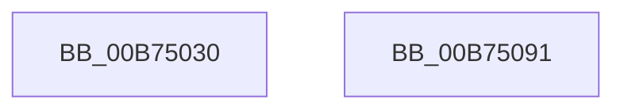

# MiTerminateHardwareEnclave

- RVA: `0x00B75030`–`0x00B75092` (길이 `98` bytes)
- VA: `0x0000000140B75030`
- 실행 섹션: `PAGELK`
- PDB 이름 있음: `예`; PDB Function 태그: `아니요`
- unwind 정보 RVA: `0x00064C80`
- 디코드: `27`개 명령, `98/98` bytes 표시
- 미해석 바이트: `0` (있으면 어셈블리에 `.byte`로 보존)

> 이 문서는 커널 이미지의 기계어와 PDB 기호를 분석해 생성했습니다. 4번과 5번은 함수 원형과 자료형을 바이너리 사용 방식에서 추정한 C 해석이며 원본 소스 복구 결과는 아닙니다.

## 1. Dependencies

- 직접 호출 지점: **3**; 고유 호출 대상: **2**
- 직접 호출자로 확인된 함수: **2**
- RIP 상대 이미지 참조: **0**

### Outgoing calls
- `0x00B75055` → [MiGetPteAddress](../../text/43/MiGetPteAddress_function_0043E130.md) (function, `0x0043E130`)
- `0x00B7506F` → [MiGetPteAddress](../../text/43/MiGetPteAddress_function_0043E130.md) (function, `0x0043E130`)
- `0x00B75082` → [MiDecommitHardwareEnclavePages](../../text/36/MiDecommitHardwareEnclavePages_function_003688D4.md) (function, `0x003688D4`)

### Direct callers
- [MiTerminateEnclave](../../page/80/MiTerminateEnclave_function_00808C18.md) at `0x00808C45`
- [MiDeleteEnclavePages](MiDeleteEnclavePages_function_00B7E228.md) at `0x00B7E26A`

### Static image references
- 디코드된 RIP-relative 메모리 참조가 없습니다.

## 2. Other-region calls and transfers

- 다른 실행 섹션으로 향하는 call: **3**
  - `0x00B75055` → [MiGetPteAddress](../../text/43/MiGetPteAddress_function_0043E130.md) (`PAGELK` → `.text`)
  - `0x00B7506F` → [MiGetPteAddress](../../text/43/MiGetPteAddress_function_0043E130.md) (`PAGELK` → `.text`)
  - `0x00B75082` → [MiDecommitHardwareEnclavePages](../../text/36/MiDecommitHardwareEnclavePages_function_003688D4.md) (`PAGELK` → `.text`)
- 별도 외부 분기/꼬리 이동을 확인하지 못했습니다.

## 3. Assembly (complete function range)

```asm
00B75030  40 53                           push rbx
00B75032  48 83 EC 30                     sub rsp, 0x30
00B75036  8B 42 1C                        mov eax, dword ptr [rdx + 0x1c]
00B75039  4C 8B D1                        mov r10, rcx
00B7503C  0F B6 4A 21                     movzx ecx, byte ptr [rdx + 0x21]
00B75040  48 8B DA                        mov rbx, rdx
00B75043  48 C1 E1 20                     shl rcx, 0x20
00B75047  48 0B C8                        or rcx, rax
00B7504A  48 C1 E1 0C                     shl rcx, 0xc
00B7504E  48 81 C9 FF 0F 00 00            or rcx, 0xfff
00B75055  E8 D6 90 8C FF                  call 0x14043e130
00B7505A  0F B6 4A 20                     movzx ecx, byte ptr [rdx + 0x20]
00B7505E  4C 8B C8                        mov r9, rax
00B75061  8B 42 18                        mov eax, dword ptr [rdx + 0x18]
00B75064  48 C1 E1 20                     shl rcx, 0x20
00B75068  48 0B C8                        or rcx, rax
00B7506B  48 C1 E1 0C                     shl rcx, 0xc
00B7506F  E8 BC 90 8C FF                  call 0x14043e130
00B75074  4C 8B C0                        mov r8, rax
00B75077  C7 44 24 20 01 00 00 00         mov dword ptr [rsp + 0x20], 1
00B7507F  49 8B CA                        mov rcx, r10
00B75082  E8 4D 38 7F FF                  call 0x1403688d4
00B75087  83 4B 40 08                     or dword ptr [rbx + 0x40], 8
00B7508B  48 83 C4 30                     add rsp, 0x30
00B7508F  5B                              pop rbx
00B75090  C3                              ret
00B75091  CC                              int3
```

## 4. C-style interpretation (structured pseudocode)

```c
__int64 __fastcall MiTerminateHardwareEnclave(__int64 a1, __int64 a2)
{
    __int64 result;
    __int64 v_rsp;
    unsigned int v_stack_m18;

    v_rsp = (v_rsp) - (48);
    a1 = (*(unsigned __int8 *)(a2 + 33)) << (32);
    a1 = (a1) | ((unsigned int)(*(unsigned int *)(a2 + 28)));
    a1 = (a1) << (12);
    a1 = (a1) | (0xFFFULL);
    result = MiGetPteAddress(a1, a2, a3, a4);
    a1 = (*(unsigned __int8 *)(a2 + 32)) << (32);
    a1 = (a1) | ((unsigned int)(*(unsigned int *)(a2 + 24)));
    a1 = (a1) << (12);
    result = MiGetPteAddress(a1, a2, a3, result);
    v_stack_m18 = 1;
    result = MiDecommitHardwareEnclavePages(a1, a2, result, result);
    v_rsp = (v_rsp) + (48);
    return result;
}
```

## 5. (Beta) C Style

```c
int64_t MiTerminateHardwareEnclave(int64_t Arg1, void *Arg2)
{
    uint8_t *arg2 = (uint8_t *)Arg2;

    int64_t result;
    int64_t local_rsp;
    uint32_t v_stack_m18;

    local_rsp = (local_rsp) - (48);
    Arg1 = (*(uint8_t *)(arg2 + 0x21)) << (32);
    Arg1 = (Arg1) | ((uint32_t)(*(uint32_t *)(arg2 + 0x1C)));
    Arg1 = (Arg1) << (12);
    Arg1 = (Arg1) | (0xFFFULL);
    result = MiGetPteAddress(Arg1, Arg2, a3, a4);
    Arg1 = (*(uint8_t *)(arg2 + 0x20)) << (32);
    Arg1 = (Arg1) | ((uint32_t)(*(uint32_t *)(arg2 + 0x18)));
    Arg1 = (Arg1) << (12);
    result = MiGetPteAddress(Arg1, Arg2, a3, result);
    v_stack_m18 = 1;
    result = MiDecommitHardwareEnclavePages(Arg1, Arg2, result, result);
    local_rsp = (local_rsp) + (48);
    return result;
}
```

### 관측된 메모리 오프셋

구조체 형식이 확인되지 않은 접근은 인자 기준의 오프셋으로만 기록했습니다.

| 기준 인자 | 오프셋 표현 | 폭 (bit) | 접근 |
|---|---:|---:|---|
| `Arg2` | `+ 0x1C` | `32` | `R` |
| `Arg2` | `+ 0x21` | `8` | `R` |
| `Arg2` | `+ 0x40` | `32` | `R/W` |

## 6. Execution-region graph

[열기: 2D/3D 그래프와 함수 탐색 컨트롤 패널](../../../control-panel.html?section=pagelk&rva=0x00B75030&view=graph)

- 2D 그래프는 위에서 아래로 흐르고, 3D 그래프는 빈 공간을 드래그해 회전합니다. Shift+드래그는 이동, 휠은 확대·축소, 함수 노드 선택은 대상 보고서 이동입니다.

### Static fallback


