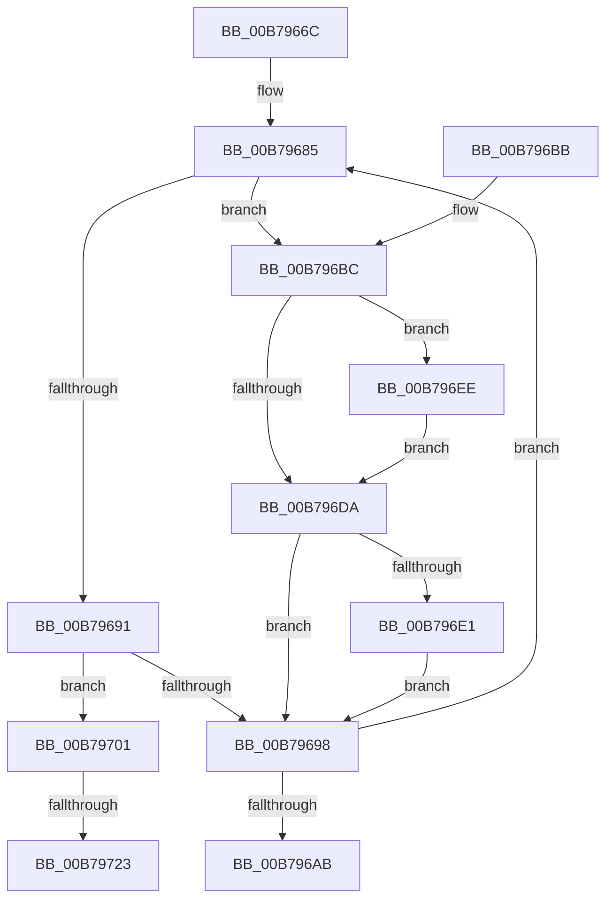

# MiUpdateUserMappings

- RVA: `0x00B7966C`–`0x00B79739` (길이 `205` bytes)
- VA: `0x0000000140B7966C`
- 실행 섹션: `PAGELK`
- PDB 이름 있음: `예`; PDB Function 태그: `예`
- unwind 정보 RVA: `0x000B690C`
- 디코드: `56`개 명령, `205/205` bytes 표시
- 미해석 바이트: `0` (있으면 어셈블리에 `.byte`로 보존)

> 이 문서는 커널 이미지의 기계어와 PDB 기호를 분석해 생성했습니다. 4번과 5번은 함수 원형과 자료형을 바이너리 사용 방식에서 추정한 C 해석이며 원본 소스 복구 결과는 아닙니다.

## 1. Dependencies

- 직접 호출 지점: **8**; 고유 호출 대상: **6**
- 직접 호출자로 확인된 함수: **1**
- RIP 상대 이미지 참조: **0**

### Outgoing calls
- `0x00B79688` → [MI_READ_PTE_LOCK_FREE](../../text/28/MI_READ_PTE_LOCK_FREE_function_002828A0.md) (function, `0x002828A0`)
- `0x00B796BF` → [MiMakeQuasiPte](../../text/41/MiMakeQuasiPte_function_0041D680.md) (function, `0x0041D680`)
- `0x00B796D1` → [MiPteInShadowRange](../../text/23/MiPteInShadowRange_function_0023FB00.md) (function, `0x0023FB00`)
- `0x00B796E7` → [MiWritePteShadow](../../text/29/MiWritePteShadow_function_00294EAC.md) (function, `0x00294EAC`)
- `0x00B796F3` → [MiSanitizeShadowPxe](../../text/29/MiSanitizeShadowPxe_function_00294B68.md) (function, `0x00294B68`)
- `0x00B79704` → [MiRevertQuasiPte](../../text/41/MiRevertQuasiPte_function_0041D6A0.md) (function, `0x0041D6A0`)
- `0x00B79716` → [MiPteInShadowRange](../../text/23/MiPteInShadowRange_function_0023FB00.md) (function, `0x0023FB00`)
- `0x00B79728` → [MiSanitizeShadowPxe](../../text/29/MiSanitizeShadowPxe_function_00294B68.md) (function, `0x00294B68`)

### Direct callers
- [PopInvokeSystemStateHandler](PopInvokeSystemStateHandler_function_00B76A6C.md) at `0x00B76E3E`
- [PopInvokeSystemStateHandler](PopInvokeSystemStateHandler_function_00B76A6C.md) at `0x00B76F53`

### Static image references
- 디코드된 RIP-relative 메모리 참조가 없습니다.

## 2. Other-region calls and transfers

- 다른 실행 섹션으로 향하는 call: **8**
  - `0x00B79688` → [MI_READ_PTE_LOCK_FREE](../../text/28/MI_READ_PTE_LOCK_FREE_function_002828A0.md) (`PAGELK` → `.text`)
  - `0x00B796BF` → [MiMakeQuasiPte](../../text/41/MiMakeQuasiPte_function_0041D680.md) (`PAGELK` → `.text`)
  - `0x00B796D1` → [MiPteInShadowRange](../../text/23/MiPteInShadowRange_function_0023FB00.md) (`PAGELK` → `.text`)
  - `0x00B796E7` → [MiWritePteShadow](../../text/29/MiWritePteShadow_function_00294EAC.md) (`PAGELK` → `.text`)
  - `0x00B796F3` → [MiSanitizeShadowPxe](../../text/29/MiSanitizeShadowPxe_function_00294B68.md) (`PAGELK` → `.text`)
  - `0x00B79704` → [MiRevertQuasiPte](../../text/41/MiRevertQuasiPte_function_0041D6A0.md) (`PAGELK` → `.text`)
  - `0x00B79716` → [MiPteInShadowRange](../../text/23/MiPteInShadowRange_function_0023FB00.md) (`PAGELK` → `.text`)
  - `0x00B79728` → [MiSanitizeShadowPxe](../../text/29/MiSanitizeShadowPxe_function_00294B68.md) (`PAGELK` → `.text`)
- call이 아닌 외부 분기/꼬리 이동: **2**
  - `0x00B7971D` → [sub_00B80820](../B8/Unknown_function_00B80820.md) (`tail-transfer`)
  - `0x00B79734` → [sub_00B80820](../B8/Unknown_function_00B80820.md) (`tail-transfer`)

## 3. Assembly (complete function range)

```asm
00B7966C  48 89 5C 24 08                  mov qword ptr [rsp + 8], rbx
00B79671  48 89 74 24 20                  mov qword ptr [rsp + 0x20], rsi
00B79676  57                              push rdi
00B79677  48 83 EC 20                     sub rsp, 0x20
00B7967B  48 BF 00 D0 BE 7D FB F6 FF FF   movabs rdi, 0xfffff6fb7dbed000
00B79685  48 8B CF                        mov rcx, rdi
00B79688  E8 13 92 70 FF                  call 0x1402828a0
00B7968D  A8 01                           test al, 1
00B7968F  75 2B                           jne 0x140b796bc
00B79691  48 0F BA E0 0A                  bt rax, 0xa
00B79696  72 69                           jb 0x140b79701
00B79698  48 83 C7 08                     add rdi, 8
00B7969C  48 B8 F8 D7 BE 7D FB F6 FF FF   movabs rax, 0xfffff6fb7dbed7f8
00B796A6  48 3B F8                        cmp rdi, rax
00B796A9  76 DA                           jbe 0x140b79685
00B796AB  48 8B 5C 24 30                  mov rbx, qword ptr [rsp + 0x30]
00B796B0  48 8B 74 24 48                  mov rsi, qword ptr [rsp + 0x48]
00B796B5  48 83 C4 20                     add rsp, 0x20
00B796B9  5F                              pop rdi
00B796BA  C3                              ret
00B796BB  CC                              int3
00B796BC  48 8B C8                        mov rcx, rax
00B796BF  E8 BC 3F 8A FF                  call 0x14041d680
00B796C4  48 8B CF                        mov rcx, rdi
00B796C7  48 89 44 24 38                  mov qword ptr [rsp + 0x38], rax
00B796CC  48 8B D8                        mov rbx, rax
00B796CF  33 F6                           xor esi, esi
00B796D1  E8 2A 64 6C FF                  call 0x14023fb00
00B796D6  85 C0                           test eax, eax
00B796D8  75 14                           jne 0x140b796ee
00B796DA  48 89 1F                        mov qword ptr [rdi], rbx
00B796DD  85 F6                           test esi, esi
00B796DF  74 B7                           je 0x140b79698
00B796E1  48 8B D3                        mov rdx, rbx
00B796E4  48 8B CF                        mov rcx, rdi
00B796E7  E8 C0 B7 71 FF                  call 0x140294eac
00B796EC  EB AA                           jmp 0x140b79698
00B796EE  48 8D 54 24 38                  lea rdx, [rsp + 0x38]
00B796F3  E8 70 B4 71 FF                  call 0x140294b68
00B796F8  48 8B 5C 24 38                  mov rbx, qword ptr [rsp + 0x38]
00B796FD  8B F0                           mov esi, eax
00B796FF  EB D9                           jmp 0x140b796da
00B79701  48 8B C8                        mov rcx, rax
00B79704  E8 97 3F 8A FF                  call 0x14041d6a0
00B79709  48 8B CF                        mov rcx, rdi
00B7970C  48 89 44 24 40                  mov qword ptr [rsp + 0x40], rax
00B79711  48 8B D8                        mov rbx, rax
00B79714  33 F6                           xor esi, esi
00B79716  E8 E5 63 6C FF                  call 0x14023fb00
00B7971B  85 C0                           test eax, eax
00B7971D  0F 84 FD 70 00 00               je 0x140b80820
00B79723  48 8D 54 24 40                  lea rdx, [rsp + 0x40]
00B79728  E8 3B B4 71 FF                  call 0x140294b68
00B7972D  48 8B 5C 24 40                  mov rbx, qword ptr [rsp + 0x40]
00B79732  8B F0                           mov esi, eax
00B79734  E9 E7 70 00 00                  jmp 0x140b80820
```

## 4. C-style interpretation (structured pseudocode)

```c
__int64 __fastcall MiUpdateUserMappings(void)
{
    __int64 result;
    __int64 v_rdi;
    __int64 v_rsi;
    __int64 v_rsp;
    unsigned __int64 v_stack_p20;
    unsigned __int64 v_stack_p38;
    unsigned __int64 v_stack_p40;
    unsigned __int64 v_stack_p8;

    v_stack_p8 = v_rbx;
    v_stack_p20 = v_rsi;
    v_rsp = (v_rsp) - (32);
loc_00B79685:
    result = MI_READ_PTE_LOCK_FREE(v_rdi, a2, a3, a4);
    if ((((unsigned __int8)(result)) & (1)) != 0) goto loc_00B796BC;
    if (condition_is_below) goto loc_00B79701;
loc_00B79698:
    v_rdi = (v_rdi) + (8);
    if (v_rdi <= result) goto loc_00B79685;
    v_rsp = (v_rsp) + (32);
    return result;
loc_00B796BC:
    result = MiMakeQuasiPte(result, a2, a3, a4);
    v_stack_p38 = result;
    v_rsi = 0;
    result = MiPteInShadowRange(v_rdi, a2, a3, a4);
    if ((unsigned int)(result) != 0) goto loc_00B796EE;
loc_00B796DA:
    *(unsigned __int64 *)(v_rdi) = result;
    if (0 == 0) goto loc_00B79698;
    result = MiWritePteShadow(v_rdi, result, a3, a4);
    goto loc_00B79698;
loc_00B796EE:
    result = MiSanitizeShadowPxe(v_rdi, v_stack_p38, a3, a4);
    goto loc_00B796DA;
loc_00B79701:
    result = MiRevertQuasiPte(result, v_stack_p38, a3, a4);
    v_stack_p40 = result;
    v_rsi = 0;
    result = MiPteInShadowRange(v_rdi, v_stack_p38, a3, a4);
    result = MiSanitizeShadowPxe(v_rdi, v_stack_p40, a3, a4);
}
```

## 5. (Beta) C Style

```c
void MiUpdateUserMappings(void)
{
    int64_t result;
    int64_t local_rdi;
    int64_t local_rsi;
    int64_t local_rsp;
    uint64_t v_stack_p20;
    uint64_t v_stack_p38;
    uint64_t v_stack_p40;
    uint64_t v_stack_p8;

    v_stack_p8 = local_rbx;
    v_stack_p20 = local_rsi;
    local_rsp = (local_rsp) - (32);
loc_00B79685:
    result = MI_READ_PTE_LOCK_FREE(local_rdi, a2, a3, a4);
    if ((((uint8_t)(result)) & (1)) != 0) goto loc_00B796BC;
    if (condition_is_below) goto loc_00B79701;
loc_00B79698:
    local_rdi = (local_rdi) + (8);
    if (local_rdi <= result) goto loc_00B79685;
    local_rsp = (local_rsp) + (32);
    return result;
loc_00B796BC:
    result = MiMakeQuasiPte(result, a2, a3, a4);
    v_stack_p38 = result;
    local_rsi = 0;
    result = MiPteInShadowRange(local_rdi, a2, a3, a4);
    if ((uint32_t)(result) != 0) goto loc_00B796EE;
loc_00B796DA:
    *(uint64_t *)(local_rdi) = result;
    if (0 == 0) goto loc_00B79698;
    result = MiWritePteShadow(local_rdi, result, a3, a4);
    goto loc_00B79698;
loc_00B796EE:
    result = MiSanitizeShadowPxe(local_rdi, v_stack_p38, a3, a4);
    goto loc_00B796DA;
loc_00B79701:
    result = MiRevertQuasiPte(result, v_stack_p38, a3, a4);
    v_stack_p40 = result;
    local_rsi = 0;
    result = MiPteInShadowRange(local_rdi, v_stack_p38, a3, a4);
    result = MiSanitizeShadowPxe(local_rdi, v_stack_p40, a3, a4);
}
```

## 6. Execution-region graph

[열기: 2D/3D 그래프와 함수 탐색 컨트롤 패널](../../../control-panel.html?section=pagelk&rva=0x00B7966C&view=graph)

- 2D 그래프는 위에서 아래로 흐르고, 3D 그래프는 빈 공간을 드래그해 회전합니다. Shift+드래그는 이동, 휠은 확대·축소, 함수 노드 선택은 대상 보고서 이동입니다.

### Static fallback


