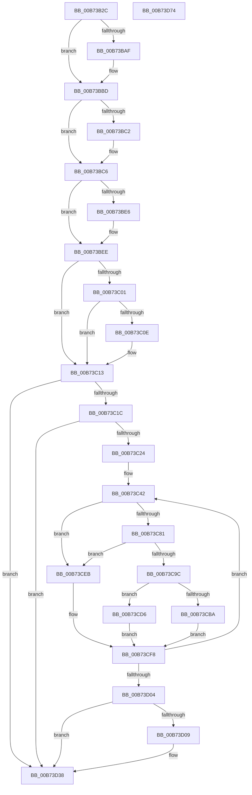

# MiZeroAllPageFiles

- RVA: `0x00B73B2C`–`0x00B73D75` (길이 `585` bytes)
- VA: `0x0000000140B73B2C`
- 실행 섹션: `PAGELK`
- PDB 이름 있음: `예`; PDB Function 태그: `아니요`
- unwind 정보 RVA: `0x000D7838`
- 디코드: `141`개 명령, `585/585` bytes 표시
- 미해석 바이트: `0` (있으면 어셈블리에 `.byte`로 보존)

> 이 문서는 커널 이미지의 기계어와 PDB 기호를 분석해 생성했습니다. 4번과 5번은 함수 원형과 자료형을 바이너리 사용 방식에서 추정한 C 해석이며 원본 소스 복구 결과는 아닙니다.

## 1. Dependencies

- 직접 호출 지점: **15**; 고유 호출 대상: **14**
- 직접 호출자로 확인된 함수: **1**
- RIP 상대 이미지 참조: **10**

### Outgoing calls
- `0x00B73B6B` → [memset](../../text/6C/memset_function_006C6C40.md) (function, `0x006C6C40`)
- `0x00B73B9E` → [KeAbPreAcquire](../../text/21/KeAbPreAcquire_function_00210230.md) (function, `0x00210230`)
- `0x00B73BB8` → [ExfAcquirePushLockExclusiveEx](../../text/20/ExfAcquirePushLockExclusiveEx_function_0020FC90.md) (function, `0x0020FC90`)
- `0x00B73BE9` → [ExfTryToWakePushLock](../../text/26/ExfTryToWakePushLock_function_00265DD0.md) (function, `0x00265DD0`)
- `0x00B73BF1` → [KeAbPostRelease](../../text/2E/KeAbPostRelease_function_002E1600.md) (function, `0x002E1600`)
- `0x00B73C0E` → [KiCheckForKernelApcDelivery](../../text/2E/KiCheckForKernelApcDelivery_function_002E2C80.md) (function, `0x002E2C80`)
- `0x00B73C3B` → [KeWaitForSingleObject](../../text/20/KeWaitForSingleObject_function_0020E6B0.md) (function, `0x0020E6B0`)
- `0x00B73C5F` → [KeInitializeEvent](../../text/40/KeInitializeEvent_function_0040DD10.md) (function, `0x0040DD10`)
- `0x00B73C8F` → [MiAllocatePool](../../text/35/MiAllocatePool_function_0035B540.md) (function, `0x0035B540`)
- `0x00B73CCF` → [ExQueueWorkItem](../../text/2F/ExQueueWorkItem_function_002F9520.md) (function, `0x002F9520`)
- `0x00B73CDC` → [KeSetEvent](../../text/33/KeSetEvent_function_0033F310.md) (function, `0x0033F310`)
- `0x00B73CE4` → [MiZeroPageFile](../../text/67/MiZeroPageFile_function_00671180.md) (function, `0x00671180`)
- `0x00B73CF3` → [KeSetEvent](../../text/33/KeSetEvent_function_0033F310.md) (function, `0x0033F310`)
- `0x00B73D33` → [KeWaitForMultipleObjects](../../text/20/KeWaitForMultipleObjects_function_0020D110.md) (function, `0x0020D110`)
- `0x00B73D4D` → [_security_check_cookie](../../text/6A/_security_check_cookie_function_006AC640.md) (function, `0x006AC640`)

### Direct callers
- [MiShutdownSystem](MiShutdownSystem_function_00B73934.md) at `0x00B73A33`

### Static image references
- `0x00B73B4C` → RVA `0x00E0A740` (`.data`; read)
- `0x00B73B76` → RVA `0x00E39140` (`.data`; read)
- `0x00B73B7D` → RVA `0x00FFDA7C` (`PAGEVRFD`; write)
- `0x00B73BC6` → RVA `0x00E38DB0` (`.data`; read)
- `0x00B73BD1` → RVA `0x00E3D558` (`.data`; read)
- `0x00B73BD7` → RVA `0x00E39140` (`.data`; read/write)
- `0x00B73C2A` → RVA `0x00E39028` (`.data`; read)
- `0x00B73C64` → RVA `0x00E38D00` (`.data`; read)
- `0x00B73CBD` → RVA `0x00671180` (`MiZeroPageFile`; read)
- `0x00B73D38` → RVA `0x00FFDA7C` (`PAGEVRFD`; read/write)

## 2. Other-region calls and transfers

- 다른 실행 섹션으로 향하는 call: **15**
  - `0x00B73B6B` → [memset](../../text/6C/memset_function_006C6C40.md) (`PAGELK` → `.text`)
  - `0x00B73B9E` → [KeAbPreAcquire](../../text/21/KeAbPreAcquire_function_00210230.md) (`PAGELK` → `.text`)
  - `0x00B73BB8` → [ExfAcquirePushLockExclusiveEx](../../text/20/ExfAcquirePushLockExclusiveEx_function_0020FC90.md) (`PAGELK` → `.text`)
  - `0x00B73BE9` → [ExfTryToWakePushLock](../../text/26/ExfTryToWakePushLock_function_00265DD0.md) (`PAGELK` → `.text`)
  - `0x00B73BF1` → [KeAbPostRelease](../../text/2E/KeAbPostRelease_function_002E1600.md) (`PAGELK` → `.text`)
  - `0x00B73C0E` → [KiCheckForKernelApcDelivery](../../text/2E/KiCheckForKernelApcDelivery_function_002E2C80.md) (`PAGELK` → `.text`)
  - `0x00B73C3B` → [KeWaitForSingleObject](../../text/20/KeWaitForSingleObject_function_0020E6B0.md) (`PAGELK` → `.text`)
  - `0x00B73C5F` → [KeInitializeEvent](../../text/40/KeInitializeEvent_function_0040DD10.md) (`PAGELK` → `.text`)
  - `0x00B73C8F` → [MiAllocatePool](../../text/35/MiAllocatePool_function_0035B540.md) (`PAGELK` → `.text`)
  - `0x00B73CCF` → [ExQueueWorkItem](../../text/2F/ExQueueWorkItem_function_002F9520.md) (`PAGELK` → `.text`)
  - `0x00B73CDC` → [KeSetEvent](../../text/33/KeSetEvent_function_0033F310.md) (`PAGELK` → `.text`)
  - `0x00B73CE4` → [MiZeroPageFile](../../text/67/MiZeroPageFile_function_00671180.md) (`PAGELK` → `.text`)
  - `0x00B73CF3` → [KeSetEvent](../../text/33/KeSetEvent_function_0033F310.md) (`PAGELK` → `.text`)
  - `0x00B73D33` → [KeWaitForMultipleObjects](../../text/20/KeWaitForMultipleObjects_function_0020D110.md) (`PAGELK` → `.text`)
  - `0x00B73D4D` → [_security_check_cookie](../../text/6A/_security_check_cookie_function_006AC640.md) (`PAGELK` → `.text`)
- 별도 외부 분기/꼬리 이동을 확인하지 못했습니다.

## 3. Assembly (complete function range)

```asm
00B73B2C  48 8B C4                        mov rax, rsp
00B73B2F  48 89 58 08                     mov qword ptr [rax + 8], rbx
00B73B33  48 89 68 10                     mov qword ptr [rax + 0x10], rbp
00B73B37  48 89 70 18                     mov qword ptr [rax + 0x18], rsi
00B73B3B  48 89 78 20                     mov qword ptr [rax + 0x20], rdi
00B73B3F  41 55                           push r13
00B73B41  41 56                           push r14
00B73B43  41 57                           push r15
00B73B45  48 81 EC 50 05 00 00            sub rsp, 0x550
00B73B4C  48 8B 05 ED 6B 29 00            mov rax, qword ptr [rip + 0x296bed]
00B73B53  48 33 C4                        xor rax, rsp
00B73B56  48 89 84 24 40 05 00 00         mov qword ptr [rsp + 0x540], rax
00B73B5E  33 D2                           xor edx, edx
00B73B60  48 8D 4C 24 40                  lea rcx, [rsp + 0x40]
00B73B65  41 B8 80 00 00 00               mov r8d, 0x80
00B73B6B  E8 D0 30 B5 FF                  call 0x1406c6c40
00B73B70  41 BD 01 00 00 00               mov r13d, 1
00B73B76  48 8D 2D C3 55 2C 00            lea rbp, [rip + 0x2c55c3]
00B73B7D  44 89 2D F8 9E 48 00            mov dword ptr [rip + 0x489ef8], r13d
00B73B84  45 33 C0                        xor r8d, r8d
00B73B87  65 48 8B 1C 25 88 01 00 00      mov rbx, qword ptr gs:[0x188]
00B73B90  33 D2                           xor edx, edx
00B73B92  48 8B CD                        mov rcx, rbp
00B73B95  66 44 29 AB E6 01 00 00         sub word ptr [rbx + 0x1e6], r13w
00B73B9D  90                              nop
00B73B9E  E8 8D C6 69 FF                  call 0x140210230
00B73BA3  F0 48 0F BA 6D 00 00            lock bts qword ptr [rbp], 0
00B73BAA  48 8B F8                        mov rdi, rax
00B73BAD  73 0E                           jae 0x140b73bbd
00B73BAF  4C 8B C5                        mov r8, rbp
00B73BB2  48 8B D0                        mov rdx, rax
00B73BB5  48 8B CD                        mov rcx, rbp
00B73BB8  E8 D3 C0 69 FF                  call 0x14020fc90
00B73BBD  48 85 FF                        test rdi, rdi
00B73BC0  74 04                           je 0x140b73bc6
00B73BC2  44 88 6F 0A                     mov byte ptr [rdi + 0xa], r13b
00B73BC6  48 8B 35 E3 51 2C 00            mov rsi, qword ptr [rip + 0x2c51e3]
00B73BCD  48 83 C8 FF                     or rax, 0xffffffffffffffff
00B73BD1  8B 3D 81 99 2C 00               mov edi, dword ptr [rip + 0x2c9981]
00B73BD7  F0 48 0F C1 05 60 55 2C 00      lock xadd qword ptr [rip + 0x2c5560], rax
00B73BE0  24 06                           and al, 6
00B73BE2  3C 02                           cmp al, 2
00B73BE4  75 08                           jne 0x140b73bee
00B73BE6  48 8B CD                        mov rcx, rbp
00B73BE9  E8 E2 21 6F FF                  call 0x140265dd0
00B73BEE  48 8B CD                        mov rcx, rbp
00B73BF1  E8 0A DA 76 FF                  call 0x1402e1600
00B73BF6  90                              nop
00B73BF7  66 44 01 AB E6 01 00 00         add word ptr [rbx + 0x1e6], r13w
00B73BFF  75 12                           jne 0x140b73c13
00B73C01  48 8D 83 98 00 00 00            lea rax, [rbx + 0x98]
00B73C08  90                              nop
00B73C09  48 39 00                        cmp qword ptr [rax], rax
00B73C0C  74 05                           je 0x140b73c13
00B73C0E  E8 6D F0 76 FF                  call 0x1402e2c80
00B73C13  48 85 F6                        test rsi, rsi
00B73C16  0F 84 1C 01 00 00               je 0x140b73d38
00B73C1C  85 FF                           test edi, edi
00B73C1E  0F 84 14 01 00 00               je 0x140b73d38
00B73C24  48 83 64 24 20 00               and qword ptr [rsp + 0x20], 0
00B73C2A  48 8D 0D F7 53 2C 00            lea rcx, [rip + 0x2c53f7]
00B73C31  45 33 C9                        xor r9d, r9d
00B73C34  45 33 C0                        xor r8d, r8d
00B73C37  41 8D 51 1A                     lea edx, [r9 + 0x1a]
00B73C3B  E8 70 AA 69 FF                  call 0x14020e6b0
00B73C40  8B F7                           mov esi, edi
00B73C42  44 8D 7E FF                     lea r15d, [rsi - 1]
00B73C46  45 33 C0                        xor r8d, r8d
00B73C49  4B 8D 04 7F                     lea rax, [r15 + r15*2]
00B73C4D  33 D2                           xor edx, edx
00B73C4F  48 8D AC 24 C0 00 00 00         lea rbp, [rsp + 0xc0]
00B73C57  48 8D 6C C5 00                  lea rbp, [rbp + rax*8]
00B73C5C  48 8B CD                        mov rcx, rbp
00B73C5F  E8 AC A0 89 FF                  call 0x14040dd10
00B73C64  48 8D 05 95 50 2C 00            lea rax, [rip + 0x2c5095]
00B73C6B  4A 89 6C FC 40                  mov qword ptr [rsp + r15*8 + 0x40], rbp
00B73C70  4A 8B 84 F8 60 48 00 00         mov rax, qword ptr [rax + r15*8 + 0x4860]
00B73C78  F6 80 AC 00 00 00 40            test byte ptr [rax + 0xac], 0x40
00B73C7F  75 6A                           jne 0x140b73ceb
00B73C81  BA 30 00 00 00                  mov edx, 0x30
00B73C86  41 B8 4D 6D 5A 77               mov r8d, 0x775a6d4d
00B73C8C  8D 4A 10                        lea ecx, [rdx + 0x10]
00B73C8F  E8 AC 78 7E FF                  call 0x14035b540
00B73C94  48 8B D8                        mov rbx, rax
00B73C97  48 85 C0                        test rax, rax
00B73C9A  74 4F                           je 0x140b73ceb
00B73C9C  48 8D 05 5D 50 2C 00            lea rax, [rip + 0x2c505d]
00B73CA3  33 D2                           xor edx, edx
00B73CA5  4A 8B 84 F8 60 48 00 00         mov rax, qword ptr [rax + r15*8 + 0x4860]
00B73CAD  48 89 43 20                     mov qword ptr [rbx + 0x20], rax
00B73CB1  48 89 6B 28                     mov qword ptr [rbx + 0x28], rbp
00B73CB5  41 3B F5                        cmp esi, r13d
00B73CB8  74 1C                           je 0x140b73cd6
00B73CBA  48 21 13                        and qword ptr [rbx], rdx
00B73CBD  48 8D 05 BC D4 AF FF            lea rax, [rip - 0x502b44]
00B73CC4  48 8B CB                        mov rcx, rbx
00B73CC7  48 89 43 10                     mov qword ptr [rbx + 0x10], rax
00B73CCB  48 89 5B 18                     mov qword ptr [rbx + 0x18], rbx
00B73CCF  E8 4C 58 78 FF                  call 0x1402f9520
00B73CD4  EB 22                           jmp 0x140b73cf8
00B73CD6  45 33 C0                        xor r8d, r8d
00B73CD9  48 8B CD                        mov rcx, rbp
00B73CDC  E8 2F B6 7C FF                  call 0x14033f310
00B73CE1  48 8B CB                        mov rcx, rbx
00B73CE4  E8 97 D4 AF FF                  call 0x140671180
00B73CE9  EB 0D                           jmp 0x140b73cf8
00B73CEB  45 33 C0                        xor r8d, r8d
00B73CEE  33 D2                           xor edx, edx
00B73CF0  48 8B CD                        mov rcx, rbp
00B73CF3  E8 18 B6 7C FF                  call 0x14033f310
00B73CF8  41 8B F7                        mov esi, r15d
00B73CFB  45 85 FF                        test r15d, r15d
00B73CFE  0F 85 3E FF FF FF               jne 0x140b73c42
00B73D04  41 3B FD                        cmp edi, r13d
00B73D07  76 2F                           jbe 0x140b73d38
00B73D09  48 8D 8C 24 40 02 00 00         lea rcx, [rsp + 0x240]
00B73D11  45 33 C9                        xor r9d, r9d
00B73D14  48 89 4C 24 38                  mov qword ptr [rsp + 0x38], rcx
00B73D19  48 8D 54 24 40                  lea rdx, [rsp + 0x40]
00B73D1E  48 83 64 24 30 00               and qword ptr [rsp + 0x30], 0
00B73D24  45 33 C0                        xor r8d, r8d
00B73D27  44 88 7C 24 28                  mov byte ptr [rsp + 0x28], r15b
00B73D2C  8B CF                           mov ecx, edi
00B73D2E  44 88 7C 24 20                  mov byte ptr [rsp + 0x20], r15b
00B73D33  E8 D8 93 69 FF                  call 0x14020d110
00B73D38  83 25 3D 9D 48 00 00            and dword ptr [rip + 0x489d3d], 0
00B73D3F  41 8B C5                        mov eax, r13d
00B73D42  48 8B 8C 24 40 05 00 00         mov rcx, qword ptr [rsp + 0x540]
00B73D4A  48 33 CC                        xor rcx, rsp
00B73D4D  E8 EE 88 B3 FF                  call 0x1406ac640
00B73D52  4C 8D 9C 24 50 05 00 00         lea r11, [rsp + 0x550]
00B73D5A  49 8B 5B 20                     mov rbx, qword ptr [r11 + 0x20]
00B73D5E  49 8B 6B 28                     mov rbp, qword ptr [r11 + 0x28]
00B73D62  49 8B 73 30                     mov rsi, qword ptr [r11 + 0x30]
00B73D66  49 8B 7B 38                     mov rdi, qword ptr [r11 + 0x38]
00B73D6A  49 8B E3                        mov rsp, r11
00B73D6D  41 5F                           pop r15
00B73D6F  41 5E                           pop r14
00B73D71  41 5D                           pop r13
00B73D73  C3                              ret
00B73D74  CC                              int3
```

## 4. C-style interpretation (structured pseudocode)

```c
__int64 __fastcall MiZeroAllPageFiles(__int64 a1, int a2, __int64 a3, int a4)
{
    __int64 result;
    __int64 v_rsp;
    unsigned __int64 v_stack_m18;
    unsigned __int64 v_stack_m28;
    unsigned __int64 v_stack_m328;
    unsigned __int64 v_stack_m4A8;
    unsigned __int64 v_stack_m528;
    unsigned __int64 v_stack_m530;
    unsigned __int64 v_stack_m538;
    unsigned __int8 v_stack_m540;
    unsigned __int64 v_stack_m548;

    *(unsigned __int64 *)(v_rsp + 8) = v_rbx;
    *(unsigned __int64 *)(v_rsp + 16) = v_rbp;
    *(unsigned __int64 *)(v_rsp + 24) = v_rsi;
    *(unsigned __int64 *)(v_rsp + 32) = v_rdi;
    v_rsp = (v_rsp) - (0x550ULL);
    result = (*(unsigned __int64 *)(v_rip + 2714605)) ^ (v_rsp);
    v_stack_m28 = result;
    a2 = 0;
    result = memset(v_stack_m528, a2, 128, a4);
    *(unsigned int *)(v_rip + 4759288) = 1;
    a3 = 0;
    a2 = 0;
    result = KeAbPreAcquire(v_rip + 2905539, a2, a3, a4);
    if (!(condition_is_above_or_equal)) {
        a3 = v_rip + 2905539;
        a2 = result;
        a1 = v_rip + 2905539;
        result = ExfAcquirePushLockExclusiveEx(a1, a2, a3, a4);
    }
    if (result != 0) {
        *(unsigned __int8 *)(result + 10) = 1;
    }
    result = (result) | (-1);
    result = (unsigned __int8)((result) & (6));
    if (((unsigned __int8)(result)) == 2) {
        a1 = v_rip + 2905539;
        result = ExfTryToWakePushLock(a1, a2, a3, a4);
    }
    result = KeAbPostRelease(v_rip + 2905539, a2, a3, a4);
    if (((unsigned __int8)(result)) != 2) goto loc_00B73C13;
    result = *(unsigned __int64 *)(gs_base + (0 + 392)) + 152;
    if ((*(unsigned __int64 *)(*(unsigned __int64 *)(gs_base + (0 + 392)) + 152)) != (*(unsigned __int64 *)(gs_base + (0 + 392)) + 152)) {
        result = KiCheckForKernelApcDelivery(v_rip + 2905539, a2, a3, a4);
    }
    if (*(unsigned __int64 *)(v_rip + 2904547) == 0) goto loc_00B73D38;
    if ((unsigned int)((unsigned int)(*(unsigned int *)(v_rip + 2922881))) == 0) goto loc_00B73D38;
    a4 = 0;
    a3 = 0;
    result = KeWaitForSingleObject(v_rip + 2905079, a4 + 26, a3, a4);
loc_00B73C42:
    a3 = 0;
    a2 = 0;
    result = KeInitializeEvent(v_stack_m4A8 + (unsigned int)((unsigned int)((unsigned int)(*(unsigned int *)(v_rip + 2922881)))) - 1 + (unsigned int)((unsigned int)((unsigned int)(*(unsigned int *)(v_rip + 2922881)))) - 1 * 2 * 8, a2, a3, a4);
    *(unsigned __int64 *)(v_rsp + (unsigned int)((unsigned int)((unsigned int)(*(unsigned int *)(v_rip + 2922881)))) - 1 * 8 + 64) = v_stack_m4A8 + (unsigned int)((unsigned int)((unsigned int)(*(unsigned int *)(v_rip + 2922881)))) - 1 + (unsigned int)((unsigned int)((unsigned int)(*(unsigned int *)(v_rip + 2922881)))) - 1 * 2 * 8;
    if (((*(unsigned __int8 *)(*(unsigned __int64 *)(v_rip + 2904213 + (unsigned int)((unsigned int)((unsigned int)(*(unsigned int *)(v_rip + 2922881)))) - 1 * 8 + 18528) + 172)) & (64)) != 0) goto loc_00B73CEB;
    result = MiAllocatePool(48 + 16, 48, (unsigned int)(0x775A6D4DULL), a4);
    if (result == 0) goto loc_00B73CEB;
    a2 = 0;
    *(unsigned __int64 *)(result + 32) = *(unsigned __int64 *)(v_rip + 2904157 + (unsigned int)((unsigned int)((unsigned int)(*(unsigned int *)(v_rip + 2922881)))) - 1 * 8 + 18528);
    *(unsigned __int64 *)(result + 40) = v_stack_m4A8 + (unsigned int)((unsigned int)((unsigned int)(*(unsigned int *)(v_rip + 2922881)))) - 1 + (unsigned int)((unsigned int)((unsigned int)(*(unsigned int *)(v_rip + 2922881)))) - 1 * 2 * 8;
    if (((unsigned int)((unsigned int)((unsigned int)((unsigned int)(*(unsigned int *)(v_rip + 2922881)))))) == 1) goto loc_00B73CD6;
    *(unsigned __int64 *)(result + 16) = v_rip - 5253956;
    *(unsigned __int64 *)(result + 24) = result;
    result = ExQueueWorkItem(result, a2, (unsigned int)(0x775A6D4DULL), a4);
    goto loc_00B73CF8;
loc_00B73CD6:
    a3 = 0;
    result = KeSetEvent(v_stack_m4A8 + (unsigned int)((unsigned int)((unsigned int)(*(unsigned int *)(v_rip + 2922881)))) - 1 + (unsigned int)((unsigned int)((unsigned int)(*(unsigned int *)(v_rip + 2922881)))) - 1 * 2 * 8, a2, a3, a4);
    result = MiZeroPageFile(result, a2, a3, a4);
    goto loc_00B73CF8;
loc_00B73CEB:
    a3 = 0;
    a2 = 0;
    result = KeSetEvent(v_stack_m4A8 + (unsigned int)((unsigned int)((unsigned int)(*(unsigned int *)(v_rip + 2922881)))) - 1 + (unsigned int)((unsigned int)((unsigned int)(*(unsigned int *)(v_rip + 2922881)))) - 1 * 2 * 8, a2, a3, a4);
loc_00B73CF8:
    if ((unsigned int)((unsigned int)((unsigned int)((unsigned int)(*(unsigned int *)(v_rip + 2922881)))) - 1) != 0) goto loc_00B73C42;
    if (((unsigned int)((unsigned int)(*(unsigned int *)(v_rip + 2922881)))) >= = 1) {
        a1 = v_stack_m328;
        a4 = 0;
        v_stack_m530 = a1;
        a2 = v_stack_m528;
        a3 = 0;
        v_stack_m540 = (unsigned __int8)((unsigned int)((unsigned int)((unsigned int)(*(unsigned int *)(v_rip + 2922881)))) - 1);
        a1 = (unsigned int)((unsigned int)(*(unsigned int *)(v_rip + 2922881)));
        v_stack_m548 = (unsigned __int8)((unsigned int)((unsigned int)((unsigned int)(*(unsigned int *)(v_rip + 2922881)))) - 1);
        result = KeWaitForMultipleObjects(a1, a2, a3, a4);
    }
    a1 = (v_stack_m28) ^ (v_rsp);
    result = _security_check_cookie(a1, a2, a3, a4);
    return result;
}
```

## 5. (Beta) C Style

```c
int64_t MiZeroAllPageFiles(int64_t Arg1, int32_t Arg2, int64_t Arg3, int32_t Arg4)
{
    int64_t result;
    int64_t local_rsp;
    uint64_t v_stack_m18;
    uint64_t v_stack_m28;
    uint64_t v_stack_m328;
    uint64_t v_stack_m4A8;
    uint64_t v_stack_m528;
    uint64_t v_stack_m530;
    uint64_t v_stack_m538;
    uint8_t v_stack_m540;
    uint64_t v_stack_m548;

    *(uint64_t *)(local_rsp + 0x8) = local_rbx;
    *(uint64_t *)(local_rsp + 0x10) = local_rbp;
    *(uint64_t *)(local_rsp + 0x18) = local_rsi;
    *(uint64_t *)(local_rsp + 0x20) = local_rdi;
    local_rsp = (local_rsp) - (0x550ULL);
    result = (*(uint64_t *)(v_rip + 0x296BED)) ^ (local_rsp);
    v_stack_m28 = result;
    Arg2 = 0;
    result = memset(v_stack_m528, Arg2, 128, Arg4);
    *(uint32_t *)(v_rip + 0x489EF8) = 1;
    Arg3 = 0;
    Arg2 = 0;
    result = KeAbPreAcquire(v_rip + 2905539, Arg2, Arg3, Arg4);
    if (!(condition_is_above_or_equal)) {
        Arg3 = v_rip + 2905539;
        Arg2 = result;
        Arg1 = v_rip + 2905539;
        result = ExfAcquirePushLockExclusiveEx(Arg1, Arg2, Arg3, Arg4);
    }
    if (result != 0) {
        *(uint8_t *)(result + 0xA) = 1;
    }
    result = (result) | (-1);
    result = (uint8_t)((result) & (6));
    if (((uint8_t)(result)) == 2) {
        Arg1 = v_rip + 2905539;
        result = ExfTryToWakePushLock(Arg1, Arg2, Arg3, Arg4);
    }
    result = KeAbPostRelease(v_rip + 2905539, Arg2, Arg3, Arg4);
    if (((uint8_t)(result)) != 2) goto loc_00B73C13;
    result = *(uint64_t *)(gs_base + (0 + 0x188)) + 152;
    if ((*(uint64_t *)(*(uint64_t *)(gs_base + (0 + 0x188)) + 0x98)) != (*(uint64_t *)(gs_base + (0 + 0x188)) + 152)) {
        result = KiCheckForKernelApcDelivery(v_rip + 2905539, Arg2, Arg3, Arg4);
    }
    if (*(uint64_t *)(v_rip + 0x2C51E3) == 0) goto loc_00B73D38;
    if ((uint32_t)((uint32_t)(*(uint32_t *)(v_rip + 0x2C9981))) == 0) goto loc_00B73D38;
    Arg4 = 0;
    Arg3 = 0;
    result = KeWaitForSingleObject(v_rip + 2905079, Arg4 + 26, Arg3, Arg4);
loc_00B73C42:
    Arg3 = 0;
    Arg2 = 0;
    result = KeInitializeEvent(v_stack_m4A8 + (uint32_t)((uint32_t)((uint32_t)(*(uint32_t *)(v_rip + 0x2C9981)))) - 1 + (uint32_t)((uint32_t)((uint32_t)(*(uint32_t *)(v_rip + 0x2C9981)))) - 1 * 2 * 8, Arg2, Arg3, Arg4);
    *(uint64_t *)(local_rsp + (uint32_t)((uint32_t)((uint32_t)(*(uint32_t *)(v_rip + 0x2C9981)))) - 0x1 * 8 + 0x40) = v_stack_m4A8 + (uint32_t)((uint32_t)((uint32_t)(*(uint32_t *)(v_rip + 0x2C9981)))) - 1 + (uint32_t)((uint32_t)((uint32_t)(*(uint32_t *)(v_rip + 0x2C9981)))) - 1 * 2 * 8;
    if (((*(uint8_t *)(*(uint64_t *)(v_rip + 0x2C5095 + (uint32_t)((uint32_t)((uint32_t)(*(uint32_t *)(v_rip + 0x2C9981)))) - 0x1 * 8 + 0x4860) + 0xAC)) & (64)) != 0) goto loc_00B73CEB;
    result = MiAllocatePool(48 + 16, 48, (uint32_t)(0x775A6D4DULL), Arg4);
    if (result == 0) goto loc_00B73CEB;
    Arg2 = 0;
    *(uint64_t *)(result + 0x20) = *(uint64_t *)(v_rip + 0x2C505D + (uint32_t)((uint32_t)((uint32_t)(*(uint32_t *)(v_rip + 0x2C9981)))) - 0x1 * 8 + 0x4860);
    *(uint64_t *)(result + 0x28) = v_stack_m4A8 + (uint32_t)((uint32_t)((uint32_t)(*(uint32_t *)(v_rip + 0x2C9981)))) - 1 + (uint32_t)((uint32_t)((uint32_t)(*(uint32_t *)(v_rip + 0x2C9981)))) - 1 * 2 * 8;
    if (((uint32_t)((uint32_t)((uint32_t)((uint32_t)(*(uint32_t *)(v_rip + 0x2C9981)))))) == 1) goto loc_00B73CD6;
    *(uint64_t *)(result + 0x10) = v_rip - 5253956;
    *(uint64_t *)(result + 0x18) = result;
    result = ExQueueWorkItem(result, Arg2, (uint32_t)(0x775A6D4DULL), Arg4);
    goto loc_00B73CF8;
loc_00B73CD6:
    Arg3 = 0;
    result = KeSetEvent(v_stack_m4A8 + (uint32_t)((uint32_t)((uint32_t)(*(uint32_t *)(v_rip + 0x2C9981)))) - 1 + (uint32_t)((uint32_t)((uint32_t)(*(uint32_t *)(v_rip + 0x2C9981)))) - 1 * 2 * 8, Arg2, Arg3, Arg4);
    result = MiZeroPageFile(result, Arg2, Arg3, Arg4);
    goto loc_00B73CF8;
loc_00B73CEB:
    Arg3 = 0;
    Arg2 = 0;
    result = KeSetEvent(v_stack_m4A8 + (uint32_t)((uint32_t)((uint32_t)(*(uint32_t *)(v_rip + 0x2C9981)))) - 1 + (uint32_t)((uint32_t)((uint32_t)(*(uint32_t *)(v_rip + 0x2C9981)))) - 1 * 2 * 8, Arg2, Arg3, Arg4);
loc_00B73CF8:
    if ((uint32_t)((uint32_t)((uint32_t)((uint32_t)(*(uint32_t *)(v_rip + 0x2C9981)))) - 1) != 0) goto loc_00B73C42;
    if (((uint32_t)((uint32_t)(*(uint32_t *)(v_rip + 0x2C9981)))) >= = 1) {
        Arg1 = v_stack_m328;
        Arg4 = 0;
        v_stack_m530 = Arg1;
        Arg2 = v_stack_m528;
        Arg3 = 0;
        v_stack_m540 = (uint8_t)((uint32_t)((uint32_t)((uint32_t)(*(uint32_t *)(v_rip + 0x2C9981)))) - 1);
        Arg1 = (uint32_t)((uint32_t)(*(uint32_t *)(v_rip + 0x2C9981)));
        v_stack_m548 = (uint8_t)((uint32_t)((uint32_t)((uint32_t)(*(uint32_t *)(v_rip + 0x2C9981)))) - 1);
        result = KeWaitForMultipleObjects(Arg1, Arg2, Arg3, Arg4);
    }
    Arg1 = (v_stack_m28) ^ (local_rsp);
    result = _security_check_cookie(Arg1, Arg2, Arg3, Arg4);
    return result;
}
```

## 6. Execution-region graph

[열기: 2D/3D 그래프와 함수 탐색 컨트롤 패널](../../../control-panel.html?section=pagelk&rva=0x00B73B2C&view=graph)

- 2D 그래프는 위에서 아래로 흐르고, 3D 그래프는 빈 공간을 드래그해 회전합니다. Shift+드래그는 이동, 휠은 확대·축소, 함수 노드 선택은 대상 보고서 이동입니다.

### Static fallback


