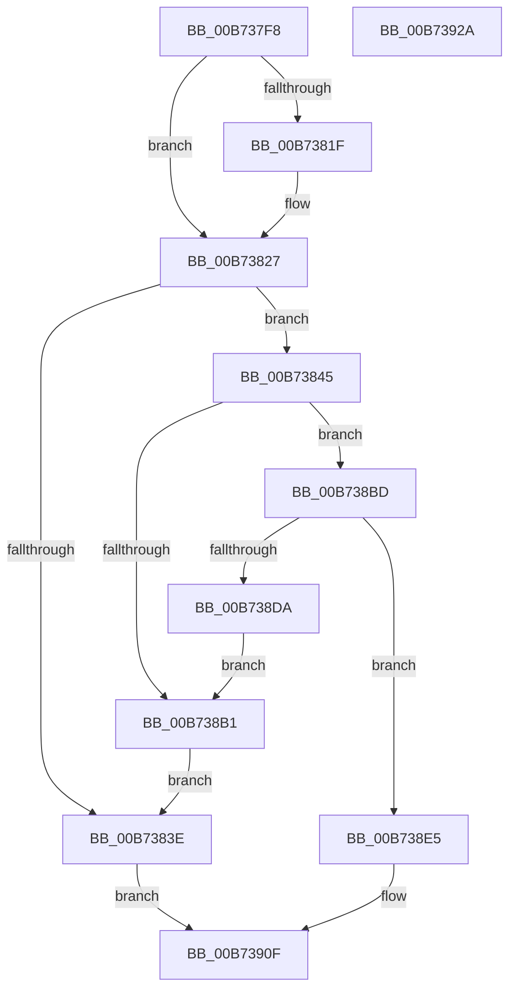

# MmInitializeProcessor

- RVA: `0x00B737F8`–`0x00B7392B` (길이 `307` bytes)
- VA: `0x0000000140B737F8`
- 실행 섹션: `PAGELK`
- PDB 이름 있음: `예`; PDB Function 태그: `아니요`
- unwind 정보 RVA: `0x0005D7BC`
- 디코드: `71`개 명령, `307/307` bytes 표시
- 미해석 바이트: `0` (있으면 어셈블리에 `.byte`로 보존)

> 이 문서는 커널 이미지의 기계어와 PDB 기호를 분석해 생성했습니다. 4번과 5번은 함수 원형과 자료형을 바이너리 사용 방식에서 추정한 C 해석이며 원본 소스 복구 결과는 아닙니다.

## 1. Dependencies

- 직접 호출 지점: **8**; 고유 호출 대상: **8**
- 직접 호출자로 확인된 함수: **3**
- RIP 상대 이미지 참조: **3**

### Outgoing calls
- `0x00B73827` → [KeGetProcessorNodeNumber](../../text/43/KeGetProcessorNodeNumber_function_0043F210.md) (function, `0x0043F210`)
- `0x00B73831` → [MiAllocatePrcb](../../text/69/MiAllocatePrcb_function_00695594.md) (function, `0x00695594`)
- `0x00B73874` → [ExGenRandom](../../text/41/ExGenRandom_function_0041B010.md) (function, `0x0041B010`)
- `0x00B7388B` → [MiInitializePageColorBase](../../text/32/MiInitializePageColorBase_function_00320410.md) (function, `0x00320410`)
- `0x00B738A8` → [MiCreateUltraThreadContext](../../text/28/MiCreateUltraThreadContext_function_00288200.md) (function, `0x00288200`)
- `0x00B738B6` → [ExFreePoolWithTag](../../poolcode/B8/ExFreePoolWithTag_function_00B82870.md) (function, `0x00B82870`)
- `0x00B738C9` → [MiReservePtes](../../text/31/MiReservePtes_function_00318D20.md) (function, `0x00318D20`)
- `0x00B738DE` → [MiDeleteUltraThreadContext](../../text/32/MiDeleteUltraThreadContext_function_00322C90.md) (function, `0x00322C90`)

### Direct callers
- [KiStartDynamicProcessor](../../page/74/KiStartDynamicProcessor_function_007456C8.md) at `0x007458A9`
- [KeStartAllProcessors](../../init/C3/KeStartAllProcessors_function_00C36F78.md) at `0x00C37298`
- [MiInitNucleus](../../init/C5/MiInitNucleus_function_00C5FD38.md) at `0x00C6039B`

### Static image references
- `0x00B73853` → RVA `0x00E38D10` (`.data`; read)
- `0x00B738C2` → RVA `0x00E37668` (`.data`; read)
- `0x00B738E5` → RVA `0x00E2DBF8` (`.data`; read)

## 2. Other-region calls and transfers

- 다른 실행 섹션으로 향하는 call: **8**
  - `0x00B73827` → [KeGetProcessorNodeNumber](../../text/43/KeGetProcessorNodeNumber_function_0043F210.md) (`PAGELK` → `.text`)
  - `0x00B73831` → [MiAllocatePrcb](../../text/69/MiAllocatePrcb_function_00695594.md) (`PAGELK` → `.text`)
  - `0x00B73874` → [ExGenRandom](../../text/41/ExGenRandom_function_0041B010.md) (`PAGELK` → `.text`)
  - `0x00B7388B` → [MiInitializePageColorBase](../../text/32/MiInitializePageColorBase_function_00320410.md) (`PAGELK` → `.text`)
  - `0x00B738A8` → [MiCreateUltraThreadContext](../../text/28/MiCreateUltraThreadContext_function_00288200.md) (`PAGELK` → `.text`)
  - `0x00B738B6` → [ExFreePoolWithTag](../../poolcode/B8/ExFreePoolWithTag_function_00B82870.md) (`PAGELK` → `POOLCODE`)
  - `0x00B738C9` → [MiReservePtes](../../text/31/MiReservePtes_function_00318D20.md) (`PAGELK` → `.text`)
  - `0x00B738DE` → [MiDeleteUltraThreadContext](../../text/32/MiDeleteUltraThreadContext_function_00322C90.md) (`PAGELK` → `.text`)
- 별도 외부 분기/꼬리 이동을 확인하지 못했습니다.

## 3. Assembly (complete function range)

```asm
00B737F8  48 8B C4                        mov rax, rsp
00B737FB  48 89 58 08                     mov qword ptr [rax + 8], rbx
00B737FF  48 89 68 10                     mov qword ptr [rax + 0x10], rbp
00B73803  48 89 70 18                     mov qword ptr [rax + 0x18], rsi
00B73807  48 89 78 20                     mov qword ptr [rax + 0x20], rdi
00B7380B  41 56                           push r14
00B7380D  48 83 EC 30                     sub rsp, 0x30
00B73811  48 83 60 F0 00                  and qword ptr [rax - 0x10], 0
00B73816  48 8B E9                        mov rbp, rcx
00B73819  83 79 24 00                     cmp dword ptr [rcx + 0x24], 0
00B7381D  74 08                           je 0x140b73827
00B7381F  48 83 89 B0 8F 00 00 FF         or qword ptr [rcx + 0x8fb0], 0xffffffffffffffff
00B73827  E8 E4 B9 8C FF                  call 0x14043f210
00B7382C  0F B7 D8                        movzx ebx, ax
00B7382F  8B CB                           mov ecx, ebx
00B73831  E8 5E 1D B2 FF                  call 0x140695594
00B73836  48 8B F0                        mov rsi, rax
00B73839  48 85 C0                        test rax, rax
00B7383C  75 07                           jne 0x140b73845
00B7383E  33 C0                           xor eax, eax
00B73840  E9 CA 00 00 00                  jmp 0x140b7390f
00B73845  83 A0 40 01 00 00 00            and dword ptr [rax + 0x140], 0
00B7384C  48 8D BD 50 87 00 00            lea rdi, [rbp + 0x8750]
00B73853  48 8B 05 B6 54 2C 00            mov rax, qword ptr [rip + 0x2c54b6]
00B7385A  48 69 CB 80 DF 00 00            imul rcx, rbx, 0xdf80
00B73861  0F B6 8C 01 28 3B 00 00         movzx ecx, byte ptr [rcx + rax + 0x3b28]
00B73869  89 8D 54 87 00 00               mov dword ptr [rbp + 0x8754], ecx
00B7386F  B9 01 00 00 00                  mov ecx, 1
00B73874  E8 97 77 8A FF                  call 0x14041b010
00B73879  44 8D 43 01                     lea r8d, [rbx + 1]
00B7387D  89 07                           mov dword ptr [rdi], eax
00B7387F  4C 8D 4C 24 20                  lea r9, [rsp + 0x20]
00B73884  BA 03 00 00 00                  mov edx, 3
00B73889  33 C9                           xor ecx, ecx
00B7388B  E8 80 CB 7A FF                  call 0x140320410
00B73890  41 B9 08 00 00 00               mov r9d, 8
00B73896  48 89 7C 24 20                  mov qword ptr [rsp + 0x20], rdi
00B7389B  48 8D 54 24 20                  lea rdx, [rsp + 0x20]
00B738A0  48 8D 4E 08                     lea rcx, [rsi + 8]
00B738A4  45 8D 41 07                     lea r8d, [r9 + 7]
00B738A8  E8 53 49 71 FF                  call 0x140288200
00B738AD  85 C0                           test eax, eax
00B738AF  75 0C                           jne 0x140b738bd
00B738B1  33 D2                           xor edx, edx
00B738B3  48 8B CE                        mov rcx, rsi
00B738B6  E8 B5 EF 00 00                  call 0x140b82870
00B738BB  EB 81                           jmp 0x140b7383e
00B738BD  BA 01 00 00 00                  mov edx, 1
00B738C2  48 8D 0D 9F 3D 2C 00            lea rcx, [rip + 0x2c3d9f]
00B738C9  E8 52 54 7A FF                  call 0x140318d20
00B738CE  48 89 86 50 01 00 00            mov qword ptr [rsi + 0x150], rax
00B738D5  48 85 C0                        test rax, rax
00B738D8  75 0B                           jne 0x140b738e5
00B738DA  48 8D 4E 08                     lea rcx, [rsi + 8]
00B738DE  E8 AD F3 7A FF                  call 0x140322c90
00B738E3  EB CC                           jmp 0x140b738b1
00B738E5  48 8B 0D 0C A3 2B 00            mov rcx, qword ptr [rip + 0x2ba30c]
00B738EC  48 8D 14 5B                     lea rdx, [rbx + rbx*2]
00B738F0  48 C1 E2 07                     shl rdx, 7
00B738F4  B8 01 00 00 00                  mov eax, 1
00B738F9  48 8B 94 0A 78 01 00 00         mov rdx, qword ptr [rdx + rcx + 0x178]
00B73901  48 89 96 48 01 00 00            mov qword ptr [rsi + 0x148], rdx
00B73908  48 89 B5 38 88 00 00            mov qword ptr [rbp + 0x8838], rsi
00B7390F  48 8B 5C 24 40                  mov rbx, qword ptr [rsp + 0x40]
00B73914  48 8B 6C 24 48                  mov rbp, qword ptr [rsp + 0x48]
00B73919  48 8B 74 24 50                  mov rsi, qword ptr [rsp + 0x50]
00B7391E  48 8B 7C 24 58                  mov rdi, qword ptr [rsp + 0x58]
00B73923  48 83 C4 30                     add rsp, 0x30
00B73927  41 5E                           pop r14
00B73929  C3                              ret
00B7392A  CC                              int3
```

## 4. C-style interpretation (structured pseudocode)

```c
__int64 __fastcall MmInitializeProcessor(__int64 a1)
{
    __int64 result;
    __int64 v_rsp;
    unsigned __int64 v_stack_m18;
    unsigned __int64 v_stack_p10;
    unsigned __int64 v_stack_p18;
    unsigned __int64 v_stack_p20;
    unsigned __int64 v_stack_p8;

    *(unsigned __int64 *)(v_rsp + 8) = v_rbx;
    *(unsigned __int64 *)(v_rsp + 16) = v_rbp;
    *(unsigned __int64 *)(v_rsp + 24) = v_rsi;
    *(unsigned __int64 *)(v_rsp + 32) = v_rdi;
    v_rsp = (v_rsp) - (48);
    if ((*(unsigned int *)(a1 + 36)) != 0) {
    }
    result = KeGetProcessorNodeNumber(a1, a2, a3, a4);
    result = MiAllocatePrcb((unsigned int)((unsigned int)((unsigned __int16)(result))), a2, a3, a4);
    if (result != 0) goto loc_00B73845;
loc_00B7383E:
    result = 0;
    goto loc_00B7390F;
loc_00B73845:
    a1 = ((unsigned int)((unsigned int)((unsigned __int16)(result)))) * ((unsigned __int16)(result));
    *(unsigned int *)(a1 + 34644) = (unsigned int)(*(unsigned __int8 *)(a1 + *(unsigned __int64 *)(v_rip + 2905270) * 1 + 15144));
    result = ExGenRandom(1, a2, a3, a4);
    *(unsigned int *)(a1 + 34640) = (unsigned int)(result);
    a1 = 0;
    result = MiInitializePageColorBase(a1, 3, (unsigned __int16)(result) + 1, v_stack_m18);
    v_stack_m18 = a1 + 34640;
    result = MiCreateUltraThreadContext(result + 8, v_stack_m18, 8 + 7, 8);
    if ((unsigned int)(result) != 0) goto loc_00B738BD;
loc_00B738B1:
    a2 = 0;
    result = ExFreePoolWithTag(result, a2, 8 + 7, 8);
    goto loc_00B7383E;
loc_00B738BD:
    result = MiReservePtes(v_rip + 2899359, 1, 8 + 7, 8);
    *(unsigned __int64 *)(result + 336) = result;
    if (result != 0) goto loc_00B738E5;
    result = MiDeleteUltraThreadContext(result + 8, 1, 8 + 7, 8);
    goto loc_00B738B1;
loc_00B738E5:
    a2 = ((unsigned __int16)(result) + (unsigned __int16)(result) * 2) << (7);
    *(unsigned __int64 *)(result + 328) = *(unsigned __int64 *)(a2 + *(unsigned __int64 *)(v_rip + 2859788) * 1 + 376);
    *(unsigned __int64 *)(a1 + 34872) = result;
loc_00B7390F:
    v_rsp = (v_rsp) + (48);
    return 1;
}
```

## 5. (Beta) C Style

```c
int64_t MmInitializeProcessor(void *Arg1)
{
    uint8_t *arg1 = (uint8_t *)Arg1;

    int64_t result;
    int64_t local_rsp;
    uint64_t v_stack_m18;
    uint64_t v_stack_p10;
    uint64_t v_stack_p18;
    uint64_t v_stack_p20;
    uint64_t v_stack_p8;

    *(uint64_t *)(local_rsp + 0x8) = local_rbx;
    *(uint64_t *)(local_rsp + 0x10) = local_rbp;
    *(uint64_t *)(local_rsp + 0x18) = local_rsi;
    *(uint64_t *)(local_rsp + 0x20) = local_rdi;
    local_rsp = (local_rsp) - (48);
    if ((*(uint32_t *)(arg1 + 0x24)) != 0) {
    }
    result = KeGetProcessorNodeNumber(Arg1, a2, a3, a4);
    result = MiAllocatePrcb((uint32_t)((uint32_t)((uint16_t)(result))), a2, a3, a4);
    if (result != 0) goto loc_00B73845;
loc_00B7383E:
    result = 0;
    goto loc_00B7390F;
loc_00B73845:
    Arg1 = ((uint32_t)((uint32_t)((uint16_t)(result)))) * ((uint16_t)(result));
    *(uint32_t *)(arg1 + 0x8754) = (uint32_t)(*(uint8_t *)(arg1 + *(uint64_t *)(v_rip + 0x2C54B6) * 1 + 0x3B28));
    result = ExGenRandom(1, a2, a3, a4);
    *(uint32_t *)(arg1 + 0x8750) = (uint32_t)(result);
    Arg1 = 0;
    result = MiInitializePageColorBase(Arg1, 3, (uint16_t)(result) + 1, v_stack_m18);
    v_stack_m18 = Arg1 + 34640;
    result = MiCreateUltraThreadContext(result + 8, v_stack_m18, 8 + 7, 8);
    if ((uint32_t)(result) != 0) goto loc_00B738BD;
loc_00B738B1:
    a2 = 0;
    result = ExFreePoolWithTag(result, a2, 8 + 7, 8);
    goto loc_00B7383E;
loc_00B738BD:
    result = MiReservePtes(v_rip + 2899359, 1, 8 + 7, 8);
    *(uint64_t *)(result + 0x150) = result;
    if (result != 0) goto loc_00B738E5;
    result = MiDeleteUltraThreadContext(result + 8, 1, 8 + 7, 8);
    goto loc_00B738B1;
loc_00B738E5:
    a2 = ((uint16_t)(result) + (uint16_t)(result) * 2) << (7);
    *(uint64_t *)(result + 0x148) = *(uint64_t *)(a2 + *(uint64_t *)(v_rip + 0x2BA30C) * 1 + 0x178);
    *(uint64_t *)(arg1 + 0x8838) = result;
loc_00B7390F:
    local_rsp = (local_rsp) + (48);
    return 1;
}
```

### 관측된 메모리 오프셋

구조체 형식이 확인되지 않은 접근은 인자 기준의 오프셋으로만 기록했습니다.

| 기준 인자 | 오프셋 표현 | 폭 (bit) | 접근 |
|---|---:|---:|---|
| `Arg1` | `+ 0x0` | `32` | `W` |
| `Arg1` | `+ 0x24` | `32` | `R` |
| `Arg1` | `+ 0x8750` | `64` | `R` |
| `Arg1` | `+ 0x8754` | `32` | `W` |
| `Arg1` | `+ 0x8838` | `64` | `W` |
| `Arg1` | `+ 0x8FB0` | `64` | `R/W` |

## 6. Execution-region graph

[열기: 2D/3D 그래프와 함수 탐색 컨트롤 패널](../../../control-panel.html?section=pagelk&rva=0x00B737F8&view=graph)

- 2D 그래프는 위에서 아래로 흐르고, 3D 그래프는 빈 공간을 드래그해 회전합니다. Shift+드래그는 이동, 휠은 확대·축소, 함수 노드 선택은 대상 보고서 이동입니다.

### Static fallback


