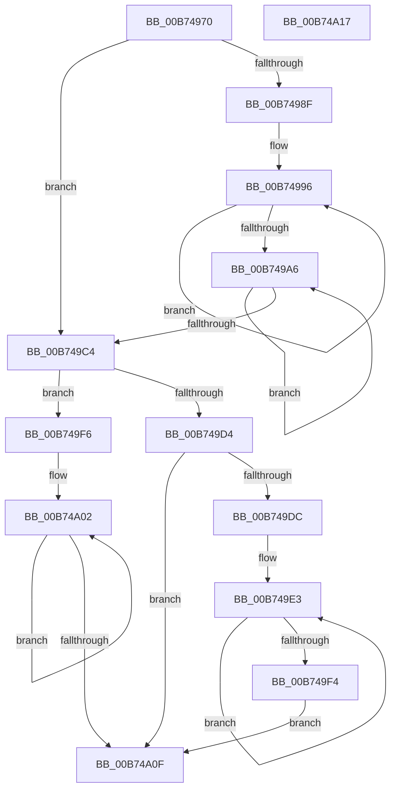

# MmInvalidateDumpAddresses

- RVA: `0x00B74970`–`0x00B74A18` (길이 `168` bytes)
- VA: `0x0000000140B74970`
- 실행 섹션: `PAGELK`
- PDB 이름 있음: `예`; PDB Function 태그: `아니요`
- unwind 정보 RVA: `0x000C3DE4`
- 디코드: `51`개 명령, `168/168` bytes 표시
- 미해석 바이트: `0` (있으면 어셈블리에 `.byte`로 보존)

> 이 문서는 커널 이미지의 기계어와 PDB 기호를 분석해 생성했습니다. 4번과 5번은 함수 원형과 자료형을 바이너리 사용 방식에서 추정한 C 해석이며 원본 소스 복구 결과는 아닙니다.

## 1. Dependencies

- 직접 호출 지점: **3**; 고유 호출 대상: **3**
- 직접 호출자로 확인된 함수: **1**
- RIP 상대 이미지 참조: **3**

### Outgoing calls
- `0x00B7497E` → [MiGetPteAddress](../../text/43/MiGetPteAddress_function_0043E130.md) (function, `0x0043E130`)
- `0x00B749B2` → [MiFlushSingleTbEntry](../../text/28/MiFlushSingleTbEntry_function_0028E730.md) (function, `0x0028E730`)
- `0x00B749CB` → [Feature_CrashDumpOneMBTransferSize__private_IsEnabledDeviceUsageNoInline](../../text/5D/Feature_CrashDumpOneMBTransferSize__private_IsEnabledDeviceUsageNoInline_function_005D4A08.md) (function, `0x005D4A08`)

### Direct callers
- [PopInvokeSystemStateHandler](PopInvokeSystemStateHandler_function_00B76A6C.md) at `0x00B76F10`
- [PopInvokeSystemStateHandler](PopInvokeSystemStateHandler_function_00B76A6C.md) at `0x00B76F2B`

### Static image references
- `0x00B7498F` → RVA `0x00010880` (`.rdata`; read)
- `0x00B749C4` → RVA `0x00E301B8` (`.data`; read)
- `0x00B749D4` → RVA `0x00E301C0` (`.data`; read)

## 2. Other-region calls and transfers

- 다른 실행 섹션으로 향하는 call: **3**
  - `0x00B7497E` → [MiGetPteAddress](../../text/43/MiGetPteAddress_function_0043E130.md) (`PAGELK` → `.text`)
  - `0x00B749B2` → [MiFlushSingleTbEntry](../../text/28/MiFlushSingleTbEntry_function_0028E730.md) (`PAGELK` → `.text`)
  - `0x00B749CB` → [Feature_CrashDumpOneMBTransferSize__private_IsEnabledDeviceUsageNoInline](../../text/5D/Feature_CrashDumpOneMBTransferSize__private_IsEnabledDeviceUsageNoInline_function_005D4A08.md) (`PAGELK` → `.text`)
- 별도 외부 분기/꼬리 이동을 확인하지 못했습니다.

## 3. Assembly (complete function range)

```asm
00B74970  40 53                           push rbx
00B74972  56                              push rsi
00B74973  57                              push rdi
00B74974  48 83 EC 20                     sub rsp, 0x20
00B74978  48 8B F2                        mov rsi, rdx
00B7497B  48 8B D9                        mov rbx, rcx
00B7497E  E8 AD 97 8C FF                  call 0x14043e130
00B74983  33 FF                           xor edi, edi
00B74985  48 8B D0                        mov rdx, rax
00B74988  8B CF                           mov ecx, edi
00B7498A  48 85 F6                        test rsi, rsi
00B7498D  74 35                           je 0x140b749c4
00B7498F  4C 8B 05 EA BE 49 FF            mov r8, qword ptr [rip - 0xb64116]
00B74996  FF C1                           inc ecx
00B74998  4C 89 02                        mov qword ptr [rdx], r8
00B7499B  8B C1                           mov eax, ecx
00B7499D  48 8D 52 08                     lea rdx, [rdx + 8]
00B749A1  48 3B C6                        cmp rax, rsi
00B749A4  72 F0                           jb 0x140b74996
00B749A6  41 B8 01 00 00 00               mov r8d, 1
00B749AC  83 CA FF                        or edx, 0xffffffff
00B749AF  48 8B CB                        mov rcx, rbx
00B749B2  E8 79 9D 71 FF                  call 0x14028e730
00B749B7  48 81 C3 00 10 00 00            add rbx, 0x1000
00B749BE  48 83 EE 01                     sub rsi, 1
00B749C2  75 E2                           jne 0x140b749a6
00B749C4  48 8B 1D ED B7 2B 00            mov rbx, qword ptr [rip + 0x2bb7ed]
00B749CB  E8 38 00 A6 FF                  call 0x1405d4a08
00B749D0  85 C0                           test eax, eax
00B749D2  74 22                           je 0x140b749f6
00B749D4  39 3D E6 B7 2B 00               cmp dword ptr [rip + 0x2bb7e6], edi
00B749DA  76 33                           jbe 0x140b74a0f
00B749DC  48 8B 05 9D BE 49 FF            mov rax, qword ptr [rip - 0xb64163]
00B749E3  48 89 03                        mov qword ptr [rbx], rax
00B749E6  FF C7                           inc edi
00B749E8  3B 3D D2 B7 2B 00               cmp edi, dword ptr [rip + 0x2bb7d2]
00B749EE  48 8D 5B 08                     lea rbx, [rbx + 8]
00B749F2  72 EF                           jb 0x140b749e3
00B749F4  EB 19                           jmp 0x140b74a0f
00B749F6  48 8B 05 83 BE 49 FF            mov rax, qword ptr [rip - 0xb6417d]
00B749FD  B9 20 00 00 00                  mov ecx, 0x20
00B74A02  48 89 03                        mov qword ptr [rbx], rax
00B74A05  48 8D 5B 08                     lea rbx, [rbx + 8]
00B74A09  48 83 E9 01                     sub rcx, 1
00B74A0D  75 F3                           jne 0x140b74a02
00B74A0F  48 83 C4 20                     add rsp, 0x20
00B74A13  5F                              pop rdi
00B74A14  5E                              pop rsi
00B74A15  5B                              pop rbx
00B74A16  C3                              ret
00B74A17  CC                              int3
```

## 4. C-style interpretation (structured pseudocode)

```c
__int64 __fastcall MmInvalidateDumpAddresses(__int64 a1, __int64 a2)
{
    __int64 result;
    __int64 v_rbx;
    __int64 v_rdi;
    __int64 v_rsi;
    __int64 v_rsp;

    v_rsp = (v_rsp) - (32);
    result = MiGetPteAddress(a1, a2, a3, a4);
    v_rdi = 0;
    if (a2 == 0) goto loc_00B749C4;
loc_00B74996:
    a1 = (unsigned int)((0) + 1);
    *(unsigned __int64 *)(result) = *(unsigned __int64 *)(v_rip - 11944214);
    if (((unsigned int)((unsigned int)(a1))) < a2) goto loc_00B74996;
loc_00B749A6:
    a2 = (unsigned int)((result + 8) | (0xFFFFFFFFULL));
    result = MiFlushSingleTbEntry(a1, a2, 1, a4);
    v_rbx = (a1) + (0x1000ULL);
    v_rsi = (a2) - (1);
    if (condition_is_not_equal) goto loc_00B749A6;
loc_00B749C4:
    result = Feature_CrashDumpOneMBTransferSize__private_IsEnabledDeviceUsageNoInline(a1, a2, 1, a4);
    if ((unsigned int)(result) == 0) goto loc_00B749F6;
    if ((*(unsigned int *)(v_rip + 2865126)) <= 0) goto loc_00B74A0F;
loc_00B749E3:
    *(unsigned __int64 *)(*(unsigned __int64 *)(v_rip + 2865133)) = *(unsigned __int64 *)(v_rip - 11944291);
    v_rdi = (unsigned int)((v_rdi) + 1);
    if (((unsigned int)(v_rdi)) < (*(unsigned int *)(v_rip + 2865106))) goto loc_00B749E3;
    goto loc_00B74A0F;
loc_00B749F6:
loc_00B74A02:
    *(unsigned __int64 *)(*(unsigned __int64 *)(v_rip + 2865133) + 8) = *(unsigned __int64 *)(v_rip - 11944317);
    a1 = (32) - (1);
    if (condition_is_not_equal) goto loc_00B74A02;
loc_00B74A0F:
    v_rsp = (v_rsp) + (32);
    return *(unsigned __int64 *)(v_rip - 11944317);
}
```

## 5. (Beta) C Style

```c
int64_t MmInvalidateDumpAddresses(int64_t Arg1, int64_t Arg2)
{
    int64_t result;
    int64_t local_rbx;
    int64_t local_rdi;
    int64_t local_rsi;
    int64_t local_rsp;

    local_rsp = (local_rsp) - (32);
    result = MiGetPteAddress(Arg1, Arg2, a3, a4);
    local_rdi = 0;
    if (Arg2 == 0) goto loc_00B749C4;
loc_00B74996:
    Arg1 = (uint32_t)((0) + 1);
    *(uint64_t *)(result) = *(uint64_t *)(v_rip - 0xB64116);
    if (((uint32_t)((uint32_t)(Arg1))) < Arg2) goto loc_00B74996;
loc_00B749A6:
    Arg2 = (uint32_t)((result + 8) | (0xFFFFFFFFULL));
    result = MiFlushSingleTbEntry(Arg1, Arg2, 1, a4);
    local_rbx = (Arg1) + (0x1000ULL);
    local_rsi = (Arg2) - (1);
    if (condition_is_not_equal) goto loc_00B749A6;
loc_00B749C4:
    result = Feature_CrashDumpOneMBTransferSize__private_IsEnabledDeviceUsageNoInline(Arg1, Arg2, 1, a4);
    if ((uint32_t)(result) == 0) goto loc_00B749F6;
    if ((*(uint32_t *)(v_rip + 0x2BB7E6)) <= 0) goto loc_00B74A0F;
loc_00B749E3:
    *(uint64_t *)(*(uint64_t *)(v_rip + 0x2BB7ED)) = *(uint64_t *)(v_rip - 0xB64163);
    local_rdi = (uint32_t)((local_rdi) + 1);
    if (((uint32_t)(local_rdi)) < (*(uint32_t *)(v_rip + 0x2BB7D2))) goto loc_00B749E3;
    goto loc_00B74A0F;
loc_00B749F6:
loc_00B74A02:
    *(uint64_t *)(*(uint64_t *)(v_rip + 0x2BB7ED) + 0x8) = *(uint64_t *)(v_rip - 0xB6417D);
    Arg1 = (32) - (1);
    if (condition_is_not_equal) goto loc_00B74A02;
loc_00B74A0F:
    local_rsp = (local_rsp) + (32);
    return *(uint64_t *)(v_rip - 0xB6417D);
}
```

## 6. Execution-region graph

[열기: 2D/3D 그래프와 함수 탐색 컨트롤 패널](../../../control-panel.html?section=pagelk&rva=0x00B74970&view=graph)

- 2D 그래프는 위에서 아래로 흐르고, 3D 그래프는 빈 공간을 드래그해 회전합니다. Shift+드래그는 이동, 휠은 확대·축소, 함수 노드 선택은 대상 보고서 이동입니다.

### Static fallback


