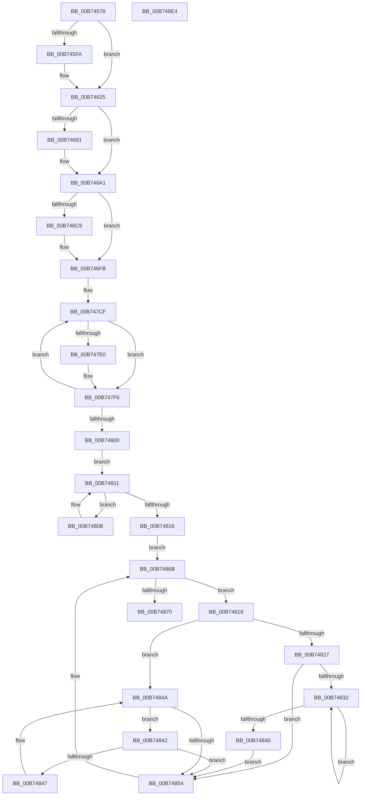

# MmMarkHiberPhase

- RVA: `0x00B74578`–`0x00B748E5` (길이 `877` bytes)
- VA: `0x0000000140B74578`
- 실행 섹션: `PAGELK`
- PDB 이름 있음: `예`; PDB Function 태그: `아니요`
- unwind 정보 RVA: `0x000D7D2C`
- 디코드: `204`개 명령, `877/877` bytes 표시
- 미해석 바이트: `0` (있으면 어셈블리에 `.byte`로 보존)

> 이 문서는 커널 이미지의 기계어와 PDB 기호를 분석해 생성했습니다. 4번과 5번은 함수 원형과 자료형을 바이너리 사용 방식에서 추정한 C 해석이며 원본 소스 복구 결과는 아닙니다.

## 1. Dependencies

- 직접 호출 지점: **23**; 고유 호출 대상: **9**
- 직접 호출자로 확인된 함수: **1**
- RIP 상대 이미지 참조: **17**

### Outgoing calls
- `0x00B74590` → [MiMarkKernelPageTablePages](MiMarkKernelPageTablePages_function_00B73F68.md) (function, `0x00B73F68`)
- `0x00B745BB` → [PoSetHiberRange](../../text/47/PoSetHiberRange_function_0047C580.md) (function, `0x0047C580`)
- `0x00B745EA` → [MiMarkNonPagedHiberPhasePages](MiMarkNonPagedHiberPhasePages_function_00B73FEC.md) (function, `0x00B73FEC`)
- `0x00B74607` → [MiQuerySystemBase](../../text/46/MiQuerySystemBase_function_00468F1C.md) (function, `0x00468F1C`)
- `0x00B74620` → [MiMarkNonPagedHiberPhasePages](MiMarkNonPagedHiberPhasePages_function_00B73FEC.md) (function, `0x00B73FEC`)
- `0x00B7463E` → [PoSetHiberRange](../../text/47/PoSetHiberRange_function_0047C580.md) (function, `0x0047C580`)
- `0x00B7466B` → [PoSetHiberRange](../../text/47/PoSetHiberRange_function_0047C580.md) (function, `0x0047C580`)
- `0x00B7469C` → [PoSetHiberRange](../../text/47/PoSetHiberRange_function_0047C580.md) (function, `0x0047C580`)
- `0x00B746BB` → [PoSetHiberRange](../../text/47/PoSetHiberRange_function_0047C580.md) (function, `0x0047C580`)
- `0x00B746C0` → [KeIsRetpolineEnabled](../../text/44/KeIsRetpolineEnabled_function_0044EE20.md) (function, `0x0044EE20`)
- `0x00B746F6` → [PoSetHiberRange](../../text/47/PoSetHiberRange_function_0047C580.md) (function, `0x0047C580`)
- `0x00B74712` → [MiMarkNonPagedHiberPhasePages](MiMarkNonPagedHiberPhasePages_function_00B73FEC.md) (function, `0x00B73FEC`)
- `0x00B74730` → [PoSetHiberRange](../../text/47/PoSetHiberRange_function_0047C580.md) (function, `0x0047C580`)
- `0x00B74757` → [PoSetHiberRange](../../text/47/PoSetHiberRange_function_0047C580.md) (function, `0x0047C580`)
- `0x00B74789` → [PoSetHiberRange](../../text/47/PoSetHiberRange_function_0047C580.md) (function, `0x0047C580`)
- `0x00B747A7` → [PoSetHiberRange](../../text/47/PoSetHiberRange_function_0047C580.md) (function, `0x0047C580`)
- `0x00B747C5` → [PoSetHiberRange](../../text/47/PoSetHiberRange_function_0047C580.md) (function, `0x0047C580`)
- `0x00B747F1` → [PoSetHiberRange](../../text/47/PoSetHiberRange_function_0047C580.md) (function, `0x0047C580`)
- `0x00B74866` → [PoSetHiberRange](../../text/47/PoSetHiberRange_function_0047C580.md) (function, `0x0047C580`)
- `0x00B7487D` → [memset](../../text/6C/memset_function_006C6C40.md) (function, `0x006C6C40`)
- `0x00B7489C` → [MiGetAnyMultiplexedVm](../../text/44/MiGetAnyMultiplexedVm_function_00448BD0.md) (function, `0x00448BD0`)
- `0x00B748C5` → [MiWalkPageTables](../../text/2C/MiWalkPageTables_function_002C2710.md) (function, `0x002C2710`)
- `0x00B748CA` → [MiMarkHiberProtectedImages](../../text/67/MiMarkHiberProtectedImages_function_00678AAC.md) (function, `0x00678AAC`)

### Direct callers
- [PopMarkComponentsBootPhase](../B6/PopMarkComponentsBootPhase_function_00B6E0E4.md) at `0x00B6E34B`

### Static image references
- `0x00B74595` → RVA `0x00FC6AB0` (`ALMOSTRO`; read)
- `0x00B745C0` → RVA `0x00FC6DE0` (`ALMOSTRO`; read)
- `0x00B745C7` → RVA `0x00FC6C38` (`ALMOSTRO`; read)
- `0x00B745EF` → RVA `0x00FC6A88` (`ALMOSTRO`; read)
- `0x00B74625` → RVA `0x00E37440` (`.data`; read)
- `0x00B746A1` → RVA `0x00E2D83C` (`.data`; read)
- `0x00B746AA` → RVA `0x00E2D830` (`.data`; read)
- `0x00B746C9` → RVA `0x00E2D858` (`.data`; read)
- `0x00B746D6` → RVA `0x00E2D860` (`.data`; read)
- `0x00B746FB` → RVA `0x00E2F160` (`.data`; read)
- `0x00B74705` → RVA `0x00E2F158` (`.data`; read)
- `0x00B74725` → RVA `0x00E2CB40` (`.data`; read)
- `0x00B74735` → RVA `0x00E30068` (`.data`; read)
- `0x00B74741` → RVA `0x00E30088` (`.data`; read)
- `0x00B747AC` → RVA `0x00EF54B0` (`.data`; read)
- `0x00B74800` → RVA `0x00E372C0` (`.data`; read)
- `0x00B74882` → RVA `0x00B73EC0` (`MiMarkHiberNotCachedPte`; read)

## 2. Other-region calls and transfers

- 다른 실행 섹션으로 향하는 call: **19**
  - `0x00B745BB` → [PoSetHiberRange](../../text/47/PoSetHiberRange_function_0047C580.md) (`PAGELK` → `.text`)
  - `0x00B74607` → [MiQuerySystemBase](../../text/46/MiQuerySystemBase_function_00468F1C.md) (`PAGELK` → `.text`)
  - `0x00B7463E` → [PoSetHiberRange](../../text/47/PoSetHiberRange_function_0047C580.md) (`PAGELK` → `.text`)
  - `0x00B7466B` → [PoSetHiberRange](../../text/47/PoSetHiberRange_function_0047C580.md) (`PAGELK` → `.text`)
  - `0x00B7469C` → [PoSetHiberRange](../../text/47/PoSetHiberRange_function_0047C580.md) (`PAGELK` → `.text`)
  - `0x00B746BB` → [PoSetHiberRange](../../text/47/PoSetHiberRange_function_0047C580.md) (`PAGELK` → `.text`)
  - `0x00B746C0` → [KeIsRetpolineEnabled](../../text/44/KeIsRetpolineEnabled_function_0044EE20.md) (`PAGELK` → `.text`)
  - `0x00B746F6` → [PoSetHiberRange](../../text/47/PoSetHiberRange_function_0047C580.md) (`PAGELK` → `.text`)
  - `0x00B74730` → [PoSetHiberRange](../../text/47/PoSetHiberRange_function_0047C580.md) (`PAGELK` → `.text`)
  - `0x00B74757` → [PoSetHiberRange](../../text/47/PoSetHiberRange_function_0047C580.md) (`PAGELK` → `.text`)
  - `0x00B74789` → [PoSetHiberRange](../../text/47/PoSetHiberRange_function_0047C580.md) (`PAGELK` → `.text`)
  - `0x00B747A7` → [PoSetHiberRange](../../text/47/PoSetHiberRange_function_0047C580.md) (`PAGELK` → `.text`)
  - `0x00B747C5` → [PoSetHiberRange](../../text/47/PoSetHiberRange_function_0047C580.md) (`PAGELK` → `.text`)
  - `0x00B747F1` → [PoSetHiberRange](../../text/47/PoSetHiberRange_function_0047C580.md) (`PAGELK` → `.text`)
  - `0x00B74866` → [PoSetHiberRange](../../text/47/PoSetHiberRange_function_0047C580.md) (`PAGELK` → `.text`)
  - `0x00B7487D` → [memset](../../text/6C/memset_function_006C6C40.md) (`PAGELK` → `.text`)
  - `0x00B7489C` → [MiGetAnyMultiplexedVm](../../text/44/MiGetAnyMultiplexedVm_function_00448BD0.md) (`PAGELK` → `.text`)
  - `0x00B748C5` → [MiWalkPageTables](../../text/2C/MiWalkPageTables_function_002C2710.md) (`PAGELK` → `.text`)
  - `0x00B748CA` → [MiMarkHiberProtectedImages](../../text/67/MiMarkHiberProtectedImages_function_00678AAC.md) (`PAGELK` → `.text`)
- 별도 외부 분기/꼬리 이동을 확인하지 못했습니다.

## 3. Assembly (complete function range)

```asm
00B74578  48 8B C4                        mov rax, rsp
00B7457B  48 89 58 10                     mov qword ptr [rax + 0x10], rbx
00B7457F  48 89 70 18                     mov qword ptr [rax + 0x18], rsi
00B74583  57                              push rdi
00B74584  48 81 EC F0 00 00 00            sub rsp, 0xf0
00B7458B  48 83 60 08 00                  and qword ptr [rax + 8], 0
00B74590  E8 D3 F9 FF FF                  call 0x140b73f68
00B74595  48 8B 05 14 25 45 00            mov rax, qword ptr [rip + 0x452514]
00B7459C  BF 00 40 01 00                  mov edi, 0x14000
00B745A1  41 B9 01 00 00 00               mov r9d, 1
00B745A7  C7 44 24 20 4D 6D 70 74         mov dword ptr [rsp + 0x20], 0x74706d4d
00B745AF  8B D7                           mov edx, edi
00B745B1  33 C9                           xor ecx, ecx
00B745B3  4C 8B 40 28                     mov r8, qword ptr [rax + 0x28]
00B745B7  49 C1 E8 0C                     shr r8, 0xc
00B745BB  E8 C0 7F 90 FF                  call 0x14047c580
00B745C0  48 8B 0D 19 28 45 00            mov rcx, qword ptr [rip + 0x452819]
00B745C7  48 8B 15 6A 26 45 00            mov rdx, qword ptr [rip + 0x45266a]
00B745CE  48 C1 E1 0C                     shl rcx, 0xc
00B745D2  48 FF CA                        dec rdx
00B745D5  48 03 D1                        add rdx, rcx
00B745D8  48 B9 00 00 00 00 00 DE FF FF   movabs rcx, 0xffffde0000000000
00B745E2  BB 00 02 00 00                  mov ebx, 0x200
00B745E7  44 8B C3                        mov r8d, ebx
00B745EA  E8 FD F9 FF FF                  call 0x140b73fec
00B745EF  48 0F BA 25 90 24 45 00 23      bt qword ptr [rip + 0x452490], 0x23
00B745F8  73 2B                           jae 0x140b74625
00B745FA  48 8D 94 24 00 01 00 00         lea rdx, [rsp + 0x100]
00B74602  B9 05 00 00 00                  mov ecx, 5
00B74607  E8 10 49 8F FF                  call 0x140468f1c
00B7460C  48 8B 94 24 00 01 00 00         mov rdx, qword ptr [rsp + 0x100]
00B74614  44 8B C3                        mov r8d, ebx
00B74617  48 FF CA                        dec rdx
00B7461A  48 8B C8                        mov rcx, rax
00B7461D  48 03 D0                        add rdx, rax
00B74620  E8 C7 F9 FF FF                  call 0x140b73fec
00B74625  4C 8B 05 14 2E 2C 00            mov r8, qword ptr [rip + 0x2c2e14]
00B7462C  41 B9 01 00 00 00               mov r9d, 1
00B74632  8B D7                           mov edx, edi
00B74634  C7 44 24 20 4D 6D 67 61         mov dword ptr [rsp + 0x20], 0x61676d4d
00B7463C  33 C9                           xor ecx, ecx
00B7463E  E8 3D 7F 90 FF                  call 0x14047c580
00B74643  65 4C 8B 04 25 88 01 00 00      mov r8, qword ptr gs:[0x188]
00B7464C  BE 00 00 01 00                  mov esi, 0x10000
00B74651  BB 4D 6D 70 62                  mov ebx, 0x62706d4d
00B74656  41 B9 40 08 00 00               mov r9d, 0x840
00B7465C  8B D6                           mov edx, esi
00B7465E  89 5C 24 20                     mov dword ptr [rsp + 0x20], ebx
00B74662  33 C9                           xor ecx, ecx
00B74664  4D 8B 80 B8 00 00 00            mov r8, qword ptr [r8 + 0xb8]
00B7466B  E8 10 7F 90 FF                  call 0x14047c580
00B74670  65 48 8B 04 25 88 01 00 00      mov rax, qword ptr gs:[0x188]
00B74679  BF 00 10 00 00                  mov edi, 0x1000
00B7467E  48 8B 88 B8 00 00 00            mov rcx, qword ptr [rax + 0xb8]
00B74685  4C 8B 81 08 05 00 00            mov r8, qword ptr [rcx + 0x508]
00B7468C  4D 85 C0                        test r8, r8
00B7468F  74 10                           je 0x140b746a1
00B74691  44 8B CF                        mov r9d, edi
00B74694  89 5C 24 20                     mov dword ptr [rsp + 0x20], ebx
00B74698  8B D6                           mov edx, esi
00B7469A  33 C9                           xor ecx, ecx
00B7469C  E8 DF 7E 90 FF                  call 0x14047c580
00B746A1  44 8B 0D 94 91 2B 00            mov r9d, dword ptr [rip + 0x2b9194]
00B746A8  8B D6                           mov edx, esi
00B746AA  4C 8B 05 7F 91 2B 00            mov r8, qword ptr [rip + 0x2b917f]
00B746B1  33 C9                           xor ecx, ecx
00B746B3  41 C1 E1 0C                     shl r9d, 0xc
00B746B7  89 5C 24 20                     mov dword ptr [rsp + 0x20], ebx
00B746BB  E8 C0 7E 90 FF                  call 0x14047c580
00B746C0  E8 5B A7 8D FF                  call 0x14044ee20
00B746C5  84 C0                           test al, al
00B746C7  74 32                           je 0x140b746fb
00B746C9  48 8B 05 88 91 2B 00            mov rax, qword ptr [rip + 0x2b9188]
00B746D0  41 B9 00 00 00 00               mov r9d, 0
00B746D6  4C 8B 05 83 91 2B 00            mov r8, qword ptr [rip + 0x2b9183]
00B746DD  A8 3F                           test al, 0x3f
00B746DF  8B D6                           mov edx, esi
00B746E1  89 5C 24 20                     mov dword ptr [rsp + 0x20], ebx
00B746E5  41 0F 95 C1                     setne r9b
00B746E9  48 C1 E8 06                     shr rax, 6
00B746ED  4C 03 C8                        add r9, rax
00B746F0  33 C9                           xor ecx, ecx
00B746F2  49 C1 E1 03                     shl r9, 3
00B746F6  E8 85 7E 90 FF                  call 0x14047c580
00B746FB  48 8B 15 5E AA 2B 00            mov rdx, qword ptr [rip + 0x2baa5e]
00B74702  45 33 C0                        xor r8d, r8d
00B74705  48 8B 0D 4C AA 2B 00            mov rcx, qword ptr [rip + 0x2baa4c]
00B7470C  48 FF CA                        dec rdx
00B7470F  48 03 D1                        add rdx, rcx
00B74712  E8 D5 F8 FF FF                  call 0x140b73fec
00B74717  41 B9 00 D0 00 00               mov r9d, 0xd000
00B7471D  C7 44 24 20 4D 6D 53 74         mov dword ptr [rsp + 0x20], 0x74536d4d
00B74725  4C 8D 05 14 84 2B 00            lea r8, [rip + 0x2b8414]
00B7472C  8B D6                           mov edx, esi
00B7472E  33 C9                           xor ecx, ecx
00B74730  E8 4B 7E 90 FF                  call 0x14047c580
00B74735  48 8B 05 2C B9 2B 00            mov rax, qword ptr [rip + 0x2bb92c]
00B7473C  BB 4D 6D 53 70                  mov ebx, 0x70536d4d
00B74741  4C 8B 05 40 B9 2B 00            mov r8, qword ptr [rip + 0x2bb940]
00B74748  8B D6                           mov edx, esi
00B7474A  33 C9                           xor ecx, ecx
00B7474C  89 5C 24 20                     mov dword ptr [rsp + 0x20], ebx
00B74750  44 8B 08                        mov r9d, dword ptr [rax]
00B74753  49 C1 E1 03                     shl r9, 3
00B74757  E8 24 7E 90 FF                  call 0x14047c580
00B7475C  4C 8B 05 05 B9 2B 00            mov r8, qword ptr [rip + 0x2bb905]
00B74763  41 B9 00 00 00 00               mov r9d, 0
00B74769  8B D6                           mov edx, esi
00B7476B  89 5C 24 20                     mov dword ptr [rsp + 0x20], ebx
00B7476F  41 8B 00                        mov eax, dword ptr [r8]
00B74772  4D 8B 40 08                     mov r8, qword ptr [r8 + 8]
00B74776  A8 3F                           test al, 0x3f
00B74778  41 0F 95 C1                     setne r9b
00B7477C  48 C1 E8 06                     shr rax, 6
00B74780  4C 03 C8                        add r9, rax
00B74783  33 C9                           xor ecx, ecx
00B74785  49 C1 E1 03                     shl r9, 3
00B74789  E8 F2 7D 90 FF                  call 0x14047c580
00B7478E  4C 8B CF                        mov r9, rdi
00B74791  C7 44 24 20 4D 6D 73 64         mov dword ptr [rsp + 0x20], 0x64736d4d
00B74799  49 B8 00 00 00 00 80 F7 FF FF   movabs r8, 0xfffff78000000000
00B747A3  8B D6                           mov edx, esi
00B747A5  33 C9                           xor ecx, ecx
00B747A7  E8 D4 7D 90 FF                  call 0x14047c580
00B747AC  4C 8B 05 FD 0C 38 00            mov r8, qword ptr [rip + 0x380cfd]
00B747B3  41 B9 D0 07 00 00               mov r9d, 0x7d0
00B747B9  8B D6                           mov edx, esi
00B747BB  C7 44 24 20 4D 6D 73 64         mov dword ptr [rsp + 0x20], 0x64736d4d
00B747C3  33 C9                           xor ecx, ecx
00B747C5  E8 B6 7D 90 FF                  call 0x14047c580
00B747CA  33 DB                           xor ebx, ebx
00B747CC  8D 7B 32                        lea edi, [rbx + 0x32]
00B747CF  48 8B 05 DA 0C 38 00            mov rax, qword ptr [rip + 0x380cda]
00B747D6  4C 8B 44 03 08                  mov r8, qword ptr [rbx + rax + 8]
00B747DB  4D 85 C0                        test r8, r8
00B747DE  74 16                           je 0x140b747f6
00B747E0  44 0F B7 0C 03                  movzx r9d, word ptr [rbx + rax]
00B747E5  8B D6                           mov edx, esi
00B747E7  33 C9                           xor ecx, ecx
00B747E9  C7 44 24 20 4D 6D 73 64         mov dword ptr [rsp + 0x20], 0x64736d4d
00B747F1  E8 8A 7D 90 FF                  call 0x14047c580
00B747F6  48 83 C3 28                     add rbx, 0x28
00B747FA  48 83 EF 01                     sub rdi, 1
00B747FE  75 CF                           jne 0x140b747cf
00B74800  48 8B 05 B9 2A 2C 00            mov rax, qword ptr [rip + 0x2c2ab9]
00B74807  33 DB                           xor ebx, ebx
00B74809  EB 06                           jmp 0x140b74811
00B7480B  48 8B D8                        mov rbx, rax
00B7480E  48 8B 00                        mov rax, qword ptr [rax]
00B74811  48 85 C0                        test rax, rax
00B74814  75 F5                           jne 0x140b7480b
00B74816  EB 53                           jmp 0x140b7486b
00B74818  48 8B 43 08                     mov rax, qword ptr [rbx + 8]
00B7481C  4C 8B C3                        mov r8, rbx
00B7481F  48 8B CB                        mov rcx, rbx
00B74822  48 85 C0                        test rax, rax
00B74825  74 23                           je 0x140b7484a
00B74827  48 8B 08                        mov rcx, qword ptr [rax]
00B7482A  48 8B D8                        mov rbx, rax
00B7482D  48 85 C9                        test rcx, rcx
00B74830  74 22                           je 0x140b74854
00B74832  48 8B 01                        mov rax, qword ptr [rcx]
00B74835  48 8B D9                        mov rbx, rcx
00B74838  48 8B C8                        mov rcx, rax
00B7483B  48 85 C0                        test rax, rax
00B7483E  75 F2                           jne 0x140b74832
00B74840  EB 12                           jmp 0x140b74854
00B74842  48 39 0B                        cmp qword ptr [rbx], rcx
00B74845  74 0D                           je 0x140b74854
00B74847  48 8B CB                        mov rcx, rbx
00B7484A  48 8B 5B 10                     mov rbx, qword ptr [rbx + 0x10]
00B7484E  48 83 E3 FC                     and rbx, 0xfffffffffffffffc
00B74852  75 EE                           jne 0x140b74842
00B74854  41 B9 B0 04 00 00               mov r9d, 0x4b0
00B7485A  C7 44 24 20 4D 6D 49 6F         mov dword ptr [rsp + 0x20], 0x6f496d4d
00B74862  8B D6                           mov edx, esi
00B74864  33 C9                           xor ecx, ecx
00B74866  E8 15 7D 90 FF                  call 0x14047c580
00B7486B  48 85 DB                        test rbx, rbx
00B7486E  75 A8                           jne 0x140b74818
00B74870  33 D2                           xor edx, edx
00B74872  48 8D 4C 24 30                  lea rcx, [rsp + 0x30]
00B74877  41 B8 C0 00 00 00               mov r8d, 0xc0
00B7487D  E8 BE 23 B5 FF                  call 0x1406c6c40
00B74882  48 8D 05 37 F6 FF FF            lea rax, [rip - 0x9c9]
00B74889  C7 44 24 30 01 23 00 00         mov dword ptr [rsp + 0x30], 0x2301
00B74891  8D 4B 04                        lea ecx, [rbx + 4]
00B74894  48 89 84 24 D8 00 00 00         mov qword ptr [rsp + 0xd8], rax
00B7489C  E8 2F 43 8D FF                  call 0x140448bd0
00B748A1  48 83 4C 24 60 FF               or qword ptr [rsp + 0x60], 0xffffffffffffffff
00B748A7  48 8D 4C 24 30                  lea rcx, [rsp + 0x30]
00B748AC  48 89 44 24 50                  mov qword ptr [rsp + 0x50], rax
00B748B1  48 B8 00 00 00 00 00 80 FF FF   movabs rax, 0xffff800000000000
00B748BB  48 89 44 24 58                  mov qword ptr [rsp + 0x58], rax
00B748C0  C6 44 24 39 11                  mov byte ptr [rsp + 0x39], 0x11
00B748C5  E8 46 DE 74 FF                  call 0x1402c2710
00B748CA  E8 DD 41 B0 FF                  call 0x140678aac
00B748CF  4C 8D 9C 24 F0 00 00 00         lea r11, [rsp + 0xf0]
00B748D7  49 8B 5B 18                     mov rbx, qword ptr [r11 + 0x18]
00B748DB  49 8B 73 20                     mov rsi, qword ptr [r11 + 0x20]
00B748DF  49 8B E3                        mov rsp, r11
00B748E2  5F                              pop rdi
00B748E3  C3                              ret
00B748E4  CC                              int3
```

## 4. C-style interpretation (structured pseudocode)

```c
__int64 __fastcall MmMarkHiberPhase(int a1)
{
    __int64 result;
    __int64 v_rbx;
    __int64 v_rdi;
    __int64 v_rsp;
    unsigned __int64 v_stack_m20;
    unsigned __int64 v_stack_m8;
    unsigned __int64 v_stack_m98;
    unsigned __int64 v_stack_mA0;
    unsigned __int64 v_stack_mA8;
    unsigned __int8 v_stack_mBF;
    unsigned __int64 v_stack_mC8;
    unsigned int v_stack_mD8;
    unsigned __int64 v_stack_p8;

    *(unsigned __int64 *)(v_rsp + 16) = v_rbx;
    *(unsigned __int64 *)(v_rsp + 24) = v_rsi;
    v_rsp = (v_rsp) - (240);
    result = MiMarkKernelPageTablePages(a1, a2, a3, a4);
    v_stack_mD8 = 0x74706D4DULL;
    a1 = 0;
    a3 = (*(unsigned __int64 *)(*(unsigned __int64 *)(v_rip + 4531476) + 40)) >> (12);
    result = PoSetHiberRange(a1, (unsigned int)((unsigned int)((unsigned int)(0x14000ULL))), a3, 1);
    a1 = (*(unsigned __int64 *)(v_rip + 4532249)) << (12);
    a2 = (*(unsigned __int64 *)(v_rip + 4531818)) - 1;
    a2 = (a2) + (a1);
    result = MiMarkNonPagedHiberPhasePages(a1, a2, 512, 1);
    if (!(condition_is_above_or_equal)) {
        a2 = v_stack_p8;
        a1 = 5;
        result = MiQuerySystemBase(a1, a2, 512, 1);
        a2 = v_stack_p8;
        a3 = 512;
        a2 = (a2) - 1;
        a1 = result;
        a2 = (a2) + (result);
        result = MiMarkNonPagedHiberPhasePages(a1, a2, a3, 1);
    }
    v_stack_mD8 = 0x61676D4DULL;
    a1 = 0;
    result = PoSetHiberRange(a1, (unsigned int)((unsigned int)((unsigned int)(0x14000ULL))), *(unsigned __int64 *)(v_rip + 2895380), 1);
    v_stack_mD8 = (unsigned int)((unsigned int)(0x62706D4DULL));
    a1 = 0;
    result = PoSetHiberRange(a1, (unsigned int)((unsigned int)((unsigned int)(0x10000ULL))), *(unsigned __int64 *)(*(unsigned __int64 *)(gs_base + (0 + 392)) + 184), (unsigned int)(0x840ULL));
    result = *(unsigned __int64 *)(gs_base + (0 + 392));
    if (*(unsigned __int64 *)(*(unsigned __int64 *)(*(unsigned __int64 *)(gs_base + (0 + 392)) + 184) + 1288) != 0) {
        a4 = (unsigned int)((unsigned int)(0x1000ULL));
        v_stack_mD8 = (unsigned int)((unsigned int)(0x62706D4DULL));
        a2 = (unsigned int)((unsigned int)(0x10000ULL));
        a1 = 0;
        result = PoSetHiberRange(a1, a2, *(unsigned __int64 *)(*(unsigned __int64 *)(*(unsigned __int64 *)(gs_base + (0 + 392)) + 184) + 1288), a4);
    }
    a1 = 0;
    a4 = (unsigned int)(((unsigned int)(*(unsigned int *)(v_rip + 2855316))) << (12));
    v_stack_mD8 = (unsigned int)((unsigned int)(0x62706D4DULL));
    result = PoSetHiberRange(a1, (unsigned int)((unsigned int)((unsigned int)(0x10000ULL))), *(unsigned __int64 *)(v_rip + 2855295), a4);
    result = KeIsRetpolineEnabled(a1, (unsigned int)((unsigned int)((unsigned int)(0x10000ULL))), *(unsigned __int64 *)(v_rip + 2855295), a4);
    if ((unsigned __int8)(result) != 0) {
        result = *(unsigned __int64 *)(v_rip + 2855304);
        a4 = 0;
        a3 = *(unsigned __int64 *)(v_rip + 2855299);
        a2 = (unsigned int)((unsigned int)(0x10000ULL));
        v_stack_mD8 = (unsigned int)((unsigned int)(0x62706D4DULL));
        a4 = ((((unsigned __int8)(result)) & (63)) != 0) ? 1 : 0;
        result = (result) >> (6);
        a4 = (a4) + (result);
        a1 = 0;
        a4 = (a4) << (3);
        result = PoSetHiberRange(a1, a2, a3, a4);
    }
    a3 = 0;
    a2 = (*(unsigned __int64 *)(v_rip + 2861662)) - 1;
    a2 = (a2) + (*(unsigned __int64 *)(v_rip + 2861644));
    result = MiMarkNonPagedHiberPhasePages(*(unsigned __int64 *)(v_rip + 2861644), a2, a3, a4);
    v_stack_mD8 = 0x74536D4DULL;
    a1 = 0;
    result = PoSetHiberRange(a1, (unsigned int)((unsigned int)((unsigned int)(0x10000ULL))), v_rip + 2851860, (unsigned int)(0xD000ULL));
    a1 = 0;
    v_stack_mD8 = (unsigned int)((unsigned int)(0x70536D4DULL));
    a4 = ((unsigned int)(*(unsigned int *)(*(unsigned __int64 *)(v_rip + 2865452)))) << (3);
    result = PoSetHiberRange(a1, (unsigned int)((unsigned int)((unsigned int)(0x10000ULL))), *(unsigned __int64 *)(v_rip + 2865472), a4);
    v_stack_mD8 = (unsigned int)((unsigned int)(0x70536D4DULL));
    a4 = ((((unsigned __int8)((unsigned int)(*(unsigned int *)(*(unsigned __int64 *)(v_rip + 2865413))))) & (63)) != 0) ? 1 : 0;
    result = ((unsigned int)(*(unsigned int *)(*(unsigned __int64 *)(v_rip + 2865413)))) >> (6);
    a4 = (a4) + (result);
    a1 = 0;
    a4 = (a4) << (3);
    result = PoSetHiberRange(a1, (unsigned int)((unsigned int)((unsigned int)(0x10000ULL))), *(unsigned __int64 *)(*(unsigned __int64 *)(v_rip + 2865413) + 8), a4);
    v_stack_mD8 = 0x64736D4DULL;
    a1 = 0;
    result = PoSetHiberRange(a1, (unsigned int)((unsigned int)((unsigned int)(0x10000ULL))), *(unsigned __int64 *)(*(unsigned __int64 *)(v_rip + 2865413) + 8), (unsigned int)(0x1000ULL));
    v_stack_mD8 = 0x64736D4DULL;
    a1 = 0;
    result = PoSetHiberRange(a1, (unsigned int)((unsigned int)((unsigned int)(0x10000ULL))), *(unsigned __int64 *)(v_rip + 3673341), (unsigned int)(0x7D0ULL));
    v_rbx = 0;
loc_00B747CF:
    result = *(unsigned __int64 *)(v_rip + 3673306);
    if (*(unsigned __int64 *)(v_rbx + *(unsigned __int64 *)(v_rip + 3673306) * 1 + 8) != 0) {
        a4 = *(unsigned __int16 *)(v_rbx + *(unsigned __int64 *)(v_rip + 3673306) * 1);
        a2 = (unsigned int)((unsigned int)(0x10000ULL));
        a1 = 0;
        v_stack_mD8 = 0x64736D4DULL;
        result = PoSetHiberRange(a1, a2, *(unsigned __int64 *)(v_rbx + *(unsigned __int64 *)(v_rip + 3673306) * 1 + 8), a4);
    }
    v_rbx = (v_rbx) + (40);
    v_rdi = (v_rbx + 50) - (1);
    if (condition_is_not_equal) goto loc_00B747CF;
    v_rbx = 0;
    goto loc_00B74811;
loc_00B7480B:
loc_00B74811:
    if (*(unsigned __int64 *)(*(unsigned __int64 *)(v_rip + 2894521)) != 0) goto loc_00B7480B;
    goto loc_00B7486B;
loc_00B74818:
    if (*(unsigned __int64 *)(*(unsigned __int64 *)(v_rip + 2894521) + 8) == 0) goto loc_00B7484A;
    if (*(unsigned __int64 *)(*(unsigned __int64 *)(*(unsigned __int64 *)(v_rip + 2894521) + 8)) == 0) goto loc_00B74854;
loc_00B74832:
    if (*(unsigned __int64 *)(*(unsigned __int64 *)(*(unsigned __int64 *)(*(unsigned __int64 *)(v_rip + 2894521) + 8))) != 0) goto loc_00B74832;
    goto loc_00B74854;
loc_00B74842:
    if ((*(unsigned __int64 *)(*(unsigned __int64 *)(*(unsigned __int64 *)(*(unsigned __int64 *)(v_rip + 2894521) + 8)))) == (*(unsigned __int64 *)(*(unsigned __int64 *)(*(unsigned __int64 *)(*(unsigned __int64 *)(v_rip + 2894521) + 8))))) goto loc_00B74854;
loc_00B7484A:
    v_rbx = (*(unsigned __int64 *)(*(unsigned __int64 *)(*(unsigned __int64 *)(*(unsigned __int64 *)(v_rip + 2894521) + 8)) + 16)) & (-4);
    if (condition_is_not_equal) goto loc_00B74842;
loc_00B74854:
    v_stack_mD8 = 0x6F496D4DULL;
    a1 = 0;
    result = PoSetHiberRange(a1, (unsigned int)((unsigned int)((unsigned int)(0x10000ULL))), *(unsigned __int64 *)(v_rip + 2894521), (unsigned int)(0x4B0ULL));
loc_00B7486B:
    if (v_rbx != 0) goto loc_00B74818;
    a2 = 0;
    result = memset(v_stack_mC8, a2, 192, (unsigned int)(0x4B0ULL));
    v_stack_mC8 = 0x2301ULL;
    v_stack_m20 = v_rip - 2505;
    result = MiGetAnyMultiplexedVm(v_rbx + 4, a2, 192, (unsigned int)(0x4B0ULL));
    v_stack_mA8 = result;
    v_stack_mA0 = result;
    v_stack_mBF = 17;
    result = MiWalkPageTables(v_stack_mC8, a2, 192, (unsigned int)(0x4B0ULL));
    result = MiMarkHiberProtectedImages(v_stack_mC8, a2, 192, (unsigned int)(0x4B0ULL));
    return result;
}
```

## 5. (Beta) C Style

```c
int64_t MmMarkHiberPhase(int32_t Arg1)
{
    int64_t result;
    int64_t local_rbx;
    int64_t local_rdi;
    int64_t local_rsp;
    uint64_t v_stack_m20;
    uint64_t v_stack_m8;
    uint64_t v_stack_m98;
    uint64_t v_stack_mA0;
    uint64_t v_stack_mA8;
    uint8_t v_stack_mBF;
    uint64_t v_stack_mC8;
    uint32_t v_stack_mD8;
    uint64_t v_stack_p8;

    *(uint64_t *)(local_rsp + 0x10) = local_rbx;
    *(uint64_t *)(local_rsp + 0x18) = local_rsi;
    local_rsp = (local_rsp) - (240);
    result = MiMarkKernelPageTablePages(Arg1, a2, a3, a4);
    v_stack_mD8 = 0x74706D4DULL;
    Arg1 = 0;
    a3 = (*(uint64_t *)(*(uint64_t *)(v_rip + 0x452514) + 0x28)) >> (12);
    result = PoSetHiberRange(Arg1, (uint32_t)((uint32_t)((uint32_t)(0x14000ULL))), a3, 1);
    Arg1 = (*(uint64_t *)(v_rip + 0x452819)) << (12);
    a2 = (*(uint64_t *)(v_rip + 0x45266A)) - 1;
    a2 = (a2) + (Arg1);
    result = MiMarkNonPagedHiberPhasePages(Arg1, a2, 512, 1);
    if (!(condition_is_above_or_equal)) {
        a2 = v_stack_p8;
        Arg1 = 5;
        result = MiQuerySystemBase(Arg1, a2, 512, 1);
        a2 = v_stack_p8;
        a3 = 512;
        a2 = (a2) - 1;
        Arg1 = result;
        a2 = (a2) + (result);
        result = MiMarkNonPagedHiberPhasePages(Arg1, a2, a3, 1);
    }
    v_stack_mD8 = 0x61676D4DULL;
    Arg1 = 0;
    result = PoSetHiberRange(Arg1, (uint32_t)((uint32_t)((uint32_t)(0x14000ULL))), *(uint64_t *)(v_rip + 0x2C2E14), 1);
    v_stack_mD8 = (uint32_t)((uint32_t)(0x62706D4DULL));
    Arg1 = 0;
    result = PoSetHiberRange(Arg1, (uint32_t)((uint32_t)((uint32_t)(0x10000ULL))), *(uint64_t *)(*(uint64_t *)(gs_base + (0 + 0x188)) + 0xB8), (uint32_t)(0x840ULL));
    result = *(uint64_t *)(gs_base + (0 + 0x188));
    if (*(uint64_t *)(*(uint64_t *)(*(uint64_t *)(gs_base + (0 + 0x188)) + 0xB8) + 0x508) != 0) {
        a4 = (uint32_t)((uint32_t)(0x1000ULL));
        v_stack_mD8 = (uint32_t)((uint32_t)(0x62706D4DULL));
        a2 = (uint32_t)((uint32_t)(0x10000ULL));
        Arg1 = 0;
        result = PoSetHiberRange(Arg1, a2, *(uint64_t *)(*(uint64_t *)(*(uint64_t *)(gs_base + (0 + 0x188)) + 0xB8) + 0x508), a4);
    }
    Arg1 = 0;
    a4 = (uint32_t)(((uint32_t)(*(uint32_t *)(v_rip + 0x2B9194))) << (12));
    v_stack_mD8 = (uint32_t)((uint32_t)(0x62706D4DULL));
    result = PoSetHiberRange(Arg1, (uint32_t)((uint32_t)((uint32_t)(0x10000ULL))), *(uint64_t *)(v_rip + 0x2B917F), a4);
    result = KeIsRetpolineEnabled(Arg1, (uint32_t)((uint32_t)((uint32_t)(0x10000ULL))), *(uint64_t *)(v_rip + 0x2B917F), a4);
    if ((uint8_t)(result) != 0) {
        result = *(uint64_t *)(v_rip + 0x2B9188);
        a4 = 0;
        a3 = *(uint64_t *)(v_rip + 0x2B9183);
        a2 = (uint32_t)((uint32_t)(0x10000ULL));
        v_stack_mD8 = (uint32_t)((uint32_t)(0x62706D4DULL));
        a4 = ((((uint8_t)(result)) & (63)) != 0) ? 1 : 0;
        result = (result) >> (6);
        a4 = (a4) + (result);
        Arg1 = 0;
        a4 = (a4) << (3);
        result = PoSetHiberRange(Arg1, a2, a3, a4);
    }
    a3 = 0;
    a2 = (*(uint64_t *)(v_rip + 0x2BAA5E)) - 1;
    a2 = (a2) + (*(uint64_t *)(v_rip + 0x2BAA4C));
    result = MiMarkNonPagedHiberPhasePages(*(uint64_t *)(v_rip + 0x2BAA4C), a2, a3, a4);
    v_stack_mD8 = 0x74536D4DULL;
    Arg1 = 0;
    result = PoSetHiberRange(Arg1, (uint32_t)((uint32_t)((uint32_t)(0x10000ULL))), v_rip + 2851860, (uint32_t)(0xD000ULL));
    Arg1 = 0;
    v_stack_mD8 = (uint32_t)((uint32_t)(0x70536D4DULL));
    a4 = ((uint32_t)(*(uint32_t *)(*(uint64_t *)(v_rip + 0x2BB92C)))) << (3);
    result = PoSetHiberRange(Arg1, (uint32_t)((uint32_t)((uint32_t)(0x10000ULL))), *(uint64_t *)(v_rip + 0x2BB940), a4);
    v_stack_mD8 = (uint32_t)((uint32_t)(0x70536D4DULL));
    a4 = ((((uint8_t)((uint32_t)(*(uint32_t *)(*(uint64_t *)(v_rip + 0x2BB905))))) & (63)) != 0) ? 1 : 0;
    result = ((uint32_t)(*(uint32_t *)(*(uint64_t *)(v_rip + 0x2BB905)))) >> (6);
    a4 = (a4) + (result);
    Arg1 = 0;
    a4 = (a4) << (3);
    result = PoSetHiberRange(Arg1, (uint32_t)((uint32_t)((uint32_t)(0x10000ULL))), *(uint64_t *)(*(uint64_t *)(v_rip + 0x2BB905) + 0x8), a4);
    v_stack_mD8 = 0x64736D4DULL;
    Arg1 = 0;
    result = PoSetHiberRange(Arg1, (uint32_t)((uint32_t)((uint32_t)(0x10000ULL))), *(uint64_t *)(*(uint64_t *)(v_rip + 0x2BB905) + 0x8), (uint32_t)(0x1000ULL));
    v_stack_mD8 = 0x64736D4DULL;
    Arg1 = 0;
    result = PoSetHiberRange(Arg1, (uint32_t)((uint32_t)((uint32_t)(0x10000ULL))), *(uint64_t *)(v_rip + 0x380CFD), (uint32_t)(0x7D0ULL));
    local_rbx = 0;
loc_00B747CF:
    result = *(uint64_t *)(v_rip + 0x380CDA);
    if (*(uint64_t *)(local_rbx + *(uint64_t *)(v_rip + 0x380CDA) * 1 + 0x8) != 0) {
        a4 = *(uint16_t *)(local_rbx + *(uint64_t *)(v_rip + 0x380CDA) * 1);
        a2 = (uint32_t)((uint32_t)(0x10000ULL));
        Arg1 = 0;
        v_stack_mD8 = 0x64736D4DULL;
        result = PoSetHiberRange(Arg1, a2, *(uint64_t *)(local_rbx + *(uint64_t *)(v_rip + 0x380CDA) * 1 + 0x8), a4);
    }
    local_rbx = (local_rbx) + (40);
    local_rdi = (local_rbx + 50) - (1);
    if (condition_is_not_equal) goto loc_00B747CF;
    local_rbx = 0;
    goto loc_00B74811;
loc_00B7480B:
loc_00B74811:
    if (*(uint64_t *)(*(uint64_t *)(v_rip + 0x2C2AB9)) != 0) goto loc_00B7480B;
    goto loc_00B7486B;
loc_00B74818:
    if (*(uint64_t *)(*(uint64_t *)(v_rip + 0x2C2AB9) + 0x8) == 0) goto loc_00B7484A;
    if (*(uint64_t *)(*(uint64_t *)(*(uint64_t *)(v_rip + 0x2C2AB9) + 0x8)) == 0) goto loc_00B74854;
loc_00B74832:
    if (*(uint64_t *)(*(uint64_t *)(*(uint64_t *)(*(uint64_t *)(v_rip + 0x2C2AB9) + 0x8))) != 0) goto loc_00B74832;
    goto loc_00B74854;
loc_00B74842:
    if ((*(uint64_t *)(*(uint64_t *)(*(uint64_t *)(*(uint64_t *)(v_rip + 0x2C2AB9) + 0x8)))) == (*(uint64_t *)(*(uint64_t *)(*(uint64_t *)(*(uint64_t *)(v_rip + 0x2C2AB9) + 0x8))))) goto loc_00B74854;
loc_00B7484A:
    local_rbx = (*(uint64_t *)(*(uint64_t *)(*(uint64_t *)(*(uint64_t *)(v_rip + 0x2C2AB9) + 0x8)) + 0x10)) & (-4);
    if (condition_is_not_equal) goto loc_00B74842;
loc_00B74854:
    v_stack_mD8 = 0x6F496D4DULL;
    Arg1 = 0;
    result = PoSetHiberRange(Arg1, (uint32_t)((uint32_t)((uint32_t)(0x10000ULL))), *(uint64_t *)(v_rip + 0x2C2AB9), (uint32_t)(0x4B0ULL));
loc_00B7486B:
    if (local_rbx != 0) goto loc_00B74818;
    a2 = 0;
    result = memset(v_stack_mC8, a2, 192, (uint32_t)(0x4B0ULL));
    v_stack_mC8 = 0x2301ULL;
    v_stack_m20 = v_rip - 2505;
    result = MiGetAnyMultiplexedVm(local_rbx + 4, a2, 192, (uint32_t)(0x4B0ULL));
    v_stack_mA8 = result;
    v_stack_mA0 = result;
    v_stack_mBF = 17;
    result = MiWalkPageTables(v_stack_mC8, a2, 192, (uint32_t)(0x4B0ULL));
    result = MiMarkHiberProtectedImages(v_stack_mC8, a2, 192, (uint32_t)(0x4B0ULL));
    return result;
}
```

## 6. Execution-region graph

[열기: 2D/3D 그래프와 함수 탐색 컨트롤 패널](../../../control-panel.html?section=pagelk&rva=0x00B74578&view=graph)

- 2D 그래프는 위에서 아래로 흐르고, 3D 그래프는 빈 공간을 드래그해 회전합니다. Shift+드래그는 이동, 휠은 확대·축소, 함수 노드 선택은 대상 보고서 이동입니다.

### Static fallback


