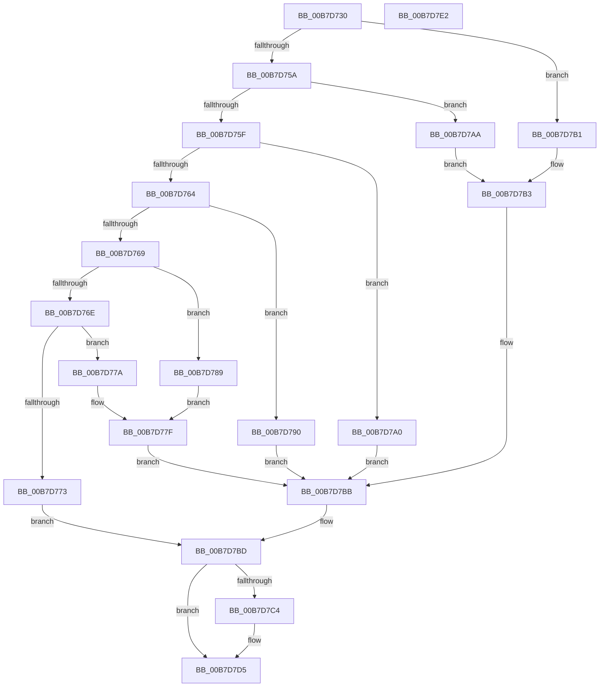

# MmPerformMemoryListCommand

- RVA: `0x00B7D730`–`0x00B7D7E3` (길이 `179` bytes)
- VA: `0x0000000140B7D730`
- 실행 섹션: `PAGELK`
- PDB 이름 있음: `예`; PDB Function 태그: `아니요`
- unwind 정보 RVA: `0x00068D5C`
- 디코드: `56`개 명령, `179/179` bytes 표시
- 미해석 바이트: `0` (있으면 어셈블리에 `.byte`로 보존)

> 이 문서는 커널 이미지의 기계어와 PDB 기호를 분석해 생성했습니다. 4번과 5번은 함수 원형과 자료형을 바이너리 사용 방식에서 추정한 C 해석이며 원본 소스 복구 결과는 아닙니다.

## 1. Dependencies

- 직접 호출 지점: **6**; 고유 호출 대상: **6**
- 직접 호출자로 확인된 함수: **5**
- RIP 상대 이미지 참조: **0**

### Outgoing calls
- `0x00B7D74E` → [MiPartitionObjectToPartition](../../text/3E/MiPartitionObjectToPartition_function_003EAB0C.md) (function, `0x003EAB0C`)
- `0x00B7D782` → [MiPurgePartitionStandby](../../text/33/MiPurgePartitionStandby_function_00334460.md) (function, `0x00334460`)
- `0x00B7D799` → [MiFlushAllPages](../../text/3B/MiFlushAllPages_function_003BD294.md) (function, `0x003BD294`)
- `0x00B7D7A3` → [MiEmptyAllWorkingSets](../../text/67/MiEmptyAllWorkingSets_function_0067E6C8.md) (function, `0x0067E6C8`)
- `0x00B7D7B6` → [MiCaptureAllWorkingSetAccessBits](../../text/4F/MiCaptureAllWorkingSetAccessBits_function_004F7148.md) (function, `0x004F7148`)
- `0x00B7D7D0` → [PsDereferencePartition](../../text/34/PsDereferencePartition_function_00342E70.md) (function, `0x00342E70`)

### Direct callers
- [PfpLogScenarioEventCallback](../../page/75/PfpLogScenarioEventCallback_function_007507B0.md) at `0x007507E5`
- [MmIssueMemoryListCommand](../../page/7F/MmIssueMemoryListCommand_function_007FE8B0.md) at `0x007FE8E5`
- [PfpPowerActionSleepSystemPhaseCallback](../B6/PfpPowerActionSleepSystemPhaseCallback_function_00B6B270.md) at `0x00B6B293`
- [PfpPowerActionStartScenarioTracingCallback](../B6/PfpPowerActionStartScenarioTracingCallback_function_00B6B2E0.md) at `0x00B6B30C`
- [PopVerifierFlushMemoryBeforeSleep](PopVerifierFlushMemoryBeforeSleep_function_00B70ED4.md) at `0x00B70F03`
- [PopVerifierFlushMemoryBeforeSleep](PopVerifierFlushMemoryBeforeSleep_function_00B70ED4.md) at `0x00B70F10`
- [PopVerifierFlushMemoryBeforeSleep](PopVerifierFlushMemoryBeforeSleep_function_00B70ED4.md) at `0x00B70F1D`
- [PopVerifierFlushMemoryBeforeSleep](PopVerifierFlushMemoryBeforeSleep_function_00B70ED4.md) at `0x00B70F2E`

### Static image references
- 디코드된 RIP-relative 메모리 참조가 없습니다.

## 2. Other-region calls and transfers

- 다른 실행 섹션으로 향하는 call: **6**
  - `0x00B7D74E` → [MiPartitionObjectToPartition](../../text/3E/MiPartitionObjectToPartition_function_003EAB0C.md) (`PAGELK` → `.text`)
  - `0x00B7D782` → [MiPurgePartitionStandby](../../text/33/MiPurgePartitionStandby_function_00334460.md) (`PAGELK` → `.text`)
  - `0x00B7D799` → [MiFlushAllPages](../../text/3B/MiFlushAllPages_function_003BD294.md) (`PAGELK` → `.text`)
  - `0x00B7D7A3` → [MiEmptyAllWorkingSets](../../text/67/MiEmptyAllWorkingSets_function_0067E6C8.md) (`PAGELK` → `.text`)
  - `0x00B7D7B6` → [MiCaptureAllWorkingSetAccessBits](../../text/4F/MiCaptureAllWorkingSetAccessBits_function_004F7148.md) (`PAGELK` → `.text`)
  - `0x00B7D7D0` → [PsDereferencePartition](../../text/34/PsDereferencePartition_function_00342E70.md) (`PAGELK` → `.text`)
- 별도 외부 분기/꼬리 이동을 확인하지 못했습니다.

## 3. Assembly (complete function range)

```asm
00B7D730  48 89 5C 24 10                  mov qword ptr [rsp + 0x10], rbx
00B7D735  57                              push rdi
00B7D736  48 83 EC 20                     sub rsp, 0x20
00B7D73A  48 8B C2                        mov rax, rdx
00B7D73D  C6 44 24 30 00                  mov byte ptr [rsp + 0x30], 0
00B7D742  8B D9                           mov ebx, ecx
00B7D744  4C 8D 44 24 30                  lea r8, [rsp + 0x30]
00B7D749  48 8B C8                        mov rcx, rax
00B7D74C  B2 01                           mov dl, 1
00B7D74E  E8 B9 D3 86 FF                  call 0x1403eab0c
00B7D753  48 8B F8                        mov rdi, rax
00B7D756  85 DB                           test ebx, ebx
00B7D758  74 57                           je 0x140b7d7b1
00B7D75A  83 EB 01                        sub ebx, 1
00B7D75D  74 4B                           je 0x140b7d7aa
00B7D75F  83 EB 01                        sub ebx, 1
00B7D762  74 3C                           je 0x140b7d7a0
00B7D764  83 EB 01                        sub ebx, 1
00B7D767  74 27                           je 0x140b7d790
00B7D769  83 EB 01                        sub ebx, 1
00B7D76C  74 1B                           je 0x140b7d789
00B7D76E  83 FB 01                        cmp ebx, 1
00B7D771  74 07                           je 0x140b7d77a
00B7D773  BB BB 00 00 C0                  mov ebx, 0xc00000bb
00B7D778  EB 43                           jmp 0x140b7d7bd
00B7D77A  BA 01 00 00 00                  mov edx, 1
00B7D77F  48 8B CF                        mov rcx, rdi
00B7D782  E8 D9 6C 7B FF                  call 0x140334460
00B7D787  EB 32                           jmp 0x140b7d7bb
00B7D789  BA 08 00 00 00                  mov edx, 8
00B7D78E  EB EF                           jmp 0x140b7d77f
00B7D790  33 D2                           xor edx, edx
00B7D792  48 8B CF                        mov rcx, rdi
00B7D795  44 8D 42 08                     lea r8d, [rdx + 8]
00B7D799  E8 F6 FA 83 FF                  call 0x1403bd294
00B7D79E  EB 1B                           jmp 0x140b7d7bb
00B7D7A0  48 8B CF                        mov rcx, rdi
00B7D7A3  E8 20 0F B0 FF                  call 0x14067e6c8
00B7D7A8  EB 11                           jmp 0x140b7d7bb
00B7D7AA  BA 01 00 00 00                  mov edx, 1
00B7D7AF  EB 02                           jmp 0x140b7d7b3
00B7D7B1  33 D2                           xor edx, edx
00B7D7B3  48 8B CF                        mov rcx, rdi
00B7D7B6  E8 8D 99 97 FF                  call 0x1404f7148
00B7D7BB  33 DB                           xor ebx, ebx
00B7D7BD  80 7C 24 30 00                  cmp byte ptr [rsp + 0x30], 0
00B7D7C2  74 11                           je 0x140b7d7d5
00B7D7C4  48 8B 8F B8 00 00 00            mov rcx, qword ptr [rdi + 0xb8]
00B7D7CB  BA 4D 6D 50 6F                  mov edx, 0x6f506d4d
00B7D7D0  E8 9B 56 7C FF                  call 0x140342e70
00B7D7D5  8B C3                           mov eax, ebx
00B7D7D7  48 8B 5C 24 38                  mov rbx, qword ptr [rsp + 0x38]
00B7D7DC  48 83 C4 20                     add rsp, 0x20
00B7D7E0  5F                              pop rdi
00B7D7E1  C3                              ret
00B7D7E2  CC                              int3
```

## 4. C-style interpretation (structured pseudocode)

```c
__int64 __fastcall MmPerformMemoryListCommand(int a1, __int64 a2)
{
    __int64 result;
    __int64 v_rbx;
    __int64 v_rsp;
    unsigned __int64 v_stack_p10;
    unsigned __int8 v_stack_p8;

    v_stack_p10 = v_rbx;
    v_rsp = (v_rsp) - (32);
    v_stack_p8 = 0;
    result = MiPartitionObjectToPartition(a2, 1, v_stack_p8, a4);
    if ((unsigned int)((unsigned int)(a1)) == 0) goto loc_00B7D7B1;
    v_rbx = (unsigned int)(((unsigned int)(a1)) - (1));
    if (condition_is_equal) goto loc_00B7D7AA;
    v_rbx = (unsigned int)((v_rbx) - (1));
    if (condition_is_equal) goto loc_00B7D7A0;
    v_rbx = (unsigned int)((v_rbx) - (1));
    if (condition_is_equal) goto loc_00B7D790;
    v_rbx = (unsigned int)((v_rbx) - (1));
    if (condition_is_equal) goto loc_00B7D789;
    if (((unsigned int)(v_rbx)) == 1) goto loc_00B7D77A;
    goto loc_00B7D7BD;
loc_00B7D77A:
loc_00B7D77F:
    result = MiPurgePartitionStandby(result, 1, v_stack_p8, a4);
    goto loc_00B7D7BB;
loc_00B7D789:
    goto loc_00B7D77F;
loc_00B7D790:
    a2 = 0;
    result = MiFlushAllPages(result, a2, a2 + 8, a4);
    goto loc_00B7D7BB;
loc_00B7D7A0:
    result = MiEmptyAllWorkingSets(result, a2, a2 + 8, a4);
    goto loc_00B7D7BB;
loc_00B7D7AA:
    goto loc_00B7D7B3;
loc_00B7D7B1:
    a2 = 0;
loc_00B7D7B3:
    result = MiCaptureAllWorkingSetAccessBits(result, a2, a2 + 8, a4);
loc_00B7D7BB:
    v_rbx = 0;
loc_00B7D7BD:
    if (v_stack_p8 != 0) {
        a1 = *(unsigned __int64 *)(result + 184);
        a2 = 0x6F506D4DULL;
        result = PsDereferencePartition(a1, a2, a2 + 8, a4);
    }
    v_rsp = (v_rsp) + (32);
    return 0;
}
```

## 5. (Beta) C Style

```c
int64_t MmPerformMemoryListCommand(int32_t Arg1, int64_t Arg2)
{
    int64_t result;
    int64_t local_rbx;
    int64_t local_rsp;
    uint64_t v_stack_p10;
    uint8_t v_stack_p8;

    v_stack_p10 = local_rbx;
    local_rsp = (local_rsp) - (32);
    v_stack_p8 = 0;
    result = MiPartitionObjectToPartition(Arg2, 1, v_stack_p8, a4);
    if ((uint32_t)((uint32_t)(Arg1)) == 0) goto loc_00B7D7B1;
    local_rbx = (uint32_t)(((uint32_t)(Arg1)) - (1));
    if (condition_is_equal) goto loc_00B7D7AA;
    local_rbx = (uint32_t)((local_rbx) - (1));
    if (condition_is_equal) goto loc_00B7D7A0;
    local_rbx = (uint32_t)((local_rbx) - (1));
    if (condition_is_equal) goto loc_00B7D790;
    local_rbx = (uint32_t)((local_rbx) - (1));
    if (condition_is_equal) goto loc_00B7D789;
    if (((uint32_t)(local_rbx)) == 1) goto loc_00B7D77A;
    goto loc_00B7D7BD;
loc_00B7D77A:
loc_00B7D77F:
    result = MiPurgePartitionStandby(result, 1, v_stack_p8, a4);
    goto loc_00B7D7BB;
loc_00B7D789:
    goto loc_00B7D77F;
loc_00B7D790:
    Arg2 = 0;
    result = MiFlushAllPages(result, Arg2, Arg2 + 8, a4);
    goto loc_00B7D7BB;
loc_00B7D7A0:
    result = MiEmptyAllWorkingSets(result, Arg2, Arg2 + 8, a4);
    goto loc_00B7D7BB;
loc_00B7D7AA:
    goto loc_00B7D7B3;
loc_00B7D7B1:
    Arg2 = 0;
loc_00B7D7B3:
    result = MiCaptureAllWorkingSetAccessBits(result, Arg2, Arg2 + 8, a4);
loc_00B7D7BB:
    local_rbx = 0;
loc_00B7D7BD:
    if (v_stack_p8 != 0) {
        Arg1 = *(uint64_t *)(result + 0xB8);
        Arg2 = 0x6F506D4DULL;
        result = PsDereferencePartition(Arg1, Arg2, Arg2 + 8, a4);
    }
    local_rsp = (local_rsp) + (32);
    return 0;
}
```

## 6. Execution-region graph

[열기: 2D/3D 그래프와 함수 탐색 컨트롤 패널](../../../control-panel.html?section=pagelk&rva=0x00B7D730&view=graph)

- 2D 그래프는 위에서 아래로 흐르고, 3D 그래프는 빈 공간을 드래그해 회전합니다. Shift+드래그는 이동, 휠은 확대·축소, 함수 노드 선택은 대상 보고서 이동입니다.

### Static fallback


