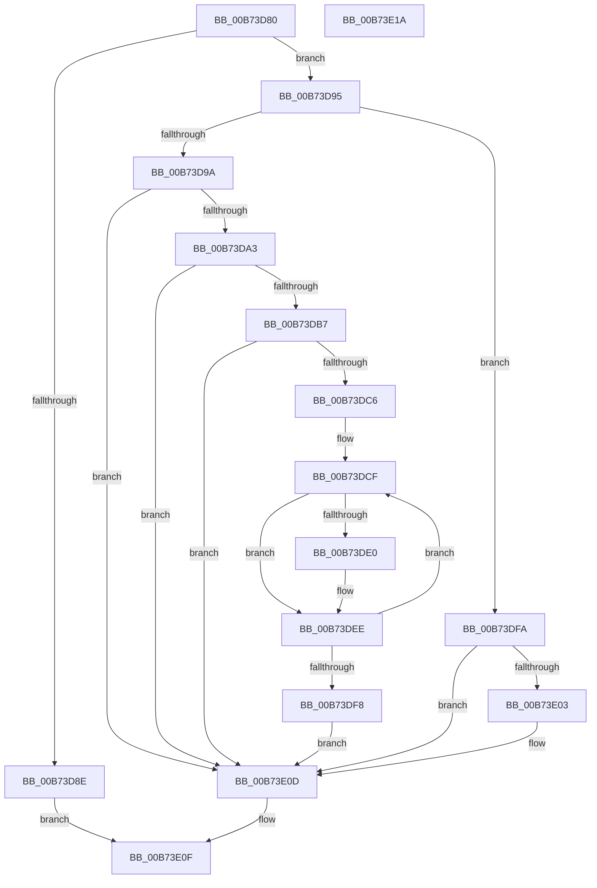

# MmShutdownSystem

- RVA: `0x00B73D80`–`0x00B73E1B` (길이 `155` bytes)
- VA: `0x0000000140B73D80`
- 실행 섹션: `PAGELK`
- PDB 이름 있음: `예`; PDB Function 태그: `아니요`
- unwind 정보 RVA: `0x0005CAAC`
- 디코드: `41`개 명령, `155/155` bytes 표시
- 미해석 바이트: `0` (있으면 어셈블리에 `.byte`로 보존)

> 이 문서는 커널 이미지의 기계어와 PDB 기호를 분석해 생성했습니다. 4번과 5번은 함수 원형과 자료형을 바이너리 사용 방식에서 추정한 C 해석이며 원본 소스 복구 결과는 아닙니다.

## 1. Dependencies

- 직접 호출 지점: **3**; 고유 호출 대상: **3**
- 직접 호출자로 확인된 함수: **2**
- RIP 상대 이미지 참조: **5**

### Outgoing calls
- `0x00B73D8E` → [MiShutdownSystem](MiShutdownSystem_function_00B73934.md) (function, `0x00B73934`)
- `0x00B73DB7` → [MiTrimAllSystemPagableMemory](../../text/67/MiTrimAllSystemPagableMemory_function_0067EDF0.md) (function, `0x0067EDF0`)
- `0x00B73DE9` → [ObfDereferenceObjectWithTag](../../text/2F/ObfDereferenceObjectWithTag_function_002F78E0.md) (function, `0x002F78E0`)

### Direct callers
- [PopGracefulShutdown](../B6/PopGracefulShutdown_function_00B6BEC8.md) at `0x00B6C0DF`
- [PopGracefulShutdown](../B6/PopGracefulShutdown_function_00B6BEC8.md) at `0x00B6C1B7`
- [sub_00B80364](../B8/Unknown_function_00B80364.md) at `0x00B803C8`

### Static image references
- `0x00B73D9A` → RVA `0x00E30144` (`.data`; read)
- `0x00B73DA3` → RVA `0x00F0C8B0` (`.data`; read)
- `0x00B73DA9` → RVA `0x00E30144` (`.data`; write)
- `0x00B73DBC` → RVA `0x00E3D558` (`.data`; read)
- `0x00B73DC6` → RVA `0x00E3D560` (`.data`; read)

## 2. Other-region calls and transfers

- 다른 실행 섹션으로 향하는 call: **2**
  - `0x00B73DB7` → [MiTrimAllSystemPagableMemory](../../text/67/MiTrimAllSystemPagableMemory_function_0067EDF0.md) (`PAGELK` → `.text`)
  - `0x00B73DE9` → [ObfDereferenceObjectWithTag](../../text/2F/ObfDereferenceObjectWithTag_function_002F78E0.md) (`PAGELK` → `.text`)
- 별도 외부 분기/꼬리 이동을 확인하지 못했습니다.

## 3. Assembly (complete function range)

```asm
00B73D80  48 89 5C 24 08                  mov qword ptr [rsp + 8], rbx
00B73D85  57                              push rdi
00B73D86  48 83 EC 20                     sub rsp, 0x20
00B73D8A  85 C9                           test ecx, ecx
00B73D8C  75 07                           jne 0x140b73d95
00B73D8E  E8 A1 FB FF FF                  call 0x140b73934
00B73D93  EB 7A                           jmp 0x140b73e0f
00B73D95  83 F9 01                        cmp ecx, 1
00B73D98  75 60                           jne 0x140b73dfa
00B73D9A  83 3D A3 C3 2B 00 02            cmp dword ptr [rip + 0x2bc3a3], 2
00B73DA1  73 6A                           jae 0x140b73e0d
00B73DA3  8B 05 07 8B 39 00               mov eax, dword ptr [rip + 0x398b07]
00B73DA9  C7 05 91 C3 2B 00 02 00 00 00   mov dword ptr [rip + 0x2bc391], 2
00B73DB3  A8 02                           test al, 2
00B73DB5  74 56                           je 0x140b73e0d
00B73DB7  E8 34 B0 B0 FF                  call 0x14067edf0
00B73DBC  8B 05 96 97 2C 00               mov eax, dword ptr [rip + 0x2c9796]
00B73DC2  85 C0                           test eax, eax
00B73DC4  74 47                           je 0x140b73e0d
00B73DC6  48 8D 1D 93 97 2C 00            lea rbx, [rip + 0x2c9793]
00B73DCD  8B F8                           mov edi, eax
00B73DCF  48 8B 0B                        mov rcx, qword ptr [rbx]
00B73DD2  BA 40 08 00 00                  mov edx, 0x840
00B73DD7  66 85 91 AC 00 00 00            test word ptr [rcx + 0xac], dx
00B73DDE  75 0E                           jne 0x140b73dee
00B73DE0  48 8B 49 18                     mov rcx, qword ptr [rcx + 0x18]
00B73DE4  BA 4D 6D 50 66                  mov edx, 0x66506d4d
00B73DE9  E8 F2 3A 78 FF                  call 0x1402f78e0
00B73DEE  48 83 C3 08                     add rbx, 8
00B73DF2  48 83 EF 01                     sub rdi, 1
00B73DF6  75 D7                           jne 0x140b73dcf
00B73DF8  EB 13                           jmp 0x140b73e0d
00B73DFA  83 3D 43 C3 2B 00 03            cmp dword ptr [rip + 0x2bc343], 3
00B73E01  73 0A                           jae 0x140b73e0d
00B73E03  C7 05 37 C3 2B 00 03 00 00 00   mov dword ptr [rip + 0x2bc337], 3
00B73E0D  B0 01                           mov al, 1
00B73E0F  48 8B 5C 24 30                  mov rbx, qword ptr [rsp + 0x30]
00B73E14  48 83 C4 20                     add rsp, 0x20
00B73E18  5F                              pop rdi
00B73E19  C3                              ret
00B73E1A  CC                              int3
```

## 4. C-style interpretation (structured pseudocode)

```c
__int64 __fastcall MmShutdownSystem(int a1)
{
    __int64 result;
    __int64 v_rbx;
    __int64 v_rdi;
    __int64 v_rsp;
    unsigned __int64 v_stack_p8;

    v_stack_p8 = v_rbx;
    v_rsp = (v_rsp) - (32);
    if (a1 != 0) goto loc_00B73D95;
    result = MiShutdownSystem(a1, a2, a3, a4);
    goto loc_00B73E0F;
loc_00B73D95:
    if (a1 != 1) goto loc_00B73DFA;
    if ((*(unsigned int *)(v_rip + 2868131)) >= 2) goto loc_00B73E0D;
    *(unsigned int *)(v_rip + 2868113) = 2;
    if ((((unsigned __int8)((unsigned int)(*(unsigned int *)(v_rip + 3771143)))) & (2)) == 0) goto loc_00B73E0D;
    result = MiTrimAllSystemPagableMemory(a1, a2, a3, a4);
    if ((unsigned int)((unsigned int)(*(unsigned int *)(v_rip + 2922390))) == 0) goto loc_00B73E0D;
loc_00B73DCF:
    result = (unsigned int)(*(unsigned int *)(v_rip + 2922390));
    if (((*(unsigned __int16 *)(*(unsigned __int64 *)(v_rip + 2922387) + 172)) & ((unsigned __int16)((unsigned int)(0x840ULL)))) == 0) {
        a1 = *(unsigned __int64 *)(*(unsigned __int64 *)(v_rip + 2922387) + 24);
        a2 = 0x66506D4DULL;
        result = ObfDereferenceObjectWithTag(a1, a2, a3, a4);
    }
    v_rbx = (v_rip + 2922387) + (8);
    v_rdi = ((unsigned int)((unsigned int)((unsigned int)(*(unsigned int *)(v_rip + 2922390))))) - (1);
    if (condition_is_not_equal) goto loc_00B73DCF;
    goto loc_00B73E0D;
loc_00B73DFA:
    if ((*(unsigned int *)(v_rip + 2868035)) < 3) {
        *(unsigned int *)(v_rip + 2868023) = 3;
    }
loc_00B73E0F:
    v_rsp = (v_rsp) + (32);
    return 1;
}
```

## 5. (Beta) C Style

```c
int64_t MmShutdownSystem(int32_t Arg1)
{
    int64_t result;
    int64_t local_rbx;
    int64_t local_rdi;
    int64_t local_rsp;
    uint64_t v_stack_p8;

    v_stack_p8 = local_rbx;
    local_rsp = (local_rsp) - (32);
    if (Arg1 != 0) goto loc_00B73D95;
    result = MiShutdownSystem(Arg1, a2, a3, a4);
    goto loc_00B73E0F;
loc_00B73D95:
    if (Arg1 != 1) goto loc_00B73DFA;
    if ((*(uint32_t *)(v_rip + 0x2BC3A3)) >= 2) goto loc_00B73E0D;
    *(uint32_t *)(v_rip + 0x2BC391) = 2;
    if ((((uint8_t)((uint32_t)(*(uint32_t *)(v_rip + 0x398B07)))) & (2)) == 0) goto loc_00B73E0D;
    result = MiTrimAllSystemPagableMemory(Arg1, a2, a3, a4);
    if ((uint32_t)((uint32_t)(*(uint32_t *)(v_rip + 0x2C9796))) == 0) goto loc_00B73E0D;
loc_00B73DCF:
    result = (uint32_t)(*(uint32_t *)(v_rip + 0x2C9796));
    if (((*(uint16_t *)(*(uint64_t *)(v_rip + 0x2C9793) + 0xAC)) & ((uint16_t)((uint32_t)(0x840ULL)))) == 0) {
        Arg1 = *(uint64_t *)(*(uint64_t *)(v_rip + 0x2C9793) + 0x18);
        a2 = 0x66506D4DULL;
        result = ObfDereferenceObjectWithTag(Arg1, a2, a3, a4);
    }
    local_rbx = (v_rip + 2922387) + (8);
    local_rdi = ((uint32_t)((uint32_t)((uint32_t)(*(uint32_t *)(v_rip + 0x2C9796))))) - (1);
    if (condition_is_not_equal) goto loc_00B73DCF;
    goto loc_00B73E0D;
loc_00B73DFA:
    if ((*(uint32_t *)(v_rip + 0x2BC343)) < 3) {
        *(uint32_t *)(v_rip + 0x2BC337) = 3;
    }
loc_00B73E0F:
    local_rsp = (local_rsp) + (32);
    return 1;
}
```

## 6. Execution-region graph

[열기: 2D/3D 그래프와 함수 탐색 컨트롤 패널](../../../control-panel.html?section=pagelk&rva=0x00B73D80&view=graph)

- 2D 그래프는 위에서 아래로 흐르고, 3D 그래프는 빈 공간을 드래그해 회전합니다. Shift+드래그는 이동, 휠은 확대·축소, 함수 노드 선택은 대상 보고서 이동입니다.

### Static fallback


