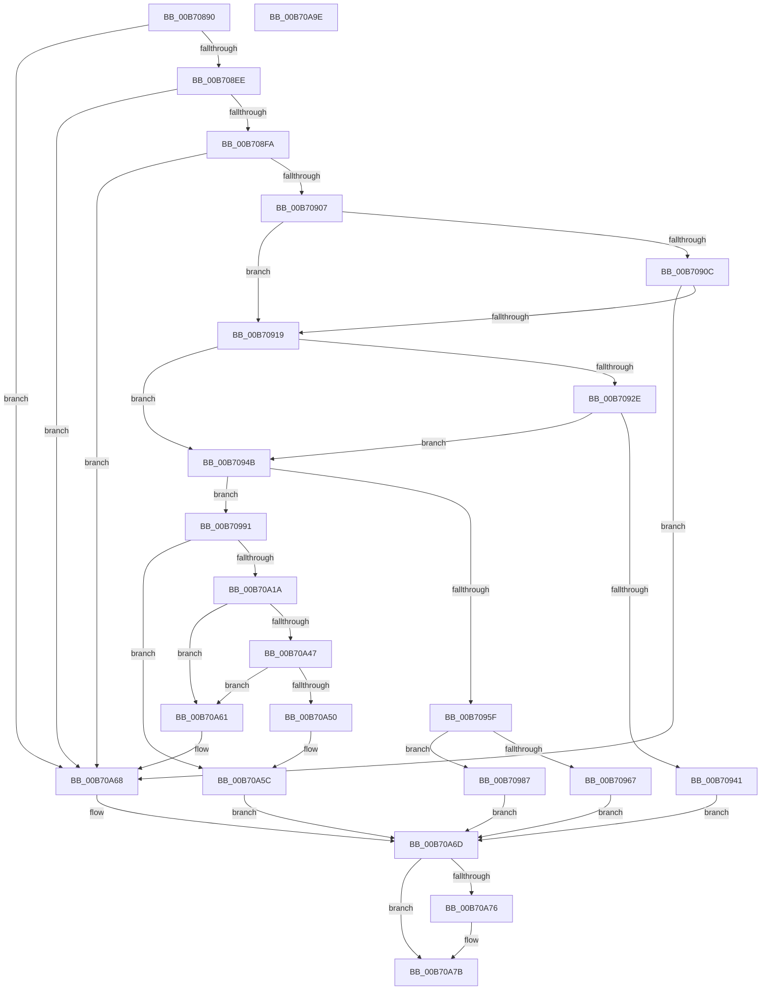

# NtSetSystemPowerState

- RVA: `0x00B70890`–`0x00B70A9F` (길이 `527` bytes)
- VA: `0x0000000140B70890`
- 실행 섹션: `PAGELK`
- PDB 이름 있음: `예`; PDB Function 태그: `아니요`
- unwind 정보 RVA: `0x0008FDA0`
- 디코드: `139`개 명령, `527/527` bytes 표시
- 미해석 바이트: `0` (있으면 어셈블리에 `.byte`로 보존)

> 이 문서는 커널 이미지의 기계어와 PDB 기호를 분석해 생성했습니다. 4번과 5번은 함수 원형과 자료형을 바이너리 사용 방식에서 추정한 C 해석이며 원본 소스 복구 결과는 아닙니다.

## 1. Dependencies

- 직접 호출 지점: **13**; 고유 호출 대상: **11**
- 직접 호출자로 확인된 함수: **1**
- RIP 상대 이미지 참조: **2**

### Outgoing calls
- `0x00B70938` → [SeSinglePrivilegeCheck](../../page/87/SeSinglePrivilegeCheck_function_00871E20.md) (function, `0x00871E20`)
- `0x00B7094B` → [PsGetCurrentServerSilo](../../text/22/PsGetCurrentServerSilo_function_00225710.md) (function, `0x00225710`)
- `0x00B70956` → [PsIsHostSilo](../../text/44/PsIsHostSilo_function_00443B30.md) (function, `0x00443B30`)
- `0x00B7097A` → [PsTerminateServerSilo](../../page/77/PsTerminateServerSilo_function_0077F620.md) (function, `0x0077F620`)
- `0x00B709BF` → [PoCaptureReasonContext](../../text/23/PoCaptureReasonContext_function_00230A38.md) (function, `0x00230A38`)
- `0x00B709DB` → [KeInitializeEvent](../../text/40/KeInitializeEvent_function_0040DD10.md) (function, `0x0040DD10`)
- `0x00B709F0` → [PopAcquirePolicyLock](PopAcquirePolicyLock_function_00B783C0.md) (function, `0x00B783C0`)
- `0x00B70A0A` → [PopExecutePowerAction](../../page/75/PopExecutePowerAction_function_0075E6B4.md) (function, `0x0075E6B4`)
- `0x00B70A0F` → [PopReleasePolicyLock](PopReleasePolicyLock_function_00B78410.md) (function, `0x00B78410`)
- `0x00B70A2B` → [KeWaitForSingleObject](../../text/20/KeWaitForSingleObject_function_0020E6B0.md) (function, `0x0020E6B0`)
- `0x00B70A30` → [PopAcquirePolicyLock](PopAcquirePolicyLock_function_00B783C0.md) (function, `0x00B783C0`)
- `0x00B70A57` → [PopReleasePolicyLock](PopReleasePolicyLock_function_00B78410.md) (function, `0x00B78410`)
- `0x00B70A76` → [PoDestroyReasonContext](../../text/23/PoDestroyReasonContext_function_00230944.md) (function, `0x00230944`)

### Direct callers
- [NtShutdownSystem](../../text/65/NtShutdownSystem_function_00655B70.md) at `0x00655BDF`

### Static image references
- `0x00B7090C` → RVA `0x00F0BD54` (`.data`; read)
- `0x00B7092E` → RVA `0x00FD9B30` (`PAGEDATA`; read)

## 2. Other-region calls and transfers

- 다른 실행 섹션으로 향하는 call: **9**
  - `0x00B70938` → [SeSinglePrivilegeCheck](../../page/87/SeSinglePrivilegeCheck_function_00871E20.md) (`PAGELK` → `PAGE`)
  - `0x00B7094B` → [PsGetCurrentServerSilo](../../text/22/PsGetCurrentServerSilo_function_00225710.md) (`PAGELK` → `.text`)
  - `0x00B70956` → [PsIsHostSilo](../../text/44/PsIsHostSilo_function_00443B30.md) (`PAGELK` → `.text`)
  - `0x00B7097A` → [PsTerminateServerSilo](../../page/77/PsTerminateServerSilo_function_0077F620.md) (`PAGELK` → `PAGE`)
  - `0x00B709BF` → [PoCaptureReasonContext](../../text/23/PoCaptureReasonContext_function_00230A38.md) (`PAGELK` → `.text`)
  - `0x00B709DB` → [KeInitializeEvent](../../text/40/KeInitializeEvent_function_0040DD10.md) (`PAGELK` → `.text`)
  - `0x00B70A0A` → [PopExecutePowerAction](../../page/75/PopExecutePowerAction_function_0075E6B4.md) (`PAGELK` → `PAGE`)
  - `0x00B70A2B` → [KeWaitForSingleObject](../../text/20/KeWaitForSingleObject_function_0020E6B0.md) (`PAGELK` → `.text`)
  - `0x00B70A76` → [PoDestroyReasonContext](../../text/23/PoDestroyReasonContext_function_00230944.md) (`PAGELK` → `.text`)
- 별도 외부 분기/꼬리 이동을 확인하지 못했습니다.

## 3. Assembly (complete function range)

```asm
00B70890  48 8B C4                        mov rax, rsp
00B70893  48 89 58 08                     mov qword ptr [rax + 8], rbx
00B70897  48 89 70 10                     mov qword ptr [rax + 0x10], rsi
00B7089B  48 89 78 18                     mov qword ptr [rax + 0x18], rdi
00B7089F  4C 89 60 20                     mov qword ptr [rax + 0x20], r12
00B708A3  55                              push rbp
00B708A4  41 56                           push r14
00B708A6  41 57                           push r15
00B708A8  48 8D 68 A1                     lea rbp, [rax - 0x5f]
00B708AC  48 81 EC A0 00 00 00            sub rsp, 0xa0
00B708B3  33 C0                           xor eax, eax
00B708B5  0F 57 C9                        xorps xmm1, xmm1
00B708B8  45 33 E4                        xor r12d, r12d
00B708BB  48 89 45 37                     mov qword ptr [rbp + 0x37], rax
00B708BF  0F 57 C0                        xorps xmm0, xmm0
00B708C2  44 89 65 DF                     mov dword ptr [rbp - 0x21], r12d
00B708C6  8D 42 FF                        lea eax, [rdx - 1]
00B708C9  45 8B F0                        mov r14d, r8d
00B708CC  44 8B FA                        mov r15d, edx
00B708CF  8B D9                           mov ebx, ecx
00B708D1  0F 11 45 E7                     movups xmmword ptr [rbp - 0x19], xmm0
00B708D5  0F 11 45 F7                     movups xmmword ptr [rbp - 9], xmm0
00B708D9  0F 11 4D 07                     movups xmmword ptr [rbp + 7], xmm1
00B708DD  0F 11 4D 17                     movups xmmword ptr [rbp + 0x17], xmm1
00B708E1  0F 11 4D 27                     movups xmmword ptr [rbp + 0x27], xmm1
00B708E5  83 F8 05                        cmp eax, 5
00B708E8  0F 87 7A 01 00 00               ja 0x140b70a68
00B708EE  8D 41 FF                        lea eax, [rcx - 1]
00B708F1  83 F8 06                        cmp eax, 6
00B708F4  0F 87 6E 01 00 00               ja 0x140b70a68
00B708FA  41 F7 C0 C0 FF FF 0C            test r8d, 0xcffffc0
00B70901  0F 85 61 01 00 00               jne 0x140b70a68
00B70907  83 F9 04                        cmp ecx, 4
00B7090A  7D 0D                           jge 0x140b70919
00B7090C  83 3D 41 B4 39 00 11            cmp dword ptr [rip + 0x39b441], 0x11
00B70913  0F 8D 4F 01 00 00               jge 0x140b70a68
00B70919  65 48 8B 04 25 88 01 00 00      mov rax, qword ptr gs:[0x188]
00B70922  40 8A B8 32 02 00 00            mov dil, byte ptr [rax + 0x232]
00B70929  40 84 FF                        test dil, dil
00B7092C  74 1D                           je 0x140b7094b
00B7092E  48 8B 0D FB 91 46 00            mov rcx, qword ptr [rip + 0x4691fb]
00B70935  40 8A D7                        mov dl, dil
00B70938  E8 E3 14 D0 FF                  call 0x140871e20
00B7093D  84 C0                           test al, al
00B7093F  75 0A                           jne 0x140b7094b
00B70941  BB 61 00 00 C0                  mov ebx, 0xc0000061
00B70946  E9 22 01 00 00                  jmp 0x140b70a6d
00B7094B  E8 C0 4D 6B FF                  call 0x140225710
00B70950  48 8B C8                        mov rcx, rax
00B70953  48 8B F0                        mov rsi, rax
00B70956  E8 D5 31 8D FF                  call 0x140443b30
00B7095B  84 C0                           test al, al
00B7095D  75 32                           jne 0x140b70991
00B7095F  8D 4B FC                        lea ecx, [rbx - 4]
00B70962  83 F9 02                        cmp ecx, 2
00B70965  77 20                           ja 0x140b70987
00B70967  83 FB 05                        cmp ebx, 5
00B7096A  BA 31 00 00 80                  mov edx, 0x80000031
00B7096F  B8 EB 02 00 C0                  mov eax, 0xc00002eb
00B70974  48 8B CE                        mov rcx, rsi
00B70977  0F 45 D0                        cmovne edx, eax
00B7097A  E8 A1 EC C0 FF                  call 0x14077f620
00B7097F  41 8B DC                        mov ebx, r12d
00B70982  E9 E6 00 00 00                  jmp 0x140b70a6d
00B70987  BB BB 00 00 C0                  mov ebx, 0xc00000bb
00B7098C  E9 DC 00 00 00                  jmp 0x140b70a6d
00B70991  48 8D 45 F7                     lea rax, [rbp - 9]
00B70995  89 5D D7                        mov dword ptr [rbp - 0x29], ebx
00B70998  48 89 44 24 28                  mov qword ptr [rsp + 0x28], rax
00B7099D  45 33 C9                        xor r9d, r9d
00B709A0  45 33 C0                        xor r8d, r8d
00B709A3  4C 89 64 24 20                  mov qword ptr [rsp + 0x20], r12
00B709A8  40 8A D7                        mov dl, dil
00B709AB  44 89 75 DB                     mov dword ptr [rbp - 0x25], r14d
00B709AF  33 C9                           xor ecx, ecx
00B709B1  C7 45 EB A0 00 00 00            mov dword ptr [rbp - 0x15], 0xa0
00B709B8  C7 45 E7 05 00 00 00            mov dword ptr [rbp - 0x19], 5
00B709BF  E8 74 00 6C FF                  call 0x140230a38
00B709C4  48 8B 4D F7                     mov rcx, qword ptr [rbp - 9]
00B709C8  85 C0                           test eax, eax
00B709CA  49 0F 48 CC                     cmovs rcx, r12
00B709CE  45 33 C0                        xor r8d, r8d
00B709D1  48 89 4D F7                     mov qword ptr [rbp - 9], rcx
00B709D5  33 D2                           xor edx, edx
00B709D7  48 8D 4D 07                     lea rcx, [rbp + 7]
00B709DB  E8 30 D3 89 FF                  call 0x14040dd10
00B709E0  48 8D 45 E7                     lea rax, [rbp - 0x19]
00B709E4  48 89 45 37                     mov qword ptr [rbp + 0x37], rax
00B709E8  48 8D 45 07                     lea rax, [rbp + 7]
00B709EC  48 89 45 EF                     mov qword ptr [rbp - 0x11], rax
00B709F0  E8 CB 79 00 00                  call 0x140b783c0
00B709F5  45 8B CF                        mov r9d, r15d
00B709F8  C7 44 24 20 01 00 00 00         mov dword ptr [rsp + 0x20], 1
00B70A00  4C 8D 45 D7                     lea r8, [rbp - 0x29]
00B70A04  33 D2                           xor edx, edx
00B70A06  48 8D 4D E7                     lea rcx, [rbp - 0x19]
00B70A0A  E8 A5 DC BE FF                  call 0x14075e6b4
00B70A0F  E8 FC 79 00 00                  call 0x140b78410
00B70A14  4C 39 65 27                     cmp qword ptr [rbp + 0x27], r12
00B70A18  74 42                           je 0x140b70a5c
00B70A1A  45 33 C9                        xor r9d, r9d
00B70A1D  4C 89 64 24 20                  mov qword ptr [rsp + 0x20], r12
00B70A22  45 33 C0                        xor r8d, r8d
00B70A25  48 8D 4D 07                     lea rcx, [rbp + 7]
00B70A29  33 D2                           xor edx, edx
00B70A2B  E8 80 DC 69 FF                  call 0x14020e6b0
00B70A30  E8 8B 79 00 00                  call 0x140b783c0
00B70A35  48 8B 4D 27                     mov rcx, qword ptr [rbp + 0x27]
00B70A39  48 8D 55 27                     lea rdx, [rbp + 0x27]
00B70A3D  48 8B 45 2F                     mov rax, qword ptr [rbp + 0x2f]
00B70A41  48 39 51 08                     cmp qword ptr [rcx + 8], rdx
00B70A45  75 1A                           jne 0x140b70a61
00B70A47  48 8D 55 27                     lea rdx, [rbp + 0x27]
00B70A4B  48 39 10                        cmp qword ptr [rax], rdx
00B70A4E  75 11                           jne 0x140b70a61
00B70A50  48 89 08                        mov qword ptr [rax], rcx
00B70A53  48 89 41 08                     mov qword ptr [rcx + 8], rax
00B70A57  E8 B4 79 00 00                  call 0x140b78410
00B70A5C  8B 5D 1F                        mov ebx, dword ptr [rbp + 0x1f]
00B70A5F  EB 0C                           jmp 0x140b70a6d
00B70A61  B9 03 00 00 00                  mov ecx, 3
00B70A66  CD 29                           int 0x29
00B70A68  BB 0D 00 00 C0                  mov ebx, 0xc000000d
00B70A6D  48 8B 4D F7                     mov rcx, qword ptr [rbp - 9]
00B70A71  48 85 C9                        test rcx, rcx
00B70A74  74 05                           je 0x140b70a7b
00B70A76  E8 C9 FE 6B FF                  call 0x140230944
00B70A7B  4C 8D 9C 24 A0 00 00 00         lea r11, [rsp + 0xa0]
00B70A83  8B C3                           mov eax, ebx
00B70A85  49 8B 5B 20                     mov rbx, qword ptr [r11 + 0x20]
00B70A89  49 8B 73 28                     mov rsi, qword ptr [r11 + 0x28]
00B70A8D  49 8B 7B 30                     mov rdi, qword ptr [r11 + 0x30]
00B70A91  4D 8B 63 38                     mov r12, qword ptr [r11 + 0x38]
00B70A95  49 8B E3                        mov rsp, r11
00B70A98  41 5F                           pop r15
00B70A9A  41 5E                           pop r14
00B70A9C  5D                              pop rbp
00B70A9D  C3                              ret
00B70A9E  CC                              int3
```

## 4. C-style interpretation (structured pseudocode)

```c
__int64 __fastcall NtSetSystemPowerState(__int64 a1, __int64 a2, int a3, int a4)
{
    __int64 result;
    __int64 v_r12;
    __int64 v_rsp;
    unsigned __int64 v_stack_m18;
    unsigned __int64 v_stack_m90;
    unsigned __int64 v_stack_m98;

    *(unsigned __int64 *)(v_rsp + 8) = v_rbx;
    *(unsigned __int64 *)(v_rsp + 16) = v_rsi;
    *(unsigned __int64 *)(v_rsp + 24) = v_rdi;
    *(unsigned __int64 *)(v_rsp + 32) = v_r12;
    v_rsp = (v_rsp) - (160);
    result = 0;
    v_r12 = 0;
    *(unsigned __int64 *)(v_rsp - 95 + 55) = 0;
    *(unsigned int *)(v_rsp - 95 - 33) = 0;
    *(unsigned __int64 *)(v_rsp - 95 - 25) = v_xmm0;
    *(unsigned __int64 *)(v_rsp - 95 - 9) = v_xmm0;
    *(unsigned __int64 *)(v_rsp - 95 + 7) = v_xmm1;
    *(unsigned __int64 *)(v_rsp - 95 + 23) = v_xmm1;
    *(unsigned __int64 *)(v_rsp - 95 + 39) = v_xmm1;
    if (((unsigned int)(a2 - 1)) > 5) goto loc_00B70A68;
    if (((unsigned int)(a1 - 1)) > 6) goto loc_00B70A68;
    if (((a3) & (0xCFFFFC0ULL)) != 0) goto loc_00B70A68;
    if (((unsigned int)(a1)) >= 4) goto loc_00B70919;
    if ((*(unsigned int *)(v_rip + 3781697)) >= 17) goto loc_00B70A68;
loc_00B70919:
    if ((unsigned __int8)(*(unsigned __int8 *)(*(unsigned __int64 *)(gs_base + (0 + 392)) + 562)) == 0) goto loc_00B7094B;
    result = SeSinglePrivilegeCheck(*(unsigned __int64 *)(v_rip + 4624891), (unsigned __int8)(*(unsigned __int8 *)(*(unsigned __int64 *)(gs_base + (0 + 392)) + 562)), a3, a4);
    if ((unsigned __int8)(result) != 0) goto loc_00B7094B;
    goto loc_00B70A6D;
loc_00B7094B:
    result = PsGetCurrentServerSilo(*(unsigned __int64 *)(v_rip + 4624891), (unsigned __int8)(*(unsigned __int8 *)(*(unsigned __int64 *)(gs_base + (0 + 392)) + 562)), a3, a4);
    result = PsIsHostSilo(result, (unsigned __int8)(*(unsigned __int8 *)(*(unsigned __int64 *)(gs_base + (0 + 392)) + 562)), a3, a4);
    if ((unsigned __int8)(result) != 0) goto loc_00B70991;
    if (((unsigned int)((unsigned int)(0xC0000061ULL) - 4)) > 2) goto loc_00B70987;
    a2 = (unsigned int)(0x80000031ULL);
    if (((unsigned int)((unsigned int)(0xC0000061ULL))) != 5) { a2 = (unsigned int)((unsigned int)(0xC00002EBULL)); }
    result = PsTerminateServerSilo(result, a2, a3, a4);
    goto loc_00B70A6D;
loc_00B70987:
    goto loc_00B70A6D;
loc_00B70991:
    *(unsigned int *)(v_rsp - 95 - 41) = (unsigned int)((unsigned int)(0xC00000BBULL));
    v_stack_m90 = v_rsp - 95 - 9;
    a4 = 0;
    a3 = 0;
    v_stack_m98 = 0;
    *(unsigned int *)(v_rsp - 95 - 37) = (unsigned int)((unsigned int)(a3));
    a1 = 0;
    *(unsigned int *)(v_rsp - 95 - 21) = 160;
    *(unsigned int *)(v_rsp - 95 - 25) = 5;
    result = PoCaptureReasonContext(a1, (unsigned __int8)(*(unsigned __int8 *)(*(unsigned __int64 *)(gs_base + (0 + 392)) + 562)), a3, a4);
    a1 = *(unsigned __int64 *)(v_rsp - 95 - 9);
    if (sign_flag) { a1 = 0; }
    a3 = 0;
    *(unsigned __int64 *)(v_rsp - 95 - 9) = a1;
    a2 = 0;
    result = KeInitializeEvent(v_rsp - 95 + 7, a2, a3, a4);
    *(unsigned __int64 *)(v_rsp - 95 + 55) = v_rsp - 95 - 25;
    *(unsigned __int64 *)(v_rsp - 95 - 17) = v_rsp - 95 + 7;
    result = PopAcquirePolicyLock(v_rsp - 95 + 7, a2, a3, a4);
    v_stack_m98 = 1;
    a2 = 0;
    result = PopExecutePowerAction(v_rsp - 95 - 25, a2, v_rsp - 95 - 41, (unsigned int)((unsigned int)((unsigned int)((unsigned int)(a2)))));
    result = PopReleasePolicyLock(v_rsp - 95 - 25, a2, v_rsp - 95 - 41, (unsigned int)((unsigned int)((unsigned int)((unsigned int)(a2)))));
    if ((*(unsigned __int64 *)(v_rsp - 95 + 39)) == 0) goto loc_00B70A5C;
    a4 = 0;
    v_stack_m98 = 0;
    a3 = 0;
    a2 = 0;
    result = KeWaitForSingleObject(v_rsp - 95 + 7, a2, a3, a4);
    result = PopAcquirePolicyLock(v_rsp - 95 + 7, a2, a3, a4);
    if ((*(unsigned __int64 *)(*(unsigned __int64 *)(v_rsp - 95 + 39) + 8)) != (v_rsp - 95 + 39)) goto loc_00B70A61;
    if ((*(unsigned __int64 *)(*(unsigned __int64 *)(v_rsp - 95 + 47))) != (v_rsp - 95 + 39)) goto loc_00B70A61;
    *(unsigned __int64 *)(*(unsigned __int64 *)(v_rsp - 95 + 47)) = *(unsigned __int64 *)(v_rsp - 95 + 39);
    *(unsigned __int64 *)(*(unsigned __int64 *)(v_rsp - 95 + 39) + 8) = *(unsigned __int64 *)(v_rsp - 95 + 47);
    result = PopReleasePolicyLock(*(unsigned __int64 *)(v_rsp - 95 + 39), v_rsp - 95 + 39, a3, a4);
loc_00B70A5C:
    goto loc_00B70A6D;
loc_00B70A61:
loc_00B70A68:
loc_00B70A6D:
    if (*(unsigned __int64 *)(v_rsp - 95 - 9) != 0) {
        result = PoDestroyReasonContext(*(unsigned __int64 *)(v_rsp - 95 - 9), v_rsp - 95 + 39, a3, a4);
    }
    return (unsigned int)((unsigned int)((unsigned int)(0xC000000DULL)));
}
```

## 5. (Beta) C Style

```c
int64_t NtSetSystemPowerState(void *Arg1, void *Arg2, int32_t Arg3, int32_t Arg4)
{
    uint8_t *arg1 = (uint8_t *)Arg1;
    uint8_t *arg2 = (uint8_t *)Arg2;

    int64_t result;
    int64_t local_r12;
    int64_t local_rsp;
    uint64_t v_stack_m18;
    uint64_t v_stack_m90;
    uint64_t v_stack_m98;

    *(uint64_t *)(local_rsp + 0x8) = local_rbx;
    *(uint64_t *)(local_rsp + 0x10) = local_rsi;
    *(uint64_t *)(local_rsp + 0x18) = local_rdi;
    *(uint64_t *)(local_rsp + 0x20) = local_r12;
    local_rsp = (local_rsp) - (160);
    result = 0;
    local_r12 = 0;
    *(uint64_t *)(local_rsp - 0x5F + 0x37) = 0;
    *(uint32_t *)(local_rsp - 0x5F - 0x21) = 0;
    *(uint64_t *)(local_rsp - 0x5F - 0x19) = v_xmm0;
    *(uint64_t *)(local_rsp - 0x5F - 0x9) = v_xmm0;
    *(uint64_t *)(local_rsp - 0x5F + 0x7) = v_xmm1;
    *(uint64_t *)(local_rsp - 0x5F + 0x17) = v_xmm1;
    *(uint64_t *)(local_rsp - 0x5F + 0x27) = v_xmm1;
    if (((uint32_t)(Arg2 - 1)) > 5) goto loc_00B70A68;
    if (((uint32_t)(Arg1 - 1)) > 6) goto loc_00B70A68;
    if (((Arg3) & (0xCFFFFC0ULL)) != 0) goto loc_00B70A68;
    if (((uint32_t)(Arg1)) >= 4) goto loc_00B70919;
    if ((*(uint32_t *)(v_rip + 0x39B441)) >= 17) goto loc_00B70A68;
loc_00B70919:
    if ((uint8_t)(*(uint8_t *)(*(uint64_t *)(gs_base + (0 + 0x188)) + 0x232)) == 0) goto loc_00B7094B;
    result = SeSinglePrivilegeCheck(*(uint64_t *)(v_rip + 0x4691FB), (uint8_t)(*(uint8_t *)(*(uint64_t *)(gs_base + (0 + 0x188)) + 0x232)), Arg3, Arg4);
    if ((uint8_t)(result) != 0) goto loc_00B7094B;
    goto loc_00B70A6D;
loc_00B7094B:
    result = PsGetCurrentServerSilo(*(uint64_t *)(v_rip + 0x4691FB), (uint8_t)(*(uint8_t *)(*(uint64_t *)(gs_base + (0 + 0x188)) + 0x232)), Arg3, Arg4);
    result = PsIsHostSilo(result, (uint8_t)(*(uint8_t *)(*(uint64_t *)(gs_base + (0 + 0x188)) + 0x232)), Arg3, Arg4);
    if ((uint8_t)(result) != 0) goto loc_00B70991;
    if (((uint32_t)((uint32_t)(0xC0000061ULL) - 4)) > 2) goto loc_00B70987;
    Arg2 = (uint32_t)(0x80000031ULL);
    if (((uint32_t)((uint32_t)(0xC0000061ULL))) != 5) { Arg2 = (uint32_t)((uint32_t)(0xC00002EBULL)); }
    result = PsTerminateServerSilo(result, Arg2, Arg3, Arg4);
    goto loc_00B70A6D;
loc_00B70987:
    goto loc_00B70A6D;
loc_00B70991:
    *(uint32_t *)(local_rsp - 0x5F - 0x29) = (uint32_t)((uint32_t)(0xC00000BBULL));
    v_stack_m90 = local_rsp - 95 - 9;
    Arg4 = 0;
    Arg3 = 0;
    v_stack_m98 = 0;
    *(uint32_t *)(local_rsp - 0x5F - 0x25) = (uint32_t)((uint32_t)(Arg3));
    Arg1 = 0;
    *(uint32_t *)(local_rsp - 0x5F - 0x15) = 160;
    *(uint32_t *)(local_rsp - 0x5F - 0x19) = 5;
    result = PoCaptureReasonContext(Arg1, (uint8_t)(*(uint8_t *)(*(uint64_t *)(gs_base + (0 + 0x188)) + 0x232)), Arg3, Arg4);
    Arg1 = *(uint64_t *)(local_rsp - 0x5F - 0x9);
    if (sign_flag) { Arg1 = 0; }
    Arg3 = 0;
    *(void **)(local_rsp - 0x5F - 0x9) = Arg1;
    Arg2 = 0;
    result = KeInitializeEvent(local_rsp - 95 + 7, Arg2, Arg3, Arg4);
    *(uint64_t *)(local_rsp - 0x5F + 0x37) = local_rsp - 95 - 25;
    *(uint64_t *)(local_rsp - 0x5F - 0x11) = local_rsp - 95 + 7;
    result = PopAcquirePolicyLock(local_rsp - 95 + 7, Arg2, Arg3, Arg4);
    v_stack_m98 = 1;
    Arg2 = 0;
    result = PopExecutePowerAction(local_rsp - 95 - 25, Arg2, local_rsp - 95 - 41, (uint32_t)((uint32_t)((uint32_t)((uint32_t)(Arg2)))));
    result = PopReleasePolicyLock(local_rsp - 95 - 25, Arg2, local_rsp - 95 - 41, (uint32_t)((uint32_t)((uint32_t)((uint32_t)(Arg2)))));
    if ((*(uint64_t *)(local_rsp - 0x5F + 0x27)) == 0) goto loc_00B70A5C;
    Arg4 = 0;
    v_stack_m98 = 0;
    Arg3 = 0;
    Arg2 = 0;
    result = KeWaitForSingleObject(local_rsp - 95 + 7, Arg2, Arg3, Arg4);
    result = PopAcquirePolicyLock(local_rsp - 95 + 7, Arg2, Arg3, Arg4);
    if ((*(uint64_t *)(*(uint64_t *)(local_rsp - 0x5F + 0x27) + 0x8)) != (local_rsp - 95 + 39)) goto loc_00B70A61;
    if ((*(uint64_t *)(*(uint64_t *)(local_rsp - 0x5F + 0x2F))) != (local_rsp - 95 + 39)) goto loc_00B70A61;
    *(uint64_t *)(*(uint64_t *)(local_rsp - 0x5F + 0x2F)) = *(uint64_t *)(local_rsp - 0x5F + 0x27);
    *(uint64_t *)(*(uint64_t *)(local_rsp - 0x5F + 0x27) + 0x8) = *(uint64_t *)(local_rsp - 0x5F + 0x2F);
    result = PopReleasePolicyLock(*(uint64_t *)(local_rsp - 0x5F + 0x27), local_rsp - 95 + 39, Arg3, Arg4);
loc_00B70A5C:
    goto loc_00B70A6D;
loc_00B70A61:
loc_00B70A68:
loc_00B70A6D:
    if (*(uint64_t *)(local_rsp - 0x5F - 0x9) != 0) {
        result = PoDestroyReasonContext(*(uint64_t *)(local_rsp - 0x5F - 0x9), local_rsp - 95 + 39, Arg3, Arg4);
    }
    return (uint32_t)((uint32_t)((uint32_t)(0xC000000DULL)));
}
```

### 관측된 메모리 오프셋

구조체 형식이 확인되지 않은 접근은 인자 기준의 오프셋으로만 기록했습니다.

| 기준 인자 | 오프셋 표현 | 폭 (bit) | 접근 |
|---|---:|---:|---|
| `Arg1` | `- 0x4` | `32` | `R` |
| `Arg1` | `- 0x1` | `32` | `R` |
| `Arg2` | `- 0x1` | `32` | `R` |

## 6. Execution-region graph

[열기: 2D/3D 그래프와 함수 탐색 컨트롤 패널](../../../control-panel.html?section=pagelk&rva=0x00B70890&view=graph)

- 2D 그래프는 위에서 아래로 흐르고, 3D 그래프는 빈 공간을 드래그해 회전합니다. Shift+드래그는 이동, 휠은 확대·축소, 함수 노드 선택은 대상 보고서 이동입니다.

### Static fallback


