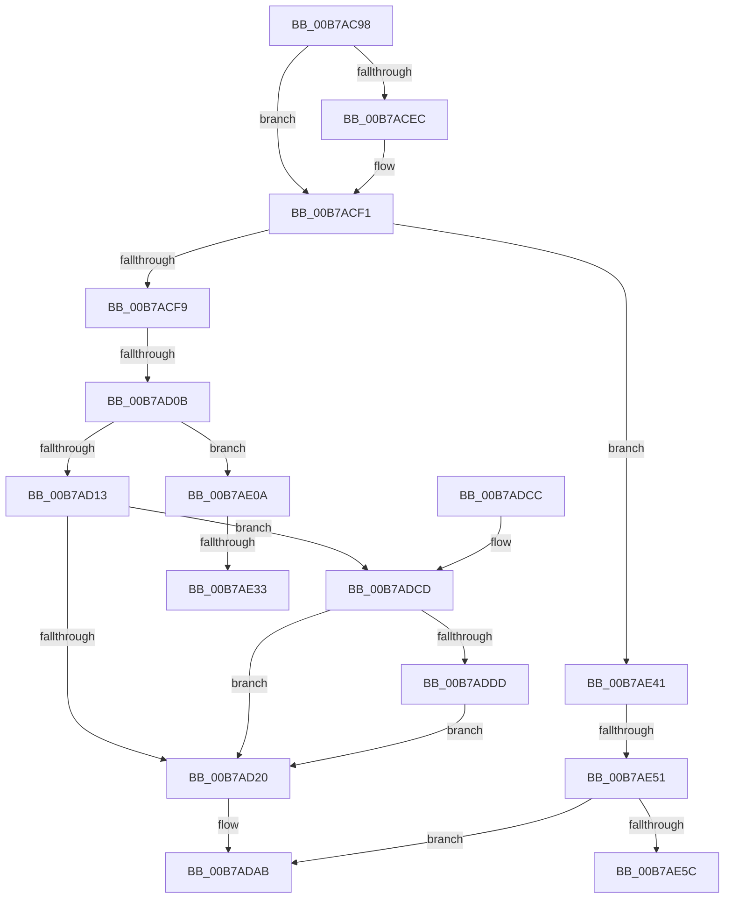

# PfPowerActionNotify

- RVA: `0x00B7AC98`–`0x00B7AE6F` (길이 `471` bytes)
- VA: `0x0000000140B7AC98`
- 실행 섹션: `PAGELK`
- PDB 이름 있음: `예`; PDB Function 태그: `예`
- unwind 정보 RVA: `0x000B93C8`
- 디코드: `121`개 명령, `471/471` bytes 표시
- 미해석 바이트: `0` (있으면 어셈블리에 `.byte`로 보존)

> 이 문서는 커널 이미지의 기계어와 PDB 기호를 분석해 생성했습니다. 4번과 5번은 함수 원형과 자료형을 바이너리 사용 방식에서 추정한 C 해석이며 원본 소스 복구 결과는 아닙니다.

## 1. Dependencies

- 직접 호출 지점: **5**; 고유 호출 대상: **3**
- 직접 호출자로 확인된 함수: **5**
- RIP 상대 이미지 참조: **8**

### Outgoing calls
- `0x00B7ADA6` → [PfpPartitionIterate](../../text/34/PfpPartitionIterate_function_00341D00.md) (function, `0x00341D00`)
- `0x00B7ADB2` → [_security_check_cookie](../../text/6A/_security_check_cookie_function_006AC640.md) (function, `0x006AC640`)
- `0x00B7AE00` → [PfpPartitionIterate](../../text/34/PfpPartitionIterate_function_00341D00.md) (function, `0x00341D00`)
- `0x00B7AE1D` → [PfpPartitionIterate](../../text/34/PfpPartitionIterate_function_00341D00.md) (function, `0x00341D00`)
- `0x00B7AE36` → [PfSnBeginBootPhase](../B6/PfSnBeginBootPhase_function_00B6BAC4.md) (function, `0x00B6BAC4`)

### Direct callers
- [PfIoPowerEventNotify](../../page/75/PfIoPowerEventNotify_function_00750784.md) at `0x00750799`
- [PfpProcessScenarioPhase](../../page/A9/PfpProcessScenarioPhase_function_00A96D44.md) at `0x00A96DE6`
- [PopIssueActionRequest](../../page/A9/PopIssueActionRequest_function_00A9CE54.md) at `0x00A9D148`
- [PopIssueActionRequest](../../page/A9/PopIssueActionRequest_function_00A9CE54.md) at `0x00A9D1DD`
- [PopDispatchSuperfetchNotification](../../page/AC/PopDispatchSuperfetchNotification_function_00AC3FD8.md) at `0x00AC400D`
- [PopTransitionSystemPowerStateEx](PopTransitionSystemPowerStateEx_function_00B7E8C0.md) at `0x00B7EEFF`
- [PopTransitionSystemPowerStateEx](PopTransitionSystemPowerStateEx_function_00B7E8C0.md) at `0x00B7EF4B`
- [PopTransitionSystemPowerStateEx](PopTransitionSystemPowerStateEx_function_00B7E8C0.md) at `0x00B7EF5F`

### Static image references
- `0x00B7ACAD` → RVA `0x00E0A740` (`.data`; read)
- `0x00B7AD76` → RVA `0x004A82B0` (`PfpPartitionLogEventCallback`; read)
- `0x00B7AD97` → RVA `0x00E670CC` (`.data`; read)
- `0x00B7ADDD` → RVA `0x00E67104` (`.data`; read)
- `0x00B7ADEB` → RVA `0x007507B0` (`PfpLogScenarioEventCallback`; read)
- `0x00B7AE0A` → RVA `0x00E670D0` (`.data`; read)
- `0x00B7AE16` → RVA `0x00B6B2E0` (`PfpPowerActionStartScenarioTracingCallback`; read)
- `0x00B7AE27` → RVA `0x00E67100` (`.data`; read)

## 2. Other-region calls and transfers

- 다른 실행 섹션으로 향하는 call: **4**
  - `0x00B7ADA6` → [PfpPartitionIterate](../../text/34/PfpPartitionIterate_function_00341D00.md) (`PAGELK` → `.text`)
  - `0x00B7ADB2` → [_security_check_cookie](../../text/6A/_security_check_cookie_function_006AC640.md) (`PAGELK` → `.text`)
  - `0x00B7AE00` → [PfpPartitionIterate](../../text/34/PfpPartitionIterate_function_00341D00.md) (`PAGELK` → `.text`)
  - `0x00B7AE1D` → [PfpPartitionIterate](../../text/34/PfpPartitionIterate_function_00341D00.md) (`PAGELK` → `.text`)
- call이 아닌 외부 분기/꼬리 이동: **5**
  - `0x00B7AD05` → [sub_00B80CFE + 0x50](../B8/Unknown_function_00B80CFE.md) (`tail-transfer`)
  - `0x00B7AE2D` → [sub_00B80CFE](../B8/Unknown_function_00B80CFE.md) (`tail-transfer`)
  - `0x00B7AE3C` → [sub_00B80CFE](../B8/Unknown_function_00B80CFE.md) (`tail-transfer`)
  - `0x00B7AE4B` → [sub_00B80CFE + 0xC4](../B8/Unknown_function_00B80CFE.md) (`tail-transfer`)
  - `0x00B7AE6A` → [sub_00B80CFE + 0xC4](../B8/Unknown_function_00B80CFE.md) (`tail-transfer`)

## 3. Assembly (complete function range)

```asm
00B7AC98  48 89 5C 24 10                  mov qword ptr [rsp + 0x10], rbx
00B7AC9D  48 89 74 24 18                  mov qword ptr [rsp + 0x18], rsi
00B7ACA2  55                              push rbp
00B7ACA3  57                              push rdi
00B7ACA4  41 57                           push r15
00B7ACA6  48 8B EC                        mov rbp, rsp
00B7ACA9  48 83 EC 70                     sub rsp, 0x70
00B7ACAD  48 8B 05 8C FA 28 00            mov rax, qword ptr [rip + 0x28fa8c]
00B7ACB4  48 33 C4                        xor rax, rsp
00B7ACB7  48 89 45 F0                     mov qword ptr [rbp - 0x10], rax
00B7ACBB  33 C0                           xor eax, eax
00B7ACBD  0F 57 C0                        xorps xmm0, xmm0
00B7ACC0  48 21 45 B8                     and qword ptr [rbp - 0x48], rax
00B7ACC4  BF 01 00 00 00                  mov edi, 1
00B7ACC9  21 45 B0                        and dword ptr [rbp - 0x50], eax
00B7ACCC  49 8B F0                        mov rsi, r8
00B7ACCF  89 45 E8                        mov dword ptr [rbp - 0x18], eax
00B7ACD2  44 8B C2                        mov r8d, edx
00B7ACD5  48 89 45 D0                     mov qword ptr [rbp - 0x30], rax
00B7ACD9  8D 04 09                        lea eax, [rcx + rcx]
00B7ACDC  89 45 B8                        mov dword ptr [rbp - 0x48], eax
00B7ACDF  0F 11 45 D8                     movups xmmword ptr [rbp - 0x28], xmm0
00B7ACE3  0F 11 45 C0                     movups xmmword ptr [rbp - 0x40], xmm0
00B7ACE7  40 84 D7                        test dil, dl
00B7ACEA  74 05                           je 0x140b7acf1
00B7ACEC  0B C7                           or eax, edi
00B7ACEE  89 45 B8                        mov dword ptr [rbp - 0x48], eax
00B7ACF1  85 C9                           test ecx, ecx
00B7ACF3  0F 84 48 01 00 00               je 0x140b7ae41
00B7ACF9  49 BF 20 03 00 00 80 F7 FF FF   movabs r15, 0xfffff78000000320
00B7AD03  2B CF                           sub ecx, edi
00B7AD05  0F 84 43 60 00 00               je 0x140b80d4e
00B7AD0B  2B CF                           sub ecx, edi
00B7AD0D  0F 84 F7 00 00 00               je 0x140b7ae0a
00B7AD13  BB 05 00 00 00                  mov ebx, 5
00B7AD18  3B CB                           cmp ecx, ebx
00B7AD1A  0F 84 AD 00 00 00               je 0x140b7adcd
00B7AD20  49 8B 0F                        mov rcx, qword ptr [r15]
00B7AD23  A1 04 00 00 00 80 F7 FF FF      movabs eax, dword ptr [0xfffff78000000004]
00B7AD2C  8B D1                           mov edx, ecx
00B7AD2E  44 8B C0                        mov r8d, eax
00B7AD31  48 C1 E9 20                     shr rcx, 0x20
00B7AD35  4C 0F AF C2                     imul r8, rdx
00B7AD39  0F AF C8                        imul ecx, eax
00B7AD3C  49 C1 E8 18                     shr r8, 0x18
00B7AD40  C1 E1 08                        shl ecx, 8
00B7AD43  44 03 C1                        add r8d, ecx
00B7AD46  44 89 45 BC                     mov dword ptr [rbp - 0x44], r8d
00B7AD4A  83 65 CC 00                     and dword ptr [rbp - 0x34], 0
00B7AD4E  4C 8D 45 C0                     lea r8, [rbp - 0x40]
00B7AD52  C7 45 C0 1C 00 00 00            mov dword ptr [rbp - 0x40], 0x1c
00B7AD59  48 B9 04 00 00 00 80 F7 FF FF   movabs rcx, 0xfffff78000000004
00B7AD63  49 8B 07                        mov rax, qword ptr [r15]
00B7AD66  8B D0                           mov edx, eax
00B7AD68  48 C1 E8 20                     shr rax, 0x20
00B7AD6C  8B 09                           mov ecx, dword ptr [rcx]
00B7AD6E  48 0F AF D1                     imul rdx, rcx
00B7AD72  48 0F AF C1                     imul rax, rcx
00B7AD76  48 8D 0D 33 D5 92 FF            lea rcx, [rip - 0x6d2acd]
00B7AD7D  C7 45 C8 08 00 00 00            mov dword ptr [rbp - 0x38], 8
00B7AD84  48 C1 EA 18                     shr rdx, 0x18
00B7AD88  48 C1 E0 08                     shl rax, 8
00B7AD8C  48 03 D0                        add rdx, rax
00B7AD8F  48 8D 45 B8                     lea rax, [rbp - 0x48]
00B7AD93  48 C1 EA 0A                     shr rdx, 0xa
00B7AD97  03 15 2F C3 2E 00               add edx, dword ptr [rip + 0x2ec32f]
00B7AD9D  89 55 C4                        mov dword ptr [rbp - 0x3c], edx
00B7ADA0  33 D2                           xor edx, edx
00B7ADA2  48 89 45 D0                     mov qword ptr [rbp - 0x30], rax
00B7ADA6  E8 55 6F 7C FF                  call 0x140341d00
00B7ADAB  48 8B 4D F0                     mov rcx, qword ptr [rbp - 0x10]
00B7ADAF  48 33 CC                        xor rcx, rsp
00B7ADB2  E8 89 18 B3 FF                  call 0x1406ac640
00B7ADB7  4C 8D 5C 24 70                  lea r11, [rsp + 0x70]
00B7ADBC  49 8B 5B 28                     mov rbx, qword ptr [r11 + 0x28]
00B7ADC0  49 8B 73 30                     mov rsi, qword ptr [r11 + 0x30]
00B7ADC4  49 8B E3                        mov rsp, r11
00B7ADC7  41 5F                           pop r15
00B7ADC9  5F                              pop rdi
00B7ADCA  5D                              pop rbp
00B7ADCB  C3                              ret
00B7ADCC  CC                              int3
00B7ADCD  8D 46 FE                        lea eax, [rsi - 2]
00B7ADD0  BA 02 00 00 00                  mov edx, 2
00B7ADD5  3B C2                           cmp eax, edx
00B7ADD7  0F 87 43 FF FF FF               ja 0x140b7ad20
00B7ADDD  8B 05 21 C3 2E 00               mov eax, dword ptr [rip + 0x2ec321]
00B7ADE3  4C 8D 45 D8                     lea r8, [rbp - 0x28]
00B7ADE7  83 65 E8 00                     and dword ptr [rbp - 0x18], 0
00B7ADEB  48 8D 0D BE 59 BD FF            lea rcx, [rip - 0x42a642]
00B7ADF2  89 55 DC                        mov dword ptr [rbp - 0x24], edx
00B7ADF5  33 D2                           xor edx, edx
00B7ADF7  89 7D D8                        mov dword ptr [rbp - 0x28], edi
00B7ADFA  89 7D E0                        mov dword ptr [rbp - 0x20], edi
00B7ADFD  89 45 E4                        mov dword ptr [rbp - 0x1c], eax
00B7AE00  E8 FB 6E 7C FF                  call 0x140341d00
00B7AE05  E9 16 FF FF FF                  jmp 0x140b7ad20
00B7AE0A  4C 8D 05 BF C2 2E 00            lea r8, [rip + 0x2ec2bf]
00B7AE11  BA 04 00 00 00                  mov edx, 4
00B7AE16  48 8D 0D C3 04 FF FF            lea rcx, [rip - 0xfb3d]
00B7AE1D  E8 DE 6E 7C FF                  call 0x140341d00
00B7AE22  BB 05 00 00 00                  mov ebx, 5
00B7AE27  39 1D D3 C2 2E 00               cmp dword ptr [rip + 0x2ec2d3], ebx
00B7AE2D  0F 85 CB 5E 00 00               jne 0x140b80cfe
00B7AE33  8D 4B FF                        lea ecx, [rbx - 1]
00B7AE36  E8 89 0C FF FF                  call 0x140b6bac4
00B7AE3B  90                              nop
00B7AE3C  E9 BD 5E 00 00                  jmp 0x140b80cfe
00B7AE41  8D 46 FE                        lea eax, [rsi - 2]
00B7AE44  BA 02 00 00 00                  mov edx, 2
00B7AE49  3B C2                           cmp eax, edx
00B7AE4B  0F 86 71 5F 00 00               jbe 0x140b80dc2
00B7AE51  8D 5A 03                        lea ebx, [rdx + 3]
00B7AE54  3B F3                           cmp esi, ebx
00B7AE56  0F 85 4F FF FF FF               jne 0x140b7adab
00B7AE5C  41 80 E0 04                     and r8b, 4
00B7AE60  41 F6 D8                        neg r8b
00B7AE63  1B FF                           sbb edi, edi
00B7AE65  83 E7 03                        and edi, 3
00B7AE68  03 FA                           add edi, edx
00B7AE6A  E9 53 5F 00 00                  jmp 0x140b80dc2
```

## 4. C-style interpretation (structured pseudocode)

```c
__int64 __fastcall PfPowerActionNotify(__int64 a1, int a2, __int64 a3)
{
    __int64 result;
    __int64 v_rdi;
    __int64 v_rsp;
    unsigned __int64 v_stack_m18;
    unsigned __int64 v_stack_m28;
    unsigned int v_stack_m30;
    unsigned int v_stack_m34;
    unsigned int v_stack_m38;
    unsigned int v_stack_m3C;
    unsigned __int64 v_stack_m40;
    unsigned __int64 v_stack_m48;
    unsigned int v_stack_m4C;
    unsigned int v_stack_m50;
    unsigned int v_stack_m54;
    unsigned __int64 v_stack_m58;
    unsigned int v_stack_m5C;
    unsigned __int64 v_stack_m60;
    unsigned int v_stack_m68;
    unsigned __int64 v_stack_p10;
    unsigned __int64 v_stack_p18;

    v_stack_p10 = v_rbx;
    v_stack_p18 = v_rsi;
    v_rsp = (v_rsp) - (112);
    result = (*(unsigned __int64 *)(v_rip + 2685580)) ^ (v_rsp);
    v_stack_m28 = result;
    result = 0;
    v_stack_m30 = 0;
    v_stack_m48 = 0;
    v_stack_m60 = (unsigned int)(a1 + a1 * 1);
    v_stack_m40 = v_xmm0;
    v_stack_m58 = v_xmm0;
    result = a1 + a1 * 1;
    if (((1) & ((unsigned __int8)(a2))) != 0) {
        result = (unsigned int)((a1 + a1 * 1) | (1));
        v_stack_m60 = (unsigned int)(result);
    }
    if ((unsigned int)(a1) == 0) goto loc_00B7AE41;
    a1 = (unsigned int)((a1) - (1));
    a1 = (unsigned int)((a1) - (1));
    if (condition_is_equal) goto loc_00B7AE0A;
    if (((unsigned int)(a1)) == 5) goto loc_00B7ADCD;
loc_00B7AD20:
    a1 = (*(unsigned __int64 *)(v_r15)) >> (32);
    a3 = ((unsigned int)((unsigned int)(result))) * ((unsigned int)((unsigned int)(*(unsigned __int64 *)(v_r15))));
    a1 = (unsigned int)((a1) * ((unsigned int)(result)));
    a3 = (a3) >> (24);
    a1 = (unsigned int)((a1) << (8));
    a3 = (unsigned int)((a3) + ((unsigned int)(a1)));
    v_stack_m5C = (unsigned int)(a3);
    v_stack_m58 = 28;
    result = (*(unsigned __int64 *)(v_r15)) >> (32);
    a2 = ((unsigned int)((unsigned int)(*(unsigned __int64 *)(v_r15)))) * ((unsigned int)(*(unsigned int *)(a1)));
    result = (result) * ((unsigned int)(*(unsigned int *)(a1)));
    v_stack_m50 = 8;
    a2 = (a2) >> (24);
    result = (result) << (8);
    a2 = (a2) + (result);
    a2 = (a2) >> (10);
    a2 = (unsigned int)((a2) + (*(unsigned int *)(v_rip + 3064623)));
    v_stack_m54 = a2;
    a2 = 0;
    v_stack_m48 = v_stack_m60;
    result = PfpPartitionIterate(v_rip - 7154381, a2, v_stack_m58, a4);
loc_00B7ADAB:
    a1 = (v_stack_m28) ^ (v_rsp);
    result = _security_check_cookie(a1, a2, v_stack_m58, a4);
    return result;
loc_00B7ADCD:
    if (((unsigned int)(*(unsigned __int64 *)(v_stack_m18 + 48) - 2)) > 2) goto loc_00B7AD20;
    v_stack_m3C = 2;
    a2 = 0;
    v_stack_m40 = 1;
    v_stack_m38 = 1;
    v_stack_m34 = (unsigned int)((unsigned int)(*(unsigned int *)(v_rip + 3064609)));
    result = PfpPartitionIterate(v_rip - 4367938, a2, v_stack_m40, a4);
    goto loc_00B7AD20;
loc_00B7AE0A:
    result = PfpPartitionIterate(v_rip - 64317, 4, v_rip + 3064511, a4);
    result = PfSnBeginBootPhase(5 - 1, 4, v_rip + 3064511, a4);
loc_00B7AE41:
    if (((unsigned int)(*(unsigned __int64 *)(v_stack_m18 + 48))) != ((unsigned int)(2 + 3))) goto loc_00B7ADAB;
    a3 = (unsigned __int8)((v_rip + 3064511) & (4));
    a3 = (unsigned __int8)(-(a3));
    v_rdi = (unsigned int)((1) & (3));
    v_rdi = (unsigned int)((v_rdi) + (2));
}
```

## 5. (Beta) C Style

```c
int64_t PfPowerActionNotify(void *Arg1, int32_t Arg2, void *Arg3)
{
    uint8_t *arg1 = (uint8_t *)Arg1;
    uint8_t *arg3 = (uint8_t *)Arg3;

    int64_t result;
    int64_t local_rdi;
    int64_t local_rsp;
    uint64_t v_stack_m18;
    uint64_t v_stack_m28;
    uint32_t v_stack_m30;
    uint32_t v_stack_m34;
    uint32_t v_stack_m38;
    uint32_t v_stack_m3C;
    uint64_t v_stack_m40;
    uint64_t v_stack_m48;
    uint32_t v_stack_m4C;
    uint32_t v_stack_m50;
    uint32_t v_stack_m54;
    uint64_t v_stack_m58;
    uint32_t v_stack_m5C;
    uint64_t v_stack_m60;
    uint32_t v_stack_m68;
    uint64_t v_stack_p10;
    uint64_t v_stack_p18;

    v_stack_p10 = local_rbx;
    v_stack_p18 = local_rsi;
    local_rsp = (local_rsp) - (112);
    result = (*(uint64_t *)(v_rip + 0x28FA8C)) ^ (local_rsp);
    v_stack_m28 = result;
    result = 0;
    v_stack_m30 = 0;
    v_stack_m48 = 0;
    v_stack_m60 = (uint32_t)(Arg1 + Arg1 * 1);
    v_stack_m40 = v_xmm0;
    v_stack_m58 = v_xmm0;
    result = Arg1 + Arg1 * 1;
    if (((1) & ((uint8_t)(Arg2))) != 0) {
        result = (uint32_t)((Arg1 + Arg1 * 1) | (1));
        v_stack_m60 = (uint32_t)(result);
    }
    if ((uint32_t)(Arg1) == 0) goto loc_00B7AE41;
    Arg1 = (uint32_t)((Arg1) - (1));
    Arg1 = (uint32_t)((Arg1) - (1));
    if (condition_is_equal) goto loc_00B7AE0A;
    if (((uint32_t)(Arg1)) == 5) goto loc_00B7ADCD;
loc_00B7AD20:
    Arg1 = (*(uint64_t *)(local_r15)) >> (32);
    Arg3 = ((uint32_t)((uint32_t)(result))) * ((uint32_t)((uint32_t)(*(uint64_t *)(local_r15))));
    Arg1 = (uint32_t)((Arg1) * ((uint32_t)(result)));
    Arg3 = (Arg3) >> (24);
    Arg1 = (uint32_t)((Arg1) << (8));
    Arg3 = (uint32_t)((Arg3) + ((uint32_t)(Arg1)));
    v_stack_m5C = (uint32_t)(Arg3);
    v_stack_m58 = 28;
    result = (*(uint64_t *)(local_r15)) >> (32);
    Arg2 = ((uint32_t)((uint32_t)(*(uint64_t *)(local_r15)))) * ((uint32_t)(*(uint32_t *)(arg1)));
    result = (result) * ((uint32_t)(*(uint32_t *)(arg1)));
    v_stack_m50 = 8;
    Arg2 = (Arg2) >> (24);
    result = (result) << (8);
    Arg2 = (Arg2) + (result);
    Arg2 = (Arg2) >> (10);
    Arg2 = (uint32_t)((Arg2) + (*(uint32_t *)(v_rip + 0x2EC32F)));
    v_stack_m54 = Arg2;
    Arg2 = 0;
    v_stack_m48 = v_stack_m60;
    result = PfpPartitionIterate(v_rip - 7154381, Arg2, v_stack_m58, a4);
loc_00B7ADAB:
    Arg1 = (v_stack_m28) ^ (local_rsp);
    result = _security_check_cookie(Arg1, Arg2, v_stack_m58, a4);
    return result;
loc_00B7ADCD:
    if (((uint32_t)(*(uint64_t *)(v_stack_m18 + 0x30) - 2)) > 2) goto loc_00B7AD20;
    v_stack_m3C = 2;
    Arg2 = 0;
    v_stack_m40 = 1;
    v_stack_m38 = 1;
    v_stack_m34 = (uint32_t)((uint32_t)(*(uint32_t *)(v_rip + 0x2EC321)));
    result = PfpPartitionIterate(v_rip - 4367938, Arg2, v_stack_m40, a4);
    goto loc_00B7AD20;
loc_00B7AE0A:
    result = PfpPartitionIterate(v_rip - 64317, 4, v_rip + 3064511, a4);
    result = PfSnBeginBootPhase(5 - 1, 4, v_rip + 3064511, a4);
loc_00B7AE41:
    if (((uint32_t)(*(uint64_t *)(v_stack_m18 + 0x30))) != ((uint32_t)(2 + 3))) goto loc_00B7ADAB;
    Arg3 = (uint8_t)((v_rip + 3064511) & (4));
    Arg3 = (uint8_t)(-(Arg3));
    local_rdi = (uint32_t)((1) & (3));
    local_rdi = (uint32_t)((local_rdi) + (2));
}
```

### 관측된 메모리 오프셋

구조체 형식이 확인되지 않은 접근은 인자 기준의 오프셋으로만 기록했습니다.

| 기준 인자 | 오프셋 표현 | 폭 (bit) | 접근 |
|---|---:|---:|---|
| `Arg1` | `+ 0x0 + rcx*1` | `32` | `R` |
| `Arg3` | `- 0x2` | `32` | `R` |

## 6. Execution-region graph

[열기: 2D/3D 그래프와 함수 탐색 컨트롤 패널](../../../control-panel.html?section=pagelk&rva=0x00B7AC98&view=graph)

- 2D 그래프는 위에서 아래로 흐르고, 3D 그래프는 빈 공간을 드래그해 회전합니다. Shift+드래그는 이동, 휠은 확대·축소, 함수 노드 선택은 대상 보고서 이동입니다.

### Static fallback


