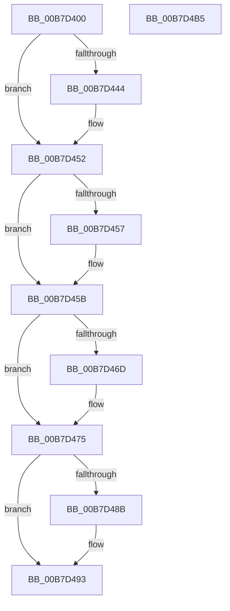

# PfpScenCtxQueryScenarioInformation

- RVA: `0x00B7D400`–`0x00B7D4B6` (길이 `182` bytes)
- VA: `0x0000000140B7D400`
- 실행 섹션: `PAGELK`
- PDB 이름 있음: `예`; PDB Function 태그: `아니요`
- unwind 정보 RVA: `0x0005C954`
- 디코드: `50`개 명령, `182/182` bytes 표시
- 미해석 바이트: `0` (있으면 어셈블리에 `.byte`로 보존)

> 이 문서는 커널 이미지의 기계어와 PDB 기호를 분석해 생성했습니다. 4번과 5번은 함수 원형과 자료형을 바이너리 사용 방식에서 추정한 C 해석이며 원본 소스 복구 결과는 아닙니다.

## 1. Dependencies

- 직접 호출 지점: **6**; 고유 호출 대상: **6**
- 직접 호출자로 확인된 함수: **1**
- RIP 상대 이미지 참조: **0**

### Outgoing calls
- `0x00B7D434` → [KeAbPreAcquire](../../text/21/KeAbPreAcquire_function_00210230.md) (function, `0x00210230`)
- `0x00B7D44D` → [ExfAcquirePushLockExclusiveEx](../../text/20/ExfAcquirePushLockExclusiveEx_function_0020FC90.md) (function, `0x0020FC90`)
- `0x00B7D479` → [KeResetEvent](../../text/24/KeResetEvent_function_00248350.md) (function, `0x00248350`)
- `0x00B7D48E` → [ExfTryToWakePushLock](../../text/26/ExfTryToWakePushLock_function_00265DD0.md) (function, `0x00265DD0`)
- `0x00B7D496` → [KeAbPostRelease](../../text/2E/KeAbPostRelease_function_002E1600.md) (function, `0x002E1600`)
- `0x00B7D49B` → [KeLeaveCriticalRegion](../../text/25/KeLeaveCriticalRegion_function_0025D8B0.md) (function, `0x0025D8B0`)

### Direct callers
- [PfpQueryScenarioInformation](../../page/AD/PfpQueryScenarioInformation_function_00AD5324.md) at `0x00AD53BA`

### Static image references
- 디코드된 RIP-relative 메모리 참조가 없습니다.

## 2. Other-region calls and transfers

- 다른 실행 섹션으로 향하는 call: **6**
  - `0x00B7D434` → [KeAbPreAcquire](../../text/21/KeAbPreAcquire_function_00210230.md) (`PAGELK` → `.text`)
  - `0x00B7D44D` → [ExfAcquirePushLockExclusiveEx](../../text/20/ExfAcquirePushLockExclusiveEx_function_0020FC90.md) (`PAGELK` → `.text`)
  - `0x00B7D479` → [KeResetEvent](../../text/24/KeResetEvent_function_00248350.md) (`PAGELK` → `.text`)
  - `0x00B7D48E` → [ExfTryToWakePushLock](../../text/26/ExfTryToWakePushLock_function_00265DD0.md) (`PAGELK` → `.text`)
  - `0x00B7D496` → [KeAbPostRelease](../../text/2E/KeAbPostRelease_function_002E1600.md) (`PAGELK` → `.text`)
  - `0x00B7D49B` → [KeLeaveCriticalRegion](../../text/25/KeLeaveCriticalRegion_function_0025D8B0.md) (`PAGELK` → `.text`)
- 별도 외부 분기/꼬리 이동을 확인하지 못했습니다.

## 3. Assembly (complete function range)

```asm
00B7D400  48 89 5C 24 08                  mov qword ptr [rsp + 8], rbx
00B7D405  48 89 6C 24 10                  mov qword ptr [rsp + 0x10], rbp
00B7D40A  48 89 74 24 18                  mov qword ptr [rsp + 0x18], rsi
00B7D40F  57                              push rdi
00B7D410  48 83 EC 20                     sub rsp, 0x20
00B7D414  65 48 8B 04 25 88 01 00 00      mov rax, qword ptr gs:[0x188]
00B7D41D  48 8B EA                        mov rbp, rdx
00B7D420  48 83 CB FF                     or rbx, 0xffffffffffffffff
00B7D424  45 33 C0                        xor r8d, r8d
00B7D427  33 D2                           xor edx, edx
00B7D429  48 8B F9                        mov rdi, rcx
00B7D42C  66 01 98 E4 01 00 00            add word ptr [rax + 0x1e4], bx
00B7D433  90                              nop
00B7D434  E8 F7 2D 69 FF                  call 0x140210230
00B7D439  F0 48 0F BA 2F 00               lock bts qword ptr [rdi], 0
00B7D43F  48 8B F0                        mov rsi, rax
00B7D442  73 0E                           jae 0x140b7d452
00B7D444  4C 8B C7                        mov r8, rdi
00B7D447  48 8B D0                        mov rdx, rax
00B7D44A  48 8B CF                        mov rcx, rdi
00B7D44D  E8 3E 28 69 FF                  call 0x14020fc90
00B7D452  48 85 F6                        test rsi, rsi
00B7D455  74 04                           je 0x140b7d45b
00B7D457  C6 46 0A 01                     mov byte ptr [rsi + 0xa], 1
00B7D45B  8B 47 30                        mov eax, dword ptr [rdi + 0x30]
00B7D45E  89 45 04                        mov dword ptr [rbp + 4], eax
00B7D461  8B 47 34                        mov eax, dword ptr [rdi + 0x34]
00B7D464  89 45 0C                        mov dword ptr [rbp + 0xc], eax
00B7D467  83 7F 30 03                     cmp dword ptr [rdi + 0x30], 3
00B7D46B  75 08                           jne 0x140b7d475
00B7D46D  48 8B 47 38                     mov rax, qword ptr [rdi + 0x38]
00B7D471  48 89 45 18                     mov qword ptr [rbp + 0x18], rax
00B7D475  48 8B 4F 40                     mov rcx, qword ptr [rdi + 0x40]
00B7D479  E8 D2 AE 6C FF                  call 0x140248350
00B7D47E  F0 48 0F C1 1F                  lock xadd qword ptr [rdi], rbx
00B7D483  80 E3 06                        and bl, 6
00B7D486  80 FB 02                        cmp bl, 2
00B7D489  75 08                           jne 0x140b7d493
00B7D48B  48 8B CF                        mov rcx, rdi
00B7D48E  E8 3D 89 6E FF                  call 0x140265dd0
00B7D493  48 8B CF                        mov rcx, rdi
00B7D496  E8 65 41 76 FF                  call 0x1402e1600
00B7D49B  E8 10 04 6E FF                  call 0x14025d8b0
00B7D4A0  48 8B 5C 24 30                  mov rbx, qword ptr [rsp + 0x30]
00B7D4A5  48 8B 6C 24 38                  mov rbp, qword ptr [rsp + 0x38]
00B7D4AA  48 8B 74 24 40                  mov rsi, qword ptr [rsp + 0x40]
00B7D4AF  48 83 C4 20                     add rsp, 0x20
00B7D4B3  5F                              pop rdi
00B7D4B4  C3                              ret
00B7D4B5  CC                              int3
```

## 4. C-style interpretation (structured pseudocode)

```c
__int64 __fastcall PfpScenCtxQueryScenarioInformation(__int64 a1, __int64 a2, int a3)
{
    __int64 result;
    __int64 v_rbx;
    __int64 v_rsp;
    unsigned __int64 v_stack_p10;
    unsigned __int64 v_stack_p18;
    unsigned __int64 v_stack_p8;

    v_stack_p8 = v_rbx;
    v_stack_p10 = v_rbp;
    v_stack_p18 = v_rsi;
    v_rsp = (v_rsp) - (32);
    v_rbx = (v_rbx) | (-1);
    a3 = 0;
    a2 = 0;
    result = KeAbPreAcquire(a1, a2, a3, a4);
    if (!(condition_is_above_or_equal)) {
        a3 = a1;
        a2 = result;
        a1 = a1;
        result = ExfAcquirePushLockExclusiveEx(a1, a2, a3, a4);
    }
    if (result != 0) {
        *(unsigned __int8 *)(result + 10) = 1;
    }
    *(unsigned int *)(a2 + 4) = (unsigned int)((unsigned int)(*(unsigned int *)(a1 + 48)));
    *(unsigned int *)(a2 + 12) = (unsigned int)((unsigned int)(*(unsigned int *)(a1 + 52)));
    result = (unsigned int)(*(unsigned int *)(a1 + 52));
    if ((*(unsigned int *)(a1 + 48)) == 3) {
        result = *(unsigned __int64 *)(a1 + 56);
        *(unsigned __int64 *)(a2 + 24) = result;
    }
    result = KeResetEvent(*(unsigned __int64 *)(a1 + 64), a2, a3, a4);
    v_rbx = (unsigned __int8)((v_rbx) & (6));
    if (((unsigned __int8)(v_rbx)) == 2) {
        a1 = a1;
        result = ExfTryToWakePushLock(a1, a2, a3, a4);
    }
    result = KeAbPostRelease(a1, a2, a3, a4);
    result = KeLeaveCriticalRegion(a1, a2, a3, a4);
    v_rsp = (v_rsp) + (32);
    return result;
}
```

## 5. (Beta) C Style

```c
int64_t PfpScenCtxQueryScenarioInformation(void *Arg1, void *Arg2, int32_t Arg3)
{
    uint8_t *arg1 = (uint8_t *)Arg1;
    uint8_t *arg2 = (uint8_t *)Arg2;

    int64_t result;
    int64_t local_rbx;
    int64_t local_rsp;
    uint64_t v_stack_p10;
    uint64_t v_stack_p18;
    uint64_t v_stack_p8;

    v_stack_p8 = local_rbx;
    v_stack_p10 = local_rbp;
    v_stack_p18 = local_rsi;
    local_rsp = (local_rsp) - (32);
    local_rbx = (local_rbx) | (-1);
    Arg3 = 0;
    Arg2 = 0;
    result = KeAbPreAcquire(Arg1, Arg2, Arg3, a4);
    if (!(condition_is_above_or_equal)) {
        Arg3 = Arg1;
        Arg2 = result;
        Arg1 = Arg1;
        result = ExfAcquirePushLockExclusiveEx(Arg1, Arg2, Arg3, a4);
    }
    if (result != 0) {
        *(uint8_t *)(result + 0xA) = 1;
    }
    *(uint32_t *)(arg2 + 0x4) = (uint32_t)((uint32_t)(*(uint32_t *)(arg1 + 0x30)));
    *(uint32_t *)(arg2 + 0xC) = (uint32_t)((uint32_t)(*(uint32_t *)(arg1 + 0x34)));
    result = (uint32_t)(*(uint32_t *)(arg1 + 0x34));
    if ((*(uint32_t *)(arg1 + 0x30)) == 3) {
        result = *(uint64_t *)(arg1 + 0x38);
        *(uint64_t *)(arg2 + 0x18) = result;
    }
    result = KeResetEvent(*(uint64_t *)(arg1 + 0x40), Arg2, Arg3, a4);
    local_rbx = (uint8_t)((local_rbx) & (6));
    if (((uint8_t)(local_rbx)) == 2) {
        Arg1 = Arg1;
        result = ExfTryToWakePushLock(Arg1, Arg2, Arg3, a4);
    }
    result = KeAbPostRelease(Arg1, Arg2, Arg3, a4);
    result = KeLeaveCriticalRegion(Arg1, Arg2, Arg3, a4);
    local_rsp = (local_rsp) + (32);
    return result;
}
```

### 관측된 메모리 오프셋

구조체 형식이 확인되지 않은 접근은 인자 기준의 오프셋으로만 기록했습니다.

| 기준 인자 | 오프셋 표현 | 폭 (bit) | 접근 |
|---|---:|---:|---|
| `Arg1` | `+ 0x0` | `64` | `R/W` |
| `Arg1` | `+ 0x30` | `32` | `R` |
| `Arg1` | `+ 0x34` | `32` | `R` |
| `Arg1` | `+ 0x38` | `64` | `R` |
| `Arg1` | `+ 0x40` | `64` | `R` |
| `Arg2` | `+ 0x4` | `32` | `W` |
| `Arg2` | `+ 0xC` | `32` | `W` |
| `Arg2` | `+ 0x18` | `64` | `W` |

## 6. Execution-region graph

[열기: 2D/3D 그래프와 함수 탐색 컨트롤 패널](../../../control-panel.html?section=pagelk&rva=0x00B7D400&view=graph)

- 2D 그래프는 위에서 아래로 흐르고, 3D 그래프는 빈 공간을 드래그해 회전합니다. Shift+드래그는 이동, 휠은 확대·축소, 함수 노드 선택은 대상 보고서 이동입니다.

### Static fallback


