# PfpScenCtxScenarioSet

- RVA: `0x00B7CFF0`–`0x00B7D178` (길이 `392` bytes)
- VA: `0x0000000140B7CFF0`
- 실행 섹션: `PAGELK`
- PDB 이름 있음: `예`; PDB Function 태그: `아니요`
- unwind 정보 RVA: `0x0008A668`
- 디코드: `114`개 명령, `392/392` bytes 표시
- 미해석 바이트: `0` (있으면 어셈블리에 `.byte`로 보존)

> 이 문서는 커널 이미지의 기계어와 PDB 기호를 분석해 생성했습니다. 4번과 5번은 함수 원형과 자료형을 바이너리 사용 방식에서 추정한 C 해석이며 원본 소스 복구 결과는 아닙니다.

## 1. Dependencies

- 직접 호출 지점: **13**; 고유 호출 대상: **13**
- 직접 호출자로 확인된 함수: **2**
- RIP 상대 이미지 참조: **0**

### Outgoing calls
- `0x00B7D036` → [PfpServiceMainThreadBoostPrep](../../page/AC/PfpServiceMainThreadBoostPrep_function_00ACB08C.md) (function, `0x00ACB08C`)
- `0x00B7D058` → [KeAbPreAcquire](../../text/21/KeAbPreAcquire_function_00210230.md) (function, `0x00210230`)
- `0x00B7D071` → [ExfAcquirePushLockExclusiveEx](../../text/20/ExfAcquirePushLockExclusiveEx_function_0020FC90.md) (function, `0x0020FC90`)
- `0x00B7D0A2` → [PfpScenCtxPrefetchStateSet](../B6/PfpScenCtxPrefetchStateSet_function_00B6B4A8.md) (function, `0x00B6B4A8`)
- `0x00B7D0AA` → [PfpScenCtxWaiterTimedOut](../../text/5C/PfpScenCtxWaiterTimedOut_function_005CDB80.md) (function, `0x005CDB80`)
- `0x00B7D0BF` → [PfpScenCtxPrefetchAbortSet](../B6/PfpScenCtxPrefetchAbortSet_function_00B6B3B0.md) (function, `0x00B6B3B0`)
- `0x00B7D0FA` → [PfpServiceMainThreadBoost](../../text/5C/PfpServiceMainThreadBoost_function_005CDBB0.md) (function, `0x005CDBB0`)
- `0x00B7D111` → [KeSetEvent](../../text/33/KeSetEvent_function_0033F310.md) (function, `0x0033F310`)
- `0x00B7D126` → [ExfTryToWakePushLock](../../text/26/ExfTryToWakePushLock_function_00265DD0.md) (function, `0x00265DD0`)
- `0x00B7D12E` → [KeAbPostRelease](../../text/2E/KeAbPostRelease_function_002E1600.md) (function, `0x002E1600`)
- `0x00B7D133` → [KeLeaveCriticalRegion](../../text/25/KeLeaveCriticalRegion_function_0025D8B0.md) (function, `0x0025D8B0`)
- `0x00B7D142` → [ObDereferenceObjectDeferDelete](../../text/3F/ObDereferenceObjectDeferDelete_function_003FCE40.md) (function, `0x003FCE40`)
- `0x00B7D153` → [ExFreePoolWithTag](../../poolcode/B8/ExFreePoolWithTag_function_00B82870.md) (function, `0x00B82870`)

### Direct callers
- [sub_00B47AE6](../../page/B4/Unknown_function_00B47AE6.md) at `0x00B47B1A`
- [sub_00B47AE6](../../page/B4/Unknown_function_00B47AE6.md) at `0x00B47C2C`
- [sub_00B80CFE](../B8/Unknown_function_00B80CFE.md) at `0x00B80D0D`
- [sub_00B80CFE](../B8/Unknown_function_00B80CFE.md) at `0x00B80D23`
- [sub_00B80CFE](../B8/Unknown_function_00B80CFE.md) at `0x00B80D37`
- [sub_00B80CFE](../B8/Unknown_function_00B80CFE.md) at `0x00B80DD1`

### Static image references
- 디코드된 RIP-relative 메모리 참조가 없습니다.

## 2. Other-region calls and transfers

- 다른 실행 섹션으로 향하는 call: **11**
  - `0x00B7D036` → [PfpServiceMainThreadBoostPrep](../../page/AC/PfpServiceMainThreadBoostPrep_function_00ACB08C.md) (`PAGELK` → `PAGE`)
  - `0x00B7D058` → [KeAbPreAcquire](../../text/21/KeAbPreAcquire_function_00210230.md) (`PAGELK` → `.text`)
  - `0x00B7D071` → [ExfAcquirePushLockExclusiveEx](../../text/20/ExfAcquirePushLockExclusiveEx_function_0020FC90.md) (`PAGELK` → `.text`)
  - `0x00B7D0AA` → [PfpScenCtxWaiterTimedOut](../../text/5C/PfpScenCtxWaiterTimedOut_function_005CDB80.md) (`PAGELK` → `.text`)
  - `0x00B7D0FA` → [PfpServiceMainThreadBoost](../../text/5C/PfpServiceMainThreadBoost_function_005CDBB0.md) (`PAGELK` → `.text`)
  - `0x00B7D111` → [KeSetEvent](../../text/33/KeSetEvent_function_0033F310.md) (`PAGELK` → `.text`)
  - `0x00B7D126` → [ExfTryToWakePushLock](../../text/26/ExfTryToWakePushLock_function_00265DD0.md) (`PAGELK` → `.text`)
  - `0x00B7D12E` → [KeAbPostRelease](../../text/2E/KeAbPostRelease_function_002E1600.md) (`PAGELK` → `.text`)
  - `0x00B7D133` → [KeLeaveCriticalRegion](../../text/25/KeLeaveCriticalRegion_function_0025D8B0.md) (`PAGELK` → `.text`)
  - `0x00B7D142` → [ObDereferenceObjectDeferDelete](../../text/3F/ObDereferenceObjectDeferDelete_function_003FCE40.md) (`PAGELK` → `.text`)
  - `0x00B7D153` → [ExFreePoolWithTag](../../poolcode/B8/ExFreePoolWithTag_function_00B82870.md) (`PAGELK` → `POOLCODE`)
- 별도 외부 분기/꼬리 이동을 확인하지 못했습니다.

## 3. Assembly (complete function range)

```asm
00B7CFF0  48 8B C4                        mov rax, rsp
00B7CFF3  48 89 58 08                     mov qword ptr [rax + 8], rbx
00B7CFF7  48 89 68 10                     mov qword ptr [rax + 0x10], rbp
00B7CFFB  48 89 70 18                     mov qword ptr [rax + 0x18], rsi
00B7CFFF  48 89 78 20                     mov qword ptr [rax + 0x20], rdi
00B7D003  41 54                           push r12
00B7D005  41 56                           push r14
00B7D007  41 57                           push r15
00B7D009  48 83 EC 40                     sub rsp, 0x40
00B7D00D  0F 57 C0                        xorps xmm0, xmm0
00B7D010  4D 8B E1                        mov r12, r9
00B7D013  0F 11 40 D8                     movups xmmword ptr [rax - 0x28], xmm0
00B7D017  41 8D 40 FF                     lea eax, [r8 - 1]
00B7D01B  41 8B F0                        mov esi, r8d
00B7D01E  44 8B FA                        mov r15d, edx
00B7D021  48 8B F9                        mov rdi, rcx
00B7D024  A9 FA FF FF FF                  test eax, 0xfffffffa
00B7D029  75 10                           jne 0x140b7d03b
00B7D02B  41 83 F8 06                     cmp r8d, 6
00B7D02F  74 0A                           je 0x140b7d03b
00B7D031  48 8D 54 24 30                  lea rdx, [rsp + 0x30]
00B7D036  E8 51 E0 F4 FF                  call 0x140acb08c
00B7D03B  65 48 8B 04 25 88 01 00 00      mov rax, qword ptr gs:[0x188]
00B7D044  48 83 CB FF                     or rbx, 0xffffffffffffffff
00B7D048  45 33 C0                        xor r8d, r8d
00B7D04B  33 D2                           xor edx, edx
00B7D04D  48 8B CF                        mov rcx, rdi
00B7D050  66 01 98 E4 01 00 00            add word ptr [rax + 0x1e4], bx
00B7D057  90                              nop
00B7D058  E8 D3 31 69 FF                  call 0x140210230
00B7D05D  F0 48 0F BA 2F 00               lock bts qword ptr [rdi], 0
00B7D063  4C 8B F0                        mov r14, rax
00B7D066  73 0E                           jae 0x140b7d076
00B7D068  4C 8B C7                        mov r8, rdi
00B7D06B  48 8B D0                        mov rdx, rax
00B7D06E  48 8B CF                        mov rcx, rdi
00B7D071  E8 1A 2C 69 FF                  call 0x14020fc90
00B7D076  BD 01 00 00 00                  mov ebp, 1
00B7D07B  4D 85 F6                        test r14, r14
00B7D07E  74 04                           je 0x140b7d084
00B7D080  41 88 6E 0A                     mov byte ptr [r14 + 0xa], bpl
00B7D084  85 F6                           test esi, esi
00B7D086  75 0A                           jne 0x140b7d092
00B7D088  44 39 7F 30                     cmp dword ptr [rdi + 0x30], r15d
00B7D08C  0F 85 84 00 00 00               jne 0x140b7d116
00B7D092  8B 57 30                        mov edx, dword ptr [rdi + 0x30]
00B7D095  85 D2                           test edx, edx
00B7D097  74 2F                           je 0x140b7d0c8
00B7D099  44 8B CD                        mov r9d, ebp
00B7D09C  45 33 C0                        xor r8d, r8d
00B7D09F  48 8B CF                        mov rcx, rdi
00B7D0A2  E8 01 E4 FE FF                  call 0x140b6b4a8
00B7D0A7  48 8B CF                        mov rcx, rdi
00B7D0AA  E8 D1 0A A5 FF                  call 0x1405cdb80
00B7D0AF  8B 57 30                        mov edx, dword ptr [rdi + 0x30]
00B7D0B2  44 8B CD                        mov r9d, ebp
00B7D0B5  45 33 C0                        xor r8d, r8d
00B7D0B8  89 6C 24 20                     mov dword ptr [rsp + 0x20], ebp
00B7D0BC  48 8B CF                        mov rcx, rdi
00B7D0BF  E8 EC E2 FE FF                  call 0x140b6b3b0
00B7D0C4  83 67 08 F3                     and dword ptr [rdi + 8], 0xfffffff3
00B7D0C8  83 7F 30 00                     cmp dword ptr [rdi + 0x30], 0
00B7D0CC  75 09                           jne 0x140b7d0d7
00B7D0CE  85 F6                           test esi, esi
00B7D0D0  75 05                           jne 0x140b7d0d7
00B7D0D2  89 77 30                        mov dword ptr [rdi + 0x30], esi
00B7D0D5  EB 3F                           jmp 0x140b7d116
00B7D0D7  89 77 30                        mov dword ptr [rdi + 0x30], esi
00B7D0DA  85 F6                           test esi, esi
00B7D0DC  74 2A                           je 0x140b7d108
00B7D0DE  01 6F 34                        add dword ptr [rdi + 0x34], ebp
00B7D0E1  83 FE 03                        cmp esi, 3
00B7D0E4  75 04                           jne 0x140b7d0ea
00B7D0E6  4C 89 67 38                     mov qword ptr [rdi + 0x38], r12
00B7D0EA  48 83 7C 24 30 00               cmp qword ptr [rsp + 0x30], 0
00B7D0F0  74 11                           je 0x140b7d103
00B7D0F2  48 8D 54 24 30                  lea rdx, [rsp + 0x30]
00B7D0F7  48 8B CF                        mov rcx, rdi
00B7D0FA  E8 B1 0A A5 FF                  call 0x1405cdbb0
00B7D0FF  33 ED                           xor ebp, ebp
00B7D101  EB 05                           jmp 0x140b7d108
00B7D103  BD 04 00 00 00                  mov ebp, 4
00B7D108  48 8B 4F 40                     mov rcx, qword ptr [rdi + 0x40]
00B7D10C  45 33 C0                        xor r8d, r8d
00B7D10F  8B D5                           mov edx, ebp
00B7D111  E8 FA 21 7C FF                  call 0x14033f310
00B7D116  F0 48 0F C1 1F                  lock xadd qword ptr [rdi], rbx
00B7D11B  80 E3 06                        and bl, 6
00B7D11E  80 FB 02                        cmp bl, 2
00B7D121  75 08                           jne 0x140b7d12b
00B7D123  48 8B CF                        mov rcx, rdi
00B7D126  E8 A5 8C 6E FF                  call 0x140265dd0
00B7D12B  48 8B CF                        mov rcx, rdi
00B7D12E  E8 CD 44 76 FF                  call 0x1402e1600
00B7D133  E8 78 07 6E FF                  call 0x14025d8b0
00B7D138  48 8B 4C 24 30                  mov rcx, qword ptr [rsp + 0x30]
00B7D13D  48 85 C9                        test rcx, rcx
00B7D140  74 05                           je 0x140b7d147
00B7D142  E8 F9 FC 87 FF                  call 0x1403fce40
00B7D147  48 8B 4C 24 38                  mov rcx, qword ptr [rsp + 0x38]
00B7D14C  48 85 C9                        test rcx, rcx
00B7D14F  74 07                           je 0x140b7d158
00B7D151  33 D2                           xor edx, edx
00B7D153  E8 18 57 00 00                  call 0x140b82870
00B7D158  48 8B 5C 24 60                  mov rbx, qword ptr [rsp + 0x60]
00B7D15D  48 8B 6C 24 68                  mov rbp, qword ptr [rsp + 0x68]
00B7D162  48 8B 74 24 70                  mov rsi, qword ptr [rsp + 0x70]
00B7D167  48 8B 7C 24 78                  mov rdi, qword ptr [rsp + 0x78]
00B7D16C  48 83 C4 40                     add rsp, 0x40
00B7D170  41 5F                           pop r15
00B7D172  41 5E                           pop r14
00B7D174  41 5C                           pop r12
00B7D176  C3                              ret
00B7D177  CC                              int3
```

## 4. C-style interpretation (structured pseudocode)

```c
__int64 __fastcall PfpScenCtxScenarioSet(__int64 a1, int a2, __int64 a3, __int64 a4)
{
    __int64 result;
    __int64 v_rbp;
    __int64 v_rbx;
    __int64 v_rsp;
    unsigned __int64 v_stack_m20;
    unsigned __int64 v_stack_m28;
    unsigned int v_stack_m38;
    unsigned __int64 v_stack_p10;
    unsigned __int64 v_stack_p18;
    unsigned __int64 v_stack_p20;
    unsigned __int64 v_stack_p8;

    *(unsigned __int64 *)(v_rsp + 8) = v_rbx;
    *(unsigned __int64 *)(v_rsp + 16) = v_rbp;
    *(unsigned __int64 *)(v_rsp + 24) = v_rsi;
    *(unsigned __int64 *)(v_rsp + 32) = v_rdi;
    v_rsp = (v_rsp) - (64);
    *(unsigned __int64 *)(v_rsp - 40) = v_xmm0;
    if ((((unsigned int)(a3 - 1)) & (0xFFFFFFFAULL)) != 0) goto loc_00B7D03B;
    result = a3 - 1;
    if (((unsigned int)(a3)) != 6) {
        a2 = v_stack_m28;
        result = PfpServiceMainThreadBoostPrep(a1, a2, a3, a4);
    }
    v_rbx = (v_rbx) | (-1);
    a3 = 0;
    a2 = 0;
    result = KeAbPreAcquire(a1, a2, a3, a4);
    if (!(condition_is_above_or_equal)) {
        a3 = a1;
        a2 = result;
        a1 = a1;
        result = ExfAcquirePushLockExclusiveEx(a1, a2, a3, a4);
    }
    if (result != 0) {
        *(unsigned __int8 *)(result + 10) = 1;
    }
    if ((unsigned int)((unsigned int)((unsigned int)(a3))) != 0) goto loc_00B7D092;
    if ((*(unsigned int *)(a1 + 48)) != ((unsigned int)((unsigned int)(a2)))) goto loc_00B7D116;
loc_00B7D092:
    if ((unsigned int)((unsigned int)(*(unsigned int *)(a1 + 48))) != 0) {
        a4 = 1;
        a3 = 0;
        a1 = a1;
        result = PfpScenCtxPrefetchStateSet(a1, (unsigned int)(*(unsigned int *)(a1 + 48)), a3, a4);
        a1 = a1;
        result = PfpScenCtxWaiterTimedOut(a1, (unsigned int)(*(unsigned int *)(a1 + 48)), a3, a4);
        a2 = *(unsigned int *)(a1 + 48);
        a4 = 1;
        a3 = 0;
        v_stack_m38 = 1;
        a1 = a1;
        result = PfpScenCtxPrefetchAbortSet(a1, a2, a3, a4);
    }
    if ((*(unsigned int *)(a1 + 48)) != 0) goto loc_00B7D0D7;
    if ((unsigned int)((unsigned int)((unsigned int)(a3))) != 0) goto loc_00B7D0D7;
    *(unsigned int *)(a1 + 48) = (unsigned int)((unsigned int)((unsigned int)(a3)));
    goto loc_00B7D116;
loc_00B7D0D7:
    *(unsigned int *)(a1 + 48) = (unsigned int)((unsigned int)((unsigned int)(a3)));
    if ((unsigned int)((unsigned int)((unsigned int)(a3))) == 0) goto loc_00B7D108;
    if (((unsigned int)((unsigned int)((unsigned int)(a3)))) == 3) {
        *(unsigned __int64 *)(a1 + 56) = a4;
    }
    if (v_stack_m28 == 0) goto loc_00B7D103;
    result = PfpServiceMainThreadBoost(a1, v_stack_m28, a3, a4);
    v_rbp = 0;
    goto loc_00B7D108;
loc_00B7D103:
loc_00B7D108:
    a3 = 0;
    result = KeSetEvent(*(unsigned __int64 *)(a1 + 64), 4, a3, a4);
loc_00B7D116:
    v_rbx = (unsigned __int8)((v_rbx) & (6));
    if (((unsigned __int8)(v_rbx)) == 2) {
        a1 = a1;
        result = ExfTryToWakePushLock(a1, 4, a3, a4);
    }
    result = KeAbPostRelease(a1, 4, a3, a4);
    result = KeLeaveCriticalRegion(a1, 4, a3, a4);
    if (v_stack_m28 != 0) {
        result = ObDereferenceObjectDeferDelete(v_stack_m28, 4, a3, a4);
    }
    if (v_stack_m20 != 0) {
        a2 = 0;
        result = ExFreePoolWithTag(v_stack_m20, a2, a3, a4);
    }
    v_rsp = (v_rsp) + (64);
    return result;
}
```

## 5. (Beta) C Style

```c
int64_t PfpScenCtxScenarioSet(void *Arg1, int32_t Arg2, void *Arg3, int64_t Arg4)
{
    uint8_t *arg1 = (uint8_t *)Arg1;
    uint8_t *arg3 = (uint8_t *)Arg3;

    int64_t result;
    int64_t local_rbp;
    int64_t local_rbx;
    int64_t local_rsp;
    uint64_t v_stack_m20;
    uint64_t v_stack_m28;
    uint32_t v_stack_m38;
    uint64_t v_stack_p10;
    uint64_t v_stack_p18;
    uint64_t v_stack_p20;
    uint64_t v_stack_p8;

    *(uint64_t *)(local_rsp + 0x8) = local_rbx;
    *(uint64_t *)(local_rsp + 0x10) = local_rbp;
    *(uint64_t *)(local_rsp + 0x18) = local_rsi;
    *(uint64_t *)(local_rsp + 0x20) = local_rdi;
    local_rsp = (local_rsp) - (64);
    *(uint64_t *)(local_rsp - 0x28) = v_xmm0;
    if ((((uint32_t)(Arg3 - 1)) & (0xFFFFFFFAULL)) != 0) goto loc_00B7D03B;
    result = Arg3 - 1;
    if (((uint32_t)(Arg3)) != 6) {
        Arg2 = v_stack_m28;
        result = PfpServiceMainThreadBoostPrep(Arg1, Arg2, Arg3, Arg4);
    }
    local_rbx = (local_rbx) | (-1);
    Arg3 = 0;
    Arg2 = 0;
    result = KeAbPreAcquire(Arg1, Arg2, Arg3, Arg4);
    if (!(condition_is_above_or_equal)) {
        Arg3 = Arg1;
        Arg2 = result;
        Arg1 = Arg1;
        result = ExfAcquirePushLockExclusiveEx(Arg1, Arg2, Arg3, Arg4);
    }
    if (result != 0) {
        *(uint8_t *)(result + 0xA) = 1;
    }
    if ((uint32_t)((uint32_t)((uint32_t)(Arg3))) != 0) goto loc_00B7D092;
    if ((*(uint32_t *)(arg1 + 0x30)) != ((uint32_t)((uint32_t)(Arg2)))) goto loc_00B7D116;
loc_00B7D092:
    if ((uint32_t)((uint32_t)(*(uint32_t *)(arg1 + 0x30))) != 0) {
        Arg4 = 1;
        Arg3 = 0;
        Arg1 = Arg1;
        result = PfpScenCtxPrefetchStateSet(Arg1, (uint32_t)(*(uint32_t *)(arg1 + 0x30)), Arg3, Arg4);
        Arg1 = Arg1;
        result = PfpScenCtxWaiterTimedOut(Arg1, (uint32_t)(*(uint32_t *)(arg1 + 0x30)), Arg3, Arg4);
        Arg2 = *(uint32_t *)(arg1 + 0x30);
        Arg4 = 1;
        Arg3 = 0;
        v_stack_m38 = 1;
        Arg1 = Arg1;
        result = PfpScenCtxPrefetchAbortSet(Arg1, Arg2, Arg3, Arg4);
    }
    if ((*(uint32_t *)(arg1 + 0x30)) != 0) goto loc_00B7D0D7;
    if ((uint32_t)((uint32_t)((uint32_t)(Arg3))) != 0) goto loc_00B7D0D7;
    *(uint32_t *)(arg1 + 0x30) = (uint32_t)((uint32_t)((uint32_t)(Arg3)));
    goto loc_00B7D116;
loc_00B7D0D7:
    *(uint32_t *)(arg1 + 0x30) = (uint32_t)((uint32_t)((uint32_t)(Arg3)));
    if ((uint32_t)((uint32_t)((uint32_t)(Arg3))) == 0) goto loc_00B7D108;
    if (((uint32_t)((uint32_t)((uint32_t)(Arg3)))) == 3) {
        *(uint64_t *)(arg1 + 0x38) = Arg4;
    }
    if (v_stack_m28 == 0) goto loc_00B7D103;
    result = PfpServiceMainThreadBoost(Arg1, v_stack_m28, Arg3, Arg4);
    local_rbp = 0;
    goto loc_00B7D108;
loc_00B7D103:
loc_00B7D108:
    Arg3 = 0;
    result = KeSetEvent(*(uint64_t *)(arg1 + 0x40), 4, Arg3, Arg4);
loc_00B7D116:
    local_rbx = (uint8_t)((local_rbx) & (6));
    if (((uint8_t)(local_rbx)) == 2) {
        Arg1 = Arg1;
        result = ExfTryToWakePushLock(Arg1, 4, Arg3, Arg4);
    }
    result = KeAbPostRelease(Arg1, 4, Arg3, Arg4);
    result = KeLeaveCriticalRegion(Arg1, 4, Arg3, Arg4);
    if (v_stack_m28 != 0) {
        result = ObDereferenceObjectDeferDelete(v_stack_m28, 4, Arg3, Arg4);
    }
    if (v_stack_m20 != 0) {
        Arg2 = 0;
        result = ExFreePoolWithTag(v_stack_m20, Arg2, Arg3, Arg4);
    }
    local_rsp = (local_rsp) + (64);
    return result;
}
```

### 관측된 메모리 오프셋

구조체 형식이 확인되지 않은 접근은 인자 기준의 오프셋으로만 기록했습니다.

| 기준 인자 | 오프셋 표현 | 폭 (bit) | 접근 |
|---|---:|---:|---|
| `Arg1` | `+ 0x0` | `64` | `R/W` |
| `Arg1` | `+ 0x8` | `32` | `R/W` |
| `Arg1` | `+ 0x30` | `32` | `R` |
| `Arg1` | `+ 0x30` | `32` | `W` |
| `Arg1` | `+ 0x34` | `32` | `R/W` |
| `Arg1` | `+ 0x38` | `64` | `W` |
| `Arg1` | `+ 0x40` | `64` | `R` |
| `Arg3` | `- 0x1` | `32` | `R` |

## 6. Execution-region graph

[열기: 2D/3D 그래프와 함수 탐색 컨트롤 패널](../../../control-panel.html?section=pagelk&rva=0x00B7CFF0&view=graph)

- 2D 그래프는 위에서 아래로 흐르고, 3D 그래프는 빈 공간을 드래그해 회전합니다. Shift+드래그는 이동, 휠은 확대·축소, 함수 노드 선택은 대상 보고서 이동입니다.

### Static fallback

```mermaid
flowchart TD
  bb_00B7CFF0[BB_00B7CFF0]
  bb_00B7D02B[BB_00B7D02B]
  bb_00B7D031[BB_00B7D031]
  bb_00B7D03B[BB_00B7D03B]
  bb_00B7D068[BB_00B7D068]
  bb_00B7D076[BB_00B7D076]
  bb_00B7D080[BB_00B7D080]
  bb_00B7D084[BB_00B7D084]
  bb_00B7D088[BB_00B7D088]
  bb_00B7D092[BB_00B7D092]
  bb_00B7D099[BB_00B7D099]
  bb_00B7D0C8[BB_00B7D0C8]
  bb_00B7D0CE[BB_00B7D0CE]
  bb_00B7D0D2[BB_00B7D0D2]
  bb_00B7D0D7[BB_00B7D0D7]
  bb_00B7D0DE[BB_00B7D0DE]
  bb_00B7D0E6[BB_00B7D0E6]
  bb_00B7D0EA[BB_00B7D0EA]
  bb_00B7D0F2[BB_00B7D0F2]
  bb_00B7D103[BB_00B7D103]
  bb_00B7D108[BB_00B7D108]
  bb_00B7D116[BB_00B7D116]
  bb_00B7D123[BB_00B7D123]
  bb_00B7D12B[BB_00B7D12B]
  bb_00B7D142[BB_00B7D142]
  bb_00B7D147[BB_00B7D147]
  bb_00B7D151[BB_00B7D151]
  bb_00B7D158[BB_00B7D158]
  bb_00B7D177[BB_00B7D177]
  bb_00B7CFF0 -->|branch| bb_00B7D03B
  bb_00B7CFF0 -->|fallthrough| bb_00B7D02B
  bb_00B7D02B -->|branch| bb_00B7D03B
  bb_00B7D02B -->|fallthrough| bb_00B7D031
  bb_00B7D031 -->|flow| bb_00B7D03B
  bb_00B7D03B -->|branch| bb_00B7D076
  bb_00B7D03B -->|fallthrough| bb_00B7D068
  bb_00B7D068 -->|flow| bb_00B7D076
  bb_00B7D076 -->|branch| bb_00B7D084
  bb_00B7D076 -->|fallthrough| bb_00B7D080
  bb_00B7D080 -->|flow| bb_00B7D084
  bb_00B7D084 -->|branch| bb_00B7D092
  bb_00B7D084 -->|fallthrough| bb_00B7D088
  bb_00B7D088 -->|branch| bb_00B7D116
  bb_00B7D088 -->|fallthrough| bb_00B7D092
  bb_00B7D092 -->|branch| bb_00B7D0C8
  bb_00B7D092 -->|fallthrough| bb_00B7D099
  bb_00B7D099 -->|flow| bb_00B7D0C8
  bb_00B7D0C8 -->|branch| bb_00B7D0D7
  bb_00B7D0C8 -->|fallthrough| bb_00B7D0CE
  bb_00B7D0CE -->|branch| bb_00B7D0D7
  bb_00B7D0CE -->|fallthrough| bb_00B7D0D2
  bb_00B7D0D2 -->|branch| bb_00B7D116
  bb_00B7D0D7 -->|branch| bb_00B7D108
  bb_00B7D0D7 -->|fallthrough| bb_00B7D0DE
  bb_00B7D0DE -->|branch| bb_00B7D0EA
  bb_00B7D0DE -->|fallthrough| bb_00B7D0E6
  bb_00B7D0E6 -->|flow| bb_00B7D0EA
  bb_00B7D0EA -->|branch| bb_00B7D103
  bb_00B7D0EA -->|fallthrough| bb_00B7D0F2
  bb_00B7D0F2 -->|branch| bb_00B7D108
  bb_00B7D103 -->|flow| bb_00B7D108
  bb_00B7D108 -->|flow| bb_00B7D116
  bb_00B7D116 -->|branch| bb_00B7D12B
  bb_00B7D116 -->|fallthrough| bb_00B7D123
  bb_00B7D123 -->|flow| bb_00B7D12B
  bb_00B7D12B -->|branch| bb_00B7D147
  bb_00B7D12B -->|fallthrough| bb_00B7D142
  bb_00B7D142 -->|flow| bb_00B7D147
  bb_00B7D147 -->|branch| bb_00B7D158
  bb_00B7D147 -->|fallthrough| bb_00B7D151
  bb_00B7D151 -->|flow| bb_00B7D158
```


