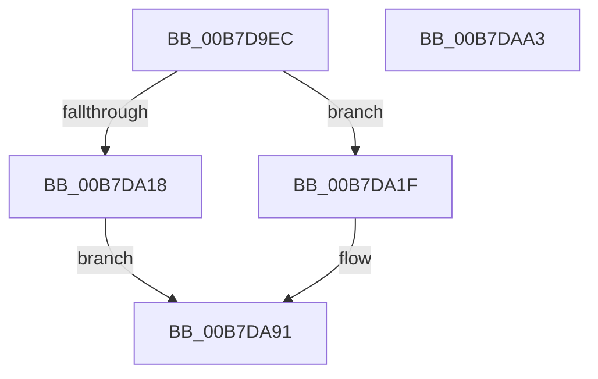

# PfpStartLoggingHardFaultEvents

- RVA: `0x00B7D9EC`–`0x00B7DAA4` (길이 `184` bytes)
- VA: `0x0000000140B7D9EC`
- 실행 섹션: `PAGELK`
- PDB 이름 있음: `예`; PDB Function 태그: `아니요`
- unwind 정보 RVA: `0x000794E0`
- 디코드: `44`개 명령, `184/184` bytes 표시
- 미해석 바이트: `0` (있으면 어셈블리에 `.byte`로 보존)

> 이 문서는 커널 이미지의 기계어와 PDB 기호를 분석해 생성했습니다. 4번과 5번은 함수 원형과 자료형을 바이너리 사용 방식에서 추정한 C 해석이며 원본 소스 복구 결과는 아닙니다.

## 1. Dependencies

- 직접 호출 지점: **6**; 고유 호출 대상: **6**
- 직접 호출자로 확인된 함수: **1**
- RIP 상대 이미지 참조: **5**

### Outgoing calls
- `0x00B7DA09` → [ExAllocatePool2](../../poolcode/B8/ExAllocatePool2_function_00B820F0.md) (function, `0x00B820F0`)
- `0x00B7DA2C` → [KeAcquireSpinLockRaiseToDpc](../../text/20/KeAcquireSpinLockRaiseToDpc_function_00208470.md) (function, `0x00208470`)
- `0x00B7DA56` → [KeReleaseSpinLock](../../text/39/KeReleaseSpinLock_function_00392BA0.md) (function, `0x00392BA0`)
- `0x00B7DA5F` → [KeInitializeTimer](../../text/45/KeInitializeTimer_function_0045B590.md) (function, `0x0045B590`)
- `0x00B7DA71` → [KeInitializeDpc](../../text/45/KeInitializeDpc_function_0045BBD0.md) (function, `0x0045BBD0`)
- `0x00B7DA8C` → [KiSetTimerEx](../../text/23/KiSetTimerEx_function_00232CB0.md) (function, `0x00232CB0`)

### Direct callers
- [sub_00B80CFE](../B8/Unknown_function_00B80CFE.md) at `0x00B80D3C`

### Static image references
- `0x00B7DA1F` → RVA `0x00E67138` (`.data`; read)
- `0x00B7DA31` → RVA `0x00E67144` (`.data`; read)
- `0x00B7DA39` → RVA `0x00E67144` (`.data`; write)
- `0x00B7DA45` → RVA `0x00F0F22C` (`.data`; read/write)
- `0x00B7DA67` → RVA `0x005CDAE0` (`PfpPowerActionDpcRoutine`; read)

## 2. Other-region calls and transfers

- 다른 실행 섹션으로 향하는 call: **6**
  - `0x00B7DA09` → [ExAllocatePool2](../../poolcode/B8/ExAllocatePool2_function_00B820F0.md) (`PAGELK` → `POOLCODE`)
  - `0x00B7DA2C` → [KeAcquireSpinLockRaiseToDpc](../../text/20/KeAcquireSpinLockRaiseToDpc_function_00208470.md) (`PAGELK` → `.text`)
  - `0x00B7DA56` → [KeReleaseSpinLock](../../text/39/KeReleaseSpinLock_function_00392BA0.md) (`PAGELK` → `.text`)
  - `0x00B7DA5F` → [KeInitializeTimer](../../text/45/KeInitializeTimer_function_0045B590.md) (`PAGELK` → `.text`)
  - `0x00B7DA71` → [KeInitializeDpc](../../text/45/KeInitializeDpc_function_0045BBD0.md) (`PAGELK` → `.text`)
  - `0x00B7DA8C` → [KiSetTimerEx](../../text/23/KiSetTimerEx_function_00232CB0.md) (`PAGELK` → `.text`)
- 별도 외부 분기/꼬리 이동을 확인하지 못했습니다.

## 3. Assembly (complete function range)

```asm
00B7D9EC  48 89 5C 24 08                  mov qword ptr [rsp + 8], rbx
00B7D9F1  48 89 74 24 10                  mov qword ptr [rsp + 0x10], rsi
00B7D9F6  57                              push rdi
00B7D9F7  48 83 EC 30                     sub rsp, 0x30
00B7D9FB  BA A8 00 00 00                  mov edx, 0xa8
00B7DA00  41 B8 50 66 50 44               mov r8d, 0x44506650
00B7DA06  8D 4A 98                        lea ecx, [rdx - 0x68]
00B7DA09  E8 E2 46 00 00                  call 0x140b820f0
00B7DA0E  33 FF                           xor edi, edi
00B7DA10  48 8B F0                        mov rsi, rax
00B7DA13  48 85 C0                        test rax, rax
00B7DA16  75 07                           jne 0x140b7da1f
00B7DA18  BF 9A 00 00 C0                  mov edi, 0xc000009a
00B7DA1D  EB 72                           jmp 0x140b7da91
00B7DA1F  48 8D 0D 12 97 2E 00            lea rcx, [rip + 0x2e9712]
00B7DA26  89 B8 A0 00 00 00               mov dword ptr [rax + 0xa0], edi
00B7DA2C  E8 3F AA 68 FF                  call 0x140208470
00B7DA31  8B 15 0D 97 2E 00               mov edx, dword ptr [rip + 0x2e970d]
00B7DA37  FF C2                           inc edx
00B7DA39  89 15 05 97 2E 00               mov dword ptr [rip + 0x2e9705], edx
00B7DA3F  89 96 A4 00 00 00               mov dword ptr [rsi + 0xa4], edx
00B7DA45  F0 83 0D DF 17 39 00 01         lock or dword ptr [rip + 0x3917df], 1
00B7DA4D  8A D0                           mov dl, al
00B7DA4F  48 8D 0D E2 96 2E 00            lea rcx, [rip + 0x2e96e2]
00B7DA56  E8 45 51 81 FF                  call 0x140392ba0
00B7DA5B  48 8D 4E 40                     lea rcx, [rsi + 0x40]
00B7DA5F  E8 2C DB 8D FF                  call 0x14045b590
00B7DA64  4C 8B C6                        mov r8, rsi
00B7DA67  48 8D 15 72 00 A5 FF            lea rdx, [rip - 0x5aff8e]
00B7DA6E  48 8B CE                        mov rcx, rsi
00B7DA71  E8 5A E1 8D FF                  call 0x14045bbd0
00B7DA76  45 33 C9                        xor r9d, r9d
00B7DA79  48 89 74 24 20                  mov qword ptr [rsp + 0x20], rsi
00B7DA7E  45 33 C0                        xor r8d, r8d
00B7DA81  48 8D 4E 40                     lea rcx, [rsi + 0x40]
00B7DA85  48 C7 C2 00 3E 14 F4            mov rdx, 0xfffffffff4143e00
00B7DA8C  E8 1F 52 6B FF                  call 0x140232cb0
00B7DA91  48 8B 5C 24 40                  mov rbx, qword ptr [rsp + 0x40]
00B7DA96  8B C7                           mov eax, edi
00B7DA98  48 8B 74 24 48                  mov rsi, qword ptr [rsp + 0x48]
00B7DA9D  48 83 C4 30                     add rsp, 0x30
00B7DAA1  5F                              pop rdi
00B7DAA2  C3                              ret
00B7DAA3  CC                              int3
```

## 4. C-style interpretation (structured pseudocode)

```c
__int64 __fastcall PfpStartLoggingHardFaultEvents(__int64 a1, __int64 a2, __int64 a3, int a4)
{
    __int64 result;
    __int64 v_rdi;
    __int64 v_rsp;
    unsigned __int64 v_stack_m18;
    unsigned __int64 v_stack_p10;
    unsigned __int64 v_stack_p8;

    v_stack_p8 = v_rbx;
    v_stack_p10 = v_rsi;
    v_rsp = (v_rsp) - (48);
    result = ExAllocatePool2(168 - 104, 168, (unsigned int)(0x44506650ULL), a4);
    v_rdi = 0;
    if (result != 0) goto loc_00B7DA1F;
    goto loc_00B7DA91;
loc_00B7DA1F:
    *(unsigned int *)(result + 160) = (unsigned int)((unsigned int)(0xC000009AULL));
    result = KeAcquireSpinLockRaiseToDpc(v_rip + 3053330, 168, (unsigned int)(0x44506650ULL), a4);
    a2 = (unsigned int)(((unsigned int)(*(unsigned int *)(v_rip + 3053325))) + 1);
    *(unsigned int *)(v_rip + 3053317) = (unsigned int)(a2);
    *(unsigned int *)(result + 164) = (unsigned int)(a2);
    result = KeReleaseSpinLock(v_rip + 3053282, (unsigned __int8)(result), (unsigned int)(0x44506650ULL), a4);
    result = KeInitializeTimer(result + 64, (unsigned __int8)(result), (unsigned int)(0x44506650ULL), a4);
    result = KeInitializeDpc(result, v_rip - 5963662, result, a4);
    a4 = 0;
    v_stack_m18 = result;
    a3 = 0;
    result = KiSetTimerEx(result + 64, 0xFFFFFFFFF4143E00ULL, a3, a4);
loc_00B7DA91:
    v_rsp = (v_rsp) + (48);
    return (unsigned int)((unsigned int)((unsigned int)(0xC000009AULL)));
}
```

## 5. (Beta) C Style

```c
int64_t PfpStartLoggingHardFaultEvents(int64_t Arg1, int64_t Arg2, int64_t Arg3, int32_t Arg4)
{
    int64_t result;
    int64_t local_rdi;
    int64_t local_rsp;
    uint64_t v_stack_m18;
    uint64_t v_stack_p10;
    uint64_t v_stack_p8;

    v_stack_p8 = local_rbx;
    v_stack_p10 = local_rsi;
    local_rsp = (local_rsp) - (48);
    result = ExAllocatePool2(168 - 104, 168, (uint32_t)(0x44506650ULL), Arg4);
    local_rdi = 0;
    if (result != 0) goto loc_00B7DA1F;
    goto loc_00B7DA91;
loc_00B7DA1F:
    *(uint32_t *)(result + 0xA0) = (uint32_t)((uint32_t)(0xC000009AULL));
    result = KeAcquireSpinLockRaiseToDpc(v_rip + 3053330, 168, (uint32_t)(0x44506650ULL), Arg4);
    Arg2 = (uint32_t)(((uint32_t)(*(uint32_t *)(v_rip + 0x2E970D))) + 1);
    *(uint32_t *)(v_rip + 0x2E9705) = (uint32_t)(Arg2);
    *(uint32_t *)(result + 0xA4) = (uint32_t)(Arg2);
    result = KeReleaseSpinLock(v_rip + 3053282, (uint8_t)(result), (uint32_t)(0x44506650ULL), Arg4);
    result = KeInitializeTimer(result + 64, (uint8_t)(result), (uint32_t)(0x44506650ULL), Arg4);
    result = KeInitializeDpc(result, v_rip - 5963662, result, Arg4);
    Arg4 = 0;
    v_stack_m18 = result;
    Arg3 = 0;
    result = KiSetTimerEx(result + 64, 0xFFFFFFFFF4143E00ULL, Arg3, Arg4);
loc_00B7DA91:
    local_rsp = (local_rsp) + (48);
    return (uint32_t)((uint32_t)((uint32_t)(0xC000009AULL)));
}
```

## 6. Execution-region graph

[열기: 2D/3D 그래프와 함수 탐색 컨트롤 패널](../../../control-panel.html?section=pagelk&rva=0x00B7D9EC&view=graph)

- 2D 그래프는 위에서 아래로 흐르고, 3D 그래프는 빈 공간을 드래그해 회전합니다. Shift+드래그는 이동, 휠은 확대·축소, 함수 노드 선택은 대상 보고서 이동입니다.

### Static fallback


