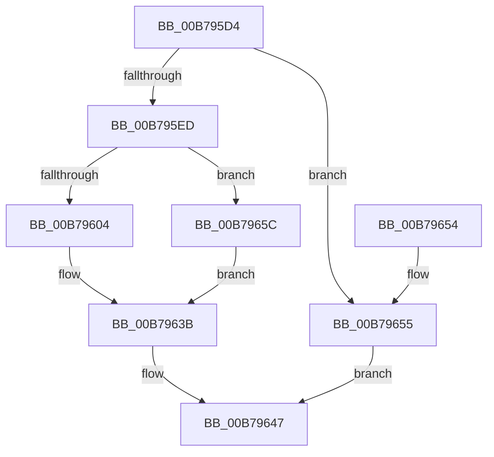

# PoDelistPowerStateTransitionBlocker

- RVA: `0x00B795D4`–`0x00B79663` (길이 `143` bytes)
- VA: `0x0000000140B795D4`
- 실행 섹션: `PAGELK`
- PDB 이름 있음: `예`; PDB Function 태그: `아니요`
- unwind 정보 RVA: `0x0008A6D8`
- 디코드: `38`개 명령, `143/143` bytes 표시
- 미해석 바이트: `0` (있으면 어셈블리에 `.byte`로 보존)

> 이 문서는 커널 이미지의 기계어와 PDB 기호를 분석해 생성했습니다. 4번과 5번은 함수 원형과 자료형을 바이너리 사용 방식에서 추정한 C 해석이며 원본 소스 복구 결과는 아닙니다.

## 1. Dependencies

- 직접 호출 지점: **4**; 고유 호출 대상: **3**
- 직접 호출자로 확인된 함수: **10**
- RIP 상대 이미지 참조: **5**

### Outgoing calls
- `0x00B795F4` → [PopAcquireRwLockExclusive](../../text/43/PopAcquireRwLockExclusive_function_00430B44.md) (function, `0x00430B44`)
- `0x00B7961A` → [ObfDereferenceObject](../../text/2F/ObfDereferenceObject_function_002F9350.md) (function, `0x002F9350`)
- `0x00B79622` → [ObfDereferenceObject](../../text/2F/ObfDereferenceObject_function_002F9350.md) (function, `0x002F9350`)
- `0x00B79642` → [PopReleaseRwLock](../../text/2D/PopReleaseRwLock_function_002DFBBC.md) (function, `0x002DFBBC`)

### Direct callers
- [PopUmpoSendPowerMessage](../../text/23/PopUmpoSendPowerMessage_function_00230730.md) at `0x00230934`
- [PopWakeDeviceList](../../text/43/PopWakeDeviceList_function_00430238.md) at `0x0043043F`
- [PopSleepDeviceList](../../text/43/PopSleepDeviceList_function_00430460.md) at `0x004306C5`
- [PopInitSystemSleeperThread](../../page/9E/PopInitSystemSleeperThread_function_009ECBA8.md) at `0x009ECCEA`
- [PopManageTransitionRecordRequest](../../page/A6/PopManageTransitionRecordRequest_function_00A63B34.md) at `0x00A63BAF`
- [ExSwapinWorkerThreads](../../page/A6/ExSwapinWorkerThreads_function_00A68C40.md) at `0x00A68DCA`
- [PopIssueActionRequest](../../page/A9/PopIssueActionRequest_function_00A9CE54.md) at `0x00A9D308`
- [PopUnlockAfterSleepWorker](PopUnlockAfterSleepWorker_function_00B782A0.md) at `0x00B78396`
- [PopTransitionSystemPowerStateEx](PopTransitionSystemPowerStateEx_function_00B7E8C0.md) at `0x00B7F6F9`
- [sub_00B80E6E](../B8/Unknown_function_00B80E6E.md) at `0x00B8103B`

### Static image references
- `0x00B795DE` → RVA `0x00F0BEF4` (`.data`; read)
- `0x00B795ED` → RVA `0x00F0DD88` (`.data`; read)
- `0x00B795F9` → RVA `0x00F0DD80` (`.data`; read)
- `0x00B79608` → RVA `0x00F0D180` (`.data`; read)
- `0x00B79635` → RVA `0x00F0DD80` (`.data`; read/write)

## 2. Other-region calls and transfers

- 다른 실행 섹션으로 향하는 call: **4**
  - `0x00B795F4` → [PopAcquireRwLockExclusive](../../text/43/PopAcquireRwLockExclusive_function_00430B44.md) (`PAGELK` → `.text`)
  - `0x00B7961A` → [ObfDereferenceObject](../../text/2F/ObfDereferenceObject_function_002F9350.md) (`PAGELK` → `.text`)
  - `0x00B79622` → [ObfDereferenceObject](../../text/2F/ObfDereferenceObject_function_002F9350.md) (`PAGELK` → `.text`)
  - `0x00B79642` → [PopReleaseRwLock](../../text/2D/PopReleaseRwLock_function_002DFBBC.md) (`PAGELK` → `.text`)
- 별도 외부 분기/꼬리 이동을 확인하지 못했습니다.

## 3. Assembly (complete function range)

```asm
00B795D4  48 89 5C 24 08                  mov qword ptr [rsp + 8], rbx
00B795D9  57                              push rdi
00B795DA  48 83 EC 20                     sub rsp, 0x20
00B795DE  8B 05 10 29 39 00               mov eax, dword ptr [rip + 0x392910]
00B795E4  33 FF                           xor edi, edi
00B795E6  FF C8                           dec eax
00B795E8  83 F8 01                        cmp eax, 1
00B795EB  77 68                           ja 0x140b79655
00B795ED  48 8D 0D 94 47 39 00            lea rcx, [rip + 0x394794]
00B795F4  E8 4B 75 8B FF                  call 0x140430b44
00B795F9  8B 05 81 47 39 00               mov eax, dword ptr [rip + 0x394781]
00B795FF  83 F8 40                        cmp eax, 0x40
00B79602  73 58                           jae 0x140b7965c
00B79604  48 8D 1C 40                     lea rbx, [rax + rax*2]
00B79608  48 8D 05 71 3B 39 00            lea rax, [rip + 0x393b71]
00B7960F  48 C1 E3 04                     shl rbx, 4
00B79613  48 03 D8                        add rbx, rax
00B79616  48 8B 4B 08                     mov rcx, qword ptr [rbx + 8]
00B7961A  E8 31 FD 77 FF                  call 0x1402f9350
00B7961F  48 8B 0B                        mov rcx, qword ptr [rbx]
00B79622  E8 29 FD 77 FF                  call 0x1402f9350
00B79627  0F 57 C0                        xorps xmm0, xmm0
00B7962A  0F 11 03                        movups xmmword ptr [rbx], xmm0
00B7962D  0F 11 43 10                     movups xmmword ptr [rbx + 0x10], xmm0
00B79631  0F 11 43 20                     movups xmmword ptr [rbx + 0x20], xmm0
00B79635  FF 0D 45 47 39 00               dec dword ptr [rip + 0x394745]
00B7963B  48 8D 0D 46 47 39 00            lea rcx, [rip + 0x394746]
00B79642  E8 75 65 76 FF                  call 0x1402dfbbc
00B79647  48 8B 5C 24 30                  mov rbx, qword ptr [rsp + 0x30]
00B7964C  8B C7                           mov eax, edi
00B7964E  48 83 C4 20                     add rsp, 0x20
00B79652  5F                              pop rdi
00B79653  C3                              ret
00B79654  CC                              int3
00B79655  BF D3 02 00 C0                  mov edi, 0xc00002d3
00B7965A  EB EB                           jmp 0x140b79647
00B7965C  BF 17 00 00 C0                  mov edi, 0xc0000017
00B79661  EB D8                           jmp 0x140b7963b
```

## 4. C-style interpretation (structured pseudocode)

```c
__int64 __fastcall PoDelistPowerStateTransitionBlocker(void)
{
    __int64 result;
    __int64 v_rbx;
    __int64 v_rdi;
    __int64 v_rsp;
    unsigned __int64 v_stack_p8;

    v_stack_p8 = v_rbx;
    v_rsp = (v_rsp) - (32);
    v_rdi = 0;
    result = (unsigned int)(((unsigned int)(*(unsigned int *)(v_rip + 3746064))) - 1);
    if (((unsigned int)(result)) > 1) goto loc_00B79655;
    result = PopAcquireRwLockExclusive(v_rip + 3753876, a2, a3, a4);
    if (((unsigned int)((unsigned int)(*(unsigned int *)(v_rip + 3753857)))) >= 64) goto loc_00B7965C;
    v_rbx = ((unsigned int)(*(unsigned int *)(v_rip + 3753857)) + (unsigned int)(*(unsigned int *)(v_rip + 3753857)) * 2) << (4);
    v_rbx = (v_rbx) + (v_rip + 3750769);
    result = ObfDereferenceObject(*(unsigned __int64 *)(v_rbx + 8), a2, a3, a4);
    result = ObfDereferenceObject(*(unsigned __int64 *)(v_rbx), a2, a3, a4);
    *(unsigned __int64 *)(v_rbx) = v_xmm0;
    *(unsigned __int64 *)(v_rbx + 16) = v_xmm0;
    *(unsigned __int64 *)(v_rbx + 32) = v_xmm0;
loc_00B7963B:
    result = PopReleaseRwLock(v_rip + 3753798, a2, a3, a4);
loc_00B79647:
    v_rsp = (v_rsp) + (32);
    return 0;
loc_00B79655:
    goto loc_00B79647;
loc_00B7965C:
    goto loc_00B7963B;
}
```

## 5. (Beta) C Style

```c
void PoDelistPowerStateTransitionBlocker(void)
{
    int64_t result;
    int64_t local_rbx;
    int64_t local_rdi;
    int64_t local_rsp;
    uint64_t v_stack_p8;

    v_stack_p8 = local_rbx;
    local_rsp = (local_rsp) - (32);
    local_rdi = 0;
    result = (uint32_t)(((uint32_t)(*(uint32_t *)(v_rip + 0x392910))) - 1);
    if (((uint32_t)(result)) > 1) goto loc_00B79655;
    result = PopAcquireRwLockExclusive(v_rip + 3753876, a2, a3, a4);
    if (((uint32_t)((uint32_t)(*(uint32_t *)(v_rip + 0x394781)))) >= 64) goto loc_00B7965C;
    local_rbx = ((uint32_t)(*(uint32_t *)(v_rip + 0x394781)) + (uint32_t)(*(uint32_t *)(v_rip + 0x394781)) * 2) << (4);
    local_rbx = (local_rbx) + (v_rip + 3750769);
    result = ObfDereferenceObject(*(uint64_t *)(local_rbx + 0x8), a2, a3, a4);
    result = ObfDereferenceObject(*(uint64_t *)(local_rbx), a2, a3, a4);
    *(uint64_t *)(local_rbx) = v_xmm0;
    *(uint64_t *)(local_rbx + 0x10) = v_xmm0;
    *(uint64_t *)(local_rbx + 0x20) = v_xmm0;
loc_00B7963B:
    result = PopReleaseRwLock(v_rip + 3753798, a2, a3, a4);
loc_00B79647:
    local_rsp = (local_rsp) + (32);
    return 0;
loc_00B79655:
    goto loc_00B79647;
loc_00B7965C:
    goto loc_00B7963B;
}
```

## 6. Execution-region graph

[열기: 2D/3D 그래프와 함수 탐색 컨트롤 패널](../../../control-panel.html?section=pagelk&rva=0x00B795D4&view=graph)

- 2D 그래프는 위에서 아래로 흐르고, 3D 그래프는 빈 공간을 드래그해 회전합니다. Shift+드래그는 이동, 휠은 확대·축소, 함수 노드 선택은 대상 보고서 이동입니다.

### Static fallback


