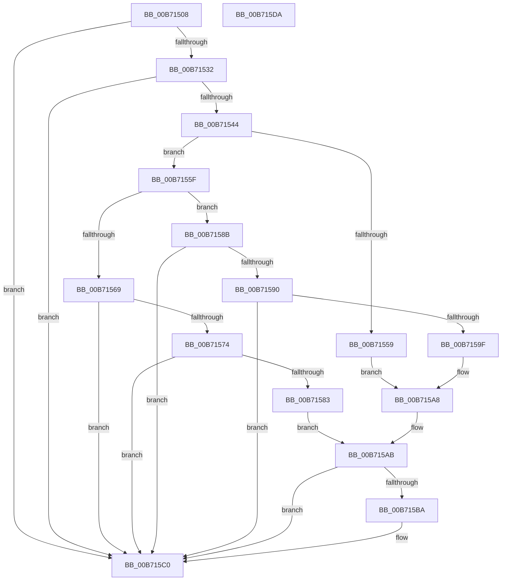

# PoGetWorkloadClassCount

- RVA: `0x00B71508`–`0x00B715DB` (길이 `211` bytes)
- VA: `0x0000000140B71508`
- 실행 섹션: `PAGELK`
- PDB 이름 있음: `예`; PDB Function 태그: `아니요`
- unwind 정보 RVA: `0x000CCC98`
- 디코드: `65`개 명령, `211/211` bytes 표시
- 미해석 바이트: `0` (있으면 어셈블리에 `.byte`로 보존)

> 이 문서는 커널 이미지의 기계어와 PDB 기호를 분석해 생성했습니다. 4번과 5번은 함수 원형과 자료형을 바이너리 사용 방식에서 추정한 C 해석이며 원본 소스 복구 결과는 아닙니다.

## 1. Dependencies

- 직접 호출 지점: **1**; 고유 호출 대상: **1**
- 직접 호출자로 확인된 함수: **3**
- RIP 상대 이미지 참조: **3**

### Outgoing calls
- `0x00B715CA` → [_security_check_cookie](../../text/6A/_security_check_cookie_function_006AC640.md) (function, `0x006AC640`)

### Direct callers
- [KiInitializeWpsWorkloadClasses](../B6/KiInitializeWpsWorkloadClasses_function_00B66B80.md) at `0x00B66B93`
- [PpmHeteroInitializeIntelWpsSupport](../../init/C4/PpmHeteroInitializeIntelWpsSupport_function_00C440C8.md) at `0x00C44312`
- [PpmHeteroInitializeAmdWpsSupport](../../init/C4/PpmHeteroInitializeAmdWpsSupport_function_00C4448C.md) at `0x00C4457D`

### Static image references
- `0x00B71515` → RVA `0x00E0A740` (`.data`; read)
- `0x00B7153B` → RVA `0x00FC6D4C` (`ALMOSTRO`; read)
- `0x00B7154D` → RVA `0x00FC7048` (`ALMOSTRO`; read)

## 2. Other-region calls and transfers

- 다른 실행 섹션으로 향하는 call: **1**
  - `0x00B715CA` → [_security_check_cookie](../../text/6A/_security_check_cookie_function_006AC640.md) (`PAGELK` → `.text`)
- 별도 외부 분기/꼬리 이동을 확인하지 못했습니다.

## 3. Assembly (complete function range)

```asm
00B71508  48 89 5C 24 10                  mov qword ptr [rsp + 0x10], rbx
00B7150D  55                              push rbp
00B7150E  48 8B EC                        mov rbp, rsp
00B71511  48 83 EC 20                     sub rsp, 0x20
00B71515  48 8B 05 24 92 29 00            mov rax, qword ptr [rip + 0x299224]
00B7151C  48 33 C4                        xor rax, rsp
00B7151F  48 89 45 F0                     mov qword ptr [rbp - 0x10], rax
00B71523  45 32 C9                        xor r9b, r9b
00B71526  4C 8B C1                        mov r8, rcx
00B71529  48 85 C9                        test rcx, rcx
00B7152C  0F 84 8E 00 00 00               je 0x140b715c0
00B71532  41 BA 01 00 00 00               mov r10d, 1
00B71538  44 89 11                        mov dword ptr [rcx], r10d
00B7153B  83 3D 0A 58 45 00 00            cmp dword ptr [rip + 0x45580a], 0
00B71542  75 7C                           jne 0x140b715c0
00B71544  65 48 8B 0C 25 20 00 00 00      mov rcx, qword ptr gs:[0x20]
00B7154D  48 8B 05 F4 5A 45 00            mov rax, qword ptr [rip + 0x455af4]
00B71554  41 84 C2                        test r10b, al
00B71557  74 06                           je 0x140b7155f
00B71559  48 C1 E8 34                     shr rax, 0x34
00B7155D  EB 49                           jmp 0x140b715a8
00B7155F  8A 81 8D 00 00 00               mov al, byte ptr [rcx + 0x8d]
00B71565  3C 02                           cmp al, 2
00B71567  75 22                           jne 0x140b7158b
00B71569  33 C0                           xor eax, eax
00B7156B  33 C9                           xor ecx, ecx
00B7156D  0F A2                           cpuid
00B7156F  83 F8 07                        cmp eax, 7
00B71572  72 4C                           jb 0x140b715c0
00B71574  33 C9                           xor ecx, ecx
00B71576  B8 06 00 00 00                  mov eax, 6
00B7157B  0F A2                           cpuid
00B7157D  0F BA E0 17                     bt eax, 0x17
00B71581  73 3D                           jae 0x140b715c0
00B71583  C1 E9 08                        shr ecx, 8
00B71586  0F B6 C1                        movzx eax, cl
00B71589  EB 20                           jmp 0x140b715ab
00B7158B  41 3A C2                        cmp al, r10b
00B7158E  75 30                           jne 0x140b715c0
00B71590  33 C9                           xor ecx, ecx
00B71592  B8 21 00 00 80                  mov eax, 0x80000021
00B71597  0F A2                           cpuid
00B71599  0F BA E0 16                     bt eax, 0x16
00B7159D  73 21                           jae 0x140b715c0
00B7159F  B8 27 00 00 80                  mov eax, 0x80000027
00B715A4  33 C9                           xor ecx, ecx
00B715A6  0F A2                           cpuid
00B715A8  83 E0 0F                        and eax, 0xf
00B715AB  49 8B C8                        mov rcx, r8
00B715AE  45 8A CA                        mov r9b, r10b
00B715B1  89 01                           mov dword ptr [rcx], eax
00B715B3  FF C8                           dec eax
00B715B5  83 F8 07                        cmp eax, 7
00B715B8  76 06                           jbe 0x140b715c0
00B715BA  45 89 10                        mov dword ptr [r8], r10d
00B715BD  45 32 C9                        xor r9b, r9b
00B715C0  41 8A C1                        mov al, r9b
00B715C3  48 8B 4D F0                     mov rcx, qword ptr [rbp - 0x10]
00B715C7  48 33 CC                        xor rcx, rsp
00B715CA  E8 71 B0 B3 FF                  call 0x1406ac640
00B715CF  48 8B 5C 24 38                  mov rbx, qword ptr [rsp + 0x38]
00B715D4  48 83 C4 20                     add rsp, 0x20
00B715D8  5D                              pop rbp
00B715D9  C3                              ret
00B715DA  CC                              int3
```

## 4. C-style interpretation (structured pseudocode)

```c
__int64 __fastcall PoGetWorkloadClassCount(__int64 a1, __int64 a2, __int64 a3, unsigned __int8 a4)
{
    __int64 result;
    __int64 v_rsp;
    unsigned __int64 v_stack_m18;
    unsigned __int64 v_stack_p10;

    v_stack_p10 = v_rbx;
    v_rsp = (v_rsp) - (32);
    result = (*(unsigned __int64 *)(v_rip + 2724388)) ^ (v_rsp);
    v_stack_m18 = result;
    a4 = 0;
    if (a1 == 0) goto loc_00B715C0;
    *(unsigned int *)(a1) = 1;
    if ((*(unsigned int *)(v_rip + 4544522)) != 0) goto loc_00B715C0;
    if (((1) & ((unsigned __int8)(*(unsigned __int64 *)(v_rip + 4545268)))) == 0) goto loc_00B7155F;
    result = (*(unsigned __int64 *)(v_rip + 4545268)) >> (52);
    goto loc_00B715A8;
loc_00B7155F:
    if (((unsigned __int8)(*(unsigned __int8 *)(*(unsigned __int64 *)(gs_base + (0 + 32)) + 141))) != 2) goto loc_00B7158B;
    result = 0;
    a1 = 0;
    if (0 < 7) goto loc_00B715C0;
    a1 = 0;
    if (condition_is_above_or_equal) goto loc_00B715C0;
    a1 = (unsigned int)((a1) >> (8));
    goto loc_00B715AB;
loc_00B7158B:
    if (((unsigned __int8)((unsigned __int8)(a1))) != 1) goto loc_00B715C0;
    a1 = 0;
    if (condition_is_above_or_equal) goto loc_00B715C0;
    a1 = 0;
loc_00B715A8:
    result = (unsigned int)(((unsigned int)(0x80000027ULL)) & (15));
loc_00B715AB:
    *(unsigned int *)(0) = (unsigned int)(result);
    result = (unsigned int)((result) - 1);
    if (((unsigned int)(result)) >= = 7) {
        *(unsigned int *)(a1) = 1;
        a4 = 0;
    }
    a1 = (v_stack_m18) ^ (v_rsp);
    result = _security_check_cookie(a1, a2, a1, a4);
    v_rsp = (v_rsp) + (32);
    return result;
}
```

## 5. (Beta) C Style

```c
int64_t PoGetWorkloadClassCount(void *Arg1, int64_t Arg2, int64_t Arg3, uint8_t Arg4)
{
    uint8_t *arg1 = (uint8_t *)Arg1;

    int64_t result;
    int64_t local_rsp;
    uint64_t v_stack_m18;
    uint64_t v_stack_p10;

    v_stack_p10 = local_rbx;
    local_rsp = (local_rsp) - (32);
    result = (*(uint64_t *)(v_rip + 0x299224)) ^ (local_rsp);
    v_stack_m18 = result;
    Arg4 = 0;
    if (Arg1 == NULL) goto loc_00B715C0;
    *(uint32_t *)(arg1) = 1;
    if ((*(uint32_t *)(v_rip + 0x45580A)) != 0) goto loc_00B715C0;
    if (((1) & ((uint8_t)(*(uint64_t *)(v_rip + 0x455AF4)))) == 0) goto loc_00B7155F;
    result = (*(uint64_t *)(v_rip + 0x455AF4)) >> (52);
    goto loc_00B715A8;
loc_00B7155F:
    if (((uint8_t)(*(uint8_t *)(*(uint64_t *)(gs_base + (0 + 0x20)) + 0x8D))) != 2) goto loc_00B7158B;
    result = 0;
    Arg1 = 0;
    if (0 < 7) goto loc_00B715C0;
    Arg1 = 0;
    if (condition_is_above_or_equal) goto loc_00B715C0;
    Arg1 = (uint32_t)((Arg1) >> (8));
    goto loc_00B715AB;
loc_00B7158B:
    if (((uint8_t)((uint8_t)(Arg1))) != 1) goto loc_00B715C0;
    Arg1 = 0;
    if (condition_is_above_or_equal) goto loc_00B715C0;
    Arg1 = 0;
loc_00B715A8:
    result = (uint32_t)(((uint32_t)(0x80000027ULL)) & (15));
loc_00B715AB:
    *(uint32_t *)(0) = (uint32_t)(result);
    result = (uint32_t)((result) - 1);
    if (((uint32_t)(result)) >= = 7) {
        *(uint32_t *)(arg1) = 1;
        Arg4 = 0;
    }
    Arg1 = (v_stack_m18) ^ (local_rsp);
    result = _security_check_cookie(Arg1, Arg2, Arg1, Arg4);
    local_rsp = (local_rsp) + (32);
    return result;
}
```

### 관측된 메모리 오프셋

구조체 형식이 확인되지 않은 접근은 인자 기준의 오프셋으로만 기록했습니다.

| 기준 인자 | 오프셋 표현 | 폭 (bit) | 접근 |
|---|---:|---:|---|
| `Arg1` | `+ 0x0` | `32` | `W` |

## 6. Execution-region graph

[열기: 2D/3D 그래프와 함수 탐색 컨트롤 패널](../../../control-panel.html?section=pagelk&rva=0x00B71508&view=graph)

- 2D 그래프는 위에서 아래로 흐르고, 3D 그래프는 빈 공간을 드래그해 회전합니다. Shift+드래그는 이동, 휠은 확대·축소, 함수 노드 선택은 대상 보고서 이동입니다.

### Static fallback


