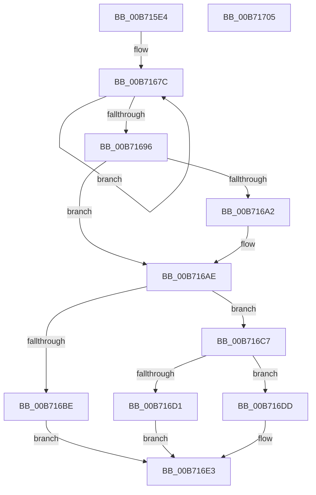

# PoInitializePrcb

- RVA: `0x00B715E4`–`0x00B71706` (길이 `290` bytes)
- VA: `0x0000000140B715E4`
- 실행 섹션: `PAGELK`
- PDB 이름 있음: `예`; PDB Function 태그: `아니요`
- unwind 정보 RVA: `0x0005E6B4`
- 디코드: `67`개 명령, `290/290` bytes 표시
- 미해석 바이트: `0` (있으면 어셈블리에 `.byte`로 보존)

> 이 문서는 커널 이미지의 기계어와 PDB 기호를 분석해 생성했습니다. 4번과 5번은 함수 원형과 자료형을 바이너리 사용 방식에서 추정한 C 해석이며 원본 소스 복구 결과는 아닙니다.

## 1. Dependencies

- 직접 호출 지점: **4**; 고유 호출 대상: **4**
- 직접 호출자로 확인된 함수: **1**
- RIP 상대 이미지 참조: **3**

### Outgoing calls
- `0x00B71612` → [memset](../../text/6C/memset_function_006C6C40.md) (function, `0x006C6C40`)
- `0x00B71662` → [KeInitializeDpc](../../text/45/KeInitializeDpc_function_0045BBD0.md) (function, `0x0045BBD0`)
- `0x00B7166D` → [PpmHeteroHgsProcessorInit](../../text/5D/PpmHeteroHgsProcessorInit_function_005D8C08.md) (function, `0x005D8C08`)
- `0x00B716B5` → [PpmHvUseNativeAlgorithms](../../text/4B/PpmHvUseNativeAlgorithms_function_004BDBB4.md) (function, `0x004BDBB4`)

### Direct callers
- [KiInitializeKernel](../B6/KiInitializeKernel_function_00B68D20.md) at `0x00B68FD9`

### Static image references
- `0x00B71621` → RVA `0x009E13A0` (`PpmWmiDispatch`; read)
- `0x00B7164C` → RVA `0x002D7E70` (`PpmPerfAction`; read)
- `0x00B716C7` → RVA `0x00FC6A90` (`ALMOSTRO`; read)

## 2. Other-region calls and transfers

- 다른 실행 섹션으로 향하는 call: **4**
  - `0x00B71612` → [memset](../../text/6C/memset_function_006C6C40.md) (`PAGELK` → `.text`)
  - `0x00B71662` → [KeInitializeDpc](../../text/45/KeInitializeDpc_function_0045BBD0.md) (`PAGELK` → `.text`)
  - `0x00B7166D` → [PpmHeteroHgsProcessorInit](../../text/5D/PpmHeteroHgsProcessorInit_function_005D8C08.md) (`PAGELK` → `.text`)
  - `0x00B716B5` → [PpmHvUseNativeAlgorithms](../../text/4B/PpmHvUseNativeAlgorithms_function_004BDBB4.md) (`PAGELK` → `.text`)
- 별도 외부 분기/꼬리 이동을 확인하지 못했습니다.

## 3. Assembly (complete function range)

```asm
00B715E4  48 8B C4                        mov rax, rsp
00B715E7  48 89 58 08                     mov qword ptr [rax + 8], rbx
00B715EB  48 89 68 10                     mov qword ptr [rax + 0x10], rbp
00B715EF  48 89 70 18                     mov qword ptr [rax + 0x18], rsi
00B715F3  48 89 78 20                     mov qword ptr [rax + 0x20], rdi
00B715F7  41 56                           push r14
00B715F9  48 83 EC 20                     sub rsp, 0x20
00B715FD  48 8D 99 40 88 00 00            lea rbx, [rcx + 0x8840]
00B71604  48 8B F1                        mov rsi, rcx
00B71607  48 8B CB                        mov rcx, rbx
00B7160A  33 D2                           xor edx, edx
00B7160C  41 B8 38 02 00 00               mov r8d, 0x238
00B71612  E8 29 56 B5 FF                  call 0x1406c6c40
00B71617  C7 86 B8 86 00 00 00 00 01 00   mov dword ptr [rsi + 0x86b8], 0x10000
00B71621  48 8D 05 78 FD E6 FF            lea rax, [rip - 0x190288]
00B71628  BD 01 00 00 00                  mov ebp, 1
00B7162D  48 89 83 E8 00 00 00            mov qword ptr [rbx + 0xe8], rax
00B71634  48 8D BB 18 01 00 00            lea rdi, [rbx + 0x118]
00B7163B  40 88 AB F8 00 00 00            mov byte ptr [rbx + 0xf8], bpl
00B71642  4C 8B C6                        mov r8, rsi
00B71645  C6 83 D8 00 00 00 02            mov byte ptr [rbx + 0xd8], 2
00B7164C  48 8D 15 1D 68 76 FF            lea rdx, [rip - 0x8997e3]
00B71653  48 8B CF                        mov rcx, rdi
00B71656  44 8D 75 63                     lea r14d, [rbp + 0x63]
00B7165A  66 44 89 B3 AE 01 00 00         mov word ptr [rbx + 0x1ae], r14w
00B71662  E8 69 A5 8E FF                  call 0x14045bbd0
00B71667  40 8A D5                        mov dl, bpl
00B7166A  48 8B CE                        mov rcx, rsi
00B7166D  E8 96 75 A6 FF                  call 0x1405d8c08
00B71672  41 8B CE                        mov ecx, r14d
00B71675  48 8D 93 2A 02 00 00            lea rdx, [rbx + 0x22a]
00B7167C  8B C1                           mov eax, ecx
00B7167E  41 03 CE                        add ecx, r14d
00B71681  C1 E8 02                        shr eax, 2
00B71684  66 2B C5                        sub ax, bp
00B71687  66 89 02                        mov word ptr [rdx], ax
00B7168A  48 8D 52 02                     lea rdx, [rdx + 2]
00B7168E  81 F9 F4 01 00 00               cmp ecx, 0x1f4
00B71694  72 E6                           jb 0x140b7167c
00B71696  48 8B 47 38                     mov rax, qword ptr [rdi + 0x38]
00B7169A  8B 4E 24                        mov ecx, dword ptr [rsi + 0x24]
00B7169D  48 85 C0                        test rax, rax
00B716A0  75 0C                           jne 0x140b716ae
00B716A2  B8 00 08 00 00                  mov eax, 0x800
00B716A7  66 03 C8                        add cx, ax
00B716AA  66 89 4F 02                     mov word ptr [rdi + 2], cx
00B716AE  C6 83 19 01 00 00 03            mov byte ptr [rbx + 0x119], 3
00B716B5  E8 FA C4 94 FF                  call 0x1404bdbb4
00B716BA  84 C0                           test al, al
00B716BC  74 09                           je 0x140b716c7
00B716BE  83 A3 E0 00 00 00 00            and dword ptr [rbx + 0xe0], 0
00B716C5  EB 1C                           jmp 0x140b716e3
00B716C7  8B 05 C3 53 45 00               mov eax, dword ptr [rip + 0x4553c3]
00B716CD  A8 02                           test al, 2
00B716CF  74 0C                           je 0x140b716dd
00B716D1  C7 83 E0 00 00 00 02 00 00 00   mov dword ptr [rbx + 0xe0], 2
00B716DB  EB 06                           jmp 0x140b716e3
00B716DD  89 AB E0 00 00 00               mov dword ptr [rbx + 0xe0], ebp
00B716E3  48 8B 74 24 40                  mov rsi, qword ptr [rsp + 0x40]
00B716E8  48 8B 7C 24 48                  mov rdi, qword ptr [rsp + 0x48]
00B716ED  40 88 AB B4 01 00 00            mov byte ptr [rbx + 0x1b4], bpl
00B716F4  48 8B 5C 24 30                  mov rbx, qword ptr [rsp + 0x30]
00B716F9  48 8B 6C 24 38                  mov rbp, qword ptr [rsp + 0x38]
00B716FE  48 83 C4 20                     add rsp, 0x20
00B71702  41 5E                           pop r14
00B71704  C3                              ret
00B71705  CC                              int3
```

## 4. C-style interpretation (structured pseudocode)

```c
__int64 __fastcall PoInitializePrcb(__int64 a1, int a2)
{
    __int64 result;
    __int64 v_rsp;
    unsigned __int64 v_stack_p10;
    unsigned __int64 v_stack_p18;
    unsigned __int64 v_stack_p20;
    unsigned __int64 v_stack_p8;

    *(unsigned __int64 *)(v_rsp + 8) = v_rbx;
    *(unsigned __int64 *)(v_rsp + 16) = v_rbp;
    *(unsigned __int64 *)(v_rsp + 24) = v_rsi;
    *(unsigned __int64 *)(v_rsp + 32) = v_rdi;
    v_rsp = (v_rsp) - (32);
    a2 = 0;
    result = memset(a1 + 34880, a2, 568, a4);
    *(unsigned int *)(a1 + 34488) = 0x10000ULL;
    *(unsigned __int64 *)(a1 + 34880 + 232) = v_rip - 1639048;
    *(unsigned __int8 *)(a1 + 34880 + 248) = 1;
    *(unsigned __int8 *)(a1 + 34880 + 216) = 2;
    *(unsigned __int16 *)(a1 + 34880 + 430) = (unsigned __int16)(1 + 99);
    result = KeInitializeDpc(a1 + 34880 + 280, v_rip - 9017315, a1, a4);
    result = PpmHeteroHgsProcessorInit(a1, 1, a1, a4);
loc_00B7167C:
    a1 = (unsigned int)(((unsigned int)((unsigned int)(1 + 99))) + ((unsigned int)(1 + 99)));
    result = (unsigned int)(((unsigned int)((unsigned int)((unsigned int)((unsigned int)(1 + 99))))) >> (2));
    result = (unsigned __int16)((result) - (1));
    *(unsigned __int16 *)(a1 + 34880 + 554) = (unsigned __int16)(result);
    if (((unsigned int)(a1)) < 500) goto loc_00B7167C;
    result = *(unsigned __int64 *)(a1 + 34880 + 280 + 56);
    if (*(unsigned __int64 *)(a1 + 34880 + 280 + 56) == 0) {
        result = 0x800ULL;
        a1 = (unsigned __int16)(((unsigned int)(*(unsigned int *)(a1 + 36))) + ((unsigned __int16)(result)));
        *(unsigned __int16 *)(a1 + 34880 + 280 + 2) = (unsigned __int16)(a1);
    }
    *(unsigned __int8 *)(a1 + 34880 + 281) = 3;
    result = PpmHvUseNativeAlgorithms(a1, a1 + 34880 + 554 + 2, a1, a4);
    if ((unsigned __int8)(result) == 0) goto loc_00B716C7;
    goto loc_00B716E3;
loc_00B716C7:
    if ((((unsigned __int8)((unsigned int)(*(unsigned int *)(v_rip + 4543427)))) & (2)) == 0) goto loc_00B716DD;
    *(unsigned int *)(a1 + 34880 + 224) = 2;
    goto loc_00B716E3;
loc_00B716DD:
    *(unsigned int *)(a1 + 34880 + 224) = 1;
loc_00B716E3:
    *(unsigned __int8 *)(a1 + 34880 + 436) = 1;
    v_rsp = (v_rsp) + (32);
    return (unsigned int)(*(unsigned int *)(v_rip + 4543427));
}
```

## 5. (Beta) C Style

```c
int64_t PoInitializePrcb(void *Arg1, int32_t Arg2)
{
    uint8_t *arg1 = (uint8_t *)Arg1;

    int64_t result;
    int64_t local_rsp;
    uint64_t v_stack_p10;
    uint64_t v_stack_p18;
    uint64_t v_stack_p20;
    uint64_t v_stack_p8;

    *(uint64_t *)(local_rsp + 0x8) = local_rbx;
    *(uint64_t *)(local_rsp + 0x10) = local_rbp;
    *(uint64_t *)(local_rsp + 0x18) = local_rsi;
    *(uint64_t *)(local_rsp + 0x20) = local_rdi;
    local_rsp = (local_rsp) - (32);
    Arg2 = 0;
    result = memset(Arg1 + 34880, Arg2, 568, a4);
    *(uint32_t *)(arg1 + 0x86B8) = 0x10000ULL;
    *(uint64_t *)(arg1 + 0x8840 + 0xE8) = v_rip - 1639048;
    *(uint8_t *)(arg1 + 0x8840 + 0xF8) = 1;
    *(uint8_t *)(arg1 + 0x8840 + 0xD8) = 2;
    *(uint16_t *)(arg1 + 0x8840 + 0x1AE) = (uint16_t)(1 + 99);
    result = KeInitializeDpc(Arg1 + 34880 + 280, v_rip - 9017315, Arg1, a4);
    result = PpmHeteroHgsProcessorInit(Arg1, 1, Arg1, a4);
loc_00B7167C:
    Arg1 = (uint32_t)(((uint32_t)((uint32_t)(1 + 99))) + ((uint32_t)(1 + 99)));
    result = (uint32_t)(((uint32_t)((uint32_t)((uint32_t)((uint32_t)(1 + 99))))) >> (2));
    result = (uint16_t)((result) - (1));
    *(uint16_t *)(arg1 + 0x8840 + 0x22A) = (uint16_t)(result);
    if (((uint32_t)(Arg1)) < 500) goto loc_00B7167C;
    result = *(uint64_t *)(arg1 + 0x8840 + 0x118 + 0x38);
    if (*(uint64_t *)(arg1 + 0x8840 + 0x118 + 0x38) == 0) {
        result = 0x800ULL;
        Arg1 = (uint16_t)(((uint32_t)(*(uint32_t *)(arg1 + 0x24))) + ((uint16_t)(result)));
        *(uint16_t *)(arg1 + 0x8840 + 0x118 + 0x2) = (uint16_t)(Arg1);
    }
    *(uint8_t *)(arg1 + 0x8840 + 0x119) = 3;
    result = PpmHvUseNativeAlgorithms(Arg1, Arg1 + 34880 + 554 + 2, Arg1, a4);
    if ((uint8_t)(result) == 0) goto loc_00B716C7;
    goto loc_00B716E3;
loc_00B716C7:
    if ((((uint8_t)((uint32_t)(*(uint32_t *)(v_rip + 0x4553C3)))) & (2)) == 0) goto loc_00B716DD;
    *(uint32_t *)(arg1 + 0x8840 + 0xE0) = 2;
    goto loc_00B716E3;
loc_00B716DD:
    *(uint32_t *)(arg1 + 0x8840 + 0xE0) = 1;
loc_00B716E3:
    *(uint8_t *)(arg1 + 0x8840 + 0x1B4) = 1;
    local_rsp = (local_rsp) + (32);
    return (uint32_t)(*(uint32_t *)(v_rip + 0x4553C3));
}
```

### 관측된 메모리 오프셋

구조체 형식이 확인되지 않은 접근은 인자 기준의 오프셋으로만 기록했습니다.

| 기준 인자 | 오프셋 표현 | 폭 (bit) | 접근 |
|---|---:|---:|---|
| `Arg1` | `+ 0x0` | `16` | `W` |
| `Arg1` | `+ 0x2` | `16` | `W` |
| `Arg1` | `+ 0x2` | `64` | `R` |
| `Arg1` | `+ 0x24` | `32` | `R` |
| `Arg1` | `+ 0x38` | `64` | `R` |
| `Arg1` | `+ 0xD8` | `8` | `W` |
| `Arg1` | `+ 0xE0` | `32` | `R/W` |
| `Arg1` | `+ 0xE0` | `32` | `W` |
| `Arg1` | `+ 0xE8` | `64` | `W` |
| `Arg1` | `+ 0xF8` | `8` | `W` |
| `Arg1` | `+ 0x118` | `64` | `R` |
| `Arg1` | `+ 0x119` | `8` | `W` |
| `Arg1` | `+ 0x1AE` | `16` | `W` |
| `Arg1` | `+ 0x1B4` | `8` | `W` |
| `Arg1` | `+ 0x22A` | `64` | `R` |
| `Arg1` | `+ 0x86B8` | `32` | `W` |
| `Arg1` | `+ 0x8840` | `64` | `R` |

## 6. Execution-region graph

[열기: 2D/3D 그래프와 함수 탐색 컨트롤 패널](../../../control-panel.html?section=pagelk&rva=0x00B715E4&view=graph)

- 2D 그래프는 위에서 아래로 흐르고, 3D 그래프는 빈 공간을 드래그해 회전합니다. Shift+드래그는 이동, 휠은 확대·축소, 함수 노드 선택은 대상 보고서 이동입니다.

### Static fallback


