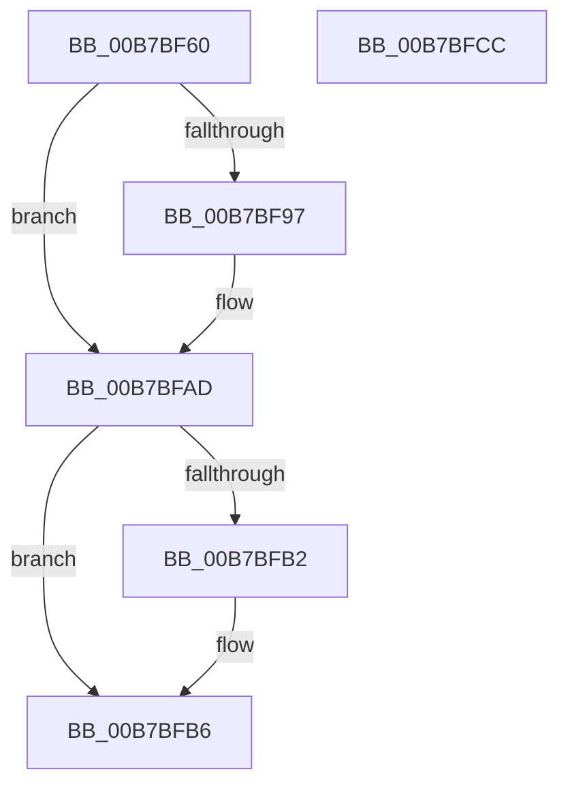

# PopAcquireAwaymodeLock

- RVA: `0x00B7BF60`–`0x00B7BFCD` (길이 `109` bytes)
- VA: `0x0000000140B7BF60`
- 실행 섹션: `PAGELK`
- PDB 이름 있음: `예`; PDB Function 태그: `아니요`
- unwind 정보 RVA: `0x0005CF00`
- 디코드: `25`개 명령, `109/109` bytes 표시
- 미해석 바이트: `0` (있으면 어셈블리에 `.byte`로 보존)

> 이 문서는 커널 이미지의 기계어와 PDB 기호를 분석해 생성했습니다. 4번과 5번은 함수 원형과 자료형을 바이너리 사용 방식에서 추정한 C 해석이며 원본 소스 복구 결과는 아닙니다.

## 1. Dependencies

- 직접 호출 지점: **2**; 고유 호출 대상: **2**
- 직접 호출자로 확인된 함수: **2**
- RIP 상대 이미지 참조: **3**

### Outgoing calls
- `0x00B7BF83` → [KeAbPreAcquire](../../text/21/KeAbPreAcquire_function_00210230.md) (function, `0x00210230`)
- `0x00B7BFA8` → [ExfAcquirePushLockExclusiveEx](../../text/20/ExfAcquirePushLockExclusiveEx_function_0020FC90.md) (function, `0x0020FC90`)

### Direct callers
- [PopIssueActionRequest](../../page/A9/PopIssueActionRequest_function_00A9CE54.md) at `0x00A9CE9A`
- [PopPowerRequestCallbackAwayModeRequired](../../page/AA/PopPowerRequestCallbackAwayModeRequired_function_00AACA00.md) at `0x00AACA09`

### Static image references
- `0x00B7BF6F` → RVA `0x00F0CAD8` (`.data`; read)
- `0x00B7BF88` → RVA `0x00F0CAD8` (`.data`; read/write)
- `0x00B7BFBF` → RVA `0x00F0C8F0` (`.data`; write)

## 2. Other-region calls and transfers

- 다른 실행 섹션으로 향하는 call: **2**
  - `0x00B7BF83` → [KeAbPreAcquire](../../text/21/KeAbPreAcquire_function_00210230.md) (`PAGELK` → `.text`)
  - `0x00B7BFA8` → [ExfAcquirePushLockExclusiveEx](../../text/20/ExfAcquirePushLockExclusiveEx_function_0020FC90.md) (`PAGELK` → `.text`)
- 별도 외부 분기/꼬리 이동을 확인하지 못했습니다.

## 3. Assembly (complete function range)

```asm
00B7BF60  40 53                           push rbx
00B7BF62  48 83 EC 20                     sub rsp, 0x20
00B7BF66  65 48 8B 04 25 88 01 00 00      mov rax, qword ptr gs:[0x188]
00B7BF6F  48 8D 0D 62 0B 39 00            lea rcx, [rip + 0x390b62]
00B7BF76  45 33 C0                        xor r8d, r8d
00B7BF79  33 D2                           xor edx, edx
00B7BF7B  66 FF 88 E4 01 00 00            dec word ptr [rax + 0x1e4]
00B7BF82  90                              nop
00B7BF83  E8 A8 42 69 FF                  call 0x140210230
00B7BF88  F0 48 0F BA 2D 46 0B 39 00 00   lock bts qword ptr [rip + 0x390b46], 0
00B7BF92  48 8B D8                        mov rbx, rax
00B7BF95  73 16                           jae 0x140b7bfad
00B7BF97  4C 8D 05 3A 0B 39 00            lea r8, [rip + 0x390b3a]
00B7BF9E  48 8B D0                        mov rdx, rax
00B7BFA1  48 8D 0D 30 0B 39 00            lea rcx, [rip + 0x390b30]
00B7BFA8  E8 E3 3C 69 FF                  call 0x14020fc90
00B7BFAD  48 85 DB                        test rbx, rbx
00B7BFB0  74 04                           je 0x140b7bfb6
00B7BFB2  C6 43 0A 01                     mov byte ptr [rbx + 0xa], 1
00B7BFB6  65 48 8B 04 25 88 01 00 00      mov rax, qword ptr gs:[0x188]
00B7BFBF  48 89 05 2A 09 39 00            mov qword ptr [rip + 0x39092a], rax
00B7BFC6  48 83 C4 20                     add rsp, 0x20
00B7BFCA  5B                              pop rbx
00B7BFCB  C3                              ret
00B7BFCC  CC                              int3
```

## 4. C-style interpretation (structured pseudocode)

```c
__int64 __fastcall PopAcquireAwaymodeLock(__int64 a1, int a2, int a3)
{
    __int64 result;
    __int64 v_rsp;

    v_rsp = (v_rsp) - (32);
    a3 = 0;
    a2 = 0;
    result = KeAbPreAcquire(v_rip + 3738466, a2, a3, a4);
    if (!(condition_is_above_or_equal)) {
        a3 = v_rip + 3738426;
        a2 = result;
        a1 = v_rip + 3738416;
        result = ExfAcquirePushLockExclusiveEx(a1, a2, a3, a4);
    }
    if (result != 0) {
        *(unsigned __int8 *)(result + 10) = 1;
    }
    *(unsigned __int64 *)(v_rip + 3737898) = *(unsigned __int64 *)(gs_base + (0 + 392));
    v_rsp = (v_rsp) + (32);
    return *(unsigned __int64 *)(gs_base + (0 + 392));
}
```

## 5. (Beta) C Style

```c
int64_t PopAcquireAwaymodeLock(int64_t Arg1, int32_t Arg2, int32_t Arg3)
{
    int64_t result;
    int64_t local_rsp;

    local_rsp = (local_rsp) - (32);
    Arg3 = 0;
    Arg2 = 0;
    result = KeAbPreAcquire(v_rip + 3738466, Arg2, Arg3, a4);
    if (!(condition_is_above_or_equal)) {
        Arg3 = v_rip + 3738426;
        Arg2 = result;
        Arg1 = v_rip + 3738416;
        result = ExfAcquirePushLockExclusiveEx(Arg1, Arg2, Arg3, a4);
    }
    if (result != 0) {
        *(uint8_t *)(result + 0xA) = 1;
    }
    *(uint64_t *)(v_rip + 0x39092A) = *(uint64_t *)(gs_base + (0 + 0x188));
    local_rsp = (local_rsp) + (32);
    return *(uint64_t *)(gs_base + (0 + 0x188));
}
```

## 6. Execution-region graph

[열기: 2D/3D 그래프와 함수 탐색 컨트롤 패널](../../../control-panel.html?section=pagelk&rva=0x00B7BF60&view=graph)

- 2D 그래프는 위에서 아래로 흐르고, 3D 그래프는 빈 공간을 드래그해 회전합니다. Shift+드래그는 이동, 휠은 확대·축소, 함수 노드 선택은 대상 보고서 이동입니다.

### Static fallback


