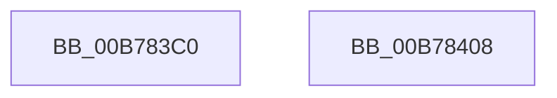

# PopAcquirePolicyLock

- RVA: `0x00B783C0`–`0x00B78409` (길이 `73` bytes)
- VA: `0x0000000140B783C0`
- 실행 섹션: `PAGELK`
- PDB 이름 있음: `예`; PDB Function 태그: `아니요`
- unwind 정보 RVA: `0x0005C788`
- 디코드: `15`개 명령, `73/73` bytes 표시
- 미해석 바이트: `0` (있으면 어셈블리에 `.byte`로 보존)

> 이 문서는 커널 이미지의 기계어와 PDB 기호를 분석해 생성했습니다. 4번과 5번은 함수 원형과 자료형을 바이너리 사용 방식에서 추정한 C 해석이며 원본 소스 복구 결과는 아닙니다.

## 1. Dependencies

- 직접 호출 지점: **2**; 고유 호출 대상: **2**
- 직접 호출자로 확인된 함수: **105**
- RIP 상대 이미지 참조: **2**

### Outgoing calls
- `0x00B783CF` → [PsBoostThreadIo](../../text/39/PsBoostThreadIo_function_003927C0.md) (function, `0x003927C0`)
- `0x00B783EE` → [ExAcquireResourceExclusiveLite](../../text/21/ExAcquireResourceExclusiveLite_function_00214E20.md) (function, `0x00214E20`)

### Direct callers
- [PopCaptureSleepStudyStatistics](../../text/43/PopCaptureSleepStudyStatistics_function_004399F4.md) at `0x00439AEC`
- [PoSetUserPresent](../../text/48/PoSetUserPresent_function_004829A0.md) at `0x00482A3D`
- [PoSetSystemState](../../text/48/PoSetSystemState_function_00482A50.md) at `0x00482A66`
- [PopUserPresentSetWorker](../../text/49/PopUserPresentSetWorker_function_0049D4F0.md) at `0x0049D5E9`
- [PopCheckAndHandleThermalConditions](../../text/4A/PopCheckAndHandleThermalConditions_function_004A8C00.md) at `0x004A8CB8`
- [PopVideoBrightnessSettingsCallback](../../text/4B/PopVideoBrightnessSettingsCallback_function_004B3290.md) at `0x004B32D0`
- [PopVideoBrightnessSettingsCallback](../../text/4B/PopVideoBrightnessSettingsCallback_function_004B3290.md) at `0x004B3305`
- [PopVideoBrightnessSettingsCallback](../../text/4B/PopVideoBrightnessSettingsCallback_function_004B3290.md) at `0x004B331F`
- [PopVideoBrightnessSettingsCallback](../../text/4B/PopVideoBrightnessSettingsCallback_function_004B3290.md) at `0x004B33C5`
- [PopVideoBrightnessSettingsCallback](../../text/4B/PopVideoBrightnessSettingsCallback_function_004B3290.md) at `0x004B33EA`
- [PopVideoBrightnessSettingsCallback](../../text/4B/PopVideoBrightnessSettingsCallback_function_004B3290.md) at `0x004B340F`
- [PopNetEvaluationWorkerCallback](../../text/4B/PopNetEvaluationWorkerCallback_function_004BE0B0.md) at `0x004BE0CE`
- [PopPowerSourceChangeCallback](../../text/4C/PopPowerSourceChangeCallback_function_004C3A60.md) at `0x004C3C3B`
- [PopVideoPowerSettingCallback](../../text/4C/PopVideoPowerSettingCallback_function_004C9F50.md) at `0x004C9FA8`
- [PdcPoLowPower](../../text/4D/PdcPoLowPower_function_004D3F20.md) at `0x004D3F2B`
- [PopSwitchForcedShutdownSettingCallback](../../text/5D/PopSwitchForcedShutdownSettingCallback_function_005D1350.md) at `0x005D1372`
- [PdcPoCurrentPdcPhase](../../text/5D/PdcPoCurrentPdcPhase_function_005D9E70.md) at `0x005D9F54`
- [PopPowerAggregatorNotifyAcDcStateChange](../../page/6F/PopPowerAggregatorNotifyAcDcStateChange_function_006FE41C.md) at `0x006FE420`
- [PopPowerAggregatorDisengageAggressiveStandbyActions](../../page/6F/PopPowerAggregatorDisengageAggressiveStandbyActions_function_006FEB30.md) at `0x006FEB34`
- [PopPdcRegister](../../page/70/PopPdcRegister_function_00704AD0.md) at `0x00704AF6`
- [PoInitHiberServices](../../page/75/PoInitHiberServices_function_007537C4.md) at `0x00753817`
- [PopUpdateUpgradeInProgress](../../page/75/PopUpdateUpgradeInProgress_function_00754880.md) at `0x007549F8`
- [PopAllowAwayModeSettingCallback](../../page/75/PopAllowAwayModeSettingCallback_function_00758000.md) at `0x00758022`
- [PopBatteryAlarmPowerSettingCallback](../../page/75/PopBatteryAlarmPowerSettingCallback_function_007580A0.md) at `0x007580A9`
- [PopConsoleLockPowerSettingCallback](../../page/75/PopConsoleLockPowerSettingCallback_function_007580D0.md) at `0x007580EB`
- [PopPowerButtonSettingCallback](../../page/75/PopPowerButtonSettingCallback_function_00758340.md) at `0x0075836D`
- [PopWnfUserAwayPredictionCallback](../../page/75/PopWnfUserAwayPredictionCallback_function_00758640.md) at `0x00758676`
- [PopCoalescingNotify](../../page/75/PopCoalescingNotify_function_0075C0E0.md) at `0x0075C0E4`
- [PopCoalescingPowerSettingCallback](../../page/75/PopCoalescingPowerSettingCallback_function_0075C170.md) at `0x0075C192`
- [PopWnfHibernatePolicyCallback](../../page/75/PopWnfHibernatePolicyCallback_function_0075E3C0.md) at `0x0075E3F2`
- [PopSwitchUpdateUserShutdownScenarioState](../../page/75/PopSwitchUpdateUserShutdownScenarioState_function_0075F260.md) at `0x0075F26C`
- [PopSwitchUpdateUserShutdownScenarioState](../../page/75/PopSwitchUpdateUserShutdownScenarioState_function_0075F260.md) at `0x0075F383`
- [PopThermalStateTransitionWorker](../../page/75/PopThermalStateTransitionWorker_function_0075F820.md) at `0x0075F916`
- [PopThermalZoneAdd](../../page/75/PopThermalZoneAdd_function_0075F980.md) at `0x0075FA8A`
- [PopThermalZoneRemove](../../page/75/PopThermalZoneRemove_function_0075FAD0.md) at `0x0075FBDF`
- [PopUpdateOverThrottledCount](../../page/75/PopUpdateOverThrottledCount_function_0075FC24.md) at `0x0075FC3D`
- [NtInitiatePowerAction](../../page/75/NtInitiatePowerAction_function_0075FCB0.md) at `0x0075FE85`
- [NtInitiatePowerAction](../../page/75/NtInitiatePowerAction_function_0075FCB0.md) at `0x0075FF0A`
- [PopDiagTracePreSleepNotification](../../page/76/PopDiagTracePreSleepNotification_function_00762BE4.md) at `0x00762CAB`
- [PopPreCriticalBatteryNotify](../../page/76/PopPreCriticalBatteryNotify_function_007639C0.md) at `0x007639C4`
- [PopPowerAggregatorDozeTimerWorker](../../page/76/PopPowerAggregatorDozeTimerWorker_function_00764490.md) at `0x007644F3`
- [PopPowerAggregatorEngageAggressiveStandbyActions](../../page/76/PopPowerAggregatorEngageAggressiveStandbyActions_function_0076460C.md) at `0x0076462A`
- [PopPowerAggregatorNotifyPdcPhaseState](../../page/76/PopPowerAggregatorNotifyPdcPhaseState_function_00764C54.md) at `0x00764C7E`
- [PopPowerAggregatorScreenOffEnterStateHandler](../../page/76/PopPowerAggregatorScreenOffEnterStateHandler_function_00764E90.md) at `0x00764F67`
- [PopDeepSleepPowerSettingCallback](../../page/76/PopDeepSleepPowerSettingCallback_function_00765360.md) at `0x00765396`
- [PopEvaluateInputSuppressionAction](../../page/76/PopEvaluateInputSuppressionAction_function_00765454.md) at `0x007654A1`
- [PopUsb4DisplayPresenceUpdatedWorker](../../page/76/PopUsb4DisplayPresenceUpdatedWorker_function_00765690.md) at `0x00765696`
- [PopUsb4DisplayPresenceUpdatedWorker](../../page/76/PopUsb4DisplayPresenceUpdatedWorker_function_00765690.md) at `0x007656B4`
- [PopWnfUsb4DisplayPresenceCallback](../../page/76/PopWnfUsb4DisplayPresenceCallback_function_007656E0.md) at `0x0076578A`
- [PopNotifyPolicyDevice](../../page/76/PopNotifyPolicyDevice_function_00765FF0.md) at `0x0076603B`
- [PopPolicyDeviceHandleWakeAlarmNotification](../../page/76/PopPolicyDeviceHandleWakeAlarmNotification_function_007660A4.md) at `0x0076637A`
- [PopBatteryAdd](../../page/76/PopBatteryAdd_function_00766580.md) at `0x007665BB`
- [PopBatteryRemove](../../page/76/PopBatteryRemove_function_00766D40.md) at `0x00766DD7`
- [PopBatteryUpdateTestExempt](../../page/76/PopBatteryUpdateTestExempt_function_00766F54.md) at `0x00767153`
- [PopBatteryUpdateTestExempt](../../page/76/PopBatteryUpdateTestExempt_function_00766F54.md) at `0x00767227`
- [PopIdleAoAcDozeToS4](../../page/76/PopIdleAoAcDozeToS4_function_00768790.md) at `0x00768799`
- [PopNetConnectivityInStandbyCallback](../../page/76/PopNetConnectivityInStandbyCallback_function_00768A90.md) at `0x00768AAA`
- [PopNetDisconnectedStandbyModeCallback](../../page/76/PopNetDisconnectedStandbyModeCallback_function_00768B40.md) at `0x00768B5A`
- [PopNetRefreshTimerWorkerCallback](../../page/76/PopNetRefreshTimerWorkerCallback_function_00768D10.md) at `0x00768D16`
- [PopNetResiliencyPhaseStateChanged](../../page/76/PopNetResiliencyPhaseStateChanged_function_00768DD8.md) at `0x00768DE4`
- [PdcPoNetworkResiliency](../../page/76/PdcPoNetworkResiliency_function_007693A0.md) at `0x007693A8`
- [PdcPoReportButton](../../page/76/PdcPoReportButton_function_007694A0.md) at `0x007694AE`
- [PdcPoSetPowerAction](../../page/76/PdcPoSetPowerAction_function_00769520.md) at `0x0076953F`
- [PdcPoVerifyActionPolicy](../../page/76/PdcPoVerifyActionPolicy_function_00769580.md) at `0x00769589`
- [PdcPoVerifyPowerState](../../page/76/PdcPoVerifyPowerState_function_007695B0.md) at `0x007695BF`
- [PoTtmInitiatePowerStateTransition](../../page/76/PoTtmInitiatePowerStateTransition_function_007695E8.md) at `0x00769617`
- [PopMonitorInvocation](../../page/76/PopMonitorInvocation_function_00769710.md) at `0x00769723`
- [PopAdaptiveUpdateIdleContextWorker](../../page/76/PopAdaptiveUpdateIdleContextWorker_function_0076BA80.md) at `0x0076BA84`
- [PopUpdateExternalDisplayState](../../page/76/PopUpdateExternalDisplayState_function_0076C0DC.md) at `0x0076C0E4`
- [PopDripsWatchdogCallbackWorker](../../page/76/PopDripsWatchdogCallbackWorker_function_0076C360.md) at `0x0076C4A8`
- [PopAdaptiveStandbyActionWorker](../../page/76/PopAdaptiveStandbyActionWorker_function_0076C9B0.md) at `0x0076CAA1`
- [PopWnfSprActiveSessionChangeCallback](../../page/90/PopWnfSprActiveSessionChangeCallback_function_0090C930.md) at `0x0090C9CA`
- [PopBatteryUpdateCompositeInformation](../../page/90/PopBatteryUpdateCompositeInformation_function_0090FDD0.md) at `0x0090FEF1`
- [PopSleepPowerSettingCallback](../../page/91/PopSleepPowerSettingCallback_function_009103E0.md) at `0x00910405`
- [NtPowerInformation](../../page/95/NtPowerInformation_function_00955D80.md) at `0x009561C2`
- [NtPowerInformation](../../page/95/NtPowerInformation_function_00955D80.md) at `0x009565F5`
- [NtPowerInformation](../../page/95/NtPowerInformation_function_00955D80.md) at `0x00956ECE`
- [NtPowerInformation](../../page/95/NtPowerInformation_function_00955D80.md) at `0x00957316`
- [NtPowerInformation](../../page/95/NtPowerInformation_function_00955D80.md) at `0x00957CB2`
- [PopPowerAggregatorEnterScreenOff](../../page/98/PopPowerAggregatorEnterScreenOff_function_00989F38.md) at `0x0098A065`
- [PdcPoResiliencyClient](../../page/A3/PdcPoResiliencyClient_function_00A314B0.md) at `0x00A314DF`
- [PopPdcIdleResiliencyCallback](../../page/A3/PopPdcIdleResiliencyCallback_function_00A31518.md) at `0x00A3152C`
- [PopPowerRequestCallbackExecutionRequired](../../page/A3/PopPowerRequestCallbackExecutionRequired_function_00A31660.md) at `0x00A316A6`
- [PopDiagTraceControlCallback](../../page/A3/PopDiagTraceControlCallback_function_00A38CB0.md) at `0x00A38DA0`
- [PopDiagTraceControlCallback](../../page/A3/PopDiagTraceControlCallback_function_00A38CB0.md) at `0x00A38E08`
- [PopNetWnfLowPowerEpochCallback](../../page/A4/PopNetWnfLowPowerEpochCallback_function_00A49FB0.md) at `0x00A4A049`
- [PopWnfAudioCallback](../../page/A4/PopWnfAudioCallback_function_00A4A0E0.md) at `0x00A4A16E`
- [PopDirectedDripsInitializeBroadcast](../../page/A4/PopDirectedDripsInitializeBroadcast_function_00A4D634.md) at `0x00A4D836`
- [PopS0LowPowerIdleInfo](../../page/A7/PopS0LowPowerIdleInfo_function_00A7C330.md) at `0x00A7C358`
- [PopPowerInformationInternal](../../page/A8/PopPowerInformationInternal_function_00A8B7C0.md) at `0x00A8BCD9`
- [PopPowerInformationInternal](../../page/A8/PopPowerInformationInternal_function_00A8B7C0.md) at `0x00A8C680`
- [PopPowerInformationInternal](../../page/A8/PopPowerInformationInternal_function_00A8B7C0.md) at `0x00A8D0E2`
- [PopCoalescingCallbackWorker](../../page/A8/PopCoalescingCallbackWorker_function_00A8DA40.md) at `0x00A8DA44`
- [PopPolicyWorkerAction](../../page/A9/PopPolicyWorkerAction_function_00A9CC40.md) at `0x00A9CC6D`
- [PopIssueActionRequest](../../page/A9/PopIssueActionRequest_function_00A9CE54.md) at `0x00A9CF12`
- [PopIssueActionRequest](../../page/A9/PopIssueActionRequest_function_00A9CE54.md) at `0x00A9CF81`
- [PopIssueActionRequest](../../page/A9/PopIssueActionRequest_function_00A9CE54.md) at `0x00A9D195`
- [PopIssueActionRequest](../../page/A9/PopIssueActionRequest_function_00A9CE54.md) at `0x00A9D206`
- [PopIssueActionRequest](../../page/A9/PopIssueActionRequest_function_00A9CE54.md) at `0x00A9D22B`
- [PopIssueActionRequest](../../page/A9/PopIssueActionRequest_function_00A9CE54.md) at `0x00A9D2FE`
- [PopPdcCsDeviceNotification](../../page/AA/PopPdcCsDeviceNotification_function_00AA1B28.md) at `0x00AA1C38`
- [PopPdcUpdateDeviceCompliance](../../page/AA/PopPdcUpdateDeviceCompliance_function_00AA1CE4.md) at `0x00AA1D11`
- [PopExternalMonitorUpdatedWorker](../../page/AB/PopExternalMonitorUpdatedWorker_function_00AB0B20.md) at `0x00AB0B26`
- [PopExternalMonitorUpdatedWorker](../../page/AB/PopExternalMonitorUpdatedWorker_function_00AB0B20.md) at `0x00AB0B4B`
- [PopUserPresencePredictionModeCallback](../../page/AB/PopUserPresencePredictionModeCallback_function_00AB0D20.md) at `0x00AB0D56`
- [PopHardDiskPowerSettingCallback](../../page/AB/PopHardDiskPowerSettingCallback_function_00AB6F60.md) at `0x00AB6FC2`
- [PopNetSetResiliencyPhaseBias](../../page/AB/PopNetSetResiliencyPhaseBias_function_00ABD9F0.md) at `0x00ABDA09`
- [PopPolicyWorkerActionPromote](../../page/AB/PopPolicyWorkerActionPromote_function_00ABFE10.md) at `0x00ABFE16`
- [NtSetThreadExecutionState](../../page/AC/NtSetThreadExecutionState_function_00AC0A40.md) at `0x00AC0BB9`
- [NtSetThreadExecutionState](../../page/AC/NtSetThreadExecutionState_function_00AC0A40.md) at `0x00AC0C1E`
- [NtSetThreadExecutionState](../../page/AC/NtSetThreadExecutionState_function_00AC0A40.md) at `0x00AC0C83`
- [NtSetThreadExecutionState](../../page/AC/NtSetThreadExecutionState_function_00AC0A40.md) at `0x00AC0CBA`
- [PdcPoReportLidState](../../page/AC/PdcPoReportLidState_function_00AC3480.md) at `0x00AC3488`
- [PopSleepstudyStartNextSession](../../page/AC/PopSleepstudyStartNextSession_function_00AC4720.md) at `0x00AC478F`
- [PopRecordLidStateWorker](../../page/AC/PopRecordLidStateWorker_function_00ACD4D0.md) at `0x00ACD4EB`
- [PopIdleGlobalUserPresenceCallback](../../page/AD/PopIdleGlobalUserPresenceCallback_function_00AD89F0.md) at `0x00AD8A1F`
- [PopSmartSuspendMakePredictions](../../page/AD/PopSmartSuspendMakePredictions_function_00AD9168.md) at `0x00AD9290`
- [PopSmartSuspendMakePredictions](../../page/AD/PopSmartSuspendMakePredictions_function_00AD9168.md) at `0x00AD929F`
- [PopIdleCsStateChanged](../../page/AD/PopIdleCsStateChanged_function_00AD9DE0.md) at `0x00AD9DE8`
- [PopNetUpdateStandbyRequest](../../page/AD/PopNetUpdateStandbyRequest_function_00ADB704.md) at `0x00ADB749`
- [PopBatteryApplyCompositeState](../../page/AE/PopBatteryApplyCompositeState_function_00AE0CD0.md) at `0x00AE0D1D`
- [PopBatteryApplyCompositeState](../../page/AE/PopBatteryApplyCompositeState_function_00AE0CD0.md) at `0x00AE1119`
- [PopBatteryWorker](../../page/AE/PopBatteryWorker_function_00AE1650.md) at `0x00AE1848`
- [PopRecalculateCBTriggerLevels](../../page/AE/PopRecalculateCBTriggerLevels_function_00AE3018.md) at `0x00AE302B`
- [sub_00B39B66](../../page/B3/Unknown_function_00B39B66.md) at `0x00B39B66`
- [NtSetSystemPowerState](NtSetSystemPowerState_function_00B70890.md) at `0x00B709F0`
- [NtSetSystemPowerState](NtSetSystemPowerState_function_00B70890.md) at `0x00B70A30`
- [PopUnlockAfterSleepWorker](PopUnlockAfterSleepWorker_function_00B782A0.md) at `0x00B7835C`
- [PopTransitionSystemPowerStateEx](PopTransitionSystemPowerStateEx_function_00B7E8C0.md) at `0x00B7EA65`
- [PopTransitionSystemPowerStateEx](PopTransitionSystemPowerStateEx_function_00B7E8C0.md) at `0x00B7EB9C`
- [PopTransitionSystemPowerStateEx](PopTransitionSystemPowerStateEx_function_00B7E8C0.md) at `0x00B7ED7F`
- [PopTransitionSystemPowerStateEx](PopTransitionSystemPowerStateEx_function_00B7E8C0.md) at `0x00B7F03E`
- [PopTransitionSystemPowerStateEx](PopTransitionSystemPowerStateEx_function_00B7E8C0.md) at `0x00B7F973`
- [PopInitPlatformSettings](../../init/C3/PopInitPlatformSettings_function_00C3D40C.md) at `0x00C3D439`
- [PopPdcCsCheckSystemVolumeDevice](../../init/C4/PopPdcCsCheckSystemVolumeDevice_function_00C42D9C.md) at `0x00C42EDB`
- [PopWatchdogInit](../../init/C4/PopWatchdogInit_function_00C43330.md) at `0x00C43354`
- [PoInitSystem](../../init/C7/PoInitSystem_function_00C72358.md) at `0x00C72FE3`
- [PoInitSystem](../../init/C7/PoInitSystem_function_00C72358.md) at `0x00C731A7`

### Static image references
- `0x00B783DD` → RVA `0x00F0CAE0` (`.data`; read)
- `0x00B783FC` → RVA `0x00F0C8D0` (`.data`; write)

## 2. Other-region calls and transfers

- 다른 실행 섹션으로 향하는 call: **2**
  - `0x00B783CF` → [PsBoostThreadIo](../../text/39/PsBoostThreadIo_function_003927C0.md) (`PAGELK` → `.text`)
  - `0x00B783EE` → [ExAcquireResourceExclusiveLite](../../text/21/ExAcquireResourceExclusiveLite_function_00214E20.md) (`PAGELK` → `.text`)
- 별도 외부 분기/꼬리 이동을 확인하지 못했습니다.

## 3. Assembly (complete function range)

```asm
00B783C0  48 83 EC 28                     sub rsp, 0x28
00B783C4  65 48 8B 0C 25 88 01 00 00      mov rcx, qword ptr gs:[0x188]
00B783CD  33 D2                           xor edx, edx
00B783CF  E8 EC A3 81 FF                  call 0x1403927c0
00B783D4  65 48 8B 04 25 88 01 00 00      mov rax, qword ptr gs:[0x188]
00B783DD  48 8D 0D FC 46 39 00            lea rcx, [rip + 0x3946fc]
00B783E4  B2 01                           mov dl, 1
00B783E6  66 FF 88 E4 01 00 00            dec word ptr [rax + 0x1e4]
00B783ED  90                              nop
00B783EE  E8 2D CA 69 FF                  call 0x140214e20
00B783F3  65 48 8B 04 25 88 01 00 00      mov rax, qword ptr gs:[0x188]
00B783FC  48 89 05 CD 44 39 00            mov qword ptr [rip + 0x3944cd], rax
00B78403  48 83 C4 28                     add rsp, 0x28
00B78407  C3                              ret
00B78408  CC                              int3
```

## 4. C-style interpretation (structured pseudocode)

```c
__int64 __fastcall PopAcquirePolicyLock(__int64 a1, int a2)
{
    __int64 result;
    __int64 v_rsp;

    v_rsp = (v_rsp) - (40);
    a2 = 0;
    result = PsBoostThreadIo(*(unsigned __int64 *)(gs_base + (0 + 392)), a2, a3, a4);
    result = ExAcquireResourceExclusiveLite(v_rip + 3753724, 1, a3, a4);
    *(unsigned __int64 *)(v_rip + 3753165) = *(unsigned __int64 *)(gs_base + (0 + 392));
    v_rsp = (v_rsp) + (40);
    return *(unsigned __int64 *)(gs_base + (0 + 392));
}
```

## 5. (Beta) C Style

```c
int64_t PopAcquirePolicyLock(int64_t Arg1, int32_t Arg2)
{
    int64_t result;
    int64_t local_rsp;

    local_rsp = (local_rsp) - (40);
    Arg2 = 0;
    result = PsBoostThreadIo(*(uint64_t *)(gs_base + (0 + 0x188)), Arg2, a3, a4);
    result = ExAcquireResourceExclusiveLite(v_rip + 3753724, 1, a3, a4);
    *(uint64_t *)(v_rip + 0x3944CD) = *(uint64_t *)(gs_base + (0 + 0x188));
    local_rsp = (local_rsp) + (40);
    return *(uint64_t *)(gs_base + (0 + 0x188));
}
```

## 6. Execution-region graph

[열기: 2D/3D 그래프와 함수 탐색 컨트롤 패널](../../../control-panel.html?section=pagelk&rva=0x00B783C0&view=graph)

- 2D 그래프는 위에서 아래로 흐르고, 3D 그래프는 빈 공간을 드래그해 회전합니다. Shift+드래그는 이동, 휠은 확대·축소, 함수 노드 선택은 대상 보고서 이동입니다.

### Static fallback


