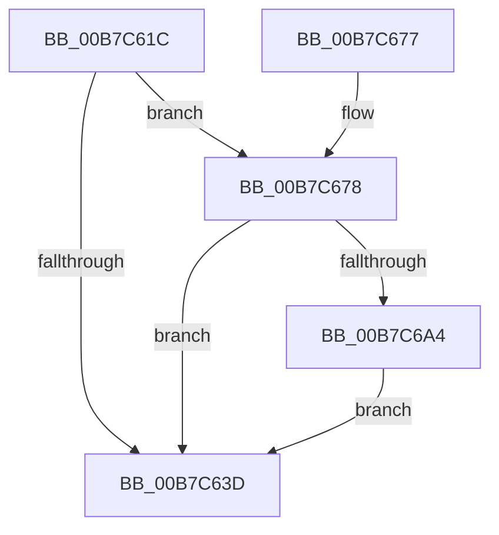

# PopAcquireTransitionLockAfterSleep

- RVA: `0x00B7C61C`–`0x00B7C6AD` (길이 `145` bytes)
- VA: `0x0000000140B7C61C`
- 실행 섹션: `PAGELK`
- PDB 이름 있음: `예`; PDB Function 태그: `아니요`
- unwind 정보 RVA: `0x0006FCD8`
- 디코드: `29`개 명령, `145/145` bytes 표시
- 미해석 바이트: `0` (있으면 어셈블리에 `.byte`로 보존)

> 이 문서는 커널 이미지의 기계어와 PDB 기호를 분석해 생성했습니다. 4번과 5번은 함수 원형과 자료형을 바이너리 사용 방식에서 추정한 C 해석이며 원본 소스 복구 결과는 아닙니다.

## 1. Dependencies

- 직접 호출 지점: **6**; 고유 호출 대상: **4**
- 직접 호출자로 확인된 함수: **1**
- RIP 상대 이미지 참조: **3**

### Outgoing calls
- `0x00B7C627` → [PopAcquireRwLockExclusive](../../text/43/PopAcquireRwLockExclusive_function_00430B44.md) (function, `0x00430B44`)
- `0x00B7C644` → [PopReleaseRwLock](../../text/2D/PopReleaseRwLock_function_002DFBBC.md) (function, `0x002DFBBC`)
- `0x00B7C64E` → [PopAcquireTransitionLock](../../page/AA/PopAcquireTransitionLock_function_00AA9E7C.md) (function, `0x00AA9E7C`)
- `0x00B7C65A` → [PopAcquireRwLockExclusive](../../text/43/PopAcquireRwLockExclusive_function_00430B44.md) (function, `0x00430B44`)
- `0x00B7C66D` → [PopReleaseRwLock](../../text/2D/PopReleaseRwLock_function_002DFBBC.md) (function, `0x002DFBBC`)
- `0x00B7C69B` → [PopPushPowerStateTransitionRecordWithCallback](../../text/43/PopPushPowerStateTransitionRecordWithCallback_function_00430A04.md) (function, `0x00430A04`)

### Direct callers
- [PopTransitionSystemPowerStateEx](PopTransitionSystemPowerStateEx_function_00B7E8C0.md) at `0x00B7E9D5`

### Static image references
- `0x00B7C620` → RVA `0x00F0B920` (`.data`; read)
- `0x00B7C62C` → RVA `0x00F0BF18` (`.data`; read)
- `0x00B7C634` → RVA `0x00F09169` (`.data`; write)

## 2. Other-region calls and transfers

- 다른 실행 섹션으로 향하는 call: **6**
  - `0x00B7C627` → [PopAcquireRwLockExclusive](../../text/43/PopAcquireRwLockExclusive_function_00430B44.md) (`PAGELK` → `.text`)
  - `0x00B7C644` → [PopReleaseRwLock](../../text/2D/PopReleaseRwLock_function_002DFBBC.md) (`PAGELK` → `.text`)
  - `0x00B7C64E` → [PopAcquireTransitionLock](../../page/AA/PopAcquireTransitionLock_function_00AA9E7C.md) (`PAGELK` → `PAGE`)
  - `0x00B7C65A` → [PopAcquireRwLockExclusive](../../text/43/PopAcquireRwLockExclusive_function_00430B44.md) (`PAGELK` → `.text`)
  - `0x00B7C66D` → [PopReleaseRwLock](../../text/2D/PopReleaseRwLock_function_002DFBBC.md) (`PAGELK` → `.text`)
  - `0x00B7C69B` → [PopPushPowerStateTransitionRecordWithCallback](../../text/43/PopPushPowerStateTransitionRecordWithCallback_function_00430A04.md) (`PAGELK` → `.text`)
- 별도 외부 분기/꼬리 이동을 확인하지 못했습니다.

## 3. Assembly (complete function range)

```asm
00B7C61C  48 83 EC 38                     sub rsp, 0x38
00B7C620  48 8D 0D F9 F2 38 00            lea rcx, [rip + 0x38f2f9]
00B7C627  E8 18 45 8B FF                  call 0x140430b44
00B7C62C  48 83 3D E4 F8 38 00 00         cmp qword ptr [rip + 0x38f8e4], 0
00B7C634  C6 05 2E CB 38 00 01            mov byte ptr [rip + 0x38cb2e], 1
00B7C63B  75 3B                           jne 0x140b7c678
00B7C63D  48 8D 0D DC F2 38 00            lea rcx, [rip + 0x38f2dc]
00B7C644  E8 73 35 76 FF                  call 0x1402dfbbc
00B7C649  B9 01 00 00 00                  mov ecx, 1
00B7C64E  E8 29 D8 F2 FF                  call 0x140aa9e7c
00B7C653  48 8D 0D C6 F2 38 00            lea rcx, [rip + 0x38f2c6]
00B7C65A  E8 E5 44 8B FF                  call 0x140430b44
00B7C65F  48 8D 0D BA F2 38 00            lea rcx, [rip + 0x38f2ba]
00B7C666  C6 05 FC CA 38 00 00            mov byte ptr [rip + 0x38cafc], 0
00B7C66D  E8 4A 35 76 FF                  call 0x1402dfbbc
00B7C672  48 83 C4 38                     add rsp, 0x38
00B7C676  C3                              ret
00B7C677  CC                              int3
00B7C678  65 48 8B 04 25 88 01 00 00      mov rax, qword ptr gs:[0x188]
00B7C681  45 33 C9                        xor r9d, r9d
00B7C684  48 8B 15 8D F8 38 00            mov rdx, qword ptr [rip + 0x38f88d]
00B7C68B  45 33 C0                        xor r8d, r8d
00B7C68E  48 83 64 24 20 00               and qword ptr [rsp + 0x20], 0
00B7C694  48 8B 88 B8 00 00 00            mov rcx, qword ptr [rax + 0xb8]
00B7C69B  E8 64 43 8B FF                  call 0x140430a04
00B7C6A0  85 C0                           test eax, eax
00B7C6A2  79 99                           jns 0x140b7c63d
00B7C6A4  C6 05 BE CA 38 00 00            mov byte ptr [rip + 0x38cabe], 0
00B7C6AB  EB 90                           jmp 0x140b7c63d
```

## 4. C-style interpretation (structured pseudocode)

```c
__int64 __fastcall PopAcquireTransitionLockAfterSleep(__int64 a1, __int64 a2, int a3, int a4)
{
    __int64 result;
    __int64 v_rsp;
    unsigned __int64 v_stack_p20;

    v_rsp = (v_rsp) - (56);
    result = PopAcquireRwLockExclusive(v_rip + 3732217, a2, a3, a4);
    *(unsigned __int8 *)(v_rip + 3722030) = 1;
    if ((*(unsigned __int64 *)(v_rip + 3733732)) != 0) goto loc_00B7C678;
loc_00B7C63D:
    result = PopReleaseRwLock(v_rip + 3732188, a2, a3, a4);
    result = PopAcquireTransitionLock(1, a2, a3, a4);
    result = PopAcquireRwLockExclusive(v_rip + 3732166, a2, a3, a4);
    *(unsigned __int8 *)(v_rip + 3721980) = 0;
    result = PopReleaseRwLock(v_rip + 3732154, a2, a3, a4);
    v_rsp = (v_rsp) + (56);
    return result;
loc_00B7C678:
    a4 = 0;
    a3 = 0;
    result = PopPushPowerStateTransitionRecordWithCallback(*(unsigned __int64 *)(*(unsigned __int64 *)(gs_base + (0 + 392)) + 184), *(unsigned __int64 *)(v_rip + 3733645), a3, a4);
    if (!sign_flag) goto loc_00B7C63D;
    *(unsigned __int8 *)(v_rip + 3721918) = 0;
    goto loc_00B7C63D;
}
```

## 5. (Beta) C Style

```c
int64_t PopAcquireTransitionLockAfterSleep(int64_t Arg1, int64_t Arg2, int32_t Arg3, int32_t Arg4)
{
    int64_t result;
    int64_t local_rsp;
    uint64_t v_stack_p20;

    local_rsp = (local_rsp) - (56);
    result = PopAcquireRwLockExclusive(v_rip + 3732217, Arg2, Arg3, Arg4);
    *(uint8_t *)(v_rip + 0x38CB2E) = 1;
    if ((*(uint64_t *)(v_rip + 0x38F8E4)) != 0) goto loc_00B7C678;
loc_00B7C63D:
    result = PopReleaseRwLock(v_rip + 3732188, Arg2, Arg3, Arg4);
    result = PopAcquireTransitionLock(1, Arg2, Arg3, Arg4);
    result = PopAcquireRwLockExclusive(v_rip + 3732166, Arg2, Arg3, Arg4);
    *(uint8_t *)(v_rip + 0x38CAFC) = 0;
    result = PopReleaseRwLock(v_rip + 3732154, Arg2, Arg3, Arg4);
    local_rsp = (local_rsp) + (56);
    return result;
loc_00B7C678:
    Arg4 = 0;
    Arg3 = 0;
    result = PopPushPowerStateTransitionRecordWithCallback(*(uint64_t *)(*(uint64_t *)(gs_base + (0 + 0x188)) + 0xB8), *(uint64_t *)(v_rip + 0x38F88D), Arg3, Arg4);
    if (!sign_flag) goto loc_00B7C63D;
    *(uint8_t *)(v_rip + 0x38CABE) = 0;
    goto loc_00B7C63D;
}
```

## 6. Execution-region graph

[열기: 2D/3D 그래프와 함수 탐색 컨트롤 패널](../../../control-panel.html?section=pagelk&rva=0x00B7C61C&view=graph)

- 2D 그래프는 위에서 아래로 흐르고, 3D 그래프는 빈 공간을 드래그해 회전합니다. Shift+드래그는 이동, 휠은 확대·축소, 함수 노드 선택은 대상 보고서 이동입니다.

### Static fallback


