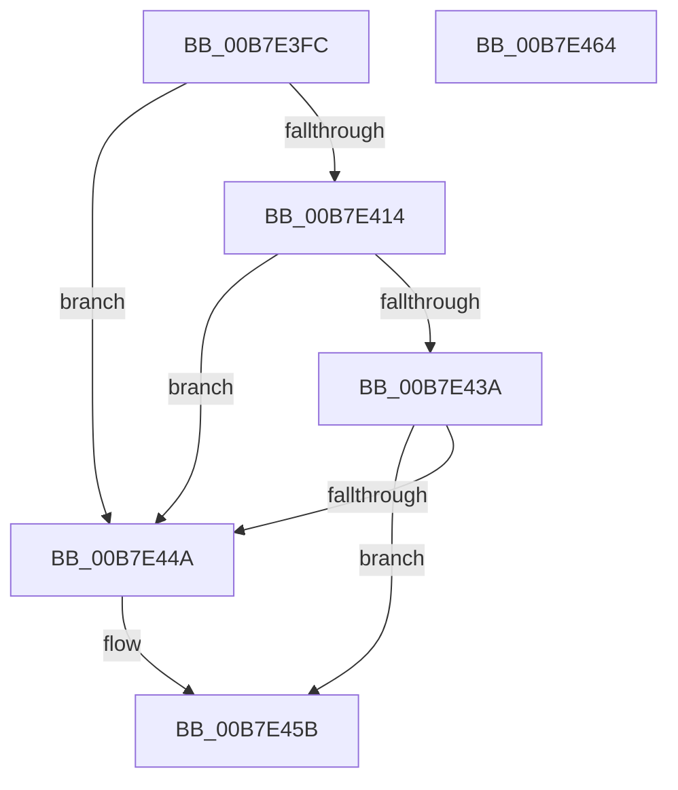

# PopAllocatePages

- RVA: `0x00B7E3FC`–`0x00B7E465` (길이 `105` bytes)
- VA: `0x0000000140B7E3FC`
- 실행 섹션: `PAGELK`
- PDB 이름 있음: `예`; PDB Function 태그: `아니요`
- unwind 정보 RVA: `0x00064C80`
- 디코드: `27`개 명령, `105/105` bytes 표시
- 미해석 바이트: `0` (있으면 어셈블리에 `.byte`로 보존)

> 이 문서는 커널 이미지의 기계어와 PDB 기호를 분석해 생성했습니다. 4번과 5번은 함수 원형과 자료형을 바이너리 사용 방식에서 추정한 C 해석이며 원본 소스 복구 결과는 아닙니다.

## 1. Dependencies

- 직접 호출 지점: **2**; 고유 호출 대상: **2**
- 직접 호출자로 확인된 함수: **2**
- RIP 상대 이미지 참조: **2**

### Outgoing calls
- `0x00B7E40A` → [PopGenerateMdl](../../text/3E/PopGenerateMdl_function_003EBC70.md) (function, `0x003EBC70`)
- `0x00B7E42D` → [MmMapLockedPagesSpecifyCache](../../text/31/MmMapLockedPagesSpecifyCache_function_00318800.md) (function, `0x00318800`)

### Direct callers
- [PopAllocateHiberContext](../../page/AD/PopAllocateHiberContext_function_00ADC05C.md) at `0x00ADC45D`
- [PopAllocateHiberContext](../../page/AD/PopAllocateHiberContext_function_00ADC05C.md) at `0x00ADC547`
- [PopBuildMemoryImageHeader](../B6/PopBuildMemoryImageHeader_function_00B6CA20.md) at `0x00B6CC21`

### Static image references
- `0x00B7E402` → RVA `0x00E676F8` (`.data`; read/write)
- `0x00B7E43A` → RVA `0x00F0BD90` (`.data`; read)

## 2. Other-region calls and transfers

- 다른 실행 섹션으로 향하는 call: **2**
  - `0x00B7E40A` → [PopGenerateMdl](../../text/3E/PopGenerateMdl_function_003EBC70.md) (`PAGELK` → `.text`)
  - `0x00B7E42D` → [MmMapLockedPagesSpecifyCache](../../text/31/MmMapLockedPagesSpecifyCache_function_00318800.md) (`PAGELK` → `.text`)
- 별도 외부 분기/꼬리 이동을 확인하지 못했습니다.

## 3. Assembly (complete function range)

```asm
00B7E3FC  40 53                           push rbx
00B7E3FE  48 83 EC 30                     sub rsp, 0x30
00B7E402  01 0D F0 92 2E 00               add dword ptr [rip + 0x2e92f0], ecx
00B7E408  33 DB                           xor ebx, ebx
00B7E40A  E8 61 D8 86 FF                  call 0x1403ebc70
00B7E40F  48 85 C0                        test rax, rax
00B7E412  74 36                           je 0x140b7e44a
00B7E414  44 8D 43 01                     lea r8d, [rbx + 1]
00B7E418  C7 44 24 28 20 00 00 40         mov dword ptr [rsp + 0x28], 0x40000020
00B7E420  45 33 C9                        xor r9d, r9d
00B7E423  44 89 44 24 20                  mov dword ptr [rsp + 0x20], r8d
00B7E428  33 D2                           xor edx, edx
00B7E42A  48 8B C8                        mov rcx, rax
00B7E42D  E8 CE A3 79 FF                  call 0x140318800
00B7E432  48 8B D8                        mov rbx, rax
00B7E435  48 85 C0                        test rax, rax
00B7E438  74 10                           je 0x140b7e44a
00B7E43A  48 8B 0D 4F D9 38 00            mov rcx, qword ptr [rip + 0x38d94f]
00B7E441  83 B9 CC 00 00 00 00            cmp dword ptr [rcx + 0xcc], 0
00B7E448  7D 11                           jge 0x140b7e45b
00B7E44A  48 8B 0D 3F D9 38 00            mov rcx, qword ptr [rip + 0x38d93f]
00B7E451  C7 81 CC 00 00 00 9A 00 00 C0   mov dword ptr [rcx + 0xcc], 0xc000009a
00B7E45B  48 8B C3                        mov rax, rbx
00B7E45E  48 83 C4 30                     add rsp, 0x30
00B7E462  5B                              pop rbx
00B7E463  C3                              ret
00B7E464  CC                              int3
```

## 4. C-style interpretation (structured pseudocode)

```c
__int64 __fastcall PopAllocatePages(int a1, int a2, __int64 a3, int a4)
{
    __int64 result;
    __int64 v_rbx;
    __int64 v_rsp;
    unsigned int v_stack_m10;
    unsigned int v_stack_m18;

    v_rsp = (v_rsp) - (48);
    v_rbx = 0;
    result = PopGenerateMdl(a1, a2, a3, a4);
    if (result == 0) goto loc_00B7E44A;
    v_stack_m10 = 0x40000020ULL;
    a4 = 0;
    v_stack_m18 = (unsigned int)(v_rbx + 1);
    a2 = 0;
    result = MmMapLockedPagesSpecifyCache(result, a2, v_rbx + 1, a4);
    if (result == 0) goto loc_00B7E44A;
    if ((*(unsigned int *)(*(unsigned __int64 *)(v_rip + 3725647) + 204)) < 0) {
        a1 = *(unsigned __int64 *)(v_rip + 3725631);
        *(unsigned int *)(a1 + 204) = 0xC000009AULL;
    }
    v_rsp = (v_rsp) + (48);
    return result;
}
```

## 5. (Beta) C Style

```c
int64_t PopAllocatePages(int32_t Arg1, int32_t Arg2, int64_t Arg3, int32_t Arg4)
{
    int64_t result;
    int64_t local_rbx;
    int64_t local_rsp;
    uint32_t v_stack_m10;
    uint32_t v_stack_m18;

    local_rsp = (local_rsp) - (48);
    local_rbx = 0;
    result = PopGenerateMdl(Arg1, Arg2, Arg3, Arg4);
    if (result == 0) goto loc_00B7E44A;
    v_stack_m10 = 0x40000020ULL;
    Arg4 = 0;
    v_stack_m18 = (uint32_t)(local_rbx + 1);
    Arg2 = 0;
    result = MmMapLockedPagesSpecifyCache(result, Arg2, local_rbx + 1, Arg4);
    if (result == 0) goto loc_00B7E44A;
    if ((*(uint32_t *)(*(uint64_t *)(v_rip + 0x38D94F) + 0xCC)) < 0) {
        Arg1 = *(uint64_t *)(v_rip + 0x38D93F);
        *(uint32_t *)(Arg1 + 0xCC) = 0xC000009AULL;
    }
    local_rsp = (local_rsp) + (48);
    return result;
}
```

## 6. Execution-region graph

[열기: 2D/3D 그래프와 함수 탐색 컨트롤 패널](../../../control-panel.html?section=pagelk&rva=0x00B7E3FC&view=graph)

- 2D 그래프는 위에서 아래로 흐르고, 3D 그래프는 빈 공간을 드래그해 회전합니다. Shift+드래그는 이동, 휠은 확대·축소, 함수 노드 선택은 대상 보고서 이동입니다.

### Static fallback


