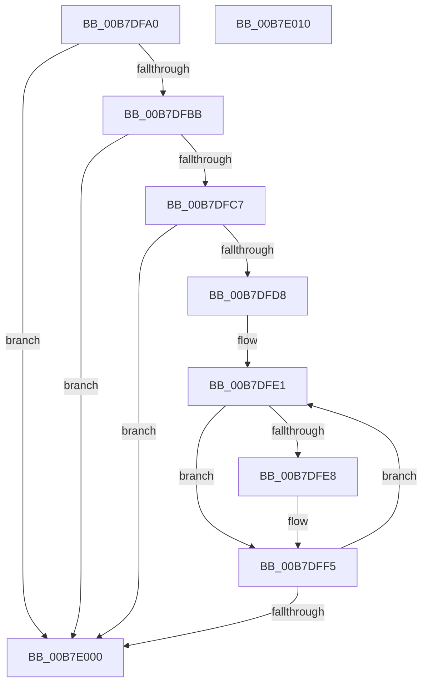

# PopBootLoaderSiDataProcess

- RVA: `0x00B7DFA0`–`0x00B7E011` (길이 `113` bytes)
- VA: `0x0000000140B7DFA0`
- 실행 섹션: `PAGELK`
- PDB 이름 있음: `예`; PDB Function 태그: `아니요`
- unwind 정보 RVA: `0x00060BC4`
- 디코드: `33`개 명령, `113/113` bytes 표시
- 미해석 바이트: `0` (있으면 어셈블리에 `.byte`로 보존)

> 이 문서는 커널 이미지의 기계어와 PDB 기호를 분석해 생성했습니다. 4번과 5번은 함수 원형과 자료형을 바이너리 사용 방식에서 추정한 C 해석이며 원본 소스 복구 결과는 아닙니다.

## 1. Dependencies

- 직접 호출 지점: **2**; 고유 호출 대상: **2**
- 직접 호출자로 확인된 함수: **1**
- RIP 상대 이미지 참조: **1**

### Outgoing calls
- `0x00B7DFCB` → [BapdRemoveWbclData](../B5/BapdRemoveWbclData_function_00B5B2EC.md) (function, `0x00B5B2EC`)
- `0x00B7DFF0` → [BapdRegisterSiData](BapdRegisterSiData_function_00B7B5B8.md) (function, `0x00B7B5B8`)

### Direct callers
- [sub_00B80364](../B8/Unknown_function_00B80364.md) at `0x00B8044E`

### Static image references
- `0x00B7DFAF` → RVA `0x00F0BD90` (`.data`; read)

## 2. Other-region calls and transfers

- 다른 실행 섹션으로 향하는 call: **0**
- 별도 외부 분기/꼬리 이동을 확인하지 못했습니다.

## 3. Assembly (complete function range)

```asm
00B7DFA0  48 89 5C 24 08                  mov qword ptr [rsp + 8], rbx
00B7DFA5  48 89 74 24 10                  mov qword ptr [rsp + 0x10], rsi
00B7DFAA  57                              push rdi
00B7DFAB  48 83 EC 20                     sub rsp, 0x20
00B7DFAF  48 8B 05 DA DD 38 00            mov rax, qword ptr [rip + 0x38ddda]
00B7DFB6  48 85 C0                        test rax, rax
00B7DFB9  74 45                           je 0x140b7e000
00B7DFBB  48 8B 88 E8 00 00 00            mov rcx, qword ptr [rax + 0xe8]
00B7DFC2  48 85 C9                        test rcx, rcx
00B7DFC5  74 39                           je 0x140b7e000
00B7DFC7  48 8B 71 20                     mov rsi, qword ptr [rcx + 0x20]
00B7DFCB  E8 1C D3 FD FF                  call 0x140b5b2ec
00B7DFD0  81 3E 48 69 62 4C               cmp dword ptr [rsi], 0x4c626948
00B7DFD6  75 28                           jne 0x140b7e000
00B7DFD8  BB 01 00 00 00                  mov ebx, 1
00B7DFDD  48 8D 7E 10                     lea rdi, [rsi + 0x10]
00B7DFE1  8B 57 04                        mov edx, dword ptr [rdi + 4]
00B7DFE4  85 D2                           test edx, edx
00B7DFE6  74 0D                           je 0x140b7dff5
00B7DFE8  8B 0F                           mov ecx, dword ptr [rdi]
00B7DFEA  44 8B C3                        mov r8d, ebx
00B7DFED  48 03 CE                        add rcx, rsi
00B7DFF0  E8 C3 D5 FF FF                  call 0x140b7b5b8
00B7DFF5  FF C3                           inc ebx
00B7DFF7  48 83 C7 08                     add rdi, 8
00B7DFFB  83 FB 02                        cmp ebx, 2
00B7DFFE  76 E1                           jbe 0x140b7dfe1
00B7E000  48 8B 5C 24 30                  mov rbx, qword ptr [rsp + 0x30]
00B7E005  48 8B 74 24 38                  mov rsi, qword ptr [rsp + 0x38]
00B7E00A  48 83 C4 20                     add rsp, 0x20
00B7E00E  5F                              pop rdi
00B7E00F  C3                              ret
00B7E010  CC                              int3
```

## 4. C-style interpretation (structured pseudocode)

```c
__int64 __fastcall PopBootLoaderSiDataProcess(void)
{
    __int64 result;
    __int64 v_rbx;
    __int64 v_rdi;
    __int64 v_rsp;
    unsigned __int64 v_stack_p10;
    unsigned __int64 v_stack_p8;

    v_stack_p8 = v_rbx;
    v_stack_p10 = v_rsi;
    v_rsp = (v_rsp) - (32);
    if (*(unsigned __int64 *)(v_rip + 3726810) == 0) goto loc_00B7E000;
    if (*(unsigned __int64 *)(*(unsigned __int64 *)(v_rip + 3726810) + 232) == 0) goto loc_00B7E000;
    result = BapdRemoveWbclData(*(unsigned __int64 *)(*(unsigned __int64 *)(v_rip + 3726810) + 232), a2, a3, a4);
    if ((*(unsigned int *)(*(unsigned __int64 *)(*(unsigned __int64 *)(*(unsigned __int64 *)(v_rip + 3726810) + 232) + 32))) != 0x4C626948ULL) goto loc_00B7E000;
loc_00B7DFE1:
    if ((unsigned int)((unsigned int)(*(unsigned int *)(*(unsigned __int64 *)(*(unsigned __int64 *)(*(unsigned __int64 *)(v_rip + 3726810) + 232) + 32) + 16 + 4))) != 0) {
        a1 = *(unsigned int *)(*(unsigned __int64 *)(*(unsigned __int64 *)(*(unsigned __int64 *)(v_rip + 3726810) + 232) + 32) + 16);
        a3 = 1;
        a1 = (a1) + (*(unsigned __int64 *)(*(unsigned __int64 *)(*(unsigned __int64 *)(v_rip + 3726810) + 232) + 32));
        result = BapdRegisterSiData(a1, (unsigned int)(*(unsigned int *)(*(unsigned __int64 *)(*(unsigned __int64 *)(*(unsigned __int64 *)(v_rip + 3726810) + 232) + 32) + 16 + 4)), a3, a4);
    }
    v_rbx = (unsigned int)((1) + 1);
    v_rdi = (*(unsigned __int64 *)(*(unsigned __int64 *)(*(unsigned __int64 *)(v_rip + 3726810) + 232) + 32) + 16) + (8);
    if (((unsigned int)(v_rbx)) <= 2) goto loc_00B7DFE1;
loc_00B7E000:
    v_rsp = (v_rsp) + (32);
    return result;
}
```

## 5. (Beta) C Style

```c
void PopBootLoaderSiDataProcess(void)
{
    int64_t result;
    int64_t local_rbx;
    int64_t local_rdi;
    int64_t local_rsp;
    uint64_t v_stack_p10;
    uint64_t v_stack_p8;

    v_stack_p8 = local_rbx;
    v_stack_p10 = local_rsi;
    local_rsp = (local_rsp) - (32);
    if (*(uint64_t *)(v_rip + 0x38DDDA) == 0) goto loc_00B7E000;
    if (*(uint64_t *)(*(uint64_t *)(v_rip + 0x38DDDA) + 0xE8) == 0) goto loc_00B7E000;
    result = BapdRemoveWbclData(*(uint64_t *)(*(uint64_t *)(v_rip + 0x38DDDA) + 0xE8), a2, a3, a4);
    if ((*(uint32_t *)(*(uint64_t *)(*(uint64_t *)(*(uint64_t *)(v_rip + 0x38DDDA) + 0xE8) + 0x20))) != 0x4C626948ULL) goto loc_00B7E000;
loc_00B7DFE1:
    if ((uint32_t)((uint32_t)(*(uint32_t *)(*(uint64_t *)(*(uint64_t *)(*(uint64_t *)(v_rip + 0x38DDDA) + 0xE8) + 0x20) + 0x10 + 0x4))) != 0) {
        a1 = *(uint32_t *)(*(uint64_t *)(*(uint64_t *)(*(uint64_t *)(v_rip + 0x38DDDA) + 0xE8) + 0x20) + 0x10);
        a3 = 1;
        a1 = (a1) + (*(uint64_t *)(*(uint64_t *)(*(uint64_t *)(v_rip + 0x38DDDA) + 0xE8) + 0x20));
        result = BapdRegisterSiData(a1, (uint32_t)(*(uint32_t *)(*(uint64_t *)(*(uint64_t *)(*(uint64_t *)(v_rip + 0x38DDDA) + 0xE8) + 0x20) + 0x10 + 0x4)), a3, a4);
    }
    local_rbx = (uint32_t)((1) + 1);
    local_rdi = (*(uint64_t *)(*(uint64_t *)(*(uint64_t *)(v_rip + 0x38DDDA) + 0xE8) + 0x20) + 16) + (8);
    if (((uint32_t)(local_rbx)) <= 2) goto loc_00B7DFE1;
loc_00B7E000:
    local_rsp = (local_rsp) + (32);
    return result;
}
```

## 6. Execution-region graph

[열기: 2D/3D 그래프와 함수 탐색 컨트롤 패널](../../../control-panel.html?section=pagelk&rva=0x00B7DFA0&view=graph)

- 2D 그래프는 위에서 아래로 흐르고, 3D 그래프는 빈 공간을 드래그해 회전합니다. Shift+드래그는 이동, 휠은 확대·축소, 함수 노드 선택은 대상 보고서 이동입니다.

### Static fallback


