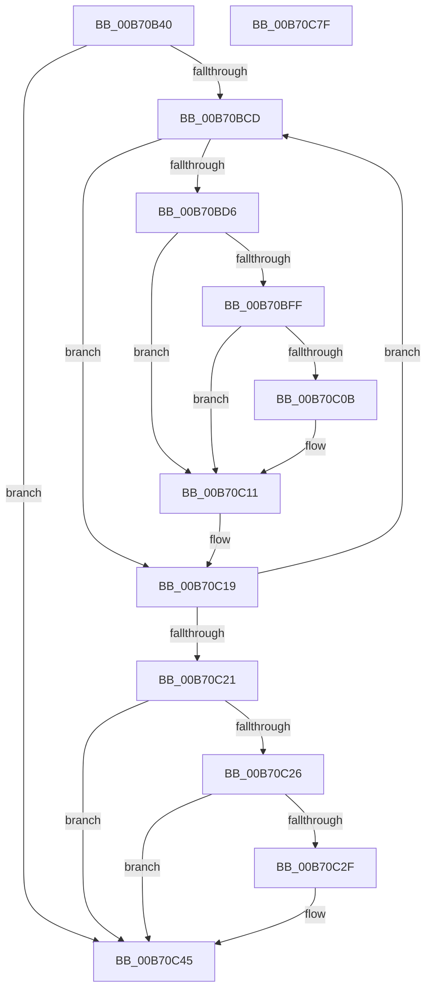

# PopBroadcastBlameBugcheckCallback

- RVA: `0x00B70B40`–`0x00B70C80` (길이 `320` bytes)
- VA: `0x0000000140B70B40`
- 실행 섹션: `PAGELK`
- PDB 이름 있음: `예`; PDB Function 태그: `아니요`
- unwind 정보 RVA: `0x000C3AF8`
- 디코드: `83`개 명령, `320/320` bytes 표시
- 미해석 바이트: `0` (있으면 어셈블리에 `.byte`로 보존)

> 이 문서는 커널 이미지의 기계어와 PDB 기호를 분석해 생성했습니다. 4번과 5번은 함수 원형과 자료형을 바이너리 사용 방식에서 추정한 C 해석이며 원본 소스 복구 결과는 아닙니다.

## 1. Dependencies

- 직접 호출 지점: **8**; 고유 호출 대상: **6**
- 직접 호출자로 확인된 함수: **0**
- RIP 상대 이미지 참조: **4**

### Outgoing calls
- `0x00B70B88` → [KeAcquireInStackQueuedSpinLock](../../text/27/KeAcquireInStackQueuedSpinLock_function_002757A0.md) (function, `0x002757A0`)
- `0x00B70B99` → [KeAcquireInStackQueuedSpinLock](../../text/27/KeAcquireInStackQueuedSpinLock_function_002757A0.md) (function, `0x002757A0`)
- `0x00B70BB0` → [KiQueryUnbiasedInterruptTime](../../text/42/KiQueryUnbiasedInterruptTime_function_0042D180.md) (function, `0x0042D180`)
- `0x00B70BF1` → [KeAcquireSpinLockAtDpcLevel](../../text/20/KeAcquireSpinLockAtDpcLevel_function_00208430.md) (function, `0x00208430`)
- `0x00B70C14` → [KxReleaseSpinLock](../../text/20/KxReleaseSpinLock_function_00206670.md) (function, `0x00206670`)
- `0x00B70C40` → [PopIrpWatchdogBugcheck](../../text/5C/PopIrpWatchdogBugcheck_function_005CE868.md) (function, `0x005CE868`)
- `0x00B70C52` → [KeReleaseInStackQueuedSpinLock](../../text/34/KeReleaseInStackQueuedSpinLock_function_00342CE0.md) (function, `0x00342CE0`)
- `0x00B70C5C` → [KeReleaseInStackQueuedSpinLock](../../text/34/KeReleaseInStackQueuedSpinLock_function_00342CE0.md) (function, `0x00342CE0`)

### Direct callers
- 이 함수 시작 RVA로 연결되는 직접 call은 확인되지 않았습니다. 간접 호출은 완전히 역산할 수 없습니다.

### Static image references
- `0x00B70B5C` → RVA `0x00F0BCD0` (`.data`; read)
- `0x00B70B92` → RVA `0x00F0CA50` (`.data`; read)
- `0x00B70BA9` → RVA `0x00F0BD28` (`.data`; write)
- `0x00B70C45` → RVA `0x00F0BD28` (`.data`; read/write)

## 2. Other-region calls and transfers

- 다른 실행 섹션으로 향하는 call: **8**
  - `0x00B70B88` → [KeAcquireInStackQueuedSpinLock](../../text/27/KeAcquireInStackQueuedSpinLock_function_002757A0.md) (`PAGELK` → `.text`)
  - `0x00B70B99` → [KeAcquireInStackQueuedSpinLock](../../text/27/KeAcquireInStackQueuedSpinLock_function_002757A0.md) (`PAGELK` → `.text`)
  - `0x00B70BB0` → [KiQueryUnbiasedInterruptTime](../../text/42/KiQueryUnbiasedInterruptTime_function_0042D180.md) (`PAGELK` → `.text`)
  - `0x00B70BF1` → [KeAcquireSpinLockAtDpcLevel](../../text/20/KeAcquireSpinLockAtDpcLevel_function_00208430.md) (`PAGELK` → `.text`)
  - `0x00B70C14` → [KxReleaseSpinLock](../../text/20/KxReleaseSpinLock_function_00206670.md) (`PAGELK` → `.text`)
  - `0x00B70C40` → [PopIrpWatchdogBugcheck](../../text/5C/PopIrpWatchdogBugcheck_function_005CE868.md) (`PAGELK` → `.text`)
  - `0x00B70C52` → [KeReleaseInStackQueuedSpinLock](../../text/34/KeReleaseInStackQueuedSpinLock_function_00342CE0.md) (`PAGELK` → `.text`)
  - `0x00B70C5C` → [KeReleaseInStackQueuedSpinLock](../../text/34/KeReleaseInStackQueuedSpinLock_function_00342CE0.md) (`PAGELK` → `.text`)
- 별도 외부 분기/꼬리 이동을 확인하지 못했습니다.

## 3. Assembly (complete function range)

```asm
00B70B40  4C 8B DC                        mov r11, rsp
00B70B43  49 89 5B 08                     mov qword ptr [r11 + 8], rbx
00B70B47  49 89 6B 10                     mov qword ptr [r11 + 0x10], rbp
00B70B4B  49 89 73 18                     mov qword ptr [r11 + 0x18], rsi
00B70B4F  57                              push rdi
00B70B50  41 54                           push r12
00B70B52  41 55                           push r13
00B70B54  41 56                           push r14
00B70B56  41 57                           push r15
00B70B58  48 83 EC 50                     sub rsp, 0x50
00B70B5C  48 8B 0D 6D B1 39 00            mov rcx, qword ptr [rip + 0x39b16d]
00B70B63  33 C0                           xor eax, eax
00B70B65  0F 57 C0                        xorps xmm0, xmm0
00B70B68  0F 57 C9                        xorps xmm1, xmm1
00B70B6B  4C 8B E2                        mov r12, rdx
00B70B6E  48 83 C1 08                     add rcx, 8
00B70B72  0F 11 44 24 38                  movups xmmword ptr [rsp + 0x38], xmm0
00B70B77  49 8D 53 C0                     lea rdx, [r11 - 0x40]
00B70B7B  49 89 43 D0                     mov qword ptr [r11 - 0x30], rax
00B70B7F  0F 11 4C 24 20                  movups xmmword ptr [rsp + 0x20], xmm1
00B70B84  49 89 43 B8                     mov qword ptr [r11 - 0x48], rax
00B70B88  E8 13 4C 70 FF                  call 0x1402757a0
00B70B8D  48 8D 54 24 20                  lea rdx, [rsp + 0x20]
00B70B92  48 8D 0D B7 BE 39 00            lea rcx, [rip + 0x39beb7]
00B70B99  E8 02 4C 70 FF                  call 0x1402757a0
00B70B9E  65 48 8B 04 25 88 01 00 00      mov rax, qword ptr gs:[0x188]
00B70BA7  B1 01                           mov cl, 1
00B70BA9  48 89 05 78 B1 39 00            mov qword ptr [rip + 0x39b178], rax
00B70BB0  E8 CB C5 8B FF                  call 0x14042d180
00B70BB5  49 81 C4 B0 01 00 00            add r12, 0x1b0
00B70BBC  33 FF                           xor edi, edi
00B70BBE  45 33 F6                        xor r14d, r14d
00B70BC1  4C 8B E8                        mov r13, rax
00B70BC4  49 8B 1C 24                     mov rbx, qword ptr [r12]
00B70BC8  49 3B DC                        cmp rbx, r12
00B70BCB  74 78                           je 0x140b70c45
00B70BCD  48 8B 73 78                     mov rsi, qword ptr [rbx + 0x78]
00B70BD1  48 85 F6                        test rsi, rsi
00B70BD4  74 43                           je 0x140b70c19
00B70BD6  48 0F BE 46 42                  movsx rax, byte ptr [rsi + 0x42]
00B70BDB  48 8D 0C C0                     lea rcx, [rax + rax*8]
00B70BDF  48 8B AC CE C8 00 00 00         mov rbp, qword ptr [rsi + rcx*8 + 0xc8]
00B70BE7  4C 8D BD 20 01 00 00            lea r15, [rbp + 0x120]
00B70BEE  49 8B CF                        mov rcx, r15
00B70BF1  E8 3A 78 69 FF                  call 0x140208430
00B70BF6  83 BD 28 01 00 00 01            cmp dword ptr [rbp + 0x128], 1
00B70BFD  75 12                           jne 0x140b70c11
00B70BFF  48 8B 45 30                     mov rax, qword ptr [rbp + 0x30]
00B70C03  49 2B C5                        sub rax, r13
00B70C06  49 3B C6                        cmp rax, r14
00B70C09  72 06                           jb 0x140b70c11
00B70C0B  4C 8B F0                        mov r14, rax
00B70C0E  48 8B FE                        mov rdi, rsi
00B70C11  49 8B CF                        mov rcx, r15
00B70C14  E8 57 5A 69 FF                  call 0x140206670
00B70C19  48 8B 1B                        mov rbx, qword ptr [rbx]
00B70C1C  49 3B DC                        cmp rbx, r12
00B70C1F  75 AC                           jne 0x140b70bcd
00B70C21  48 85 FF                        test rdi, rdi
00B70C24  74 1F                           je 0x140b70c45
00B70C26  49 81 FE 00 A3 E1 11            cmp r14, 0x11e1a300
00B70C2D  72 16                           jb 0x140b70c45
00B70C2F  48 0F BE 47 42                  movsx rax, byte ptr [rdi + 0x42]
00B70C34  48 8D 0C C0                     lea rcx, [rax + rax*8]
00B70C38  48 8B 8C CF C8 00 00 00         mov rcx, qword ptr [rdi + rcx*8 + 0xc8]
00B70C40  E8 23 DC A5 FF                  call 0x1405ce868
00B70C45  48 83 25 DB B0 39 00 00         and qword ptr [rip + 0x39b0db], 0
00B70C4D  48 8D 4C 24 20                  lea rcx, [rsp + 0x20]
00B70C52  E8 89 20 7D FF                  call 0x140342ce0
00B70C57  48 8D 4C 24 38                  lea rcx, [rsp + 0x38]
00B70C5C  E8 7F 20 7D FF                  call 0x140342ce0
00B70C61  4C 8D 5C 24 50                  lea r11, [rsp + 0x50]
00B70C66  49 8B 5B 30                     mov rbx, qword ptr [r11 + 0x30]
00B70C6A  49 8B 6B 38                     mov rbp, qword ptr [r11 + 0x38]
00B70C6E  49 8B 73 40                     mov rsi, qword ptr [r11 + 0x40]
00B70C72  49 8B E3                        mov rsp, r11
00B70C75  41 5F                           pop r15
00B70C77  41 5E                           pop r14
00B70C79  41 5D                           pop r13
00B70C7B  41 5C                           pop r12
00B70C7D  5F                              pop rdi
00B70C7E  C3                              ret
00B70C7F  CC                              int3
```

## 4. C-style interpretation (structured pseudocode)

```c
__int64 __fastcall PopBroadcastBlameBugcheckCallback(__int64 a1, __int64 a2)
{
    __int64 result;
    __int64 v_r12;
    __int64 v_r14;
    __int64 v_rdi;
    __int64 v_rsp;
    unsigned __int64 v_stack_m28;
    unsigned __int64 v_stack_m40;
    unsigned __int64 v_stack_m58;

    *(unsigned __int64 *)(v_rsp + 8) = v_rbx;
    *(unsigned __int64 *)(v_rsp + 16) = v_rbp;
    *(unsigned __int64 *)(v_rsp + 24) = v_rsi;
    v_rsp = (v_rsp) - (80);
    result = 0;
    a1 = (*(unsigned __int64 *)(v_rip + 3780973)) + (8);
    v_stack_m40 = v_xmm0;
    *(unsigned __int64 *)(v_rsp - 48) = 0;
    v_stack_m58 = v_xmm1;
    *(unsigned __int64 *)(v_rsp - 72) = 0;
    result = KeAcquireInStackQueuedSpinLock(a1, v_rsp - 64, a3, a4);
    result = KeAcquireInStackQueuedSpinLock(v_rip + 3784375, v_stack_m58, a3, a4);
    *(unsigned __int64 *)(v_rip + 3780984) = *(unsigned __int64 *)(gs_base + (0 + 392));
    result = KiQueryUnbiasedInterruptTime(1, v_stack_m58, a3, a4);
    v_r12 = (a2) + (432);
    v_rdi = 0;
    v_r14 = 0;
    if ((*(unsigned __int64 *)(v_r12)) == v_r12) goto loc_00B70C45;
loc_00B70BCD:
    if (*(unsigned __int64 *)(*(unsigned __int64 *)(v_r12) + 120) == 0) goto loc_00B70C19;
    result = KeAcquireSpinLockAtDpcLevel(*(unsigned __int64 *)(*(unsigned __int64 *)(*(unsigned __int64 *)(v_r12) + 120) + (__int8)(*(unsigned __int8 *)(*(unsigned __int64 *)(*(unsigned __int64 *)(v_r12) + 120) + 66)) + (__int8)(*(unsigned __int8 *)(*(unsigned __int64 *)(*(unsigned __int64 *)(v_r12) + 120) + 66)) * 8 * 8 + 200) + 288, v_stack_m58, a3, a4);
    if ((*(unsigned int *)(*(unsigned __int64 *)(*(unsigned __int64 *)(*(unsigned __int64 *)(v_r12) + 120) + (__int8)(*(unsigned __int8 *)(*(unsigned __int64 *)(*(unsigned __int64 *)(v_r12) + 120) + 66)) + (__int8)(*(unsigned __int8 *)(*(unsigned __int64 *)(*(unsigned __int64 *)(v_r12) + 120) + 66)) * 8 * 8 + 200) + 296)) != 1) goto loc_00B70C11;
    result = (*(unsigned __int64 *)(*(unsigned __int64 *)(*(unsigned __int64 *)(*(unsigned __int64 *)(v_r12) + 120) + (__int8)(*(unsigned __int8 *)(*(unsigned __int64 *)(*(unsigned __int64 *)(v_r12) + 120) + 66)) + (__int8)(*(unsigned __int8 *)(*(unsigned __int64 *)(*(unsigned __int64 *)(v_r12) + 120) + 66)) * 8 * 8 + 200) + 48)) - (result);
    if (result >= 0) {
        v_r14 = result;
        v_rdi = *(unsigned __int64 *)(*(unsigned __int64 *)(v_r12) + 120);
    }
    result = KxReleaseSpinLock(*(unsigned __int64 *)(*(unsigned __int64 *)(*(unsigned __int64 *)(v_r12) + 120) + (__int8)(*(unsigned __int8 *)(*(unsigned __int64 *)(*(unsigned __int64 *)(v_r12) + 120) + 66)) + (__int8)(*(unsigned __int8 *)(*(unsigned __int64 *)(*(unsigned __int64 *)(v_r12) + 120) + 66)) * 8 * 8 + 200) + 288, v_stack_m58, a3, a4);
loc_00B70C19:
    if ((*(unsigned __int64 *)(*(unsigned __int64 *)(v_r12))) != v_r12) goto loc_00B70BCD;
    if (v_rdi == 0) goto loc_00B70C45;
    if (v_r14 >= 0x11E1A300ULL) {
        result = (__int8)(*(unsigned __int8 *)(v_rdi + 66));
        a1 = result + result * 8;
        a1 = *(unsigned __int64 *)(v_rdi + a1 * 8 + 200);
        result = PopIrpWatchdogBugcheck(a1, v_stack_m58, a3, a4);
    }
    result = KeReleaseInStackQueuedSpinLock(v_stack_m58, v_stack_m58, a3, a4);
    result = KeReleaseInStackQueuedSpinLock(v_stack_m40, v_stack_m58, a3, a4);
    return result;
}
```

## 5. (Beta) C Style

```c
int64_t PopBroadcastBlameBugcheckCallback(int64_t Arg1, void *Arg2)
{
    uint8_t *arg2 = (uint8_t *)Arg2;

    int64_t result;
    int64_t local_r12;
    int64_t local_r14;
    int64_t local_rdi;
    int64_t local_rsp;
    uint64_t v_stack_m28;
    uint64_t v_stack_m40;
    uint64_t v_stack_m58;

    *(uint64_t *)(local_rsp + 0x8) = local_rbx;
    *(uint64_t *)(local_rsp + 0x10) = local_rbp;
    *(uint64_t *)(local_rsp + 0x18) = local_rsi;
    local_rsp = (local_rsp) - (80);
    result = 0;
    Arg1 = (*(uint64_t *)(v_rip + 0x39B16D)) + (8);
    v_stack_m40 = v_xmm0;
    *(uint64_t *)(local_rsp - 0x30) = 0;
    v_stack_m58 = v_xmm1;
    *(uint64_t *)(local_rsp - 0x48) = 0;
    result = KeAcquireInStackQueuedSpinLock(Arg1, local_rsp - 64, a3, a4);
    result = KeAcquireInStackQueuedSpinLock(v_rip + 3784375, v_stack_m58, a3, a4);
    *(uint64_t *)(v_rip + 0x39B178) = *(uint64_t *)(gs_base + (0 + 0x188));
    result = KiQueryUnbiasedInterruptTime(1, v_stack_m58, a3, a4);
    local_r12 = (Arg2) + (432);
    local_rdi = 0;
    local_r14 = 0;
    if ((*(uint64_t *)(local_r12)) == local_r12) goto loc_00B70C45;
loc_00B70BCD:
    if (*(uint64_t *)(*(uint64_t *)(local_r12) + 0x78) == 0) goto loc_00B70C19;
    result = KeAcquireSpinLockAtDpcLevel(*(uint64_t *)(*(uint64_t *)(*(uint64_t *)(local_r12) + 0x78) + (int8_t)(*(uint8_t *)(*(uint64_t *)(*(uint64_t *)(local_r12) + 0x78) + 0x42)) + (int8_t)(*(uint8_t *)(*(uint64_t *)(*(uint64_t *)(local_r12) + 0x78) + 0x42)) * 8 * 8 + 0xC8) + 288, v_stack_m58, a3, a4);
    if ((*(uint32_t *)(*(uint64_t *)(*(uint64_t *)(*(uint64_t *)(local_r12) + 0x78) + (int8_t)(*(uint8_t *)(*(uint64_t *)(*(uint64_t *)(local_r12) + 0x78) + 0x42)) + (int8_t)(*(uint8_t *)(*(uint64_t *)(*(uint64_t *)(local_r12) + 0x78) + 0x42)) * 8 * 8 + 0xC8) + 0x128)) != 1) goto loc_00B70C11;
    result = (*(uint64_t *)(*(uint64_t *)(*(uint64_t *)(*(uint64_t *)(local_r12) + 0x78) + (int8_t)(*(uint8_t *)(*(uint64_t *)(*(uint64_t *)(local_r12) + 0x78) + 0x42)) + (int8_t)(*(uint8_t *)(*(uint64_t *)(*(uint64_t *)(local_r12) + 0x78) + 0x42)) * 8 * 8 + 0xC8) + 0x30)) - (result);
    if (result >= 0) {
        local_r14 = result;
        local_rdi = *(uint64_t *)(*(uint64_t *)(local_r12) + 0x78);
    }
    result = KxReleaseSpinLock(*(uint64_t *)(*(uint64_t *)(*(uint64_t *)(local_r12) + 0x78) + (int8_t)(*(uint8_t *)(*(uint64_t *)(*(uint64_t *)(local_r12) + 0x78) + 0x42)) + (int8_t)(*(uint8_t *)(*(uint64_t *)(*(uint64_t *)(local_r12) + 0x78) + 0x42)) * 8 * 8 + 0xC8) + 288, v_stack_m58, a3, a4);
loc_00B70C19:
    if ((*(uint64_t *)(*(uint64_t *)(local_r12))) != local_r12) goto loc_00B70BCD;
    if (local_rdi == 0) goto loc_00B70C45;
    if (local_r14 >= 0x11E1A300ULL) {
        result = (int8_t)(*(uint8_t *)(local_rdi + 0x42));
        Arg1 = result + result * 8;
        Arg1 = *(uint64_t *)(local_rdi + Arg1 * 8 + 0xC8);
        result = PopIrpWatchdogBugcheck(Arg1, v_stack_m58, a3, a4);
    }
    result = KeReleaseInStackQueuedSpinLock(v_stack_m58, v_stack_m58, a3, a4);
    result = KeReleaseInStackQueuedSpinLock(v_stack_m40, v_stack_m58, a3, a4);
    return result;
}
```

### 관측된 메모리 오프셋

구조체 형식이 확인되지 않은 접근은 인자 기준의 오프셋으로만 기록했습니다.

| 기준 인자 | 오프셋 표현 | 폭 (bit) | 접근 |
|---|---:|---:|---|
| `Arg2` | `+ 0x0` | `64` | `R` |

## 6. Execution-region graph

[열기: 2D/3D 그래프와 함수 탐색 컨트롤 패널](../../../control-panel.html?section=pagelk&rva=0x00B70B40&view=graph)

- 2D 그래프는 위에서 아래로 흐르고, 3D 그래프는 빈 공간을 드래그해 회전합니다. Shift+드래그는 이동, 휠은 확대·축소, 함수 노드 선택은 대상 보고서 이동입니다.

### Static fallback


