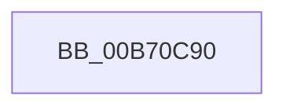

# PopBuildDeviceNotifyListWatchdog

- RVA: `0x00B70C90`–`0x00B70CAD` (길이 `29` bytes)
- VA: `0x0000000140B70C90`
- 실행 섹션: `PAGELK`
- PDB 이름 있음: `예`; PDB Function 태그: `아니요`
- unwind 정보 RVA: `0x0007E574`
- 디코드: `8`개 명령, `29/29` bytes 표시
- 미해석 바이트: `0` (있으면 어셈블리에 `.byte`로 보존)

> 이 문서는 커널 이미지의 기계어와 PDB 기호를 분석해 생성했습니다. 4번과 5번은 함수 원형과 자료형을 바이너리 사용 방식에서 추정한 C 해석이며 원본 소스 복구 결과는 아닙니다.

## 1. Dependencies

- 직접 호출 지점: **2**; 고유 호출 대상: **2**
- 직접 호출자로 확인된 함수: **0**
- RIP 상대 이미지 참조: **1**

### Outgoing calls
- `0x00B70C9C` → [KeSetEvent](../../text/33/KeSetEvent_function_0033F310.md) (function, `0x0033F310`)
- `0x00B70CA7` → [PnpBugcheckPowerTimeout](../../text/5A/PnpBugcheckPowerTimeout_function_005A6A34.md) (function, `0x005A6A34`)

### Direct callers
- 이 함수 시작 RVA로 연결되는 직접 call은 확인되지 않았습니다. 간접 호출은 완전히 역산할 수 없습니다.

### Static image references
- `0x00B70CA1` → RVA `0x00FC5090` (`ALMOSTRO`; read)

## 2. Other-region calls and transfers

- 다른 실행 섹션으로 향하는 call: **2**
  - `0x00B70C9C` → [KeSetEvent](../../text/33/KeSetEvent_function_0033F310.md) (`PAGELK` → `.text`)
  - `0x00B70CA7` → [PnpBugcheckPowerTimeout](../../text/5A/PnpBugcheckPowerTimeout_function_005A6A34.md) (`PAGELK` → `.text`)
- 별도 외부 분기/꼬리 이동을 확인하지 못했습니다.

## 3. Assembly (complete function range)

```asm
00B70C90  48 83 EC 28                     sub rsp, 0x28
00B70C94  48 8B CA                        mov rcx, rdx
00B70C97  45 33 C0                        xor r8d, r8d
00B70C9A  33 D2                           xor edx, edx
00B70C9C  E8 6F E6 7C FF                  call 0x14033f310
00B70CA1  8B 0D E9 43 45 00               mov ecx, dword ptr [rip + 0x4543e9]
00B70CA7  E8 88 5D A3 FF                  call 0x1405a6a34
00B70CAC  CC                              int3
```

## 4. C-style interpretation (structured pseudocode)

```c
__int64 __fastcall PopBuildDeviceNotifyListWatchdog(__int64 a1, __int64 a2, int a3)
{
    __int64 result;
    __int64 v_rsp;

    v_rsp = (v_rsp) - (40);
    a3 = 0;
    a2 = 0;
    result = KeSetEvent(a2, a2, a3, a4);
    result = PnpBugcheckPowerTimeout((unsigned int)(*(unsigned int *)(v_rip + 4539369)), a2, a3, a4);
    return result;
}
```

## 5. (Beta) C Style

```c
int64_t PopBuildDeviceNotifyListWatchdog(int64_t Arg1, int64_t Arg2, int32_t Arg3)
{
    int64_t result;
    int64_t local_rsp;

    local_rsp = (local_rsp) - (40);
    Arg3 = 0;
    Arg2 = 0;
    result = KeSetEvent(Arg2, Arg2, Arg3, a4);
    result = PnpBugcheckPowerTimeout((uint32_t)(*(uint32_t *)(v_rip + 0x4543E9)), Arg2, Arg3, a4);
    return result;
}
```

## 6. Execution-region graph

[열기: 2D/3D 그래프와 함수 탐색 컨트롤 패널](../../../control-panel.html?section=pagelk&rva=0x00B70C90&view=graph)

- 2D 그래프는 위에서 아래로 흐르고, 3D 그래프는 빈 공간을 드래그해 회전합니다. Shift+드래그는 이동, 휠은 확대·축소, 함수 노드 선택은 대상 보고서 이동입니다.

### Static fallback


