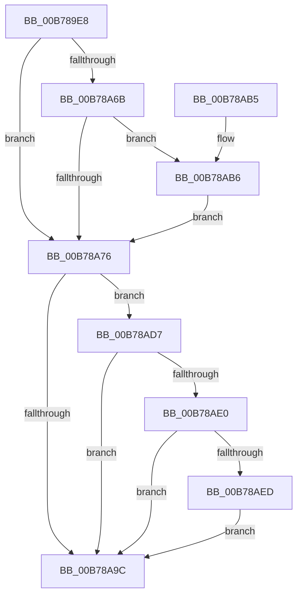

# PopBuildDeviceNotifyList

- RVA: `0x00B789E8`–`0x00B78B06` (길이 `286` bytes)
- VA: `0x0000000140B789E8`
- 실행 섹션: `PAGELK`
- PDB 이름 있음: `예`; PDB Function 태그: `아니요`
- unwind 정보 RVA: `0x000AF47C`
- 디코드: `76`개 명령, `286/286` bytes 표시
- 미해석 바이트: `0` (있으면 어셈블리에 `.byte`로 보존)

> 이 문서는 커널 이미지의 기계어와 PDB 기호를 분석해 생성했습니다. 4번과 5번은 함수 원형과 자료형을 바이너리 사용 방식에서 추정한 C 해석이며 원본 소스 복구 결과는 아닙니다.

## 1. Dependencies

- 직접 호출 지점: **10**; 고유 호출 대상: **9**
- 직접 호출자로 확인된 함수: **2**
- RIP 상대 이미지 참조: **4**

### Outgoing calls
- `0x00B78A32` → [memset](../../text/6C/memset_function_006C6C40.md) (function, `0x006C6C40`)
- `0x00B78A42` → [KeInitializeEvent](../../text/40/KeInitializeEvent_function_0040DD10.md) (function, `0x0040DD10`)
- `0x00B78A4B` → [KeInitializeTimer](../../text/45/KeInitializeTimer_function_0045B590.md) (function, `0x0045B590`)
- `0x00B78A5F` → [KeInitializeDpc](../../text/45/KeInitializeDpc_function_0045BBD0.md) (function, `0x0045BBD0`)
- `0x00B78A7D` → [PopDiagTraceEventNoPayload](../../text/49/PopDiagTraceEventNoPayload_function_004982F8.md) (function, `0x004982F8`)
- `0x00B78A87` → [IoBuildPoDeviceNotifyList](IoBuildPoDeviceNotifyList_function_00B78B0C.md) (function, `0x00B78B0C`)
- `0x00B78A93` → [PopDiagTraceEventNoPayload](../../text/49/PopDiagTraceEventNoPayload_function_004982F8.md) (function, `0x004982F8`)
- `0x00B78AD0` → [KiSetTimerEx](../../text/23/KiSetTimerEx_function_00232CB0.md) (function, `0x00232CB0`)
- `0x00B78AE4` → [KeCancelTimer](../../text/23/KeCancelTimer_function_002327E0.md) (function, `0x002327E0`)
- `0x00B78AFF` → [KeWaitForSingleObject](../../text/20/KeWaitForSingleObject_function_0020E6B0.md) (function, `0x0020E6B0`)

### Direct callers
- [PoInitializeBroadcast](../../page/A4/PoInitializeBroadcast_function_00A4DD98.md) at `0x00A4DE61`
- [PopGracefulShutdown](../B6/PopGracefulShutdown_function_00B6BEC8.md) at `0x00B6C193`

### Static image references
- `0x00B78A54` → RVA `0x00B70C90` (`PopBuildDeviceNotifyListWatchdog`; read)
- `0x00B78A6B` → RVA `0x00FC5090` (`ALMOSTRO`; read)
- `0x00B78A76` → RVA `0x0001A570` (`.rdata`; read)
- `0x00B78A8C` → RVA `0x0001A580` (`.rdata`; read)

## 2. Other-region calls and transfers

- 다른 실행 섹션으로 향하는 call: **9**
  - `0x00B78A32` → [memset](../../text/6C/memset_function_006C6C40.md) (`PAGELK` → `.text`)
  - `0x00B78A42` → [KeInitializeEvent](../../text/40/KeInitializeEvent_function_0040DD10.md) (`PAGELK` → `.text`)
  - `0x00B78A4B` → [KeInitializeTimer](../../text/45/KeInitializeTimer_function_0045B590.md) (`PAGELK` → `.text`)
  - `0x00B78A5F` → [KeInitializeDpc](../../text/45/KeInitializeDpc_function_0045BBD0.md) (`PAGELK` → `.text`)
  - `0x00B78A7D` → [PopDiagTraceEventNoPayload](../../text/49/PopDiagTraceEventNoPayload_function_004982F8.md) (`PAGELK` → `.text`)
  - `0x00B78A93` → [PopDiagTraceEventNoPayload](../../text/49/PopDiagTraceEventNoPayload_function_004982F8.md) (`PAGELK` → `.text`)
  - `0x00B78AD0` → [KiSetTimerEx](../../text/23/KiSetTimerEx_function_00232CB0.md) (`PAGELK` → `.text`)
  - `0x00B78AE4` → [KeCancelTimer](../../text/23/KeCancelTimer_function_002327E0.md) (`PAGELK` → `.text`)
  - `0x00B78AFF` → [KeWaitForSingleObject](../../text/20/KeWaitForSingleObject_function_0020E6B0.md) (`PAGELK` → `.text`)
- 별도 외부 분기/꼬리 이동을 확인하지 못했습니다.

## 3. Assembly (complete function range)

```asm
00B789E8  48 8B C4                        mov rax, rsp
00B789EB  48 89 58 08                     mov qword ptr [rax + 8], rbx
00B789EF  48 89 70 10                     mov qword ptr [rax + 0x10], rsi
00B789F3  48 89 78 18                     mov qword ptr [rax + 0x18], rdi
00B789F7  55                              push rbp
00B789F8  48 8D 68 A1                     lea rbp, [rax - 0x5f]
00B789FC  48 81 EC D0 00 00 00            sub rsp, 0xd0
00B78A03  33 C0                           xor eax, eax
00B78A05  0F 57 C0                        xorps xmm0, xmm0
00B78A08  8B FA                           mov edi, edx
00B78A0A  48 89 45 07                     mov qword ptr [rbp + 7], rax
00B78A0E  48 8B F1                        mov rsi, rcx
00B78A11  89 45 0F                        mov dword ptr [rbp + 0xf], eax
00B78A14  33 D2                           xor edx, edx
00B78A16  48 89 45 C7                     mov qword ptr [rbp - 0x39], rax
00B78A1A  44 8D 40 40                     lea r8d, [rax + 0x40]
00B78A1E  48 8D 4D 17                     lea rcx, [rbp + 0x17]
00B78A22  0F 11 45 D7                     movups xmmword ptr [rbp - 0x29], xmm0
00B78A26  0F 11 45 E7                     movups xmmword ptr [rbp - 0x19], xmm0
00B78A2A  0F 11 45 F7                     movups xmmword ptr [rbp - 9], xmm0
00B78A2E  0F 11 45 B7                     movups xmmword ptr [rbp - 0x49], xmm0
00B78A32  E8 09 E2 B4 FF                  call 0x1406c6c40
00B78A37  45 33 C0                        xor r8d, r8d
00B78A3A  48 8D 4D B7                     lea rcx, [rbp - 0x49]
00B78A3E  41 8D 50 01                     lea edx, [r8 + 1]
00B78A42  E8 C9 52 89 FF                  call 0x14040dd10
00B78A47  48 8D 4D 17                     lea rcx, [rbp + 0x17]
00B78A4B  E8 40 2B 8E FF                  call 0x14045b590
00B78A50  4C 8D 45 B7                     lea r8, [rbp - 0x49]
00B78A54  48 8D 15 35 82 FF FF            lea rdx, [rip - 0x7dcb]
00B78A5B  48 8D 4D D7                     lea rcx, [rbp - 0x29]
00B78A5F  E8 6C 31 8E FF                  call 0x14045bbd0
00B78A64  8B DF                           mov ebx, edi
00B78A66  83 E3 04                        and ebx, 4
00B78A69  75 0B                           jne 0x140b78a76
00B78A6B  48 63 05 1E C6 44 00            movsxd rax, dword ptr [rip + 0x44c61e]
00B78A72  85 C0                           test eax, eax
00B78A74  75 40                           jne 0x140b78ab6
00B78A76  48 8D 0D F3 1A 4A FF            lea rcx, [rip - 0xb5e50d]
00B78A7D  E8 76 F8 91 FF                  call 0x1404982f8
00B78A82  8B D7                           mov edx, edi
00B78A84  48 8B CE                        mov rcx, rsi
00B78A87  E8 80 00 00 00                  call 0x140b78b0c
00B78A8C  48 8D 0D ED 1A 4A FF            lea rcx, [rip - 0xb5e513]
00B78A93  E8 60 F8 91 FF                  call 0x1404982f8
00B78A98  85 DB                           test ebx, ebx
00B78A9A  74 3B                           je 0x140b78ad7
00B78A9C  4C 8D 9C 24 D0 00 00 00         lea r11, [rsp + 0xd0]
00B78AA4  49 8B 5B 10                     mov rbx, qword ptr [r11 + 0x10]
00B78AA8  49 8B 73 18                     mov rsi, qword ptr [r11 + 0x18]
00B78AAC  49 8B 7B 20                     mov rdi, qword ptr [r11 + 0x20]
00B78AB0  49 8B E3                        mov rsp, r11
00B78AB3  5D                              pop rbp
00B78AB4  C3                              ret
00B78AB5  CC                              int3
00B78AB6  48 69 D0 80 69 67 FF            imul rdx, rax, -0x989680
00B78ABD  48 8D 45 D7                     lea rax, [rbp - 0x29]
00B78AC1  45 33 C9                        xor r9d, r9d
00B78AC4  45 33 C0                        xor r8d, r8d
00B78AC7  48 89 44 24 20                  mov qword ptr [rsp + 0x20], rax
00B78ACC  48 8D 4D 17                     lea rcx, [rbp + 0x17]
00B78AD0  E8 DB A1 6B FF                  call 0x140232cb0
00B78AD5  EB 9F                           jmp 0x140b78a76
00B78AD7  83 3D B2 C5 44 00 00            cmp dword ptr [rip + 0x44c5b2], 0
00B78ADE  74 BC                           je 0x140b78a9c
00B78AE0  48 8D 4D 17                     lea rcx, [rbp + 0x17]
00B78AE4  E8 F7 9C 6B FF                  call 0x1402327e0
00B78AE9  84 C0                           test al, al
00B78AEB  75 AF                           jne 0x140b78a9c
00B78AED  48 83 64 24 20 00               and qword ptr [rsp + 0x20], 0
00B78AF3  48 8D 4D B7                     lea rcx, [rbp - 0x49]
00B78AF7  45 33 C9                        xor r9d, r9d
00B78AFA  45 33 C0                        xor r8d, r8d
00B78AFD  33 D2                           xor edx, edx
00B78AFF  E8 AC 5B 69 FF                  call 0x14020e6b0
00B78B04  EB 96                           jmp 0x140b78a9c
```

## 4. C-style interpretation (structured pseudocode)

```c
__int64 __fastcall PopBuildDeviceNotifyList(__int64 a1, int a2, __int64 a3, int a4)
{
    __int64 result;
    __int64 v_rbx;
    __int64 v_rsp;
    unsigned __int64 v_stack_m8;
    unsigned __int64 v_stack_mB0;

    *(unsigned __int64 *)(v_rsp + 8) = v_rbx;
    *(unsigned __int64 *)(v_rsp + 16) = v_rsi;
    *(unsigned __int64 *)(v_rsp + 24) = v_rdi;
    v_rsp = (v_rsp) - (208);
    result = 0;
    *(unsigned __int64 *)(v_rsp - 95 + 7) = 0;
    *(unsigned int *)(v_rsp - 95 + 15) = 0;
    a2 = 0;
    *(unsigned __int64 *)(v_rsp - 95 - 57) = 0;
    *(unsigned __int64 *)(v_rsp - 95 - 41) = v_xmm0;
    *(unsigned __int64 *)(v_rsp - 95 - 25) = v_xmm0;
    *(unsigned __int64 *)(v_rsp - 95 - 9) = v_xmm0;
    *(unsigned __int64 *)(v_rsp - 95 - 73) = v_xmm0;
    result = memset(v_rsp - 95 + 23, a2, result + 64, a4);
    a3 = 0;
    result = KeInitializeEvent(v_rsp - 95 - 73, a3 + 1, a3, a4);
    result = KeInitializeTimer(v_rsp - 95 + 23, a3 + 1, a3, a4);
    result = KeInitializeDpc(v_rsp - 95 - 41, v_rip - 32203, v_rsp - 95 - 73, a4);
    v_rbx = (unsigned int)(((unsigned int)((unsigned int)((unsigned int)(a2)))) & (4));
    if (condition_is_not_equal) goto loc_00B78A76;
    if ((unsigned int)((int)(*(unsigned int *)(v_rip + 4507166))) != 0) goto loc_00B78AB6;
loc_00B78A76:
    result = PopDiagTraceEventNoPayload(v_rip - 11920653, v_rip - 32203, v_rsp - 95 - 73, a4);
    result = IoBuildPoDeviceNotifyList(a1, (unsigned int)((unsigned int)((unsigned int)(a2))), v_rsp - 95 - 73, a4);
    result = PopDiagTraceEventNoPayload(v_rip - 11920659, (unsigned int)((unsigned int)((unsigned int)(a2))), v_rsp - 95 - 73, a4);
    if ((unsigned int)(v_rbx) == 0) goto loc_00B78AD7;
loc_00B78A9C:
    return result;
loc_00B78AB6:
    a2 = ((unsigned int)((unsigned int)((unsigned int)(a2)))) * (result);
    a4 = 0;
    a3 = 0;
    v_stack_mB0 = v_rsp - 95 - 41;
    result = KiSetTimerEx(v_rsp - 95 + 23, a2, a3, a4);
    goto loc_00B78A76;
loc_00B78AD7:
    if ((*(unsigned int *)(v_rip + 4507058)) == 0) goto loc_00B78A9C;
    result = KeCancelTimer(v_rsp - 95 + 23, a2, a3, a4);
    if ((unsigned __int8)(result) != 0) goto loc_00B78A9C;
    a4 = 0;
    a3 = 0;
    a2 = 0;
    result = KeWaitForSingleObject(v_rsp - 95 - 73, a2, a3, a4);
    goto loc_00B78A9C;
}
```

## 5. (Beta) C Style

```c
int64_t PopBuildDeviceNotifyList(int64_t Arg1, int32_t Arg2, int64_t Arg3, int32_t Arg4)
{
    int64_t result;
    int64_t local_rbx;
    int64_t local_rsp;
    uint64_t v_stack_m8;
    uint64_t v_stack_mB0;

    *(uint64_t *)(local_rsp + 0x8) = local_rbx;
    *(uint64_t *)(local_rsp + 0x10) = local_rsi;
    *(uint64_t *)(local_rsp + 0x18) = local_rdi;
    local_rsp = (local_rsp) - (208);
    result = 0;
    *(uint64_t *)(local_rsp - 0x5F + 0x7) = 0;
    *(uint32_t *)(local_rsp - 0x5F + 0xF) = 0;
    Arg2 = 0;
    *(uint64_t *)(local_rsp - 0x5F - 0x39) = 0;
    *(uint64_t *)(local_rsp - 0x5F - 0x29) = v_xmm0;
    *(uint64_t *)(local_rsp - 0x5F - 0x19) = v_xmm0;
    *(uint64_t *)(local_rsp - 0x5F - 0x9) = v_xmm0;
    *(uint64_t *)(local_rsp - 0x5F - 0x49) = v_xmm0;
    result = memset(local_rsp - 95 + 23, Arg2, result + 64, Arg4);
    Arg3 = 0;
    result = KeInitializeEvent(local_rsp - 95 - 73, Arg3 + 1, Arg3, Arg4);
    result = KeInitializeTimer(local_rsp - 95 + 23, Arg3 + 1, Arg3, Arg4);
    result = KeInitializeDpc(local_rsp - 95 - 41, v_rip - 32203, local_rsp - 95 - 73, Arg4);
    local_rbx = (uint32_t)(((uint32_t)((uint32_t)((uint32_t)(Arg2)))) & (4));
    if (condition_is_not_equal) goto loc_00B78A76;
    if ((uint32_t)((int32_t)(*(uint32_t *)(v_rip + 0x44C61E))) != 0) goto loc_00B78AB6;
loc_00B78A76:
    result = PopDiagTraceEventNoPayload(v_rip - 11920653, v_rip - 32203, local_rsp - 95 - 73, Arg4);
    result = IoBuildPoDeviceNotifyList(Arg1, (uint32_t)((uint32_t)((uint32_t)(Arg2))), local_rsp - 95 - 73, Arg4);
    result = PopDiagTraceEventNoPayload(v_rip - 11920659, (uint32_t)((uint32_t)((uint32_t)(Arg2))), local_rsp - 95 - 73, Arg4);
    if ((uint32_t)(local_rbx) == 0) goto loc_00B78AD7;
loc_00B78A9C:
    return result;
loc_00B78AB6:
    Arg2 = ((uint32_t)((uint32_t)((uint32_t)(Arg2)))) * (result);
    Arg4 = 0;
    Arg3 = 0;
    v_stack_mB0 = local_rsp - 95 - 41;
    result = KiSetTimerEx(local_rsp - 95 + 23, Arg2, Arg3, Arg4);
    goto loc_00B78A76;
loc_00B78AD7:
    if ((*(uint32_t *)(v_rip + 0x44C5B2)) == 0) goto loc_00B78A9C;
    result = KeCancelTimer(local_rsp - 95 + 23, Arg2, Arg3, Arg4);
    if ((uint8_t)(result) != 0) goto loc_00B78A9C;
    Arg4 = 0;
    Arg3 = 0;
    Arg2 = 0;
    result = KeWaitForSingleObject(local_rsp - 95 - 73, Arg2, Arg3, Arg4);
    goto loc_00B78A9C;
}
```

## 6. Execution-region graph

[열기: 2D/3D 그래프와 함수 탐색 컨트롤 패널](../../../control-panel.html?section=pagelk&rva=0x00B789E8&view=graph)

- 2D 그래프는 위에서 아래로 흐르고, 3D 그래프는 빈 공간을 드래그해 회전합니다. Shift+드래그는 이동, 휠은 확대·축소, 함수 노드 선택은 대상 보고서 이동입니다.

### Static fallback


