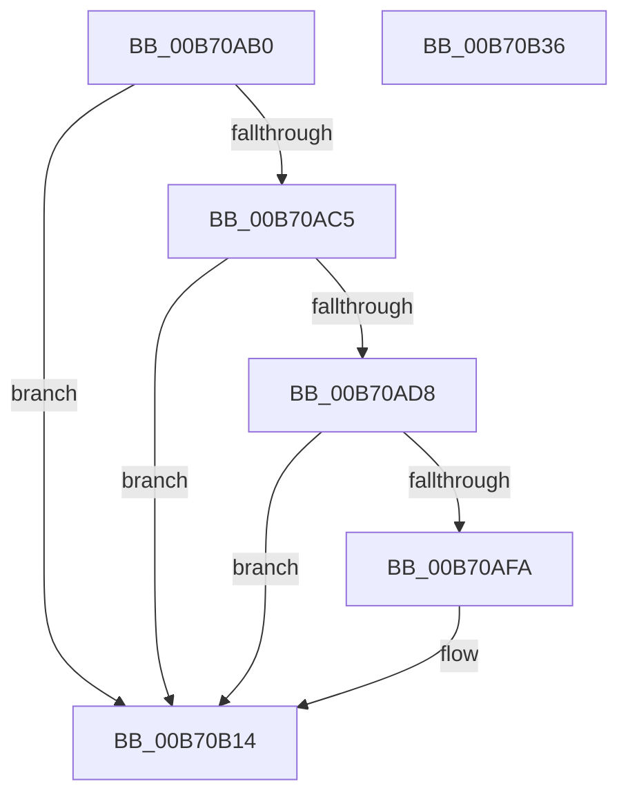

# PopCheckPowerSourceAfterRtcWakeTimerWorker

- RVA: `0x00B70AB0`–`0x00B70B37` (길이 `135` bytes)
- VA: `0x0000000140B70AB0`
- 실행 섹션: `PAGELK`
- PDB 이름 있음: `예`; PDB Function 태그: `아니요`
- unwind 정보 RVA: `0x00063458`
- 디코드: `31`개 명령, `135/135` bytes 표시
- 미해석 바이트: `0` (있으면 어셈블리에 `.byte`로 보존)

> 이 문서는 커널 이미지의 기계어와 PDB 기호를 분석해 생성했습니다. 4번과 5번은 함수 원형과 자료형을 바이너리 사용 방식에서 추정한 C 해석이며 원본 소스 복구 결과는 아닙니다.

## 1. Dependencies

- 직접 호출 지점: **5**; 고유 호출 대상: **5**
- 직접 호출자로 확인된 함수: **0**
- RIP 상대 이미지 참조: **6**

### Outgoing calls
- `0x00B70ACC` → [PopCurrentPowerStatePrecise](../../page/A3/PopCurrentPowerStatePrecise_function_00A35624.md) (function, `0x00A35624`)
- `0x00B70AEE` → [PopQueryPowerSettingUlong](../../page/AC/PopQueryPowerSettingUlong_function_00ACCCC8.md) (function, `0x00ACCCC8`)
- `0x00B70B0F` → [NtInitiatePowerAction](../../page/75/NtInitiatePowerAction_function_0075FCB0.md) (function, `0x0075FCB0`)
- `0x00B70B1B` → [PopOkayToQueueNextWorkItem](../../text/4A/PopOkayToQueueNextWorkItem_function_004AED54.md) (function, `0x004AED54`)
- `0x00B70B2C` → [KeSetEvent](../../text/33/KeSetEvent_function_0033F310.md) (function, `0x0033F310`)

### Direct callers
- 이 함수 시작 RVA로 연결되는 직접 call은 확인되지 않았습니다. 간접 호출은 완전히 역산할 수 없습니다.

### Static image references
- `0x00B70AB4` → RVA `0x00F0C300` (`.data`; read)
- `0x00B70AE7` → RVA `0x00024538` (`.rdata`; read)
- `0x00B70AFA` → RVA `0x00F0C67C` (`.data`; read)
- `0x00B70B03` → RVA `0x00F0C678` (`.data`; read)
- `0x00B70B14` → RVA `0x00F0B7A8` (`.data`; read)
- `0x00B70B23` → RVA `0x00F0B6E0` (`.data`; read)

## 2. Other-region calls and transfers

- 다른 실행 섹션으로 향하는 call: **5**
  - `0x00B70ACC` → [PopCurrentPowerStatePrecise](../../page/A3/PopCurrentPowerStatePrecise_function_00A35624.md) (`PAGELK` → `PAGE`)
  - `0x00B70AEE` → [PopQueryPowerSettingUlong](../../page/AC/PopQueryPowerSettingUlong_function_00ACCCC8.md) (`PAGELK` → `PAGE`)
  - `0x00B70B0F` → [NtInitiatePowerAction](../../page/75/NtInitiatePowerAction_function_0075FCB0.md) (`PAGELK` → `PAGE`)
  - `0x00B70B1B` → [PopOkayToQueueNextWorkItem](../../text/4A/PopOkayToQueueNextWorkItem_function_004AED54.md) (`PAGELK` → `.text`)
  - `0x00B70B2C` → [KeSetEvent](../../text/33/KeSetEvent_function_0033F310.md) (`PAGELK` → `.text`)
- 별도 외부 분기/꼬리 이동을 확인하지 못했습니다.

## 3. Assembly (complete function range)

```asm
00B70AB0  48 83 EC 48                     sub rsp, 0x48
00B70AB4  80 3D 45 B8 39 00 00            cmp byte ptr [rip + 0x39b845], 0
00B70ABB  0F 57 C0                        xorps xmm0, xmm0
00B70ABE  0F 11 44 24 20                  movups xmmword ptr [rsp + 0x20], xmm0
00B70AC3  74 4F                           je 0x140b70b14
00B70AC5  33 D2                           xor edx, edx
00B70AC7  48 8D 4C 24 20                  lea rcx, [rsp + 0x20]
00B70ACC  E8 53 4B EC FF                  call 0x140a35624
00B70AD1  80 7C 24 20 00                  cmp byte ptr [rsp + 0x20], 0
00B70AD6  75 3C                           jne 0x140b70b14
00B70AD8  83 64 24 58 00                  and dword ptr [rsp + 0x58], 0
00B70ADD  4C 8D 44 24 58                  lea r8, [rsp + 0x58]
00B70AE2  48 8D 54 24 60                  lea rdx, [rsp + 0x60]
00B70AE7  48 8D 0D 4A 3A 4B FF            lea rcx, [rip - 0xb4c5b6]
00B70AEE  E8 D5 C1 F5 FF                  call 0x140acccc8
00B70AF3  83 7C 24 58 00                  cmp dword ptr [rsp + 0x58], 0
00B70AF8  75 1A                           jne 0x140b70b14
00B70AFA  8B 15 7C BB 39 00               mov edx, dword ptr [rip + 0x39bb7c]
00B70B00  41 B1 01                        mov r9b, 1
00B70B03  8B 0D 6F BB 39 00               mov ecx, dword ptr [rip + 0x39bb6f]
00B70B09  41 B8 00 00 00 80               mov r8d, 0x80000000
00B70B0F  E8 9C F1 BE FF                  call 0x14075fcb0
00B70B14  48 8D 0D 8D AC 39 00            lea rcx, [rip + 0x39ac8d]
00B70B1B  E8 34 E2 93 FF                  call 0x1404aed54
00B70B20  45 33 C0                        xor r8d, r8d
00B70B23  48 8D 0D B6 AB 39 00            lea rcx, [rip + 0x39abb6]
00B70B2A  33 D2                           xor edx, edx
00B70B2C  E8 DF E7 7C FF                  call 0x14033f310
00B70B31  48 83 C4 48                     add rsp, 0x48
00B70B35  C3                              ret
00B70B36  CC                              int3
```

## 4. C-style interpretation (structured pseudocode)

```c
__int64 __fastcall PopCheckPowerSourceAfterRtcWakeTimerWorker(__int64 a1, int a2)
{
    __int64 result;
    __int64 v_rsp;
    unsigned __int64 v_stack_m28;
    unsigned int v_stack_p10;
    unsigned __int64 v_stack_p18;

    v_rsp = (v_rsp) - (72);
    v_stack_m28 = v_xmm0;
    if ((*(unsigned __int8 *)(v_rip + 3782725)) == 0) goto loc_00B70B14;
    a2 = 0;
    result = PopCurrentPowerStatePrecise(v_stack_m28, a2, a3, a4);
    if (v_stack_m28 != 0) goto loc_00B70B14;
    result = PopQueryPowerSettingUlong(v_rip - 11847094, v_stack_p18, v_stack_p10, a4);
    if (v_stack_p10 == 0) {
        a2 = *(unsigned int *)(v_rip + 3783548);
        a4 = 1;
        a1 = *(unsigned int *)(v_rip + 3783535);
        a3 = 0x80000000ULL;
        result = NtInitiatePowerAction(a1, a2, a3, a4);
    }
    result = PopOkayToQueueNextWorkItem(v_rip + 3779725, a2, a3, a4);
    a3 = 0;
    a2 = 0;
    result = KeSetEvent(v_rip + 3779510, a2, a3, a4);
    v_rsp = (v_rsp) + (72);
    return result;
}
```

## 5. (Beta) C Style

```c
int64_t PopCheckPowerSourceAfterRtcWakeTimerWorker(int64_t Arg1, int32_t Arg2)
{
    int64_t result;
    int64_t local_rsp;
    uint64_t v_stack_m28;
    uint32_t v_stack_p10;
    uint64_t v_stack_p18;

    local_rsp = (local_rsp) - (72);
    v_stack_m28 = v_xmm0;
    if ((*(uint8_t *)(v_rip + 0x39B845)) == 0) goto loc_00B70B14;
    Arg2 = 0;
    result = PopCurrentPowerStatePrecise(v_stack_m28, Arg2, a3, a4);
    if (v_stack_m28 != 0) goto loc_00B70B14;
    result = PopQueryPowerSettingUlong(v_rip - 11847094, v_stack_p18, v_stack_p10, a4);
    if (v_stack_p10 == 0) {
        Arg2 = *(uint32_t *)(v_rip + 0x39BB7C);
        a4 = 1;
        Arg1 = *(uint32_t *)(v_rip + 0x39BB6F);
        a3 = 0x80000000ULL;
        result = NtInitiatePowerAction(Arg1, Arg2, a3, a4);
    }
    result = PopOkayToQueueNextWorkItem(v_rip + 3779725, Arg2, a3, a4);
    a3 = 0;
    Arg2 = 0;
    result = KeSetEvent(v_rip + 3779510, Arg2, a3, a4);
    local_rsp = (local_rsp) + (72);
    return result;
}
```

## 6. Execution-region graph

[열기: 2D/3D 그래프와 함수 탐색 컨트롤 패널](../../../control-panel.html?section=pagelk&rva=0x00B70AB0&view=graph)

- 2D 그래프는 위에서 아래로 흐르고, 3D 그래프는 빈 공간을 드래그해 회전합니다. Shift+드래그는 이동, 휠은 확대·축소, 함수 노드 선택은 대상 보고서 이동입니다.

### Static fallback


