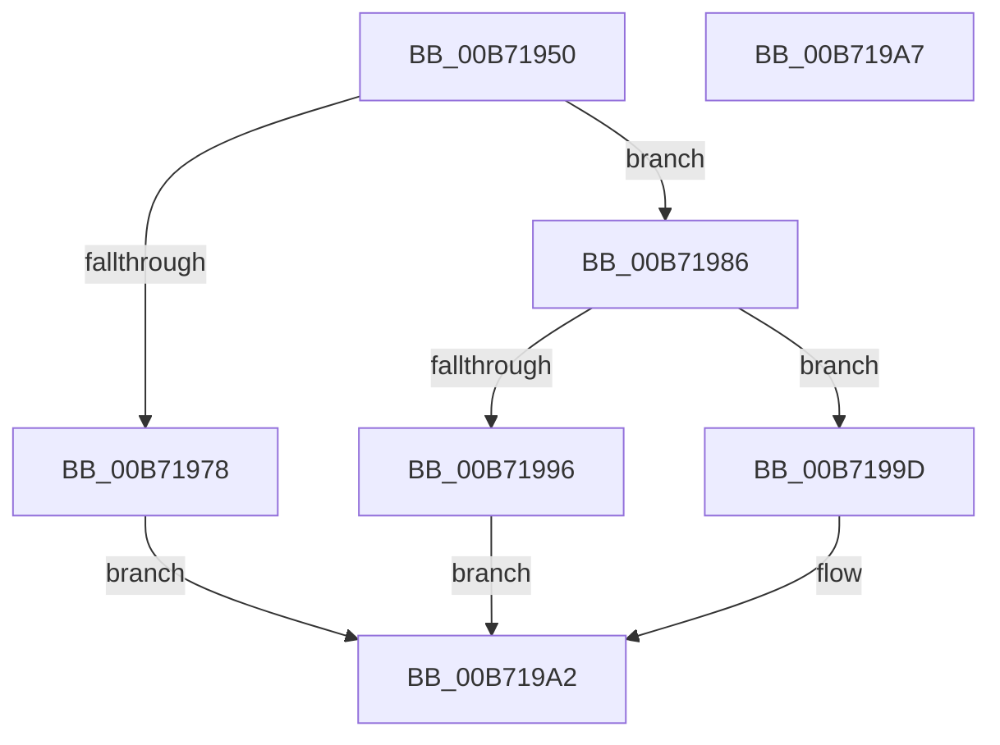

# PopCheckpointSystemSleepUnsafe

- RVA: `0x00B71950`–`0x00B719A8` (길이 `88` bytes)
- VA: `0x0000000140B71950`
- 실행 섹션: `PAGELK`
- PDB 이름 있음: `예`; PDB Function 태그: `아니요`
- unwind 정보 RVA: `0x0005D2F4`
- 디코드: `20`개 명령, `88/88` bytes 표시
- 미해석 바이트: `0` (있으면 어셈블리에 `.byte`로 보존)

> 이 문서는 커널 이미지의 기계어와 PDB 기호를 분석해 생성했습니다. 4번과 5번은 함수 원형과 자료형을 바이너리 사용 방식에서 추정한 C 해석이며 원본 소스 복구 결과는 아닙니다.

## 1. Dependencies

- 직접 호출 지점: **3**; 고유 호출 대상: **3**
- 직접 호출자로 확인된 함수: **2**
- RIP 상대 이미지 참조: **5**

### Outgoing calls
- `0x00B7197F` → [ExSetFirmwareEnvironmentVariable](../../page/7C/ExSetFirmwareEnvironmentVariable_function_007CAE70.md) (function, `0x007CAE70`)
- `0x00B71996` → [VslReportBugCheckProgress](../../text/58/VslReportBugCheckProgress_function_0058F230.md) (function, `0x0058F230`)
- `0x00B7199D` → [HalSetEnvironmentVariableEx](../../text/44/HalSetEnvironmentVariableEx_function_00448EB0.md) (function, `0x00448EB0`)

### Direct callers
- [PopEnableSystemSleepCheckpoint](../../page/AC/PopEnableSystemSleepCheckpoint_function_00AC4F50.md) at `0x00AC5027`
- [sub_00B80654](../B8/Unknown_function_00B80654.md) at `0x00B806DA`

### Static image references
- `0x00B71954` → RVA `0x00F0BD23` (`.data`; read)
- `0x00B7196F` → RVA `0x000260A8` (`.rdata`; read)
- `0x00B71978` → RVA `0x0000B420` (`.rdata`; read)
- `0x00B71986` → RVA `0x00F084F8` (`.data`; read)
- `0x00B7198D` → RVA `0x00026078` (`.rdata`; read)

## 2. Other-region calls and transfers

- 다른 실행 섹션으로 향하는 call: **3**
  - `0x00B7197F` → [ExSetFirmwareEnvironmentVariable](../../page/7C/ExSetFirmwareEnvironmentVariable_function_007CAE70.md) (`PAGELK` → `PAGE`)
  - `0x00B71996` → [VslReportBugCheckProgress](../../text/58/VslReportBugCheckProgress_function_0058F230.md) (`PAGELK` → `.text`)
  - `0x00B7199D` → [HalSetEnvironmentVariableEx](../../text/44/HalSetEnvironmentVariableEx_function_00448EB0.md) (`PAGELK` → `.text`)
- 별도 외부 분기/꼬리 이동을 확인하지 못했습니다.

## 3. Assembly (complete function range)

```asm
00B71950  48 83 EC 38                     sub rsp, 0x38
00B71954  80 3D C8 A3 39 00 00            cmp byte ptr [rip + 0x39a3c8], 0
00B7195B  4C 8D 44 24 40                  lea r8, [rsp + 0x40]
00B71960  41 B9 01 00 00 00               mov r9d, 1
00B71966  88 4C 24 40                     mov byte ptr [rsp + 0x40], cl
00B7196A  44 89 4C 24 20                  mov dword ptr [rsp + 0x20], r9d
00B7196F  48 8D 15 32 47 4B FF            lea rdx, [rip - 0xb4b8ce]
00B71976  75 0E                           jne 0x140b71986
00B71978  48 8D 0D A1 9A 49 FF            lea rcx, [rip - 0xb6655f]
00B7197F  E8 EC 94 C5 FF                  call 0x1407cae70
00B71984  EB 1C                           jmp 0x140b719a2
00B71986  80 3D 6B 6B 39 00 00            cmp byte ptr [rip + 0x396b6b], 0
00B7198D  48 8D 0D E4 46 4B FF            lea rcx, [rip - 0xb4b91c]
00B71994  74 07                           je 0x140b7199d
00B71996  E8 95 D8 A1 FF                  call 0x14058f230
00B7199B  EB 05                           jmp 0x140b719a2
00B7199D  E8 0E 75 8D FF                  call 0x140448eb0
00B719A2  48 83 C4 38                     add rsp, 0x38
00B719A6  C3                              ret
00B719A7  CC                              int3
```

## 4. C-style interpretation (structured pseudocode)

```c
__int64 __fastcall PopCheckpointSystemSleepUnsafe(unsigned __int8 a1)
{
    __int64 result;
    __int64 v_rsp;
    unsigned int v_stack_m18;
    unsigned __int64 v_stack_p8;

    v_rsp = (v_rsp) - (56);
    v_stack_p8 = a1;
    v_stack_m18 = 1;
    if ((*(unsigned __int8 *)(v_rip + 3777480)) != 0) goto loc_00B71986;
    result = ExSetFirmwareEnvironmentVariable(v_rip - 11953503, v_rip - 11843790, v_stack_p8, 1);
    goto loc_00B719A2;
loc_00B71986:
    if ((*(unsigned __int8 *)(v_rip + 3763051)) == 0) goto loc_00B7199D;
    result = VslReportBugCheckProgress(v_rip - 11843868, v_rip - 11843790, v_stack_p8, 1);
    goto loc_00B719A2;
loc_00B7199D:
    result = HalSetEnvironmentVariableEx(v_rip - 11843868, v_rip - 11843790, v_stack_p8, 1);
loc_00B719A2:
    v_rsp = (v_rsp) + (56);
    return result;
}
```

## 5. (Beta) C Style

```c
int64_t PopCheckpointSystemSleepUnsafe(uint8_t Arg1)
{
    int64_t result;
    int64_t local_rsp;
    uint32_t v_stack_m18;
    uint64_t v_stack_p8;

    local_rsp = (local_rsp) - (56);
    v_stack_p8 = Arg1;
    v_stack_m18 = 1;
    if ((*(uint8_t *)(v_rip + 0x39A3C8)) != 0) goto loc_00B71986;
    result = ExSetFirmwareEnvironmentVariable(v_rip - 11953503, v_rip - 11843790, v_stack_p8, 1);
    goto loc_00B719A2;
loc_00B71986:
    if ((*(uint8_t *)(v_rip + 0x396B6B)) == 0) goto loc_00B7199D;
    result = VslReportBugCheckProgress(v_rip - 11843868, v_rip - 11843790, v_stack_p8, 1);
    goto loc_00B719A2;
loc_00B7199D:
    result = HalSetEnvironmentVariableEx(v_rip - 11843868, v_rip - 11843790, v_stack_p8, 1);
loc_00B719A2:
    local_rsp = (local_rsp) + (56);
    return result;
}
```

## 6. Execution-region graph

[열기: 2D/3D 그래프와 함수 탐색 컨트롤 패널](../../../control-panel.html?section=pagelk&rva=0x00B71950&view=graph)

- 2D 그래프는 위에서 아래로 흐르고, 3D 그래프는 빈 공간을 드래그해 회전합니다. Shift+드래그는 이동, 휠은 확대·축소, 함수 노드 선택은 대상 보고서 이동입니다.

### Static fallback


