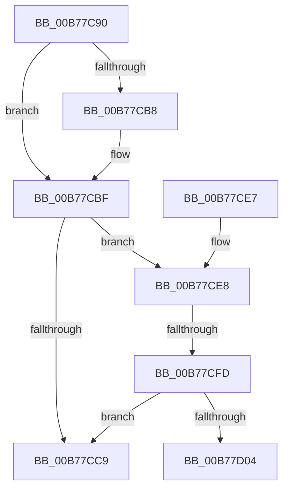

# PopCheckpointSystemSleep

- RVA: `0x00B77C90`–`0x00B77D09` (길이 `121` bytes)
- VA: `0x0000000140B77C90`
- 실행 섹션: `PAGELK`
- PDB 이름 있음: `예`; PDB Function 태그: `예`
- unwind 정보 RVA: `0x0007BD98`
- 디코드: `34`개 명령, `121/121` bytes 표시
- 미해석 바이트: `0` (있으면 어셈블리에 `.byte`로 보존)

> 이 문서는 커널 이미지의 기계어와 PDB 기호를 분석해 생성했습니다. 4번과 5번은 함수 원형과 자료형을 바이너리 사용 방식에서 추정한 C 해석이며 원본 소스 복구 결과는 아닙니다.

## 1. Dependencies

- 직접 호출 지점: **1**; 고유 호출 대상: **1**
- 직접 호출자로 확인된 함수: **21**
- RIP 상대 이미지 참조: **5**

### Outgoing calls
- `0x00B77CBA` → [PopRecordSleepCheckpoint](../../page/AA/PopRecordSleepCheckpoint_function_00AA3EEC.md) (function, `0x00AA3EEC`)

### Direct callers
- [PopPrepareSleep](../../text/4C/PopPrepareSleep_function_004C80BC.md) at `0x004C80CF`
- [PopPrepareSleep](../../text/4C/PopPrepareSleep_function_004C80BC.md) at `0x004C80EF`
- [PopResumeApps](../../page/75/PopResumeApps_function_0075EBFC.md) at `0x0075EC32`
- [PopResumeApps](../../page/75/PopResumeApps_function_0075EBFC.md) at `0x0075EC60`
- [PopSuspendApps](../../page/75/PopSuspendApps_function_0075F008.md) at `0x0075F022`
- [PopSuspendApps](../../page/75/PopSuspendApps_function_0075F008.md) at `0x0075F049`
- [PopSuspendServices](../../page/75/PopSuspendServices_function_0075F05C.md) at `0x0075F07E`
- [PopSuspendServices](../../page/75/PopSuspendServices_function_0075F05C.md) at `0x0075F0A8`
- [PopResumeServices](../../page/91/PopResumeServices_function_00912410.md) at `0x00912447`
- [PopResumeServices](../../page/91/PopResumeServices_function_00912410.md) at `0x00912478`
- [PopIssueActionRequest](../../page/A9/PopIssueActionRequest_function_00A9CE54.md) at `0x00A9D092`
- [PopIssueActionRequest](../../page/A9/PopIssueActionRequest_function_00A9CE54.md) at `0x00A9D2BD`
- [PopDispatchSuperfetchNotification](../../page/AC/PopDispatchSuperfetchNotification_function_00AC3FD8.md) at `0x00AC3FF8`
- [PopDispatchSuperfetchNotification](../../page/AC/PopDispatchSuperfetchNotification_function_00AC3FD8.md) at `0x00AC4023`
- [PopNotifyCallbacksPreSleep](../../page/AD/PopNotifyCallbacksPreSleep_function_00AD3440.md) at `0x00AD3449`
- [PopNotifyCallbacksPreSleep](../../page/AD/PopNotifyCallbacksPreSleep_function_00AD3440.md) at `0x00AD347E`
- [PopAllocateHiberContext](../../page/AD/PopAllocateHiberContext_function_00ADC05C.md) at `0x00ADC521`
- [PopAllocateHiberContext](../../page/AD/PopAllocateHiberContext_function_00ADC05C.md) at `0x00ADC564`
- [PopAllocateHiberContext](../../page/AD/PopAllocateHiberContext_function_00ADC05C.md) at `0x00ADC5C7`
- [PopAllocateHiberContext](../../page/AD/PopAllocateHiberContext_function_00ADC05C.md) at `0x00ADC656`
- [PopDecompressHiberBlocks](../B6/PopDecompressHiberBlocks_function_00B6D074.md) at `0x00B6D503`
- [PopDecompressHiberBlocks](../B6/PopDecompressHiberBlocks_function_00B6D074.md) at `0x00B6D539`
- [PopHiberCheckResume](../B6/PopHiberCheckResume_function_00B6D840.md) at `0x00B6D89A`
- [PopHiberChecksumHiberFileData](../B6/PopHiberChecksumHiberFileData_function_00B6DB10.md) at `0x00B6DC06`
- [PopRequestRead](../B6/PopRequestRead_function_00B6E6DC.md) at `0x00B6EA71`
- [PopRequestRead](../B6/PopRequestRead_function_00B6E6DC.md) at `0x00B6EABB`
- [PopRequestWrite](../B6/PopRequestWrite_function_00B6EB14.md) at `0x00B6EECF`
- [PopRequestWrite](../B6/PopRequestWrite_function_00B6EB14.md) at `0x00B6EF19`
- [PopRequestWrite](../B6/PopRequestWrite_function_00B6EB14.md) at `0x00B6EF63`
- [PopRequestWrite](../B6/PopRequestWrite_function_00B6EB14.md) at `0x00B6EFAD`
- [PopSaveHiberContext](../B6/PopSaveHiberContext_function_00B6F050.md) at `0x00B6F0F8`
- [PopSaveHiberContext](../B6/PopSaveHiberContext_function_00B6F050.md) at `0x00B6FA82`
- [PopSaveHiberContext](../B6/PopSaveHiberContext_function_00B6F050.md) at `0x00B6FACB`
- [PopWriteHiberPages](../B6/PopWriteHiberPages_function_00B6FF78.md) at `0x00B70019`
- [PoBroadcastSystemState](PoBroadcastSystemState_function_00B761B0.md) at `0x00B764C6`
- [PoBroadcastSystemState](PoBroadcastSystemState_function_00B761B0.md) at `0x00B76596`
- [PopInvokeSystemStateHandler](PopInvokeSystemStateHandler_function_00B76A6C.md) at `0x00B76DD7`
- [PopInvokeSystemStateHandler](PopInvokeSystemStateHandler_function_00B76A6C.md) at `0x00B76E61`
- [PopInvokeSystemStateHandler](PopInvokeSystemStateHandler_function_00B76A6C.md) at `0x00B76E7D`
- [PopInvokeSystemStateHandler](PopInvokeSystemStateHandler_function_00B76A6C.md) at `0x00B76EE3`
- [PopInvokeSystemStateHandler](PopInvokeSystemStateHandler_function_00B76A6C.md) at `0x00B76EFF`
- [PopInvokeSystemStateHandler](PopInvokeSystemStateHandler_function_00B76A6C.md) at `0x00B77079`
- [PopRestoreHiberContext](PopRestoreHiberContext_function_00B777F0.md) at `0x00B77AB0`
- [PopTransitionSystemPowerStateEx](PopTransitionSystemPowerStateEx_function_00B7E8C0.md) at `0x00B7EDB6`
- [PopTransitionSystemPowerStateEx](PopTransitionSystemPowerStateEx_function_00B7E8C0.md) at `0x00B7EFD6`
- [PopTransitionSystemPowerStateEx](PopTransitionSystemPowerStateEx_function_00B7E8C0.md) at `0x00B7F0B7`
- [PopTransitionSystemPowerStateEx](PopTransitionSystemPowerStateEx_function_00B7E8C0.md) at `0x00B7F82D`
- [sub_00B80364](../B8/Unknown_function_00B80364.md) at `0x00B804FA`

### Static image references
- `0x00B77CA6` → RVA `0x00F0C9DC` (`.data`; write)
- `0x00B77CAC` → RVA `0x00E0B578` (`.data`; read)
- `0x00B77CBF` → RVA `0x00F0C9D4` (`.data`; read)
- `0x00B77CDA` → RVA `0x00F0C370` (`.data`; read/write)
- `0x00B77CE8` → RVA `0x00F0C9CC` (`.data`; read)

## 2. Other-region calls and transfers

- 다른 실행 섹션으로 향하는 call: **1**
  - `0x00B77CBA` → [PopRecordSleepCheckpoint](../../page/AA/PopRecordSleepCheckpoint_function_00AA3EEC.md) (`PAGELK` → `PAGE`)
- call이 아닌 외부 분기/꼬리 이동: **2**
  - `0x00B77CF7` → [sub_00B80654](../B8/Unknown_function_00B80654.md) (`tail-transfer`)
  - `0x00B77D04` → [sub_00B80654](../B8/Unknown_function_00B80654.md) (`tail-transfer`)

## 3. Assembly (complete function range)

```asm
00B77C90  48 89 5C 24 08                  mov qword ptr [rsp + 8], rbx
00B77C95  57                              push rdi
00B77C96  48 83 EC 30                     sub rsp, 0x30
00B77C9A  48 63 D9                        movsxd rbx, ecx
00B77C9D  0F 31                           rdtsc
00B77C9F  48 C1 E2 20                     shl rdx, 0x20
00B77CA3  48 0B C2                        or rax, rdx
00B77CA6  89 1D 30 4D 39 00               mov dword ptr [rip + 0x394d30], ebx
00B77CAC  80 3D C5 38 29 00 00            cmp byte ptr [rip + 0x2938c5], 0
00B77CB3  48 8B F8                        mov rdi, rax
00B77CB6  74 07                           je 0x140b77cbf
00B77CB8  8B CB                           mov ecx, ebx
00B77CBA  E8 2D C2 F2 FF                  call 0x140aa3eec
00B77CBF  8B 0D 0F 4D 39 00               mov ecx, dword ptr [rip + 0x394d0f]
00B77CC5  85 C9                           test ecx, ecx
00B77CC7  75 1F                           jne 0x140b77ce8
00B77CC9  0F 31                           rdtsc
00B77CCB  48 8B 5C 24 40                  mov rbx, qword ptr [rsp + 0x40]
00B77CD0  48 C1 E2 20                     shl rdx, 0x20
00B77CD4  48 0B C2                        or rax, rdx
00B77CD7  48 2B C7                        sub rax, rdi
00B77CDA  48 01 05 8F 46 39 00            add qword ptr [rip + 0x39468f], rax
00B77CE1  48 83 C4 30                     add rsp, 0x30
00B77CE5  5F                              pop rdi
00B77CE6  C3                              ret
00B77CE7  CC                              int3
00B77CE8  8B 0D DE 4C 39 00               mov ecx, dword ptr [rip + 0x394cde]
00B77CEE  41 B9 01 00 00 00               mov r9d, 1
00B77CF4  41 84 C9                        test r9b, cl
00B77CF7  0F 84 57 89 00 00               je 0x140b80654
00B77CFD  C1 E9 18                        shr ecx, 0x18
00B77D00  3B D9                           cmp ebx, ecx
00B77D02  77 C5                           ja 0x140b77cc9
00B77D04  E9 4B 89 00 00                  jmp 0x140b80654
```

## 4. C-style interpretation (structured pseudocode)

```c
__int64 __fastcall PopCheckpointSystemSleep(int a1, __int64 a2)
{
    __int64 result;
    __int64 v_rsp;
    unsigned __int64 v_stack_p8;

    v_stack_p8 = v_rbx;
    v_rsp = (v_rsp) - (48);
    a2 = (a2) << (32);
    result = (result) | (a2);
    *(unsigned int *)(v_rip + 3755312) = (unsigned int)((int)(a1));
    if ((*(unsigned __int8 *)(v_rip + 2701509)) != 0) {
        a1 = (unsigned int)((int)(a1));
        result = PopRecordSleepCheckpoint(a1, a2, a3, a4);
    }
    if ((unsigned int)((unsigned int)(*(unsigned int *)(v_rip + 3755279))) != 0) goto loc_00B77CE8;
loc_00B77CC9:
    a2 = (a2) << (32);
    result = (result) | (a2);
    result = (result) - (result);
    v_rsp = (v_rsp) + (48);
    return result;
loc_00B77CE8:
    a1 = (unsigned int)(((unsigned int)(*(unsigned int *)(v_rip + 3755230))) >> (24));
    if (((unsigned int)(v_stack_p8)) > a1) goto loc_00B77CC9;
}
```

## 5. (Beta) C Style

```c
int64_t PopCheckpointSystemSleep(int32_t Arg1, int64_t Arg2)
{
    int64_t result;
    int64_t local_rsp;
    uint64_t v_stack_p8;

    v_stack_p8 = local_rbx;
    local_rsp = (local_rsp) - (48);
    Arg2 = (Arg2) << (32);
    result = (result) | (Arg2);
    *(uint32_t *)(v_rip + 0x394D30) = (uint32_t)((int32_t)(Arg1));
    if ((*(uint8_t *)(v_rip + 0x2938C5)) != 0) {
        Arg1 = (uint32_t)((int32_t)(Arg1));
        result = PopRecordSleepCheckpoint(Arg1, Arg2, a3, a4);
    }
    if ((uint32_t)((uint32_t)(*(uint32_t *)(v_rip + 0x394D0F))) != 0) goto loc_00B77CE8;
loc_00B77CC9:
    Arg2 = (Arg2) << (32);
    result = (result) | (Arg2);
    result = (result) - (result);
    local_rsp = (local_rsp) + (48);
    return result;
loc_00B77CE8:
    Arg1 = (uint32_t)(((uint32_t)(*(uint32_t *)(v_rip + 0x394CDE))) >> (24));
    if (((uint32_t)(v_stack_p8)) > Arg1) goto loc_00B77CC9;
}
```

## 6. Execution-region graph

[열기: 2D/3D 그래프와 함수 탐색 컨트롤 패널](../../../control-panel.html?section=pagelk&rva=0x00B77C90&view=graph)

- 2D 그래프는 위에서 아래로 흐르고, 3D 그래프는 빈 공간을 드래그해 회전합니다. Shift+드래그는 이동, 휠은 확대·축소, 함수 노드 선택은 대상 보고서 이동입니다.

### Static fallback


