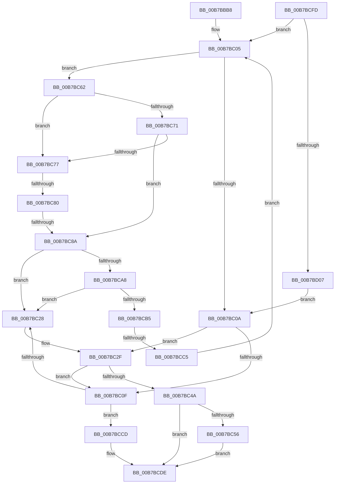

# PopCloneRange

- RVA: `0x00B7BBB8`–`0x00B7BD10` (길이 `344` bytes)
- VA: `0x0000000140B7BBB8`
- 실행 섹션: `PAGELK`
- PDB 이름 있음: `예`; PDB Function 태그: `예`
- unwind 정보 RVA: `0x000BAFF4`
- 디코드: `94`개 명령, `344/344` bytes 표시
- 미해석 바이트: `0` (있으면 어셈블리에 `.byte`로 보존)

> 이 문서는 커널 이미지의 기계어와 PDB 기호를 분석해 생성했습니다. 4번과 5번은 함수 원형과 자료형을 바이너리 사용 방식에서 추정한 C 해석이며 원본 소스 복구 결과는 아닙니다.

## 1. Dependencies

- 직접 호출 지점: **3**; 고유 호출 대상: **3**
- 직접 호출자로 확인된 함수: **1**
- RIP 상대 이미지 참조: **0**

### Outgoing calls
- `0x00B7BBE5` → [RtlSetBits](../../text/3E/RtlSetBits_function_003E1610.md) (function, `0x003E1610`)
- `0x00B7BBF9` → [RtlClearBits](../../text/3E/RtlClearBits_function_003E1A90.md) (function, `0x003E1A90`)
- `0x00B7BC3D` → [ExAllocatePool2](../../poolcode/B8/ExAllocatePool2_function_00B820F0.md) (function, `0x00B820F0`)

### Direct callers
- [PopSetRange](../../text/47/PopSetRange_function_0047C750.md) at `0x0047C78D`

### Static image references
- 디코드된 RIP-relative 메모리 참조가 없습니다.

## 2. Other-region calls and transfers

- 다른 실행 섹션으로 향하는 call: **3**
  - `0x00B7BBE5` → [RtlSetBits](../../text/3E/RtlSetBits_function_003E1610.md) (`PAGELK` → `.text`)
  - `0x00B7BBF9` → [RtlClearBits](../../text/3E/RtlClearBits_function_003E1A90.md) (`PAGELK` → `.text`)
  - `0x00B7BC3D` → [ExAllocatePool2](../../poolcode/B8/ExAllocatePool2_function_00B820F0.md) (`PAGELK` → `POOLCODE`)
- call이 아닌 외부 분기/꼬리 이동: **3**
  - `0x00B7BC7A` → [sub_00B81046](../B8/Unknown_function_00B81046.md) (`tail-transfer`)
  - `0x00B7BC84` → [sub_00B81046](../B8/Unknown_function_00B81046.md) (`tail-transfer`)
  - `0x00B7BCBF` → [sub_00B81046 + 0x17](../B8/Unknown_function_00B81046.md) (`tail-transfer`)

## 3. Assembly (complete function range)

```asm
00B7BBB8  48 8B C4                        mov rax, rsp
00B7BBBB  48 89 58 08                     mov qword ptr [rax + 8], rbx
00B7BBBF  48 89 68 10                     mov qword ptr [rax + 0x10], rbp
00B7BBC3  48 89 70 18                     mov qword ptr [rax + 0x18], rsi
00B7BBC7  48 89 78 20                     mov qword ptr [rax + 0x20], rdi
00B7BBCB  41 54                           push r12
00B7BBCD  41 56                           push r14
00B7BBCF  41 57                           push r15
00B7BBD1  48 83 EC 20                     sub rsp, 0x20
00B7BBD5  48 8B E9                        mov rbp, rcx
00B7BBD8  45 8B E1                        mov r12d, r9d
00B7BBDB  48 83 C1 30                     add rcx, 0x30
00B7BBDF  49 8B D8                        mov rbx, r8
00B7BBE2  48 8B F2                        mov rsi, rdx
00B7BBE5  E8 26 5A 86 FF                  call 0x1403e1610
00B7BBEA  48 8D 4D 20                     lea rcx, [rbp + 0x20]
00B7BBEE  44 8B C3                        mov r8d, ebx
00B7BBF1  8B D6                           mov edx, esi
00B7BBF3  4C 8D 34 1E                     lea r14, [rsi + rbx]
00B7BBF7  33 FF                           xor edi, edi
00B7BBF9  E8 92 5E 86 FF                  call 0x1403e1a90
00B7BBFE  4C 8D 7D 50                     lea r15, [rbp + 0x50]
00B7BC02  49 8B 1F                        mov rbx, qword ptr [r15]
00B7BC05  49 3B DF                        cmp rbx, r15
00B7BC08  75 58                           jne 0x140b7bc62
00B7BC0A  48 85 FF                        test rdi, rdi
00B7BC0D  74 20                           je 0x140b7bc2f
00B7BC0F  44 89 67 10                     mov dword ptr [rdi + 0x10], r12d
00B7BC13  48 89 77 18                     mov qword ptr [rdi + 0x18], rsi
00B7BC17  4C 89 77 20                     mov qword ptr [rdi + 0x20], r14
00B7BC1B  48 8B 43 08                     mov rax, qword ptr [rbx + 8]
00B7BC1F  48 39 18                        cmp qword ptr [rax], rbx
00B7BC22  0F 84 A5 00 00 00               je 0x140b7bccd
00B7BC28  B9 03 00 00 00                  mov ecx, 3
00B7BC2D  CD 29                           int 0x29
00B7BC2F  BA 30 00 00 00                  mov edx, 0x30
00B7BC34  41 B8 48 6D 61 70               mov r8d, 0x70616d48
00B7BC3A  8D 4A 10                        lea ecx, [rdx + 0x10]
00B7BC3D  E8 AE 64 00 00                  call 0x140b820f0
00B7BC42  48 8B F8                        mov rdi, rax
00B7BC45  48 85 C0                        test rax, rax
00B7BC48  75 C5                           jne 0x140b7bc0f
00B7BC4A  39 85 CC 00 00 00               cmp dword ptr [rbp + 0xcc], eax
00B7BC50  0F 8C 88 00 00 00               jl 0x140b7bcde
00B7BC56  C7 85 CC 00 00 00 9A 00 00 C0   mov dword ptr [rbp + 0xcc], 0xc000009a
00B7BC60  EB 7C                           jmp 0x140b7bcde
00B7BC62  48 8B CB                        mov rcx, rbx
00B7BC65  48 8B 1B                        mov rbx, qword ptr [rbx]
00B7BC68  48 8B 41 18                     mov rax, qword ptr [rcx + 0x18]
00B7BC6C  48 3B F0                        cmp rsi, rax
00B7BC6F  72 06                           jb 0x140b7bc77
00B7BC71  48 3B 71 20                     cmp rsi, qword ptr [rcx + 0x20]
00B7BC75  76 13                           jbe 0x140b7bc8a
00B7BC77  4C 3B F0                        cmp r14, rax
00B7BC7A  0F 82 C6 53 00 00               jb 0x140b81046
00B7BC80  4C 3B 71 20                     cmp r14, qword ptr [rcx + 0x20]
00B7BC84  0F 87 BC 53 00 00               ja 0x140b81046
00B7BC8A  48 3B F0                        cmp rsi, rax
00B7BC8D  48 0F 47 F0                     cmova rsi, rax
00B7BC91  48 8B 41 20                     mov rax, qword ptr [rcx + 0x20]
00B7BC95  4C 3B F0                        cmp r14, rax
00B7BC98  4C 0F 42 F0                     cmovb r14, rax
00B7BC9C  FF 4D 60                        dec dword ptr [rbp + 0x60]
00B7BC9F  48 8B 11                        mov rdx, qword ptr [rcx]
00B7BCA2  48 39 4A 08                     cmp qword ptr [rdx + 8], rcx
00B7BCA6  75 80                           jne 0x140b7bc28
00B7BCA8  48 8B 41 08                     mov rax, qword ptr [rcx + 8]
00B7BCAC  48 39 08                        cmp qword ptr [rax], rcx
00B7BCAF  0F 85 73 FF FF FF               jne 0x140b7bc28
00B7BCB5  48 89 10                        mov qword ptr [rax], rdx
00B7BCB8  48 89 42 08                     mov qword ptr [rdx + 8], rax
00B7BCBC  48 85 FF                        test rdi, rdi
00B7BCBF  0F 85 98 53 00 00               jne 0x140b8105d
00B7BCC5  48 8B F9                        mov rdi, rcx
00B7BCC8  E9 38 FF FF FF                  jmp 0x140b7bc05
00B7BCCD  48 89 1F                        mov qword ptr [rdi], rbx
00B7BCD0  48 89 47 08                     mov qword ptr [rdi + 8], rax
00B7BCD4  48 89 38                        mov qword ptr [rax], rdi
00B7BCD7  48 89 7B 08                     mov qword ptr [rbx + 8], rdi
00B7BCDB  FF 45 60                        inc dword ptr [rbp + 0x60]
00B7BCDE  48 8B 5C 24 40                  mov rbx, qword ptr [rsp + 0x40]
00B7BCE3  48 8B 6C 24 48                  mov rbp, qword ptr [rsp + 0x48]
00B7BCE8  48 8B 74 24 50                  mov rsi, qword ptr [rsp + 0x50]
00B7BCED  48 8B 7C 24 58                  mov rdi, qword ptr [rsp + 0x58]
00B7BCF2  48 83 C4 20                     add rsp, 0x20
00B7BCF6  41 5F                           pop r15
00B7BCF8  41 5E                           pop r14
00B7BCFA  41 5C                           pop r12
00B7BCFC  C3                              ret
00B7BCFD  CC                              int3
00B7BCFE  48 3B F0                        cmp rsi, rax
00B7BD01  0F 83 FE FE FF FF               jae 0x140b7bc05
00B7BD07  48 8B 5B 08                     mov rbx, qword ptr [rbx + 8]
00B7BD0B  E9 FA FE FF FF                  jmp 0x140b7bc0a
```

## 4. C-style interpretation (structured pseudocode)

```c
__int64 __fastcall PopCloneRange(__int64 a1, __int64 a2, __int64 a3, int a4)
{
    __int64 result;
    __int64 v_r14;
    __int64 v_rdi;
    __int64 v_rsp;
    unsigned __int64 v_stack_p10;
    unsigned __int64 v_stack_p18;
    unsigned __int64 v_stack_p20;
    unsigned __int64 v_stack_p8;

    *(unsigned __int64 *)(v_rsp + 8) = v_rbx;
    *(unsigned __int64 *)(v_rsp + 16) = v_rbp;
    *(unsigned __int64 *)(v_rsp + 24) = v_rsi;
    *(unsigned __int64 *)(v_rsp + 32) = v_rdi;
    v_rsp = (v_rsp) - (32);
    a1 = (a1) + (48);
    result = RtlSetBits(a1, a2, a3, a4);
    v_rdi = 0;
    result = RtlClearBits(a1 + 32, (unsigned int)((unsigned int)(a2)), (unsigned int)((unsigned int)(a3)), a4);
loc_00B7BC05:
    if ((*(unsigned __int64 *)(a1 + 80)) != (a1 + 80)) goto loc_00B7BC62;
loc_00B7BC0A:
    if (0 == 0) goto loc_00B7BC2F;
loc_00B7BC0F:
    *(unsigned int *)(v_rdi + 16) = (unsigned int)((unsigned int)(a4));
    *(unsigned __int64 *)(v_rdi + 24) = a2;
    *(unsigned __int64 *)(v_rdi + 32) = a2 + a3 * 1;
    if ((*(unsigned __int64 *)(*(unsigned __int64 *)(*(unsigned __int64 *)(a1 + 80) + 8))) == (*(unsigned __int64 *)(a1 + 80))) goto loc_00B7BCCD;
loc_00B7BC28:
loc_00B7BC2F:
    result = ExAllocatePool2(48 + 16, 48, (unsigned int)(0x70616D48ULL), a4);
    if (result != 0) goto loc_00B7BC0F;
    if ((*(unsigned int *)(a1 + 204)) < ((unsigned int)(result))) goto loc_00B7BCDE;
    *(unsigned int *)(a1 + 204) = 0xC000009AULL;
    goto loc_00B7BCDE;
loc_00B7BC62:
    if (a2 < (*(unsigned __int64 *)(*(unsigned __int64 *)(a1 + 80) + 24))) goto loc_00B7BC77;
    if (a2 <= (*(unsigned __int64 *)(*(unsigned __int64 *)(a1 + 80) + 32))) goto loc_00B7BC8A;
loc_00B7BC77:
loc_00B7BC8A:
    if (a2 > (*(unsigned __int64 *)(*(unsigned __int64 *)(a1 + 80) + 24))) { a2 = *(unsigned __int64 *)(*(unsigned __int64 *)(a1 + 80) + 24); }
    v_r14 = a2 + a3 * 1;
    if ((a2 + a3 * 1) < (*(unsigned __int64 *)(*(unsigned __int64 *)(a1 + 80) + 32))) { v_r14 = *(unsigned __int64 *)(*(unsigned __int64 *)(a1 + 80) + 32); }
    if ((*(unsigned __int64 *)(*(unsigned __int64 *)(*(unsigned __int64 *)(a1 + 80)) + 8)) != (*(unsigned __int64 *)(a1 + 80))) goto loc_00B7BC28;
    if ((*(unsigned __int64 *)(*(unsigned __int64 *)(*(unsigned __int64 *)(a1 + 80) + 8))) != (*(unsigned __int64 *)(a1 + 80))) goto loc_00B7BC28;
    *(unsigned __int64 *)(*(unsigned __int64 *)(*(unsigned __int64 *)(a1 + 80) + 8)) = *(unsigned __int64 *)(*(unsigned __int64 *)(a1 + 80));
    *(unsigned __int64 *)(*(unsigned __int64 *)(*(unsigned __int64 *)(a1 + 80)) + 8) = *(unsigned __int64 *)(*(unsigned __int64 *)(a1 + 80) + 8);
    goto loc_00B7BC05;
loc_00B7BCCD:
    *(unsigned __int64 *)(*(unsigned __int64 *)(a1 + 80)) = *(unsigned __int64 *)(*(unsigned __int64 *)(a1 + 80));
    *(unsigned __int64 *)(*(unsigned __int64 *)(a1 + 80) + 8) = *(unsigned __int64 *)(*(unsigned __int64 *)(a1 + 80) + 8);
    *(unsigned __int64 *)(*(unsigned __int64 *)(*(unsigned __int64 *)(a1 + 80) + 8)) = *(unsigned __int64 *)(a1 + 80);
    *(unsigned __int64 *)(*(unsigned __int64 *)(*(unsigned __int64 *)(a1 + 80)) + 8) = *(unsigned __int64 *)(a1 + 80);
loc_00B7BCDE:
    v_rsp = (v_rsp) + (32);
    return *(unsigned __int64 *)(*(unsigned __int64 *)(a1 + 80) + 8);
}
```

## 5. (Beta) C Style

```c
int64_t PopCloneRange(void *Arg1, void *Arg2, int64_t Arg3, int32_t Arg4)
{
    uint8_t *arg1 = (uint8_t *)Arg1;
    uint8_t *arg2 = (uint8_t *)Arg2;

    int64_t result;
    int64_t local_r14;
    int64_t local_rdi;
    int64_t local_rsp;
    uint64_t v_stack_p10;
    uint64_t v_stack_p18;
    uint64_t v_stack_p20;
    uint64_t v_stack_p8;

    *(uint64_t *)(local_rsp + 0x8) = local_rbx;
    *(uint64_t *)(local_rsp + 0x10) = local_rbp;
    *(uint64_t *)(local_rsp + 0x18) = local_rsi;
    *(uint64_t *)(local_rsp + 0x20) = local_rdi;
    local_rsp = (local_rsp) - (32);
    Arg1 = (Arg1) + (48);
    result = RtlSetBits(Arg1, Arg2, Arg3, Arg4);
    local_rdi = 0;
    result = RtlClearBits(Arg1 + 32, (uint32_t)((uint32_t)(Arg2)), (uint32_t)((uint32_t)(Arg3)), Arg4);
loc_00B7BC05:
    if ((*(uint64_t *)(arg1 + 0x50)) != (Arg1 + 80)) goto loc_00B7BC62;
loc_00B7BC0A:
    if (0 == 0) goto loc_00B7BC2F;
loc_00B7BC0F:
    *(uint32_t *)(local_rdi + 0x10) = (uint32_t)((uint32_t)(Arg4));
    *(void **)(local_rdi + 0x18) = Arg2;
    *(void **)(local_rdi + 0x20) = Arg2 + Arg3 * 1;
    if ((*(uint64_t *)(*(uint64_t *)(*(uint64_t *)(arg1 + 0x50) + 0x8))) == (*(uint64_t *)(arg1 + 0x50))) goto loc_00B7BCCD;
loc_00B7BC28:
loc_00B7BC2F:
    result = ExAllocatePool2(48 + 16, 48, (uint32_t)(0x70616D48ULL), Arg4);
    if (result != 0) goto loc_00B7BC0F;
    if ((*(uint32_t *)(arg1 + 0xCC)) < ((uint32_t)(result))) goto loc_00B7BCDE;
    *(uint32_t *)(arg1 + 0xCC) = 0xC000009AULL;
    goto loc_00B7BCDE;
loc_00B7BC62:
    if (Arg2 < (*(uint64_t *)(*(uint64_t *)(arg1 + 0x50) + 0x18))) goto loc_00B7BC77;
    if (Arg2 <= (*(uint64_t *)(*(uint64_t *)(arg1 + 0x50) + 0x20))) goto loc_00B7BC8A;
loc_00B7BC77:
loc_00B7BC8A:
    if (Arg2 > (*(uint64_t *)(*(uint64_t *)(arg1 + 0x50) + 0x18))) { Arg2 = *(uint64_t *)(*(uint64_t *)(arg1 + 0x50) + 0x18); }
    local_r14 = Arg2 + Arg3 * 1;
    if ((Arg2 + Arg3 * 1) < (*(uint64_t *)(*(uint64_t *)(arg1 + 0x50) + 0x20))) { local_r14 = *(uint64_t *)(*(uint64_t *)(arg1 + 0x50) + 0x20); }
    if ((*(uint64_t *)(*(uint64_t *)(*(uint64_t *)(arg1 + 0x50)) + 0x8)) != (*(uint64_t *)(arg1 + 0x50))) goto loc_00B7BC28;
    if ((*(uint64_t *)(*(uint64_t *)(*(uint64_t *)(arg1 + 0x50) + 0x8))) != (*(uint64_t *)(arg1 + 0x50))) goto loc_00B7BC28;
    *(uint64_t *)(*(uint64_t *)(*(uint64_t *)(arg1 + 0x50) + 0x8)) = *(uint64_t *)(*(uint64_t *)(arg1 + 0x50));
    *(uint64_t *)(*(uint64_t *)(*(uint64_t *)(arg1 + 0x50)) + 0x8) = *(uint64_t *)(*(uint64_t *)(arg1 + 0x50) + 0x8);
    goto loc_00B7BC05;
loc_00B7BCCD:
    *(uint64_t *)(*(uint64_t *)(arg1 + 0x50)) = *(uint64_t *)(*(uint64_t *)(arg1 + 0x50));
    *(uint64_t *)(*(uint64_t *)(arg1 + 0x50) + 0x8) = *(uint64_t *)(*(uint64_t *)(arg1 + 0x50) + 0x8);
    *(uint64_t *)(*(uint64_t *)(*(uint64_t *)(arg1 + 0x50) + 0x8)) = *(uint64_t *)(arg1 + 0x50);
    *(uint64_t *)(*(uint64_t *)(*(uint64_t *)(arg1 + 0x50)) + 0x8) = *(uint64_t *)(arg1 + 0x50);
loc_00B7BCDE:
    local_rsp = (local_rsp) + (32);
    return *(uint64_t *)(*(uint64_t *)(arg1 + 0x50) + 0x8);
}
```

### 관측된 메모리 오프셋

구조체 형식이 확인되지 않은 접근은 인자 기준의 오프셋으로만 기록했습니다.

| 기준 인자 | 오프셋 표현 | 폭 (bit) | 접근 |
|---|---:|---:|---|
| `Arg1` | `+ 0x0` | `64` | `R` |
| `Arg1` | `+ 0x20` | `64` | `R` |
| `Arg1` | `+ 0x50` | `64` | `R` |
| `Arg1` | `+ 0x60` | `32` | `R/W` |
| `Arg1` | `+ 0xCC` | `32` | `R` |
| `Arg1` | `+ 0xCC` | `32` | `W` |
| `Arg2` | `+ 0x0 + rbx*1` | `64` | `R` |

## 6. Execution-region graph

[열기: 2D/3D 그래프와 함수 탐색 컨트롤 패널](../../../control-panel.html?section=pagelk&rva=0x00B7BBB8&view=graph)

- 2D 그래프는 위에서 아래로 흐르고, 3D 그래프는 빈 공간을 드래그해 회전합니다. Shift+드래그는 이동, 휠은 확대·축소, 함수 노드 선택은 대상 보고서 이동입니다.

### Static fallback


