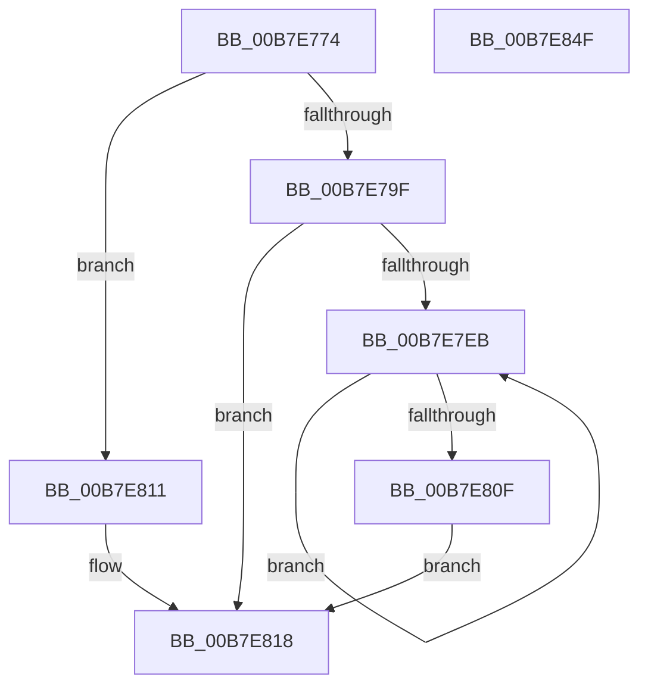

# PopCopyFirmwareRuntimeInformationPfnList

- RVA: `0x00B7E774`–`0x00B7E850` (길이 `220` bytes)
- VA: `0x0000000140B7E774`
- 실행 섹션: `PAGELK`
- PDB 이름 있음: `예`; PDB Function 태그: `아니요`
- unwind 정보 RVA: `0x0005D7BC`
- 디코드: `52`개 명령, `220/220` bytes 표시
- 미해석 바이트: `0` (있으면 어셈블리에 `.byte`로 보존)

> 이 문서는 커널 이미지의 기계어와 PDB 기호를 분석해 생성했습니다. 4번과 5번은 함수 원형과 자료형을 바이너리 사용 방식에서 추정한 C 해석이며 원본 소스 복구 결과는 아닙니다.

## 1. Dependencies

- 직접 호출 지점: **2**; 고유 호출 대상: **2**
- 직접 호출자로 확인된 함수: **1**
- RIP 상대 이미지 참조: **0**

### Outgoing calls
- `0x00B7E7DB` → [memcpy](../../text/6C/memcpy_function_006C6840.md) (function, `0x006C6840`)
- `0x00B7E801` → [PoSetHiberRange](../../text/47/PoSetHiberRange_function_0047C580.md) (function, `0x0047C580`)

### Direct callers
- [PopBuildMemoryImageHeader](../B6/PopBuildMemoryImageHeader_function_00B6CA20.md) at `0x00B6CBFA`

### Static image references
- 디코드된 RIP-relative 메모리 참조가 없습니다.

## 2. Other-region calls and transfers

- 다른 실행 섹션으로 향하는 call: **2**
  - `0x00B7E7DB` → [memcpy](../../text/6C/memcpy_function_006C6840.md) (`PAGELK` → `.text`)
  - `0x00B7E801` → [PoSetHiberRange](../../text/47/PoSetHiberRange_function_0047C580.md) (`PAGELK` → `.text`)
- 별도 외부 분기/꼬리 이동을 확인하지 못했습니다.

## 3. Assembly (complete function range)

```asm
00B7E774  48 8B C4                        mov rax, rsp
00B7E777  48 89 58 08                     mov qword ptr [rax + 8], rbx
00B7E77B  48 89 68 10                     mov qword ptr [rax + 0x10], rbp
00B7E77F  48 89 70 18                     mov qword ptr [rax + 0x18], rsi
00B7E783  48 89 78 20                     mov qword ptr [rax + 0x20], rdi
00B7E787  41 56                           push r14
00B7E789  48 83 EC 30                     sub rsp, 0x30
00B7E78D  4C 8B B1 F0 00 00 00            mov r14, qword ptr [rcx + 0xf0]
00B7E794  48 8B DA                        mov rbx, rdx
00B7E797  48 8B F9                        mov rdi, rcx
00B7E79A  4D 85 F6                        test r14, r14
00B7E79D  74 72                           je 0x140b7e811
00B7E79F  45 8B 46 28                     mov r8d, dword ptr [r14 + 0x28]
00B7E7A3  48 8D 8A 90 03 00 00            lea rcx, [rdx + 0x390]
00B7E7AA  41 F7 C0 FF 0F 00 00            test r8d, 0xfff
00B7E7B1  B8 00 00 00 00                  mov eax, 0
00B7E7B6  BD 01 00 00 00                  mov ebp, 1
00B7E7BB  0F 95 C0                        setne al
00B7E7BE  41 C1 E8 0C                     shr r8d, 0xc
00B7E7C2  41 8D 34 00                     lea esi, [r8 + rax]
00B7E7C6  48 3B F5                        cmp rsi, rbp
00B7E7C9  0F 47 F5                        cmova esi, ebp
00B7E7CC  49 83 C6 30                     add r14, 0x30
00B7E7D0  49 8B D6                        mov rdx, r14
00B7E7D3  4C 8D 04 F5 00 00 00 00         lea r8, [rsi*8]
00B7E7DB  E8 60 80 B4 FF                  call 0x1406c6840
00B7E7E0  89 B3 88 03 00 00               mov dword ptr [rbx + 0x388], esi
00B7E7E6  48 85 F6                        test rsi, rsi
00B7E7E9  74 2D                           je 0x140b7e818
00B7E7EB  4D 8B 06                        mov r8, qword ptr [r14]
00B7E7EE  4C 8B CD                        mov r9, rbp
00B7E7F1  BA 00 C0 00 00                  mov edx, 0xc000
00B7E7F6  C7 44 24 20 46 69 4D 64         mov dword ptr [rsp + 0x20], 0x644d6946
00B7E7FE  48 8B CF                        mov rcx, rdi
00B7E801  E8 7A DD 8F FF                  call 0x14047c580
00B7E806  4D 8D 76 08                     lea r14, [r14 + 8]
00B7E80A  48 2B F5                        sub rsi, rbp
00B7E80D  75 DC                           jne 0x140b7e7eb
00B7E80F  EB 07                           jmp 0x140b7e818
00B7E811  83 A2 88 03 00 00 00            and dword ptr [rdx + 0x388], 0
00B7E818  48 8B 87 00 01 00 00            mov rax, qword ptr [rdi + 0x100]
00B7E81F  48 8B 6C 24 48                  mov rbp, qword ptr [rsp + 0x48]
00B7E824  48 8B 74 24 50                  mov rsi, qword ptr [rsp + 0x50]
00B7E829  48 89 83 98 03 00 00            mov qword ptr [rbx + 0x398], rax
00B7E830  48 8B 87 08 01 00 00            mov rax, qword ptr [rdi + 0x108]
00B7E837  48 8B 7C 24 58                  mov rdi, qword ptr [rsp + 0x58]
00B7E83C  48 89 83 A0 03 00 00            mov qword ptr [rbx + 0x3a0], rax
00B7E843  48 8B 5C 24 40                  mov rbx, qword ptr [rsp + 0x40]
00B7E848  48 83 C4 30                     add rsp, 0x30
00B7E84C  41 5E                           pop r14
00B7E84E  C3                              ret
00B7E84F  CC                              int3
```

## 4. C-style interpretation (structured pseudocode)

```c
__int64 __fastcall PopCopyFirmwareRuntimeInformationPfnList(__int64 a1, __int64 a2)
{
    __int64 result;
    __int64 v_r14;
    __int64 v_rsi;
    __int64 v_rsp;
    unsigned int v_stack_m18;
    unsigned __int64 v_stack_p10;
    unsigned __int64 v_stack_p18;
    unsigned __int64 v_stack_p20;
    unsigned __int64 v_stack_p8;

    *(unsigned __int64 *)(v_rsp + 8) = v_rbx;
    *(unsigned __int64 *)(v_rsp + 16) = v_rbp;
    *(unsigned __int64 *)(v_rsp + 24) = v_rsi;
    *(unsigned __int64 *)(v_rsp + 32) = v_rdi;
    v_rsp = (v_rsp) - (48);
    if (*(unsigned __int64 *)(a1 + 240) == 0) goto loc_00B7E811;
    result = ((((unsigned int)((unsigned int)(*(unsigned int *)(*(unsigned __int64 *)(a1 + 240) + 40)))) & (0xFFFULL)) != 0) ? 1 : 0;
    a3 = (unsigned int)(((unsigned int)(*(unsigned int *)(*(unsigned __int64 *)(a1 + 240) + 40))) >> (12));
    v_rsi = a3 + result * 1;
    if ((a3 + result * 1) > 1) { v_rsi = 1; }
    v_r14 = (*(unsigned __int64 *)(a1 + 240)) + (48);
    result = memcpy(a2 + 912, v_r14, v_rsi * 8, a4);
    *(unsigned int *)(a2 + 904) = (unsigned int)(v_rsi);
    if (v_rsi == 0) goto loc_00B7E818;
loc_00B7E7EB:
    v_stack_m18 = 0x644D6946ULL;
    result = PoSetHiberRange(a1, (unsigned int)(0xC000ULL), *(unsigned __int64 *)(v_r14), 1);
    v_rsi = (v_rsi) - (1);
    if (condition_is_not_equal) goto loc_00B7E7EB;
    goto loc_00B7E818;
loc_00B7E811:
loc_00B7E818:
    *(unsigned __int64 *)(a2 + 920) = *(unsigned __int64 *)(a1 + 256);
    *(unsigned __int64 *)(a2 + 928) = *(unsigned __int64 *)(a1 + 264);
    v_rsp = (v_rsp) + (48);
    return *(unsigned __int64 *)(a1 + 264);
}
```

## 5. (Beta) C Style

```c
int64_t PopCopyFirmwareRuntimeInformationPfnList(void *Arg1, void *Arg2)
{
    uint8_t *arg1 = (uint8_t *)Arg1;
    uint8_t *arg2 = (uint8_t *)Arg2;

    int64_t result;
    int64_t local_r14;
    int64_t local_rsi;
    int64_t local_rsp;
    uint32_t v_stack_m18;
    uint64_t v_stack_p10;
    uint64_t v_stack_p18;
    uint64_t v_stack_p20;
    uint64_t v_stack_p8;

    *(uint64_t *)(local_rsp + 0x8) = local_rbx;
    *(uint64_t *)(local_rsp + 0x10) = local_rbp;
    *(uint64_t *)(local_rsp + 0x18) = local_rsi;
    *(uint64_t *)(local_rsp + 0x20) = local_rdi;
    local_rsp = (local_rsp) - (48);
    if (*(uint64_t *)(arg1 + 0xF0) == 0) goto loc_00B7E811;
    result = ((((uint32_t)((uint32_t)(*(uint32_t *)(*(uint64_t *)(arg1 + 0xF0) + 0x28)))) & (0xFFFULL)) != 0) ? 1 : 0;
    a3 = (uint32_t)(((uint32_t)(*(uint32_t *)(*(uint64_t *)(arg1 + 0xF0) + 0x28))) >> (12));
    local_rsi = a3 + result * 1;
    if ((a3 + result * 1) > 1) { local_rsi = 1; }
    local_r14 = (*(uint64_t *)(arg1 + 0xF0)) + (48);
    result = memcpy(Arg2 + 912, local_r14, local_rsi * 8, a4);
    *(uint32_t *)(arg2 + 0x388) = (uint32_t)(local_rsi);
    if (local_rsi == 0) goto loc_00B7E818;
loc_00B7E7EB:
    v_stack_m18 = 0x644D6946ULL;
    result = PoSetHiberRange(Arg1, (uint32_t)(0xC000ULL), *(uint64_t *)(local_r14), 1);
    local_rsi = (local_rsi) - (1);
    if (condition_is_not_equal) goto loc_00B7E7EB;
    goto loc_00B7E818;
loc_00B7E811:
loc_00B7E818:
    *(uint64_t *)(arg2 + 0x398) = *(uint64_t *)(arg1 + 0x100);
    *(uint64_t *)(arg2 + 0x3A0) = *(uint64_t *)(arg1 + 0x108);
    local_rsp = (local_rsp) + (48);
    return *(uint64_t *)(arg1 + 0x108);
}
```

### 관측된 메모리 오프셋

구조체 형식이 확인되지 않은 접근은 인자 기준의 오프셋으로만 기록했습니다.

| 기준 인자 | 오프셋 표현 | 폭 (bit) | 접근 |
|---|---:|---:|---|
| `Arg1` | `+ 0xF0` | `64` | `R` |
| `Arg1` | `+ 0x100` | `64` | `R` |
| `Arg1` | `+ 0x108` | `64` | `R` |
| `Arg2` | `+ 0x388` | `32` | `R/W` |
| `Arg2` | `+ 0x388` | `32` | `W` |
| `Arg2` | `+ 0x390` | `64` | `R` |
| `Arg2` | `+ 0x398` | `64` | `W` |
| `Arg2` | `+ 0x3A0` | `64` | `W` |

## 6. Execution-region graph

[열기: 2D/3D 그래프와 함수 탐색 컨트롤 패널](../../../control-panel.html?section=pagelk&rva=0x00B7E774&view=graph)

- 2D 그래프는 위에서 아래로 흐르고, 3D 그래프는 빈 공간을 드래그해 회전합니다. Shift+드래그는 이동, 휠은 확대·축소, 함수 노드 선택은 대상 보고서 이동입니다.

### Static fallback


