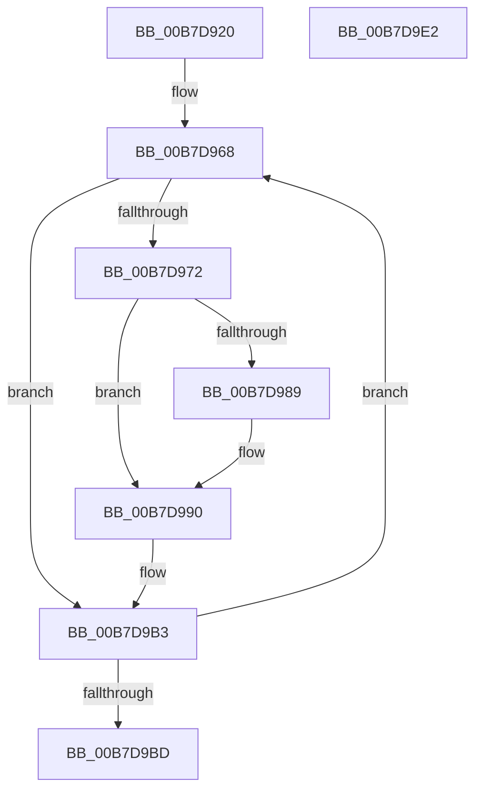

# PopDiagComputeEarlyHiberStats

- RVA: `0x00B7D920`–`0x00B7D9E3` (길이 `195` bytes)
- VA: `0x0000000140B7D920`
- 실행 섹션: `PAGELK`
- PDB 이름 있음: `예`; PDB Function 태그: `아니요`
- unwind 정보 RVA: `0x00060BC4`
- 디코드: `41`개 명령, `195/195` bytes 표시
- 미해석 바이트: `0` (있으면 어셈블리에 `.byte`로 보존)

> 이 문서는 커널 이미지의 기계어와 PDB 기호를 분석해 생성했습니다. 4번과 5번은 함수 원형과 자료형을 바이너리 사용 방식에서 추정한 C 해석이며 원본 소스 복구 결과는 아닙니다.

## 1. Dependencies

- 직접 호출 지점: **3**; 고유 호출 대상: **3**
- 직접 호출자로 확인된 함수: **1**
- RIP 상대 이미지 참조: **11**

### Outgoing calls
- `0x00B7D931` → [KeQueryPerformanceCounter](../../text/37/KeQueryPerformanceCounter_function_0037E7E0.md) (function, `0x0037E7E0`)
- `0x00B7D946` → [KeGetPrcb](../../text/2D/KeGetPrcb_function_002D85D0.md) (function, `0x002D85D0`)
- `0x00B7D9AA` → [PpmConvertTime](../../text/44/PpmConvertTime_function_00447530.md) (function, `0x00447530`)

### Direct callers
- [PopTransitionSystemPowerStateEx](PopTransitionSystemPowerStateEx_function_00B7E8C0.md) at `0x00B7EF18`

### Static image references
- `0x00B7D936` → RVA `0x00F07770` (`.data`; read)
- `0x00B7D93F` → RVA `0x00F0C4A8` (`.data`; write)
- `0x00B7D94B` → RVA `0x00003158` (`.rdata`; read)
- `0x00B7D961` → RVA `0x00F0C470` (`.data`; write)
- `0x00B7D975` → RVA `0x00F0C378` (`.data`; read)
- `0x00B7D980` → RVA `0x00F07760` (`.data`; read)
- `0x00B7D989` → RVA `0x00F07768` (`.data`; read)
- `0x00B7D999` → RVA `0x00FC6BE0` (`ALMOSTRO`; read)
- `0x00B7D9BD` → RVA `0x00F0C468` (`.data`; read)
- `0x00B7D9C4` → RVA `0x00F0C3E8` (`.data`; read)
- `0x00B7D9D5` → RVA `0x00F0C3E0` (`.data`; write)

## 2. Other-region calls and transfers

- 다른 실행 섹션으로 향하는 call: **3**
  - `0x00B7D931` → [KeQueryPerformanceCounter](../../text/37/KeQueryPerformanceCounter_function_0037E7E0.md) (`PAGELK` → `.text`)
  - `0x00B7D946` → [KeGetPrcb](../../text/2D/KeGetPrcb_function_002D85D0.md) (`PAGELK` → `.text`)
  - `0x00B7D9AA` → [PpmConvertTime](../../text/44/PpmConvertTime_function_00447530.md) (`PAGELK` → `.text`)
- 별도 외부 분기/꼬리 이동을 확인하지 못했습니다.

## 3. Assembly (complete function range)

```asm
00B7D920  48 89 5C 24 08                  mov qword ptr [rsp + 8], rbx
00B7D925  48 89 74 24 10                  mov qword ptr [rsp + 0x10], rsi
00B7D92A  57                              push rdi
00B7D92B  48 83 EC 20                     sub rsp, 0x20
00B7D92F  33 C9                           xor ecx, ecx
00B7D931  E8 AA 0E 80 FF                  call 0x14037e7e0
00B7D936  48 2B 05 33 9E 38 00            sub rax, qword ptr [rip + 0x389e33]
00B7D93D  33 C9                           xor ecx, ecx
00B7D93F  48 89 05 62 EB 38 00            mov qword ptr [rip + 0x38eb62], rax
00B7D946  E8 85 AC 75 FF                  call 0x1402d85d0
00B7D94B  4C 8D 1D 06 58 48 FF            lea r11, [rip - 0xb7a7fa]
00B7D952  BB 3B 00 00 00                  mov ebx, 0x3b
00B7D957  8B 48 44                        mov ecx, dword ptr [rax + 0x44]
00B7D95A  48 69 C1 E8 03 00 00            imul rax, rcx, 0x3e8
00B7D961  48 89 05 08 EB 38 00            mov qword ptr [rip + 0x38eb08], rax
00B7D968  41 F7 43 08 00 00 00 20         test dword ptr [r11 + 8], 0x20000000
00B7D970  74 41                           je 0x140b7d9b3
00B7D972  49 8B 3B                        mov rdi, qword ptr [r11]
00B7D975  48 8D 35 FC E9 38 00            lea rsi, [rip + 0x38e9fc]
00B7D97C  48 8B 0C 37                     mov rcx, qword ptr [rdi + rsi]
00B7D980  48 3B 0D D9 9D 38 00            cmp rcx, qword ptr [rip + 0x389dd9]
00B7D987  76 07                           jbe 0x140b7d990
00B7D989  48 2B 0D D8 9D 38 00            sub rcx, qword ptr [rip + 0x389dd8]
00B7D990  65 48 8B 04 25 20 00 00 00      mov rax, qword ptr gs:[0x20]
00B7D999  4C 8B 05 40 92 44 00            mov r8, qword ptr [rip + 0x449240]
00B7D9A0  8B 50 44                        mov edx, dword ptr [rax + 0x44]
00B7D9A3  48 69 D2 40 42 0F 00            imul rdx, rdx, 0xf4240
00B7D9AA  E8 81 9B 8C FF                  call 0x140447530
00B7D9AF  48 89 04 37                     mov qword ptr [rdi + rsi], rax
00B7D9B3  49 83 C3 18                     add r11, 0x18
00B7D9B7  48 83 EB 01                     sub rbx, 1
00B7D9BB  75 AB                           jne 0x140b7d968
00B7D9BD  48 8B 05 A4 EA 38 00            mov rax, qword ptr [rip + 0x38eaa4]
00B7D9C4  48 2B 05 1D EA 38 00            sub rax, qword ptr [rip + 0x38ea1d]
00B7D9CB  48 8B 5C 24 30                  mov rbx, qword ptr [rsp + 0x30]
00B7D9D0  48 8B 74 24 38                  mov rsi, qword ptr [rsp + 0x38]
00B7D9D5  48 89 05 04 EA 38 00            mov qword ptr [rip + 0x38ea04], rax
00B7D9DC  48 83 C4 20                     add rsp, 0x20
00B7D9E0  5F                              pop rdi
00B7D9E1  C3                              ret
00B7D9E2  CC                              int3
```

## 4. C-style interpretation (structured pseudocode)

```c
__int64 __fastcall PopDiagComputeEarlyHiberStats(int a1)
{
    __int64 result;
    __int64 v_r11;
    __int64 v_rbx;
    __int64 v_rsp;
    unsigned __int64 v_stack_p10;
    unsigned __int64 v_stack_p8;

    v_stack_p8 = v_rbx;
    v_stack_p10 = v_rsi;
    v_rsp = (v_rsp) - (32);
    a1 = 0;
    result = KeQueryPerformanceCounter(a1, a2, a3, a4);
    result = (result) - (*(unsigned __int64 *)(v_rip + 3710515));
    a1 = 0;
    *(unsigned __int64 *)(v_rip + 3730274) = result;
    result = KeGetPrcb(a1, a2, a3, a4);
    result = (result) * ((unsigned int)(*(unsigned int *)(result + 68)));
    *(unsigned __int64 *)(v_rip + 3730184) = result;
loc_00B7D968:
    if (((*(unsigned int *)(v_rip - 12036090 + 8)) & (0x20000000ULL)) == 0) goto loc_00B7D9B3;
    if ((*(unsigned __int64 *)(*(unsigned __int64 *)(v_rip - 12036090) + v_rip + 3729916 * 1)) >= = (*(unsigned __int64 *)(v_rip + 3710425))) {
        a1 = (*(unsigned __int64 *)(*(unsigned __int64 *)(v_rip - 12036090) + v_rip + 3729916 * 1)) - (*(unsigned __int64 *)(v_rip + 3710424));
    }
    a2 = ((unsigned int)(*(unsigned int *)(*(unsigned __int64 *)(gs_base + (0 + 32)) + 68))) * ((unsigned int)(*(unsigned int *)(*(unsigned __int64 *)(gs_base + (0 + 32)) + 68)));
    result = PpmConvertTime(a1, a2, *(unsigned __int64 *)(v_rip + 4493888), a4);
    *(unsigned __int64 *)(*(unsigned __int64 *)(v_rip - 12036090) + v_rip + 3729916 * 1) = result;
loc_00B7D9B3:
    v_r11 = (v_rip - 12036090) + (24);
    v_rbx = (59) - (1);
    if (condition_is_not_equal) goto loc_00B7D968;
    result = (*(unsigned __int64 *)(v_rip + 3730084)) - (*(unsigned __int64 *)(v_rip + 3729949));
    *(unsigned __int64 *)(v_rip + 3729924) = result;
    v_rsp = (v_rsp) + (32);
    return result;
}
```

## 5. (Beta) C Style

```c
int64_t PopDiagComputeEarlyHiberStats(int32_t Arg1)
{
    int64_t result;
    int64_t local_r11;
    int64_t local_rbx;
    int64_t local_rsp;
    uint64_t v_stack_p10;
    uint64_t v_stack_p8;

    v_stack_p8 = local_rbx;
    v_stack_p10 = local_rsi;
    local_rsp = (local_rsp) - (32);
    Arg1 = 0;
    result = KeQueryPerformanceCounter(Arg1, a2, a3, a4);
    result = (result) - (*(uint64_t *)(v_rip + 0x389E33));
    Arg1 = 0;
    *(uint64_t *)(v_rip + 0x38EB62) = result;
    result = KeGetPrcb(Arg1, a2, a3, a4);
    result = (result) * ((uint32_t)(*(uint32_t *)(result + 0x44)));
    *(uint64_t *)(v_rip + 0x38EB08) = result;
loc_00B7D968:
    if (((*(uint32_t *)(v_rip - 0xB7A7FA + 0x8)) & (0x20000000ULL)) == 0) goto loc_00B7D9B3;
    if ((*(uint64_t *)(*(uint64_t *)(v_rip - 0xB7A7FA) + v_rip + 0x38E9FC * 1)) >= = (*(uint64_t *)(v_rip + 0x389DD9))) {
        Arg1 = (*(uint64_t *)(*(uint64_t *)(v_rip - 0xB7A7FA) + v_rip + 0x38E9FC * 1)) - (*(uint64_t *)(v_rip + 0x389DD8));
    }
    a2 = ((uint32_t)(*(uint32_t *)(*(uint64_t *)(gs_base + (0 + 0x20)) + 0x44))) * ((uint32_t)(*(uint32_t *)(*(uint64_t *)(gs_base + (0 + 0x20)) + 0x44)));
    result = PpmConvertTime(Arg1, a2, *(uint64_t *)(v_rip + 0x449240), a4);
    *(uint64_t *)(*(uint64_t *)(v_rip - 0xB7A7FA) + v_rip + 0x38E9FC * 1) = result;
loc_00B7D9B3:
    local_r11 = (v_rip - 12036090) + (24);
    local_rbx = (59) - (1);
    if (condition_is_not_equal) goto loc_00B7D968;
    result = (*(uint64_t *)(v_rip + 0x38EAA4)) - (*(uint64_t *)(v_rip + 0x38EA1D));
    *(uint64_t *)(v_rip + 0x38EA04) = result;
    local_rsp = (local_rsp) + (32);
    return result;
}
```

## 6. Execution-region graph

[열기: 2D/3D 그래프와 함수 탐색 컨트롤 패널](../../../control-panel.html?section=pagelk&rva=0x00B7D920&view=graph)

- 2D 그래프는 위에서 아래로 흐르고, 3D 그래프는 빈 공간을 드래그해 회전합니다. Shift+드래그는 이동, 휠은 확대·축소, 함수 노드 선택은 대상 보고서 이동입니다.

### Static fallback


