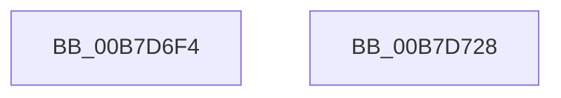

# PopDiagInterruptTimeToSystemTime

- RVA: `0x00B7D6F4`–`0x00B7D729` (길이 `53` bytes)
- VA: `0x0000000140B7D6F4`
- 실행 섹션: `PAGELK`
- PDB 이름 있음: `예`; PDB Function 태그: `아니요`
- unwind 정보 RVA: `0x000DB714`
- 디코드: `14`개 명령, `53/53` bytes 표시
- 미해석 바이트: `0` (있으면 어셈블리에 `.byte`로 보존)

> 이 문서는 커널 이미지의 기계어와 PDB 기호를 분석해 생성했습니다. 4번과 5번은 함수 원형과 자료형을 바이너리 사용 방식에서 추정한 C 해석이며 원본 소스 복구 결과는 아닙니다.

## 1. Dependencies

- 직접 호출 지점: **0**; 고유 호출 대상: **0**
- 직접 호출자로 확인된 함수: **2**
- RIP 상대 이미지 참조: **0**

### Outgoing calls
- 직접 디코드된 call 명령이 없습니다.

### Direct callers
- [PopDiagTraceRtcWakeInfo](../../text/4D/PopDiagTraceRtcWakeInfo_function_004DEA14.md) at `0x004DEA9A`
- [PopDiagTraceRtcWakeInfo](../../text/4D/PopDiagTraceRtcWakeInfo_function_004DEA14.md) at `0x004DEAAF`
- [PopDiagTraceRtcWakeInfo](../../text/4D/PopDiagTraceRtcWakeInfo_function_004DEA14.md) at `0x004DEABF`
- [PopDiagTraceRtcWakeInfo](../../text/4D/PopDiagTraceRtcWakeInfo_function_004DEA14.md) at `0x004DEACF`
- [PopTraceSystemIdleS0LowPowerDozeTimerArmed](../../page/76/PopTraceSystemIdleS0LowPowerDozeTimerArmed_function_00763EA8.md) at `0x00763F09`

### Static image references
- 디코드된 RIP-relative 메모리 참조가 없습니다.

## 2. Other-region calls and transfers

- 다른 실행 섹션으로 향하는 call: **0**
- 별도 외부 분기/꼬리 이동을 확인하지 못했습니다.

## 3. Assembly (complete function range)

```asm
00B7D6F4  49 B8 08 00 00 00 80 F7 FF FF   movabs r8, 0xfffff78000000008
00B7D6FE  4C 8B C9                        mov r9, rcx
00B7D701  48 B8 14 00 00 00 80 F7 FF FF   movabs rax, 0xfffff78000000014
00B7D70B  4D 8B 00                        mov r8, qword ptr [r8]
00B7D70E  48 8B 00                        mov rax, qword ptr [rax]
00B7D711  4D 2B C8                        sub r9, r8
00B7D714  4C 8B C1                        mov r8, rcx
00B7D717  49 F7 D8                        neg r8
00B7D71A  48 85 C9                        test rcx, rcx
00B7D71D  4D 0F 49 C1                     cmovns r8, r9
00B7D721  4C 03 C0                        add r8, rax
00B7D724  4C 89 02                        mov qword ptr [rdx], r8
00B7D727  C3                              ret
00B7D728  CC                              int3
```

## 4. C-style interpretation (structured pseudocode)

```c
__int64 __fastcall PopDiagInterruptTimeToSystemTime(__int64 a1, __int64 a2)
{
    a4 = (a1) - (*(unsigned __int64 *)(a3));
    a3 = -(a1);
    if (!sign_flag) { a3 = a4; }
    a3 = (a3) + (*(unsigned __int64 *)(result));
    *(unsigned __int64 *)(a2) = a3;
    return *(unsigned __int64 *)(result);
}
```

## 5. (Beta) C Style

```c
int64_t PopDiagInterruptTimeToSystemTime(int64_t Arg1, void *Arg2)
{
    uint8_t *arg2 = (uint8_t *)Arg2;

    a4 = (Arg1) - (*(uint64_t *)(a3));
    a3 = -(Arg1);
    if (!sign_flag) { a3 = a4; }
    a3 = (a3) + (*(uint64_t *)(result));
    *(uint64_t *)(arg2) = a3;
    return *(uint64_t *)(result);
}
```

### 관측된 메모리 오프셋

구조체 형식이 확인되지 않은 접근은 인자 기준의 오프셋으로만 기록했습니다.

| 기준 인자 | 오프셋 표현 | 폭 (bit) | 접근 |
|---|---:|---:|---|
| `Arg2` | `+ 0x0` | `64` | `W` |

## 6. Execution-region graph

[열기: 2D/3D 그래프와 함수 탐색 컨트롤 패널](../../../control-panel.html?section=pagelk&rva=0x00B7D6F4&view=graph)

- 2D 그래프는 위에서 아래로 흐르고, 3D 그래프는 빈 공간을 드래그해 회전합니다. Shift+드래그는 이동, 휠은 확대·축소, 함수 노드 선택은 대상 보고서 이동입니다.

### Static fallback


