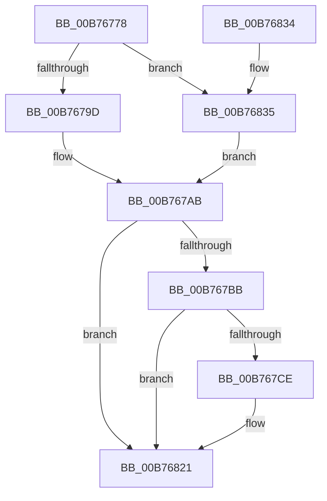

# PopDiagTraceDevicesLevel

- RVA: `0x00B76778`–`0x00B76848` (길이 `208` bytes)
- VA: `0x0000000140B76778`
- 실행 섹션: `PAGELK`
- PDB 이름 있음: `예`; PDB Function 태그: `아니요`
- unwind 정보 RVA: `0x000A10F0`
- 디코드: `45`개 명령, `208/208` bytes 표시
- 미해석 바이트: `0` (있으면 어셈블리에 `.byte`로 보존)

> 이 문서는 커널 이미지의 기계어와 PDB 기호를 분석해 생성했습니다. 4번과 5번은 함수 원형과 자료형을 바이너리 사용 방식에서 추정한 C 해석이며 원본 소스 복구 결과는 아닙니다.

## 1. Dependencies

- 직접 호출 지점: **3**; 고유 호출 대상: **3**
- 직접 호출자로 확인된 함수: **1**
- RIP 상대 이미지 참조: **7**

### Outgoing calls
- `0x00B767C5` → [EtwEventEnabled](../../text/39/EtwEventEnabled_function_00392450.md) (function, `0x00392450`)
- `0x00B7681C` → [EtwWrite](../../text/41/EtwWrite_function_0041C720.md) (function, `0x0041C720`)
- `0x00B76829` → [_security_check_cookie](../../text/6A/_security_check_cookie_function_006AC640.md) (function, `0x006AC640`)

### Direct callers
- [PoBroadcastSystemState](PoBroadcastSystemState_function_00B761B0.md) at `0x00B76332`
- [PoBroadcastSystemState](PoBroadcastSystemState_function_00B761B0.md) at `0x00B7634F`
- [PoBroadcastSystemState](PoBroadcastSystemState_function_00B761B0.md) at `0x00B76512`
- [PoBroadcastSystemState](PoBroadcastSystemState_function_00B761B0.md) at `0x00B76529`

### Static image references
- `0x00B76786` → RVA `0x00E0A740` (`.data`; read)
- `0x00B7679D` → RVA `0x00013FE8` (`.rdata`; read)
- `0x00B767A4` → RVA `0x00013FD8` (`.rdata`; read)
- `0x00B767B2` → RVA `0x00E67858` (`.data`; read)
- `0x00B767BB` → RVA `0x00F0B408` (`.data`; read)
- `0x00B76835` → RVA `0x00013FF8` (`.rdata`; read)
- `0x00B7683C` → RVA `0x00014008` (`.rdata`; read)

## 2. Other-region calls and transfers

- 다른 실행 섹션으로 향하는 call: **3**
  - `0x00B767C5` → [EtwEventEnabled](../../text/39/EtwEventEnabled_function_00392450.md) (`PAGELK` → `.text`)
  - `0x00B7681C` → [EtwWrite](../../text/41/EtwWrite_function_0041C720.md) (`PAGELK` → `.text`)
  - `0x00B76829` → [_security_check_cookie](../../text/6A/_security_check_cookie_function_006AC640.md) (`PAGELK` → `.text`)
- 별도 외부 분기/꼬리 이동을 확인하지 못했습니다.

## 3. Assembly (complete function range)

```asm
00B76778  44 88 44 24 18                  mov byte ptr [rsp + 0x18], r8b
00B7677D  89 4C 24 08                     mov dword ptr [rsp + 8], ecx
00B76781  53                              push rbx
00B76782  48 83 EC 60                     sub rsp, 0x60
00B76786  48 8B 05 B3 3F 29 00            mov rax, qword ptr [rip + 0x293fb3]
00B7678D  48 33 C4                        xor rax, rsp
00B76790  48 89 44 24 50                  mov qword ptr [rsp + 0x50], rax
00B76795  85 D2                           test edx, edx
00B76797  0F 84 98 00 00 00               je 0x140b76835
00B7679D  48 8D 05 44 D8 49 FF            lea rax, [rip - 0xb627bc]
00B767A4  48 8D 1D 2D D8 49 FF            lea rbx, [rip - 0xb627d3]
00B767AB  45 84 C9                        test r9b, r9b
00B767AE  48 0F 44 D8                     cmove rbx, rax
00B767B2  80 3D 9F 10 2F 00 00            cmp byte ptr [rip + 0x2f109f], 0
00B767B9  74 66                           je 0x140b76821
00B767BB  48 8B 0D 46 4C 39 00            mov rcx, qword ptr [rip + 0x394c46]
00B767C2  48 8B D3                        mov rdx, rbx
00B767C5  E8 86 BC 81 FF                  call 0x140392450
00B767CA  84 C0                           test al, al
00B767CC  74 53                           je 0x140b76821
00B767CE  83 64 24 3C 00                  and dword ptr [rsp + 0x3c], 0
00B767D3  48 8D 44 24 70                  lea rax, [rsp + 0x70]
00B767D8  83 64 24 4C 00                  and dword ptr [rsp + 0x4c], 0
00B767DD  41 B9 02 00 00 00               mov r9d, 2
00B767E3  48 8B 0D 1E 4C 39 00            mov rcx, qword ptr [rip + 0x394c1e]
00B767EA  45 33 C0                        xor r8d, r8d
00B767ED  48 89 44 24 30                  mov qword ptr [rsp + 0x30], rax
00B767F2  48 8B D3                        mov rdx, rbx
00B767F5  48 8D 84 24 80 00 00 00         lea rax, [rsp + 0x80]
00B767FD  C7 44 24 38 04 00 00 00         mov dword ptr [rsp + 0x38], 4
00B76805  48 89 44 24 40                  mov qword ptr [rsp + 0x40], rax
00B7680A  48 8D 44 24 30                  lea rax, [rsp + 0x30]
00B7680F  48 89 44 24 20                  mov qword ptr [rsp + 0x20], rax
00B76814  C7 44 24 48 01 00 00 00         mov dword ptr [rsp + 0x48], 1
00B7681C  E8 FF 5E 8A FF                  call 0x14041c720
00B76821  48 8B 4C 24 50                  mov rcx, qword ptr [rsp + 0x50]
00B76826  48 33 CC                        xor rcx, rsp
00B76829  E8 12 5E B3 FF                  call 0x1406ac640
00B7682E  48 83 C4 60                     add rsp, 0x60
00B76832  5B                              pop rbx
00B76833  C3                              ret
00B76834  CC                              int3
00B76835  48 8D 05 BC D7 49 FF            lea rax, [rip - 0xb62844]
00B7683C  48 8D 1D C5 D7 49 FF            lea rbx, [rip - 0xb6283b]
00B76843  E9 63 FF FF FF                  jmp 0x140b767ab
```

## 4. C-style interpretation (structured pseudocode)

```c
__int64 __fastcall PopDiagTraceDevicesLevel(int a1, int a2, int a3, unsigned __int8 a4)
{
    __int64 result;
    __int64 v_rbx;
    __int64 v_rsp;
    unsigned __int64 v_stack_m18;
    unsigned int v_stack_m1C;
    unsigned int v_stack_m20;
    unsigned __int64 v_stack_m28;
    unsigned int v_stack_m2C;
    unsigned int v_stack_m30;
    unsigned __int64 v_stack_m38;
    unsigned __int64 v_stack_m48;
    unsigned __int8 v_stack_p18;
    unsigned int v_stack_p8;

    v_stack_p18 = (unsigned __int8)(a3);
    v_stack_p8 = a1;
    v_rsp = (v_rsp) - (96);
    result = (*(unsigned __int64 *)(v_rip + 2703283)) ^ (v_rsp);
    v_stack_m18 = result;
    if (a2 == 0) goto loc_00B76835;
loc_00B767AB:
    v_rbx = v_rip - 11937747;
    if (a4 == 0) { v_rbx = v_rip - 11937724; }
    if ((*(unsigned __int8 *)(v_rip + 3084447)) == 0) goto loc_00B76821;
    result = EtwEventEnabled(*(unsigned __int64 *)(v_rip + 3755078), v_rbx, a3, a4);
    if ((unsigned __int8)(result) != 0) {
        result = v_stack_p8;
        a4 = 2;
        a1 = *(unsigned __int64 *)(v_rip + 3755038);
        a3 = 0;
        v_stack_m38 = result;
        a2 = v_rbx;
        result = v_stack_p18;
        v_stack_m30 = 4;
        v_stack_m28 = result;
        result = v_stack_m38;
        v_stack_m48 = result;
        v_stack_m20 = 1;
        result = EtwWrite(a1, a2, a3, a4);
    }
    a1 = (v_stack_m18) ^ (v_rsp);
    result = _security_check_cookie(a1, a2, a3, a4);
    v_rsp = (v_rsp) + (96);
    return result;
loc_00B76835:
    goto loc_00B767AB;
}
```

## 5. (Beta) C Style

```c
int64_t PopDiagTraceDevicesLevel(int32_t Arg1, int32_t Arg2, int32_t Arg3, uint8_t Arg4)
{
    int64_t result;
    int64_t local_rbx;
    int64_t local_rsp;
    uint64_t v_stack_m18;
    uint32_t v_stack_m1C;
    uint32_t v_stack_m20;
    uint64_t v_stack_m28;
    uint32_t v_stack_m2C;
    uint32_t v_stack_m30;
    uint64_t v_stack_m38;
    uint64_t v_stack_m48;
    uint8_t v_stack_p18;
    uint32_t v_stack_p8;

    v_stack_p18 = (uint8_t)(Arg3);
    v_stack_p8 = Arg1;
    local_rsp = (local_rsp) - (96);
    result = (*(uint64_t *)(v_rip + 0x293FB3)) ^ (local_rsp);
    v_stack_m18 = result;
    if (Arg2 == 0) goto loc_00B76835;
loc_00B767AB:
    local_rbx = v_rip - 11937747;
    if (Arg4 == 0) { local_rbx = v_rip - 11937724; }
    if ((*(uint8_t *)(v_rip + 0x2F109F)) == 0) goto loc_00B76821;
    result = EtwEventEnabled(*(uint64_t *)(v_rip + 0x394C46), local_rbx, Arg3, Arg4);
    if ((uint8_t)(result) != 0) {
        result = v_stack_p8;
        Arg4 = 2;
        Arg1 = *(uint64_t *)(v_rip + 0x394C1E);
        Arg3 = 0;
        v_stack_m38 = result;
        Arg2 = local_rbx;
        result = v_stack_p18;
        v_stack_m30 = 4;
        v_stack_m28 = result;
        result = v_stack_m38;
        v_stack_m48 = result;
        v_stack_m20 = 1;
        result = EtwWrite(Arg1, Arg2, Arg3, Arg4);
    }
    Arg1 = (v_stack_m18) ^ (local_rsp);
    result = _security_check_cookie(Arg1, Arg2, Arg3, Arg4);
    local_rsp = (local_rsp) + (96);
    return result;
loc_00B76835:
    goto loc_00B767AB;
}
```

## 6. Execution-region graph

[열기: 2D/3D 그래프와 함수 탐색 컨트롤 패널](../../../control-panel.html?section=pagelk&rva=0x00B76778&view=graph)

- 2D 그래프는 위에서 아래로 흐르고, 3D 그래프는 빈 공간을 드래그해 회전합니다. Shift+드래그는 이동, 휠은 확대·축소, 함수 노드 선택은 대상 보고서 이동입니다.

### Static fallback


