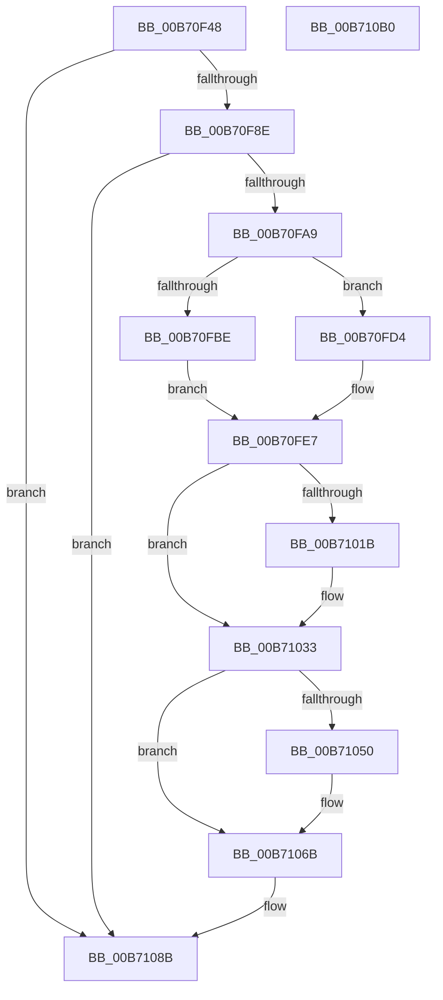

# PopDiagTraceDriverVeto

- RVA: `0x00B70F48`–`0x00B710B1` (길이 `361` bytes)
- VA: `0x0000000140B70F48`
- 실행 섹션: `PAGELK`
- PDB 이름 있음: `예`; PDB Function 태그: `아니요`
- unwind 정보 RVA: `0x000CC938`
- 디코드: `88`개 명령, `361/361` bytes 표시
- 미해석 바이트: `0` (있으면 어셈블리에 `.byte`로 보존)

> 이 문서는 커널 이미지의 기계어와 PDB 기호를 분석해 생성했습니다. 4번과 5번은 함수 원형과 자료형을 바이너리 사용 방식에서 추정한 C 해석이며 원본 소스 복구 결과는 아닙니다.

## 1. Dependencies

- 직접 호출 지점: **6**; 고유 호출 대상: **5**
- 직접 호출자로 확인된 함수: **1**
- RIP 상대 이미지 참조: **5**

### Outgoing calls
- `0x00B70F9C` → [EtwEventEnabled](../../text/39/EtwEventEnabled_function_00392450.md) (function, `0x00392450`)
- `0x00B70FB0` → [PopDiagGetDriverName](../../text/47/PopDiagGetDriverName_function_0047FDB4.md) (function, `0x0047FDB4`)
- `0x00B70FC2` → [RtlInitUnicodeString](../../text/42/RtlInitUnicodeString_function_0042A780.md) (function, `0x0042A780`)
- `0x00B70FDB` → [RtlInitUnicodeString](../../text/42/RtlInitUnicodeString_function_0042A780.md) (function, `0x0042A780`)
- `0x00B71086` → [EtwWrite](../../text/41/EtwWrite_function_0041C720.md) (function, `0x0041C720`)
- `0x00B71092` → [_security_check_cookie](../../text/6A/_security_check_cookie_function_006AC640.md) (function, `0x006AC640`)

### Direct callers
- [PopCompleteNotifyTransitionCommon](../../text/48/PopCompleteNotifyTransitionCommon_function_00483B4C.md) at `0x00483CEF`

### Static image references
- `0x00B70F63` → RVA `0x00E0A740` (`.data`; read)
- `0x00B70F76` → RVA `0x00E67858` (`.data`; read)
- `0x00B70F8E` → RVA `0x00F0B408` (`.data`; read)
- `0x00B70F95` → RVA `0x000213B0` (`.rdata`; read)
- `0x00B70FD4` → RVA `0x00B7FF40` (` ?? ::OKHAJAOM::`string'`; read)

## 2. Other-region calls and transfers

- 다른 실행 섹션으로 향하는 call: **6**
  - `0x00B70F9C` → [EtwEventEnabled](../../text/39/EtwEventEnabled_function_00392450.md) (`PAGELK` → `.text`)
  - `0x00B70FB0` → [PopDiagGetDriverName](../../text/47/PopDiagGetDriverName_function_0047FDB4.md) (`PAGELK` → `.text`)
  - `0x00B70FC2` → [RtlInitUnicodeString](../../text/42/RtlInitUnicodeString_function_0042A780.md) (`PAGELK` → `.text`)
  - `0x00B70FDB` → [RtlInitUnicodeString](../../text/42/RtlInitUnicodeString_function_0042A780.md) (`PAGELK` → `.text`)
  - `0x00B71086` → [EtwWrite](../../text/41/EtwWrite_function_0041C720.md) (`PAGELK` → `.text`)
  - `0x00B71092` → [_security_check_cookie](../../text/6A/_security_check_cookie_function_006AC640.md) (`PAGELK` → `.text`)
- 별도 외부 분기/꼬리 이동을 확인하지 못했습니다.

## 3. Assembly (complete function range)

```asm
00B70F48  48 8B C4                        mov rax, rsp
00B70F4B  48 89 58 10                     mov qword ptr [rax + 0x10], rbx
00B70F4F  48 89 70 18                     mov qword ptr [rax + 0x18], rsi
00B70F53  48 89 78 20                     mov qword ptr [rax + 0x20], rdi
00B70F57  55                              push rbp
00B70F58  48 8D 68 D8                     lea rbp, [rax - 0x28]
00B70F5C  48 81 EC 20 01 00 00            sub rsp, 0x120
00B70F63  48 8B 05 D6 97 29 00            mov rax, qword ptr [rip + 0x2997d6]
00B70F6A  48 33 C4                        xor rax, rsp
00B70F6D  48 89 45 10                     mov qword ptr [rbp + 0x10], rax
00B70F71  33 F6                           xor esi, esi
00B70F73  0F 57 C0                        xorps xmm0, xmm0
00B70F76  40 38 35 DB 68 2F 00            cmp byte ptr [rip + 0x2f68db], sil
00B70F7D  48 8B FA                        mov rdi, rdx
00B70F80  48 8B D9                        mov rbx, rcx
00B70F83  0F 11 44 24 38                  movups xmmword ptr [rsp + 0x38], xmm0
00B70F88  0F 84 FD 00 00 00               je 0x140b7108b
00B70F8E  48 8B 0D 73 A4 39 00            mov rcx, qword ptr [rip + 0x39a473]
00B70F95  48 8D 15 14 04 4B FF            lea rdx, [rip - 0xb4fbec]
00B70F9C  E8 AF 14 82 FF                  call 0x140392450
00B70FA1  84 C0                           test al, al
00B70FA3  0F 84 E2 00 00 00               je 0x140b7108b
00B70FA9  48 8D 55 90                     lea rdx, [rbp - 0x70]
00B70FAD  48 8B CB                        mov rcx, rbx
00B70FB0  E8 FF ED 90 FF                  call 0x14047fdb4
00B70FB5  48 8D 4C 24 38                  lea rcx, [rsp + 0x38]
00B70FBA  85 C0                           test eax, eax
00B70FBC  78 16                           js 0x140b70fd4
00B70FBE  48 8D 55 90                     lea rdx, [rbp - 0x70]
00B70FC2  E8 B9 97 8B FF                  call 0x14042a780
00B70FC7  0F B7 4C 24 38                  movzx ecx, word ptr [rsp + 0x38]
00B70FCC  0F B7 C1                        movzx eax, cx
00B70FCF  66 D1 E8                        shr ax, 1
00B70FD2  EB 13                           jmp 0x140b70fe7
00B70FD4  48 8D 15 65 EF 00 00            lea rdx, [rip + 0xef65]
00B70FDB  E8 A0 97 8B FF                  call 0x14042a780
00B70FE0  0F B7 4C 24 38                  movzx ecx, word ptr [rsp + 0x38]
00B70FE5  8B C6                           mov eax, esi
00B70FE7  44 0F B7 47 88                  movzx r8d, word ptr [rdi - 0x78]
00B70FEC  4C 8D 4C 24 30                  lea r9, [rsp + 0x30]
00B70FF1  41 BA 02 00 00 00               mov r10d, 2
00B70FF7  4C 89 4C 24 50                  mov qword ptr [rsp + 0x50], r9
00B70FFC  41 0F B7 D0                     movzx edx, r8w
00B71000  66 89 44 24 30                  mov word ptr [rsp + 0x30], ax
00B71005  66 D1 EA                        shr dx, 1
00B71008  66 89 54 24 34                  mov word ptr [rsp + 0x34], dx
00B7100D  4C 89 54 24 58                  mov qword ptr [rsp + 0x58], r10
00B71012  45 8D 4A FF                     lea r9d, [r10 - 1]
00B71016  66 85 C0                        test ax, ax
00B71019  74 18                           je 0x140b71033
00B7101B  48 8B 44 24 40                  mov rax, qword ptr [rsp + 0x40]
00B71020  45 8B CA                        mov r9d, r10d
00B71023  48 89 44 24 60                  mov qword ptr [rsp + 0x60], rax
00B71028  0F B7 C1                        movzx eax, cx
00B7102B  89 44 24 68                     mov dword ptr [rsp + 0x68], eax
00B7102F  89 74 24 6C                     mov dword ptr [rsp + 0x6c], esi
00B71033  41 8B C1                        mov eax, r9d
00B71036  48 8D 4C 24 34                  lea rcx, [rsp + 0x34]
00B7103B  48 03 C0                        add rax, rax
00B7103E  41 FF C1                        inc r9d
00B71041  48 89 4C C4 50                  mov qword ptr [rsp + rax*8 + 0x50], rcx
00B71046  4C 89 54 C4 58                  mov qword ptr [rsp + rax*8 + 0x58], r10
00B7104B  66 85 D2                        test dx, dx
00B7104E  74 1B                           je 0x140b7106b
00B71050  48 8B 47 90                     mov rax, qword ptr [rdi - 0x70]
00B71054  41 8B C9                        mov ecx, r9d
00B71057  48 03 C9                        add rcx, rcx
00B7105A  41 FF C1                        inc r9d
00B7105D  48 89 44 CC 50                  mov qword ptr [rsp + rcx*8 + 0x50], rax
00B71062  44 89 44 CC 58                  mov dword ptr [rsp + rcx*8 + 0x58], r8d
00B71067  89 74 CC 5C                     mov dword ptr [rsp + rcx*8 + 0x5c], esi
00B7106B  48 8B 0D 96 A3 39 00            mov rcx, qword ptr [rip + 0x39a396]
00B71072  48 8D 44 24 50                  lea rax, [rsp + 0x50]
00B71077  45 33 C0                        xor r8d, r8d
00B7107A  48 89 44 24 20                  mov qword ptr [rsp + 0x20], rax
00B7107F  48 8D 15 2A 03 4B FF            lea rdx, [rip - 0xb4fcd6]
00B71086  E8 95 B6 8A FF                  call 0x14041c720
00B7108B  48 8B 4D 10                     mov rcx, qword ptr [rbp + 0x10]
00B7108F  48 33 CC                        xor rcx, rsp
00B71092  E8 A9 B5 B3 FF                  call 0x1406ac640
00B71097  4C 8D 9C 24 20 01 00 00         lea r11, [rsp + 0x120]
00B7109F  49 8B 5B 18                     mov rbx, qword ptr [r11 + 0x18]
00B710A3  49 8B 73 20                     mov rsi, qword ptr [r11 + 0x20]
00B710A7  49 8B 7B 28                     mov rdi, qword ptr [r11 + 0x28]
00B710AB  49 8B E3                        mov rsp, r11
00B710AE  5D                              pop rbp
00B710AF  C3                              ret
00B710B0  CC                              int3
```

## 4. C-style interpretation (structured pseudocode)

```c
__int64 __fastcall PopDiagTraceDriverVeto(__int64 a1, __int64 a2)
{
    __int64 result;
    __int64 v_rsi;
    __int64 v_rsp;
    unsigned __int64 v_stack_m108;
    unsigned __int64 v_stack_m8;
    unsigned int v_stack_mBC;
    unsigned int v_stack_mC0;
    unsigned __int64 v_stack_mC8;
    unsigned __int64 v_stack_mD0;
    unsigned __int64 v_stack_mD8;
    unsigned __int64 v_stack_mE8;
    unsigned __int64 v_stack_mF0;
    unsigned __int16 v_stack_mF4;
    unsigned __int64 v_stack_mF8;

    *(unsigned __int64 *)(v_rsp + 16) = v_rbx;
    *(unsigned __int64 *)(v_rsp + 24) = v_rsi;
    *(unsigned __int64 *)(v_rsp + 32) = v_rdi;
    v_rsp = (v_rsp) - (288);
    result = (*(unsigned __int64 *)(v_rip + 2725846)) ^ (v_rsp);
    *(unsigned __int64 *)(v_rsp - 40 + 16) = result;
    v_rsi = 0;
    v_stack_mF0 = v_xmm0;
    if ((*(unsigned __int8 *)(v_rip + 3107035)) == 0) goto loc_00B7108B;
    result = EtwEventEnabled(*(unsigned __int64 *)(v_rip + 3777651), v_rip - 11860972, a3, a4);
    if ((unsigned __int8)(result) == 0) goto loc_00B7108B;
    result = PopDiagGetDriverName(a1, v_rsp - 40 - 112, a3, a4);
    if (sign_flag) goto loc_00B70FD4;
    result = RtlInitUnicodeString(v_stack_mF0, v_rsp - 40 - 112, a3, a4);
    result = (unsigned __int16)(((unsigned __int16)(v_stack_mF0)) >> (1));
    goto loc_00B70FE7;
loc_00B70FD4:
    result = RtlInitUnicodeString(v_stack_mF0, v_rip + 61285, a3, a4);
loc_00B70FE7:
    v_stack_mD8 = v_stack_mF8;
    v_stack_mF8 = 0;
    a2 = (unsigned __int16)(((unsigned __int16)(*(unsigned __int16 *)(a2 - 120))) >> (1));
    v_stack_mF4 = (unsigned __int16)(a2);
    v_stack_mD0 = 2;
    result = 0;
    if (0 != 0) {
        result = v_stack_mE8;
        a4 = 2;
        v_stack_mC8 = result;
        result = (unsigned __int16)(v_stack_mF0);
        v_stack_mC0 = (unsigned int)(result);
        v_stack_mBC = 0;
    }
    result = ((unsigned int)((unsigned int)(a4))) + ((unsigned int)((unsigned int)(a4)));
    a4 = (unsigned int)((a4) + 1);
    *(unsigned __int64 *)(v_rsp + result * 8 + 80) = v_stack_mF4;
    *(unsigned __int64 *)(v_rsp + result * 8 + 88) = 2;
    if ((unsigned __int16)(a2) != 0) {
        result = *(unsigned __int64 *)(a2 - 112);
        a1 = (unsigned int)(a4);
        a1 = (a1) + (a1);
        a4 = (unsigned int)((a4) + 1);
        *(unsigned __int64 *)(v_rsp + a1 * 8 + 80) = result;
        *(unsigned int *)(v_rsp + a1 * 8 + 88) = (unsigned int)(*(unsigned __int16 *)(a2 - 120));
        *(unsigned int *)(v_rsp + a1 * 8 + 92) = 0;
    }
    a3 = 0;
    v_stack_m108 = v_stack_mD8;
    result = EtwWrite(*(unsigned __int64 *)(v_rip + 3777430), v_rip - 11861206, a3, a4);
loc_00B7108B:
    a1 = (*(unsigned __int64 *)(v_rsp - 40 + 16)) ^ (v_rsp);
    result = _security_check_cookie(a1, v_rip - 11861206, a3, a4);
    return result;
}
```

## 5. (Beta) C Style

```c
int64_t PopDiagTraceDriverVeto(int64_t Arg1, void *Arg2)
{
    uint8_t *arg2 = (uint8_t *)Arg2;

    int64_t result;
    int64_t local_rsi;
    int64_t local_rsp;
    uint64_t v_stack_m108;
    uint64_t v_stack_m8;
    uint32_t v_stack_mBC;
    uint32_t v_stack_mC0;
    uint64_t v_stack_mC8;
    uint64_t v_stack_mD0;
    uint64_t v_stack_mD8;
    uint64_t v_stack_mE8;
    uint64_t v_stack_mF0;
    uint16_t v_stack_mF4;
    uint64_t v_stack_mF8;

    *(uint64_t *)(local_rsp + 0x10) = local_rbx;
    *(uint64_t *)(local_rsp + 0x18) = local_rsi;
    *(uint64_t *)(local_rsp + 0x20) = local_rdi;
    local_rsp = (local_rsp) - (288);
    result = (*(uint64_t *)(v_rip + 0x2997D6)) ^ (local_rsp);
    *(uint64_t *)(local_rsp - 0x28 + 0x10) = result;
    local_rsi = 0;
    v_stack_mF0 = v_xmm0;
    if ((*(uint8_t *)(v_rip + 0x2F68DB)) == 0) goto loc_00B7108B;
    result = EtwEventEnabled(*(uint64_t *)(v_rip + 0x39A473), v_rip - 11860972, a3, a4);
    if ((uint8_t)(result) == 0) goto loc_00B7108B;
    result = PopDiagGetDriverName(Arg1, local_rsp - 40 - 112, a3, a4);
    if (sign_flag) goto loc_00B70FD4;
    result = RtlInitUnicodeString(v_stack_mF0, local_rsp - 40 - 112, a3, a4);
    result = (uint16_t)(((uint16_t)(v_stack_mF0)) >> (1));
    goto loc_00B70FE7;
loc_00B70FD4:
    result = RtlInitUnicodeString(v_stack_mF0, v_rip + 61285, a3, a4);
loc_00B70FE7:
    v_stack_mD8 = v_stack_mF8;
    v_stack_mF8 = 0;
    Arg2 = (uint16_t)(((uint16_t)(*(uint16_t *)(arg2 - 0x78))) >> (1));
    v_stack_mF4 = (uint16_t)(Arg2);
    v_stack_mD0 = 2;
    result = 0;
    if (0 != 0) {
        result = v_stack_mE8;
        a4 = 2;
        v_stack_mC8 = result;
        result = (uint16_t)(v_stack_mF0);
        v_stack_mC0 = (uint32_t)(result);
        v_stack_mBC = 0;
    }
    result = ((uint32_t)((uint32_t)(a4))) + ((uint32_t)((uint32_t)(a4)));
    a4 = (uint32_t)((a4) + 1);
    *(uint64_t *)(local_rsp + result * 8 + 0x50) = v_stack_mF4;
    *(uint64_t *)(local_rsp + result * 8 + 0x58) = 2;
    if ((uint16_t)(Arg2) != 0) {
        result = *(uint64_t *)(arg2 - 0x70);
        Arg1 = (uint32_t)(a4);
        Arg1 = (Arg1) + (Arg1);
        a4 = (uint32_t)((a4) + 1);
        *(uint64_t *)(local_rsp + Arg1 * 8 + 0x50) = result;
        *(uint32_t *)(local_rsp + Arg1 * 8 + 0x58) = (uint32_t)(*(uint16_t *)(arg2 - 0x78));
        *(uint32_t *)(local_rsp + Arg1 * 8 + 0x5C) = 0;
    }
    a3 = 0;
    v_stack_m108 = v_stack_mD8;
    result = EtwWrite(*(uint64_t *)(v_rip + 0x39A396), v_rip - 11861206, a3, a4);
loc_00B7108B:
    Arg1 = (*(uint64_t *)(local_rsp - 0x28 + 0x10)) ^ (local_rsp);
    result = _security_check_cookie(Arg1, v_rip - 11861206, a3, a4);
    return result;
}
```

### 관측된 메모리 오프셋

구조체 형식이 확인되지 않은 접근은 인자 기준의 오프셋으로만 기록했습니다.

| 기준 인자 | 오프셋 표현 | 폭 (bit) | 접근 |
|---|---:|---:|---|
| `Arg2` | `- 0x78` | `16` | `R` |
| `Arg2` | `- 0x70` | `64` | `R` |

## 6. Execution-region graph

[열기: 2D/3D 그래프와 함수 탐색 컨트롤 패널](../../../control-panel.html?section=pagelk&rva=0x00B70F48&view=graph)

- 2D 그래프는 위에서 아래로 흐르고, 3D 그래프는 빈 공간을 드래그해 회전합니다. Shift+드래그는 이동, 휠은 확대·축소, 함수 노드 선택은 대상 보고서 이동입니다.

### Static fallback


