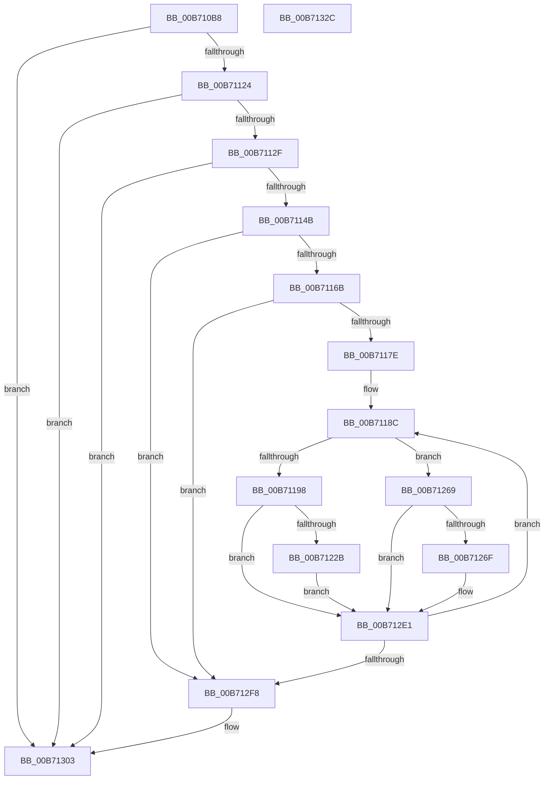

# PopDiagTraceFirmwareS3Stats

- RVA: `0x00B710B8`–`0x00B7132D` (길이 `629` bytes)
- VA: `0x0000000140B710B8`
- 실행 섹션: `PAGELK`
- PDB 이름 있음: `예`; PDB Function 태그: `아니요`
- unwind 정보 RVA: `0x000CC87C`
- 디코드: `150`개 명령, `629/629` bytes 표시
- 미해석 바이트: `0` (있으면 어셈블리에 `.byte`로 보존)

> 이 문서는 커널 이미지의 기계어와 PDB 기호를 분석해 생성했습니다. 4번과 5번은 함수 원형과 자료형을 바이너리 사용 방식에서 추정한 C 해석이며 원본 소스 복구 결과는 아닙니다.

## 1. Dependencies

- 직접 호출 지점: **8**; 고유 호출 대상: **6**
- 직접 호출자로 확인된 함수: **1**
- RIP 상대 이미지 참조: **8**

### Outgoing calls
- `0x00B71114` → [guard_dispatch_icall](../../text/6B/guard_dispatch_icall_function_006BAAD0.md) (function, `0x006BAAD0`)
- `0x00B7113A` → [ExAllocatePool2](../../poolcode/B8/ExAllocatePool2_function_00B820F0.md) (function, `0x00B820F0`)
- `0x00B7115E` → [guard_dispatch_icall](../../text/6B/guard_dispatch_icall_function_006BAAD0.md) (function, `0x006BAAD0`)
- `0x00B71219` → [EtwWriteEx](../../text/25/EtwWriteEx_function_0025F0D0.md) (function, `0x0025F0D0`)
- `0x00B71239` → [RtlULongLongMult](../../text/43/RtlULongLongMult_function_0043E530.md) (function, `0x0043E530`)
- `0x00B712DC` → [EtwWriteEx](../../text/25/EtwWriteEx_function_0025F0D0.md) (function, `0x0025F0D0`)
- `0x00B712FE` → [ExFreePoolWithTag](../../poolcode/B8/ExFreePoolWithTag_function_00B82870.md) (function, `0x00B82870`)
- `0x00B7130A` → [_security_check_cookie](../../text/6A/_security_check_cookie_function_006AC640.md) (function, `0x006AC640`)

### Direct callers
- [PopTransitionSystemPowerStateEx](PopTransitionSystemPowerStateEx_function_00B7E8C0.md) at `0x00B7EF23`

### Static image references
- `0x00B710D7` → RVA `0x00E0A740` (`.data`; read)
- `0x00B710E5` → RVA `0x00E00638` (`.data`; read)
- `0x00B7119E` → RVA `0x00F0B408` (`.data`; read)
- `0x00B711F0` → RVA `0x000235B0` (`.rdata`; read)
- `0x00B7121E` → RVA `0x00F0C348` (`.data`; read)
- `0x00B71232` → RVA `0x00FC6BE0` (`ALMOSTRO`; read)
- `0x00B71260` → RVA `0x00F0C348` (`.data`; write)
- `0x00B712BB` → RVA `0x000224B8` (`.rdata`; read)

## 2. Other-region calls and transfers

- 다른 실행 섹션으로 향하는 call: **8**
  - `0x00B71114` → [guard_dispatch_icall](../../text/6B/guard_dispatch_icall_function_006BAAD0.md) (`PAGELK` → `.text`)
  - `0x00B7113A` → [ExAllocatePool2](../../poolcode/B8/ExAllocatePool2_function_00B820F0.md) (`PAGELK` → `POOLCODE`)
  - `0x00B7115E` → [guard_dispatch_icall](../../text/6B/guard_dispatch_icall_function_006BAAD0.md) (`PAGELK` → `.text`)
  - `0x00B71219` → [EtwWriteEx](../../text/25/EtwWriteEx_function_0025F0D0.md) (`PAGELK` → `.text`)
  - `0x00B71239` → [RtlULongLongMult](../../text/43/RtlULongLongMult_function_0043E530.md) (`PAGELK` → `.text`)
  - `0x00B712DC` → [EtwWriteEx](../../text/25/EtwWriteEx_function_0025F0D0.md) (`PAGELK` → `.text`)
  - `0x00B712FE` → [ExFreePoolWithTag](../../poolcode/B8/ExFreePoolWithTag_function_00B82870.md) (`PAGELK` → `POOLCODE`)
  - `0x00B7130A` → [_security_check_cookie](../../text/6A/_security_check_cookie_function_006AC640.md) (`PAGELK` → `.text`)
- 별도 외부 분기/꼬리 이동을 확인하지 못했습니다.

## 3. Assembly (complete function range)

```asm
00B710B8  48 8B C4                        mov rax, rsp
00B710BB  48 89 58 08                     mov qword ptr [rax + 8], rbx
00B710BF  48 89 70 10                     mov qword ptr [rax + 0x10], rsi
00B710C3  48 89 78 18                     mov qword ptr [rax + 0x18], rdi
00B710C7  55                              push rbp
00B710C8  41 56                           push r14
00B710CA  41 57                           push r15
00B710CC  48 8D 68 A1                     lea rbp, [rax - 0x5f]
00B710D0  48 81 EC A0 00 00 00            sub rsp, 0xa0
00B710D7  48 8B 05 62 96 29 00            mov rax, qword ptr [rip + 0x299662]
00B710DE  48 33 C4                        xor rax, rsp
00B710E1  48 89 45 3F                     mov qword ptr [rbp + 0x3f], rax
00B710E5  48 8B 05 4C F5 28 00            mov rax, qword ptr [rip + 0x28f54c]
00B710EC  4C 8D 4D E7                     lea r9, [rbp - 0x19]
00B710F0  33 F6                           xor esi, esi
00B710F2  45 33 C0                        xor r8d, r8d
00B710F5  33 D2                           xor edx, edx
00B710F7  89 75 F3                        mov dword ptr [rbp - 0xd], esi
00B710FA  89 75 EB                        mov dword ptr [rbp - 0x15], esi
00B710FD  89 75 E7                        mov dword ptr [rbp - 0x19], esi
00B71100  8D 7E 23                        lea edi, [rsi + 0x23]
00B71103  89 75 EF                        mov dword ptr [rbp - 0x11], esi
00B71106  8B CF                           mov ecx, edi
00B71108  48 89 75 F7                     mov qword ptr [rbp - 9], rsi
00B7110C  48 89 75 07                     mov qword ptr [rbp + 7], rsi
00B71110  48 89 75 FF                     mov qword ptr [rbp - 1], rsi
00B71114  E8 B7 99 B4 FF                  call 0x1406baad0
00B71119  3D 04 00 00 C0                  cmp eax, 0xc0000004
00B7111E  0F 85 DF 01 00 00               jne 0x140b71303
00B71124  8B 45 E7                        mov eax, dword ptr [rbp - 0x19]
00B71127  85 C0                           test eax, eax
00B71129  0F 84 D4 01 00 00               je 0x140b71303
00B7112F  8B D0                           mov edx, eax
00B71131  8D 4E 40                        lea ecx, [rsi + 0x40]
00B71134  41 B8 53 33 70 74               mov r8d, 0x74703353
00B7113A  E8 B1 0F 01 00                  call 0x140b820f0
00B7113F  48 8B D8                        mov rbx, rax
00B71142  48 85 C0                        test rax, rax
00B71145  0F 84 B8 01 00 00               je 0x140b71303
00B7114B  48 8B 05 E6 F4 28 00            mov rax, qword ptr [rip + 0x28f4e6]
00B71152  4C 8D 4D E7                     lea r9, [rbp - 0x19]
00B71156  8B 55 E7                        mov edx, dword ptr [rbp - 0x19]
00B71159  4C 8B C3                        mov r8, rbx
00B7115C  8B CF                           mov ecx, edi
00B7115E  E8 6D 99 B4 FF                  call 0x1406baad0
00B71163  85 C0                           test eax, eax
00B71165  0F 88 8D 01 00 00               js 0x140b712f8
00B7116B  8B 43 04                        mov eax, dword ptr [rbx + 4]
00B7116E  48 8D 7B 08                     lea rdi, [rbx + 8]
00B71172  48 03 C3                        add rax, rbx
00B71175  48 3B F8                        cmp rdi, rax
00B71178  0F 83 7A 01 00 00               jae 0x140b712f8
00B7117E  49 BF DB 34 B6 D7 82 DE 1B 43   movabs r15, 0x431bde82d7b634db
00B71188  44 8D 76 01                     lea r14d, [rsi + 1]
00B7118C  0F B7 07                        movzx eax, word ptr [rdi]
00B7118F  66 85 C0                        test ax, ax
00B71192  0F 85 D1 00 00 00               jne 0x140b71269
00B71198  8B 47 04                        mov eax, dword ptr [rdi + 4]
00B7119B  45 8B CE                        mov r9d, r14d
00B7119E  48 8B 0D 63 A2 39 00            mov rcx, qword ptr [rip + 0x39a263]
00B711A5  45 33 C0                        xor r8d, r8d
00B711A8  89 45 EF                        mov dword ptr [rbp - 0x11], eax
00B711AB  49 8B C7                        mov rax, r15
00B711AE  48 F7 67 08                     mul qword ptr [rdi + 8]
00B711B2  49 8B C7                        mov rax, r15
00B711B5  48 C1 EA 12                     shr rdx, 0x12
00B711B9  89 55 EB                        mov dword ptr [rbp - 0x15], edx
00B711BC  48 F7 67 10                     mul qword ptr [rdi + 0x10]
00B711C0  48 8D 45 EF                     lea rax, [rbp - 0x11]
00B711C4  48 C7 45 17 04 00 00 00         mov qword ptr [rbp + 0x17], 4
00B711CC  48 89 45 0F                     mov qword ptr [rbp + 0xf], rax
00B711D0  48 8D 45 EB                     lea rax, [rbp - 0x15]
00B711D4  48 89 45 1F                     mov qword ptr [rbp + 0x1f], rax
00B711D8  48 8D 45 F3                     lea rax, [rbp - 0xd]
00B711DC  48 C1 EA 12                     shr rdx, 0x12
00B711E0  48 89 45 2F                     mov qword ptr [rbp + 0x2f], rax
00B711E4  48 8D 45 0F                     lea rax, [rbp + 0xf]
00B711E8  48 89 44 24 38                  mov qword ptr [rsp + 0x38], rax
00B711ED  89 55 F3                        mov dword ptr [rbp - 0xd], edx
00B711F0  48 8D 15 B9 23 4B FF            lea rdx, [rip - 0xb4dc47]
00B711F7  C7 44 24 30 03 00 00 00         mov dword ptr [rsp + 0x30], 3
00B711FF  48 89 74 24 28                  mov qword ptr [rsp + 0x28], rsi
00B71204  48 C7 45 27 04 00 00 00         mov qword ptr [rbp + 0x27], 4
00B7120C  48 C7 45 37 04 00 00 00         mov qword ptr [rbp + 0x37], 4
00B71214  48 89 74 24 20                  mov qword ptr [rsp + 0x20], rsi
00B71219  E8 B2 DE 6E FF                  call 0x14025f0d0
00B7121E  48 39 35 23 B1 39 00            cmp qword ptr [rip + 0x39b123], rsi
00B71225  0F 85 B6 00 00 00               jne 0x140b712e1
00B7122B  8B 4D EB                        mov ecx, dword ptr [rbp - 0x15]
00B7122E  4C 8D 45 F7                     lea r8, [rbp - 9]
00B71232  48 8B 15 A7 59 45 00            mov rdx, qword ptr [rip + 0x4559a7]
00B71239  E8 F2 D2 8C FF                  call 0x14043e530
00B7123E  48 8B 4D F7                     mov rcx, qword ptr [rbp - 9]
00B71242  48 B8 77 BE 9F 1A 2F DD 24 06   movabs rax, 0x624dd2f1a9fbe77
00B7124C  48 F7 E1                        mul rcx
00B7124F  48 2B CA                        sub rcx, rdx
00B71252  48 D1 E9                        shr rcx, 1
00B71255  48 03 CA                        add rcx, rdx
00B71258  48 C1 E9 09                     shr rcx, 9
00B7125C  48 89 4D F7                     mov qword ptr [rbp - 9], rcx
00B71260  48 89 0D E1 B0 39 00            mov qword ptr [rip + 0x39b0e1], rcx
00B71267  EB 78                           jmp 0x140b712e1
00B71269  66 41 3B C6                     cmp ax, r14w
00B7126D  75 72                           jne 0x140b712e1
00B7126F  48 8B 0D 92 A1 39 00            mov rcx, qword ptr [rip + 0x39a192]
00B71276  49 8B C7                        mov rax, r15
00B71279  48 F7 67 04                     mul qword ptr [rdi + 4]
00B7127D  49 8B C7                        mov rax, r15
00B71280  45 8B CE                        mov r9d, r14d
00B71283  48 C1 EA 12                     shr rdx, 0x12
00B71287  45 33 C0                        xor r8d, r8d
00B7128A  48 89 55 FF                     mov qword ptr [rbp - 1], rdx
00B7128E  48 F7 67 0C                     mul qword ptr [rdi + 0xc]
00B71292  48 8D 45 FF                     lea rax, [rbp - 1]
00B71296  48 C7 45 17 08 00 00 00         mov qword ptr [rbp + 0x17], 8
00B7129E  48 89 45 0F                     mov qword ptr [rbp + 0xf], rax
00B712A2  48 8D 45 07                     lea rax, [rbp + 7]
00B712A6  48 C1 EA 12                     shr rdx, 0x12
00B712AA  48 89 45 1F                     mov qword ptr [rbp + 0x1f], rax
00B712AE  48 8D 45 0F                     lea rax, [rbp + 0xf]
00B712B2  48 89 44 24 38                  mov qword ptr [rsp + 0x38], rax
00B712B7  48 89 55 07                     mov qword ptr [rbp + 7], rdx
00B712BB  48 8D 15 F6 11 4B FF            lea rdx, [rip - 0xb4ee0a]
00B712C2  C7 44 24 30 02 00 00 00         mov dword ptr [rsp + 0x30], 2
00B712CA  48 89 74 24 28                  mov qword ptr [rsp + 0x28], rsi
00B712CF  48 C7 45 27 08 00 00 00         mov qword ptr [rbp + 0x27], 8
00B712D7  48 89 74 24 20                  mov qword ptr [rsp + 0x20], rsi
00B712DC  E8 EF DD 6E FF                  call 0x14025f0d0
00B712E1  48 0F BE 47 02                  movsx rax, byte ptr [rdi + 2]
00B712E6  48 03 F8                        add rdi, rax
00B712E9  8B 43 04                        mov eax, dword ptr [rbx + 4]
00B712EC  48 03 C3                        add rax, rbx
00B712EF  48 3B F8                        cmp rdi, rax
00B712F2  0F 82 94 FE FF FF               jb 0x140b7118c
00B712F8  8B 55 E7                        mov edx, dword ptr [rbp - 0x19]
00B712FB  48 8B CB                        mov rcx, rbx
00B712FE  E8 6D 15 01 00                  call 0x140b82870
00B71303  48 8B 4D 3F                     mov rcx, qword ptr [rbp + 0x3f]
00B71307  48 33 CC                        xor rcx, rsp
00B7130A  E8 31 B3 B3 FF                  call 0x1406ac640
00B7130F  4C 8D 9C 24 A0 00 00 00         lea r11, [rsp + 0xa0]
00B71317  49 8B 5B 20                     mov rbx, qword ptr [r11 + 0x20]
00B7131B  49 8B 73 28                     mov rsi, qword ptr [r11 + 0x28]
00B7131F  49 8B 7B 30                     mov rdi, qword ptr [r11 + 0x30]
00B71323  49 8B E3                        mov rsp, r11
00B71326  41 5F                           pop r15
00B71328  41 5E                           pop r14
00B7132A  5D                              pop rbp
00B7132B  C3                              ret
00B7132C  CC                              int3
```

## 4. C-style interpretation (structured pseudocode)

```c
__int64 __fastcall PopDiagTraceFirmwareS3Stats(__int64 a1, int a2, int a3)
{
    __int64 result;
    __int64 v_rdi;
    __int64 v_rsi;
    __int64 v_rsp;
    unsigned __int64 v_stack_m18;
    unsigned __int64 v_stack_m80;
    unsigned int v_stack_m88;
    unsigned __int64 v_stack_m90;
    unsigned __int64 v_stack_m98;

    *(unsigned __int64 *)(v_rsp + 8) = v_rbx;
    *(unsigned __int64 *)(v_rsp + 16) = v_rsi;
    *(unsigned __int64 *)(v_rsp + 24) = v_rdi;
    v_rsp = (v_rsp) - (160);
    result = (*(unsigned __int64 *)(v_rip + 2725474)) ^ (v_rsp);
    *(unsigned __int64 *)(v_rsp - 95 + 63) = result;
    v_rsi = 0;
    a3 = 0;
    a2 = 0;
    *(unsigned int *)(v_rsp - 95 - 13) = 0;
    *(unsigned int *)(v_rsp - 95 - 21) = 0;
    *(unsigned int *)(v_rsp - 95 - 25) = 0;
    *(unsigned int *)(v_rsp - 95 - 17) = 0;
    *(unsigned __int64 *)(v_rsp - 95 - 9) = 0;
    *(unsigned __int64 *)(v_rsp - 95 + 7) = 0;
    *(unsigned __int64 *)(v_rsp - 95 - 1) = 0;
    result = guard_dispatch_icall((unsigned int)((unsigned int)(v_rsi + 35)), a2, a3, v_rsp - 95 - 25);
    if (((unsigned int)(result)) != 0xC0000004ULL) goto loc_00B71303;
    if ((unsigned int)((unsigned int)(*(unsigned int *)(v_rsp - 95 - 25))) == 0) goto loc_00B71303;
    result = ExAllocatePool2(v_rsi + 64, (unsigned int)((unsigned int)((unsigned int)(*(unsigned int *)(v_rsp - 95 - 25)))), (unsigned int)(0x74703353ULL), v_rsp - 95 - 25);
    if (result == 0) goto loc_00B71303;
    result = guard_dispatch_icall((unsigned int)((unsigned int)(v_rsi + 35)), (unsigned int)(*(unsigned int *)(v_rsp - 95 - 25)), result, v_rsp - 95 - 25);
    if (sign_flag) goto loc_00B712F8;
    result = ((unsigned int)(*(unsigned int *)(result + 4))) + (result);
    if ((result + 8) >= result) goto loc_00B712F8;
loc_00B7118C:
    if ((unsigned __int16)(*(unsigned __int16 *)(result + 8)) != 0) goto loc_00B71269;
    a3 = 0;
    *(unsigned int *)(v_rsp - 95 - 17) = (unsigned int)((unsigned int)(*(unsigned int *)(result + 8 + 4)));
    a2 = ((unsigned int)(*(unsigned int *)(v_rsp - 95 - 25))) >> (18);
    *(unsigned int *)(v_rsp - 95 - 21) = a2;
    *(unsigned __int64 *)(v_rsp - 95 + 23) = 4;
    *(unsigned __int64 *)(v_rsp - 95 + 15) = v_rsp - 95 - 17;
    *(unsigned __int64 *)(v_rsp - 95 + 31) = v_rsp - 95 - 21;
    a2 = (a2) >> (18);
    *(unsigned __int64 *)(v_rsp - 95 + 47) = v_rsp - 95 - 13;
    v_stack_m80 = v_rsp - 95 + 15;
    *(unsigned int *)(v_rsp - 95 - 13) = a2;
    v_stack_m88 = 3;
    v_stack_m90 = 0;
    *(unsigned __int64 *)(v_rsp - 95 + 39) = 4;
    *(unsigned __int64 *)(v_rsp - 95 + 55) = 4;
    v_stack_m98 = 0;
    result = EtwWriteEx(*(unsigned __int64 *)(v_rip + 3777123), v_rip - 11852871, a3, (unsigned int)((unsigned int)(v_rsi + 1)));
    if ((*(unsigned __int64 *)(v_rip + 3780899)) != 0) goto loc_00B712E1;
    result = RtlULongLongMult((unsigned int)(*(unsigned int *)(v_rsp - 95 - 21)), *(unsigned __int64 *)(v_rip + 4544935), v_rsp - 95 - 9, (unsigned int)((unsigned int)(v_rsi + 1)));
    a1 = (*(unsigned __int64 *)(v_rsp - 95 - 9)) - (*(unsigned __int64 *)(v_rip + 4544935));
    a1 = (a1) >> (1);
    a1 = (a1) + (*(unsigned __int64 *)(v_rip + 4544935));
    a1 = (a1) >> (9);
    *(unsigned __int64 *)(v_rsp - 95 - 9) = a1;
    *(unsigned __int64 *)(v_rip + 3780833) = a1;
    goto loc_00B712E1;
loc_00B71269:
    if (((unsigned __int16)(result)) == ((unsigned __int16)(v_rsi + 1))) {
        a1 = *(unsigned __int64 *)(v_rip + 3776914);
        result = v_r15;
        result = v_r15;
        a4 = (unsigned int)(v_rsi + 1);
        a2 = (*(unsigned __int64 *)(v_rip + 4544935)) >> (18);
        a3 = 0;
        *(unsigned __int64 *)(v_rsp - 95 - 1) = a2;
        result = v_rsp - 95 - 1;
        *(unsigned __int64 *)(v_rsp - 95 + 23) = 8;
        *(unsigned __int64 *)(v_rsp - 95 + 15) = result;
        result = v_rsp - 95 + 7;
        a2 = (a2) >> (18);
        *(unsigned __int64 *)(v_rsp - 95 + 31) = result;
        result = v_rsp - 95 + 15;
        v_stack_m80 = result;
        *(unsigned __int64 *)(v_rsp - 95 + 7) = a2;
        a2 = v_rip - 11857418;
        v_stack_m88 = 2;
        v_stack_m90 = 0;
        *(unsigned __int64 *)(v_rsp - 95 + 39) = 8;
        v_stack_m98 = 0;
        result = EtwWriteEx(a1, a2, a3, a4);
    }
    v_rdi = (result + 8) + ((__int8)(*(unsigned __int8 *)(result + 8 + 2)));
    result = ((unsigned int)(*(unsigned int *)(result + 4))) + (result);
    if (v_rdi < result) goto loc_00B7118C;
loc_00B712F8:
    result = ExFreePoolWithTag(result, (unsigned int)(*(unsigned int *)(v_rsp - 95 - 25)), a3, a4);
loc_00B71303:
    a1 = (*(unsigned __int64 *)(v_rsp - 95 + 63)) ^ (v_rsp);
    result = _security_check_cookie(a1, (unsigned int)(*(unsigned int *)(v_rsp - 95 - 25)), a3, a4);
    return result;
}
```

## 5. (Beta) C Style

```c
int64_t PopDiagTraceFirmwareS3Stats(int64_t Arg1, int32_t Arg2, int32_t Arg3)
{
    int64_t result;
    int64_t local_rdi;
    int64_t local_rsi;
    int64_t local_rsp;
    uint64_t v_stack_m18;
    uint64_t v_stack_m80;
    uint32_t v_stack_m88;
    uint64_t v_stack_m90;
    uint64_t v_stack_m98;

    *(uint64_t *)(local_rsp + 0x8) = local_rbx;
    *(uint64_t *)(local_rsp + 0x10) = local_rsi;
    *(uint64_t *)(local_rsp + 0x18) = local_rdi;
    local_rsp = (local_rsp) - (160);
    result = (*(uint64_t *)(v_rip + 0x299662)) ^ (local_rsp);
    *(uint64_t *)(local_rsp - 0x5F + 0x3F) = result;
    local_rsi = 0;
    Arg3 = 0;
    Arg2 = 0;
    *(uint32_t *)(local_rsp - 0x5F - 0xD) = 0;
    *(uint32_t *)(local_rsp - 0x5F - 0x15) = 0;
    *(uint32_t *)(local_rsp - 0x5F - 0x19) = 0;
    *(uint32_t *)(local_rsp - 0x5F - 0x11) = 0;
    *(uint64_t *)(local_rsp - 0x5F - 0x9) = 0;
    *(uint64_t *)(local_rsp - 0x5F + 0x7) = 0;
    *(uint64_t *)(local_rsp - 0x5F - 0x1) = 0;
    result = guard_dispatch_icall((uint32_t)((uint32_t)(local_rsi + 35)), Arg2, Arg3, local_rsp - 95 - 25);
    if (((uint32_t)(result)) != 0xC0000004ULL) goto loc_00B71303;
    if ((uint32_t)((uint32_t)(*(uint32_t *)(local_rsp - 0x5F - 0x19))) == 0) goto loc_00B71303;
    result = ExAllocatePool2(local_rsi + 64, (uint32_t)((uint32_t)((uint32_t)(*(uint32_t *)(local_rsp - 0x5F - 0x19)))), (uint32_t)(0x74703353ULL), local_rsp - 95 - 25);
    if (result == 0) goto loc_00B71303;
    result = guard_dispatch_icall((uint32_t)((uint32_t)(local_rsi + 35)), (uint32_t)(*(uint32_t *)(local_rsp - 0x5F - 0x19)), result, local_rsp - 95 - 25);
    if (sign_flag) goto loc_00B712F8;
    result = ((uint32_t)(*(uint32_t *)(result + 0x4))) + (result);
    if ((result + 8) >= result) goto loc_00B712F8;
loc_00B7118C:
    if ((uint16_t)(*(uint16_t *)(result + 0x8)) != 0) goto loc_00B71269;
    Arg3 = 0;
    *(uint32_t *)(local_rsp - 0x5F - 0x11) = (uint32_t)((uint32_t)(*(uint32_t *)(result + 0x8 + 0x4)));
    Arg2 = ((uint32_t)(*(uint32_t *)(local_rsp - 0x5F - 0x19))) >> (18);
    *(uint32_t *)(local_rsp - 0x5F - 0x15) = Arg2;
    *(uint64_t *)(local_rsp - 0x5F + 0x17) = 4;
    *(uint64_t *)(local_rsp - 0x5F + 0xF) = local_rsp - 95 - 17;
    *(uint64_t *)(local_rsp - 0x5F + 0x1F) = local_rsp - 95 - 21;
    Arg2 = (Arg2) >> (18);
    *(uint64_t *)(local_rsp - 0x5F + 0x2F) = local_rsp - 95 - 13;
    v_stack_m80 = local_rsp - 95 + 15;
    *(uint32_t *)(local_rsp - 0x5F - 0xD) = Arg2;
    v_stack_m88 = 3;
    v_stack_m90 = 0;
    *(uint64_t *)(local_rsp - 0x5F + 0x27) = 4;
    *(uint64_t *)(local_rsp - 0x5F + 0x37) = 4;
    v_stack_m98 = 0;
    result = EtwWriteEx(*(uint64_t *)(v_rip + 0x39A263), v_rip - 11852871, Arg3, (uint32_t)((uint32_t)(local_rsi + 1)));
    if ((*(uint64_t *)(v_rip + 0x39B123)) != 0) goto loc_00B712E1;
    result = RtlULongLongMult((uint32_t)(*(uint32_t *)(local_rsp - 0x5F - 0x15)), *(uint64_t *)(v_rip + 0x4559A7), local_rsp - 95 - 9, (uint32_t)((uint32_t)(local_rsi + 1)));
    Arg1 = (*(uint64_t *)(local_rsp - 0x5F - 0x9)) - (*(uint64_t *)(v_rip + 0x4559A7));
    Arg1 = (Arg1) >> (1);
    Arg1 = (Arg1) + (*(uint64_t *)(v_rip + 0x4559A7));
    Arg1 = (Arg1) >> (9);
    *(uint64_t *)(local_rsp - 0x5F - 0x9) = Arg1;
    *(uint64_t *)(v_rip + 0x39B0E1) = Arg1;
    goto loc_00B712E1;
loc_00B71269:
    if (((uint16_t)(result)) == ((uint16_t)(local_rsi + 1))) {
        Arg1 = *(uint64_t *)(v_rip + 0x39A192);
        result = local_r15;
        result = local_r15;
        a4 = (uint32_t)(local_rsi + 1);
        Arg2 = (*(uint64_t *)(v_rip + 0x4559A7)) >> (18);
        Arg3 = 0;
        *(uint64_t *)(local_rsp - 0x5F - 0x1) = Arg2;
        result = local_rsp - 95 - 1;
        *(uint64_t *)(local_rsp - 0x5F + 0x17) = 8;
        *(uint64_t *)(local_rsp - 0x5F + 0xF) = result;
        result = local_rsp - 95 + 7;
        Arg2 = (Arg2) >> (18);
        *(uint64_t *)(local_rsp - 0x5F + 0x1F) = result;
        result = local_rsp - 95 + 15;
        v_stack_m80 = result;
        *(uint64_t *)(local_rsp - 0x5F + 0x7) = Arg2;
        Arg2 = v_rip - 11857418;
        v_stack_m88 = 2;
        v_stack_m90 = 0;
        *(uint64_t *)(local_rsp - 0x5F + 0x27) = 8;
        v_stack_m98 = 0;
        result = EtwWriteEx(Arg1, Arg2, Arg3, a4);
    }
    local_rdi = (result + 8) + ((int8_t)(*(uint8_t *)(result + 0x8 + 0x2)));
    result = ((uint32_t)(*(uint32_t *)(result + 0x4))) + (result);
    if (local_rdi < result) goto loc_00B7118C;
loc_00B712F8:
    result = ExFreePoolWithTag(result, (uint32_t)(*(uint32_t *)(local_rsp - 0x5F - 0x19)), Arg3, a4);
loc_00B71303:
    Arg1 = (*(uint64_t *)(local_rsp - 0x5F + 0x3F)) ^ (local_rsp);
    result = _security_check_cookie(Arg1, (uint32_t)(*(uint32_t *)(local_rsp - 0x5F - 0x19)), Arg3, a4);
    return result;
}
```

## 6. Execution-region graph

[열기: 2D/3D 그래프와 함수 탐색 컨트롤 패널](../../../control-panel.html?section=pagelk&rva=0x00B710B8&view=graph)

- 2D 그래프는 위에서 아래로 흐르고, 3D 그래프는 빈 공간을 드래그해 회전합니다. Shift+드래그는 이동, 휠은 확대·축소, 함수 노드 선택은 대상 보고서 이동입니다.

### Static fallback


