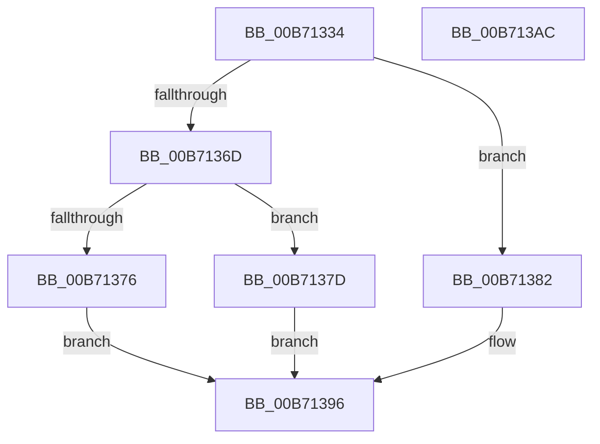

# PopDiagTraceGracefulShutdown

- RVA: `0x00B71334`–`0x00B713AD` (길이 `121` bytes)
- VA: `0x0000000140B71334`
- 실행 섹션: `PAGELK`
- PDB 이름 있음: `예`; PDB Function 태그: `아니요`
- unwind 정보 RVA: `0x0006C2A4`
- 디코드: `33`개 명령, `121/121` bytes 표시
- 미해석 바이트: `0` (있으면 어셈블리에 `.byte`로 보존)

> 이 문서는 커널 이미지의 기계어와 PDB 기호를 분석해 생성했습니다. 4번과 5번은 함수 원형과 자료형을 바이너리 사용 방식에서 추정한 C 해석이며 원본 소스 복구 결과는 아닙니다.

## 1. Dependencies

- 직접 호출 지점: **3**; 고유 호출 대상: **3**
- 직접 호출자로 확인된 함수: **1**
- RIP 상대 이미지 참조: **4**

### Outgoing calls
- `0x00B71347` → [PopDiagTraceEventNoPayload](../../text/49/PopDiagTraceEventNoPayload_function_004982F8.md) (function, `0x004982F8`)
- `0x00B71351` → [PopCurrentPowerState](../../page/A3/PopCurrentPowerState_function_00A356D8.md) (function, `0x00A356D8`)
- `0x00B713A2` → [SshSessionManagerTraceSystemStop](../../page/77/SshSessionManagerTraceSystemStop_function_007742B0.md) (function, `0x007742B0`)

### Direct callers
- [PopGracefulShutdown](../B6/PopGracefulShutdown_function_00B6BEC8.md) at `0x00B6BEDB`

### Static image references
- `0x00B7133B` → RVA `0x00021878` (`.rdata`; read)
- `0x00B71359` → RVA `0x00E0B579` (`.data`; read)
- `0x00B71364` → RVA `0x00E67A54` (`.data`; read)
- `0x00B7136D` → RVA `0x00E67884` (`.data`; read)

## 2. Other-region calls and transfers

- 다른 실행 섹션으로 향하는 call: **3**
  - `0x00B71347` → [PopDiagTraceEventNoPayload](../../text/49/PopDiagTraceEventNoPayload_function_004982F8.md) (`PAGELK` → `.text`)
  - `0x00B71351` → [PopCurrentPowerState](../../page/A3/PopCurrentPowerState_function_00A356D8.md) (`PAGELK` → `PAGE`)
  - `0x00B713A2` → [SshSessionManagerTraceSystemStop](../../page/77/SshSessionManagerTraceSystemStop_function_007742B0.md) (`PAGELK` → `PAGE`)
- 별도 외부 분기/꼬리 이동을 확인하지 못했습니다.

## 3. Assembly (complete function range)

```asm
00B71334  48 83 EC 58                     sub rsp, 0x58
00B71338  0F 57 C0                        xorps xmm0, xmm0
00B7133B  48 8D 0D 36 05 4B FF            lea rcx, [rip - 0xb4faca]
00B71342  0F 11 44 24 30                  movups xmmword ptr [rsp + 0x30], xmm0
00B71347  E8 AC 6F 92 FF                  call 0x1404982f8
00B7134C  48 8D 4C 24 30                  lea rcx, [rsp + 0x30]
00B71351  E8 82 43 EC FF                  call 0x140a356d8
00B71356  45 32 C9                        xor r9b, r9b
00B71359  44 38 0D 19 A2 29 00            cmp byte ptr [rip + 0x29a219], r9b
00B71360  41 0F 95 C0                     setne r8b
00B71364  44 38 0D E9 66 2F 00            cmp byte ptr [rip + 0x2f66e9], r9b
00B7136B  75 15                           jne 0x140b71382
00B7136D  44 38 0D 10 65 2F 00            cmp byte ptr [rip + 0x2f6510], r9b
00B71374  74 07                           je 0x140b7137d
00B71376  41 B1 01                        mov r9b, 1
00B71379  B0 02                           mov al, 2
00B7137B  EB 19                           jmp 0x140b71396
00B7137D  41 8A C1                        mov al, r9b
00B71380  EB 14                           jmp 0x140b71396
00B71382  8A 05 FC 64 2F 00               mov al, byte ptr [rip + 0x2f64fc]
00B71388  41 B1 01                        mov r9b, 1
00B7138B  F6 D8                           neg al
00B7138D  B0 02                           mov al, 2
00B7138F  1A C9                           sbb cl, cl
00B71391  22 C1                           and al, cl
00B71393  41 02 C1                        add al, r9b
00B71396  8B 54 24 38                     mov edx, dword ptr [rsp + 0x38]
00B7139A  8B 4C 24 3C                     mov ecx, dword ptr [rsp + 0x3c]
00B7139E  88 44 24 20                     mov byte ptr [rsp + 0x20], al
00B713A2  E8 09 2F C0 FF                  call 0x1407742b0
00B713A7  48 83 C4 58                     add rsp, 0x58
00B713AB  C3                              ret
00B713AC  CC                              int3
```

## 4. C-style interpretation (structured pseudocode)

```c
__int64 __fastcall PopDiagTraceGracefulShutdown(__int64 a1, __int64 a2, __int64 a3, unsigned __int8 a4)
{
    __int64 result;
    __int64 v_rsp;
    unsigned int v_stack_m1C;
    unsigned int v_stack_m20;
    unsigned __int64 v_stack_m28;
    unsigned __int8 v_stack_m38;

    v_rsp = (v_rsp) - (88);
    v_stack_m28 = v_xmm0;
    result = PopDiagTraceEventNoPayload(v_rip - 11860682, a2, a3, a4);
    result = PopCurrentPowerState(v_stack_m28, a2, a3, a4);
    a4 = 0;
    a3 = ((*(unsigned __int8 *)(v_rip + 2728473)) != 0) ? 1 : 0;
    if ((*(unsigned __int8 *)(v_rip + 3106537)) != 0) goto loc_00B71382;
    if ((*(unsigned __int8 *)(v_rip + 3106064)) == 0) goto loc_00B7137D;
    goto loc_00B71396;
loc_00B7137D:
    goto loc_00B71396;
loc_00B71382:
    result = (unsigned __int8)(-(*(unsigned __int8 *)(v_rip + 3106044)));
    result = (unsigned __int8)((2) & ((unsigned __int8)(v_stack_m28)));
    result = (unsigned __int8)((result) + (1));
loc_00B71396:
    v_stack_m38 = (unsigned __int8)(result);
    result = SshSessionManagerTraceSystemStop((unsigned int)(v_stack_m1C), (unsigned int)(v_stack_m20), a3, 1);
    v_rsp = (v_rsp) + (88);
    return result;
}
```

## 5. (Beta) C Style

```c
int64_t PopDiagTraceGracefulShutdown(int64_t Arg1, int64_t Arg2, int64_t Arg3, uint8_t Arg4)
{
    int64_t result;
    int64_t local_rsp;
    uint32_t v_stack_m1C;
    uint32_t v_stack_m20;
    uint64_t v_stack_m28;
    uint8_t v_stack_m38;

    local_rsp = (local_rsp) - (88);
    v_stack_m28 = v_xmm0;
    result = PopDiagTraceEventNoPayload(v_rip - 11860682, Arg2, Arg3, Arg4);
    result = PopCurrentPowerState(v_stack_m28, Arg2, Arg3, Arg4);
    Arg4 = 0;
    Arg3 = ((*(uint8_t *)(v_rip + 0x29A219)) != 0) ? 1 : 0;
    if ((*(uint8_t *)(v_rip + 0x2F66E9)) != 0) goto loc_00B71382;
    if ((*(uint8_t *)(v_rip + 0x2F6510)) == 0) goto loc_00B7137D;
    goto loc_00B71396;
loc_00B7137D:
    goto loc_00B71396;
loc_00B71382:
    result = (uint8_t)(-(*(uint8_t *)(v_rip + 0x2F64FC)));
    result = (uint8_t)((2) & ((uint8_t)(v_stack_m28)));
    result = (uint8_t)((result) + (1));
loc_00B71396:
    v_stack_m38 = (uint8_t)(result);
    result = SshSessionManagerTraceSystemStop((uint32_t)(v_stack_m1C), (uint32_t)(v_stack_m20), Arg3, 1);
    local_rsp = (local_rsp) + (88);
    return result;
}
```

## 6. Execution-region graph

[열기: 2D/3D 그래프와 함수 탐색 컨트롤 패널](../../../control-panel.html?section=pagelk&rva=0x00B71334&view=graph)

- 2D 그래프는 위에서 아래로 흐르고, 3D 그래프는 빈 공간을 드래그해 회전합니다. Shift+드래그는 이동, 휠은 확대·축소, 함수 노드 선택은 대상 보고서 이동입니다.

### Static fallback


