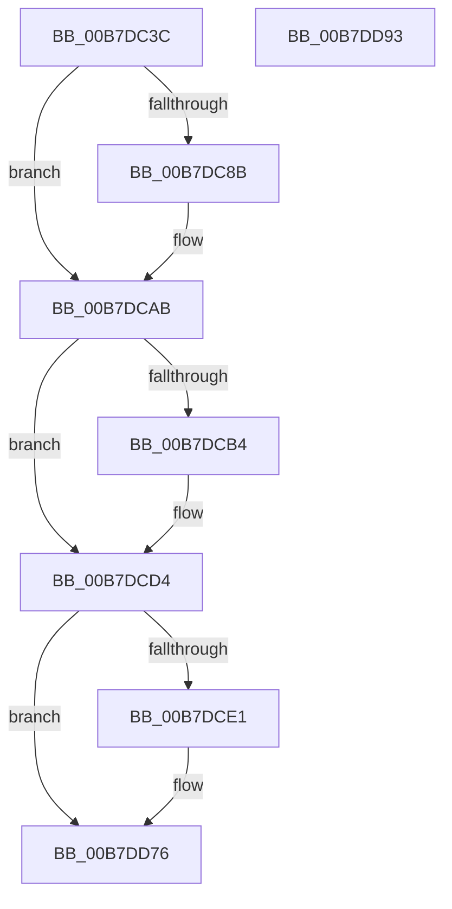

# PopDiagTracePostSleepNotification

- RVA: `0x00B7DC3C`–`0x00B7DD94` (길이 `344` bytes)
- VA: `0x0000000140B7DC3C`
- 실행 섹션: `PAGELK`
- PDB 이름 있음: `예`; PDB Function 태그: `아니요`
- unwind 정보 RVA: `0x000BE3A0`
- 디코드: `79`개 명령, `344/344` bytes 표시
- 미해석 바이트: `0` (있으면 어셈블리에 `.byte`로 보존)

> 이 문서는 커널 이미지의 기계어와 PDB 기호를 분석해 생성했습니다. 4번과 5번은 함수 원형과 자료형을 바이너리 사용 방식에서 추정한 C 해석이며 원본 소스 복구 결과는 아닙니다.

## 1. Dependencies

- 직접 호출 지점: **2**; 고유 호출 대상: **2**
- 직접 호출자로 확인된 함수: **1**
- RIP 상대 이미지 참조: **4**

### Outgoing calls
- `0x00B7DD71` → [EtwWrite](../../text/41/EtwWrite_function_0041C720.md) (function, `0x0041C720`)
- `0x00B7DD7D` → [_security_check_cookie](../../text/6A/_security_check_cookie_function_006AC640.md) (function, `0x006AC640`)

### Direct callers
- [PopTransitionSystemPowerStateEx](PopTransitionSystemPowerStateEx_function_00B7E8C0.md) at `0x00B7F798`

### Static image references
- `0x00B7DC59` → RVA `0x00E0A740` (`.data`; read)
- `0x00B7DCD4` → RVA `0x00E67858` (`.data`; read)
- `0x00B7DCE1` → RVA `0x00F0B408` (`.data`; read)
- `0x00B7DCF0` → RVA `0x000219A0` (`.rdata`; read)

## 2. Other-region calls and transfers

- 다른 실행 섹션으로 향하는 call: **2**
  - `0x00B7DD71` → [EtwWrite](../../text/41/EtwWrite_function_0041C720.md) (`PAGELK` → `.text`)
  - `0x00B7DD7D` → [_security_check_cookie](../../text/6A/_security_check_cookie_function_006AC640.md) (`PAGELK` → `.text`)
- 별도 외부 분기/꼬리 이동을 확인하지 못했습니다.

## 3. Assembly (complete function range)

```asm
00B7DC3C  48 8B C4                        mov rax, rsp
00B7DC3F  48 89 58 20                     mov qword ptr [rax + 0x20], rbx
00B7DC43  44 89 40 18                     mov dword ptr [rax + 0x18], r8d
00B7DC47  89 50 10                        mov dword ptr [rax + 0x10], edx
00B7DC4A  89 48 08                        mov dword ptr [rax + 8], ecx
00B7DC4D  55                              push rbp
00B7DC4E  48 8D 68 B9                     lea rbp, [rax - 0x47]
00B7DC52  48 81 EC C0 00 00 00            sub rsp, 0xc0
00B7DC59  48 8B 05 E0 CA 28 00            mov rax, qword ptr [rip + 0x28cae0]
00B7DC60  48 33 C4                        xor rax, rsp
00B7DC63  48 89 45 2F                     mov qword ptr [rbp + 0x2f], rax
00B7DC67  45 33 D2                        xor r10d, r10d
00B7DC6A  48 BB 14 00 00 00 80 F7 FF FF   movabs rbx, 0xfffff78000000014
00B7DC74  4C 89 55 AF                     mov qword ptr [rbp - 0x51], r10
00B7DC78  49 BB 08 00 00 00 80 F7 FF FF   movabs r11, 0xfffff78000000008
00B7DC82  4C 89 55 B7                     mov qword ptr [rbp - 0x49], r10
00B7DC86  4D 85 C9                        test r9, r9
00B7DC89  74 20                           je 0x140b7dcab
00B7DC8B  49 8B 0B                        mov rcx, qword ptr [r11]
00B7DC8E  49 8B D1                        mov rdx, r9
00B7DC91  48 8B 03                        mov rax, qword ptr [rbx]
00B7DC94  48 2B D1                        sub rdx, rcx
00B7DC97  49 8B C9                        mov rcx, r9
00B7DC9A  48 F7 D9                        neg rcx
00B7DC9D  4D 85 C9                        test r9, r9
00B7DCA0  48 0F 49 CA                     cmovns rcx, rdx
00B7DCA4  48 03 C8                        add rcx, rax
00B7DCA7  48 89 4D AF                     mov qword ptr [rbp - 0x51], rcx
00B7DCAB  4C 8B 45 6F                     mov r8, qword ptr [rbp + 0x6f]
00B7DCAF  4D 85 C0                        test r8, r8
00B7DCB2  74 20                           je 0x140b7dcd4
00B7DCB4  49 8B 0B                        mov rcx, qword ptr [r11]
00B7DCB7  49 8B D0                        mov rdx, r8
00B7DCBA  48 8B 03                        mov rax, qword ptr [rbx]
00B7DCBD  48 2B D1                        sub rdx, rcx
00B7DCC0  49 8B C8                        mov rcx, r8
00B7DCC3  48 F7 D9                        neg rcx
00B7DCC6  4D 85 C0                        test r8, r8
00B7DCC9  48 0F 49 CA                     cmovns rcx, rdx
00B7DCCD  48 03 C8                        add rcx, rax
00B7DCD0  48 89 4D B7                     mov qword ptr [rbp - 0x49], rcx
00B7DCD4  44 38 15 7D 9B 2E 00            cmp byte ptr [rip + 0x2e9b7d], r10b
00B7DCDB  0F 84 95 00 00 00               je 0x140b7dd76
00B7DCE1  48 8B 0D 20 D7 38 00            mov rcx, qword ptr [rip + 0x38d720]
00B7DCE8  48 8D 45 4F                     lea rax, [rbp + 0x4f]
00B7DCEC  48 89 45 BF                     mov qword ptr [rbp - 0x41], rax
00B7DCF0  48 8D 15 A9 3C 4A FF            lea rdx, [rip - 0xb5c357]
00B7DCF7  48 8D 45 57                     lea rax, [rbp + 0x57]
00B7DCFB  48 C7 45 C7 04 00 00 00         mov qword ptr [rbp - 0x39], 4
00B7DD03  48 89 45 CF                     mov qword ptr [rbp - 0x31], rax
00B7DD07  41 B9 07 00 00 00               mov r9d, 7
00B7DD0D  48 8D 45 5F                     lea rax, [rbp + 0x5f]
00B7DD11  48 C7 45 D7 04 00 00 00         mov qword ptr [rbp - 0x29], 4
00B7DD19  48 89 45 DF                     mov qword ptr [rbp - 0x21], rax
00B7DD1D  45 33 C0                        xor r8d, r8d
00B7DD20  48 8D 45 AF                     lea rax, [rbp - 0x51]
00B7DD24  48 C7 45 E7 04 00 00 00         mov qword ptr [rbp - 0x19], 4
00B7DD2C  48 89 45 EF                     mov qword ptr [rbp - 0x11], rax
00B7DD30  48 8D 45 B7                     lea rax, [rbp - 0x49]
00B7DD34  48 89 45 FF                     mov qword ptr [rbp - 1], rax
00B7DD38  48 8D 45 77                     lea rax, [rbp + 0x77]
00B7DD3C  48 89 45 0F                     mov qword ptr [rbp + 0xf], rax
00B7DD40  48 8D 45 7F                     lea rax, [rbp + 0x7f]
00B7DD44  48 89 45 1F                     mov qword ptr [rbp + 0x1f], rax
00B7DD48  48 8D 45 BF                     lea rax, [rbp - 0x41]
00B7DD4C  48 89 44 24 20                  mov qword ptr [rsp + 0x20], rax
00B7DD51  48 C7 45 F7 08 00 00 00         mov qword ptr [rbp - 9], 8
00B7DD59  48 C7 45 07 08 00 00 00         mov qword ptr [rbp + 7], 8
00B7DD61  48 C7 45 17 04 00 00 00         mov qword ptr [rbp + 0x17], 4
00B7DD69  48 C7 45 27 04 00 00 00         mov qword ptr [rbp + 0x27], 4
00B7DD71  E8 AA E9 89 FF                  call 0x14041c720
00B7DD76  48 8B 4D 2F                     mov rcx, qword ptr [rbp + 0x2f]
00B7DD7A  48 33 CC                        xor rcx, rsp
00B7DD7D  E8 BE E8 B2 FF                  call 0x1406ac640
00B7DD82  48 8B 9C 24 E8 00 00 00         mov rbx, qword ptr [rsp + 0xe8]
00B7DD8A  48 81 C4 C0 00 00 00            add rsp, 0xc0
00B7DD91  5D                              pop rbp
00B7DD92  C3                              ret
00B7DD93  CC                              int3
```

## 4. C-style interpretation (structured pseudocode)

```c
__int64 __fastcall PopDiagTracePostSleepNotification(int a1, int a2, int a3, __int64 a4)
{
    __int64 result;
    __int64 v_r10;
    __int64 v_rsp;
    unsigned __int64 v_stack_mA8;
    unsigned __int64 v_stack_p20;

    *(unsigned __int64 *)(v_rsp + 32) = v_rbx;
    *(unsigned int *)(v_rsp + 24) = a3;
    *(unsigned int *)(v_rsp + 16) = a2;
    *(unsigned int *)(v_rsp + 8) = a1;
    v_rsp = (v_rsp) - (192);
    result = (*(unsigned __int64 *)(v_rip + 2673376)) ^ (v_rsp);
    *(unsigned __int64 *)(v_rsp - 71 + 47) = result;
    v_r10 = 0;
    *(unsigned __int64 *)(v_rsp - 71 - 81) = 0;
    *(unsigned __int64 *)(v_rsp - 71 - 73) = 0;
    if (a4 != 0) {
        a1 = *(unsigned __int64 *)(v_r11);
        a2 = a4;
        result = *(unsigned __int64 *)(v_rbx);
        a2 = (a2) - (a1);
        a1 = a4;
        a1 = -(a1);
        if (!sign_flag) { a1 = a2; }
        a1 = (a1) + (result);
        *(unsigned __int64 *)(v_rsp - 71 - 81) = a1;
    }
    if (*(unsigned __int64 *)(v_rsp - 71 + 111) != 0) {
        a1 = *(unsigned __int64 *)(v_r11);
        a2 = *(unsigned __int64 *)(v_rsp - 71 + 111);
        result = *(unsigned __int64 *)(v_rbx);
        a2 = (a2) - (a1);
        a1 = *(unsigned __int64 *)(v_rsp - 71 + 111);
        a1 = -(a1);
        if (!sign_flag) { a1 = a2; }
        a1 = (a1) + (result);
        *(unsigned __int64 *)(v_rsp - 71 - 73) = a1;
    }
    if ((*(unsigned __int8 *)(v_rip + 3054461)) != 0) {
        a1 = *(unsigned __int64 *)(v_rip + 3725088);
        result = v_rsp - 71 + 79;
        *(unsigned __int64 *)(v_rsp - 71 - 65) = result;
        a2 = v_rip - 11912023;
        result = v_rsp - 71 + 87;
        *(unsigned __int64 *)(v_rsp - 71 - 57) = 4;
        *(unsigned __int64 *)(v_rsp - 71 - 49) = result;
        a4 = 7;
        result = v_rsp - 71 + 95;
        *(unsigned __int64 *)(v_rsp - 71 - 41) = 4;
        *(unsigned __int64 *)(v_rsp - 71 - 33) = result;
        a3 = 0;
        result = v_rsp - 71 - 81;
        *(unsigned __int64 *)(v_rsp - 71 - 25) = 4;
        *(unsigned __int64 *)(v_rsp - 71 - 17) = result;
        result = v_rsp - 71 - 73;
        *(unsigned __int64 *)(v_rsp - 71 - 1) = result;
        result = v_rsp - 71 + 119;
        *(unsigned __int64 *)(v_rsp - 71 + 15) = result;
        result = v_rsp - 71 + 127;
        *(unsigned __int64 *)(v_rsp - 71 + 31) = result;
        result = v_rsp - 71 - 65;
        v_stack_mA8 = result;
        *(unsigned __int64 *)(v_rsp - 71 - 9) = 8;
        *(unsigned __int64 *)(v_rsp - 71 + 7) = 8;
        *(unsigned __int64 *)(v_rsp - 71 + 23) = 4;
        *(unsigned __int64 *)(v_rsp - 71 + 39) = 4;
        result = EtwWrite(a1, a2, a3, a4);
    }
    a1 = (*(unsigned __int64 *)(v_rsp - 71 + 47)) ^ (v_rsp);
    result = _security_check_cookie(a1, a2, a3, a4);
    v_rsp = (v_rsp) + (192);
    return result;
}
```

## 5. (Beta) C Style

```c
int64_t PopDiagTracePostSleepNotification(int32_t Arg1, int32_t Arg2, int32_t Arg3, int64_t Arg4)
{
    int64_t result;
    int64_t local_r10;
    int64_t local_rsp;
    uint64_t v_stack_mA8;
    uint64_t v_stack_p20;

    *(uint64_t *)(local_rsp + 0x20) = local_rbx;
    *(uint32_t *)(local_rsp + 0x18) = Arg3;
    *(uint32_t *)(local_rsp + 0x10) = Arg2;
    *(uint32_t *)(local_rsp + 0x8) = Arg1;
    local_rsp = (local_rsp) - (192);
    result = (*(uint64_t *)(v_rip + 0x28CAE0)) ^ (local_rsp);
    *(uint64_t *)(local_rsp - 0x47 + 0x2F) = result;
    local_r10 = 0;
    *(uint64_t *)(local_rsp - 0x47 - 0x51) = 0;
    *(uint64_t *)(local_rsp - 0x47 - 0x49) = 0;
    if (Arg4 != 0) {
        Arg1 = *(uint64_t *)(local_r11);
        Arg2 = Arg4;
        result = *(uint64_t *)(local_rbx);
        Arg2 = (Arg2) - (Arg1);
        Arg1 = Arg4;
        Arg1 = -(Arg1);
        if (!sign_flag) { Arg1 = Arg2; }
        Arg1 = (Arg1) + (result);
        *(uint64_t *)(local_rsp - 0x47 - 0x51) = Arg1;
    }
    if (*(uint64_t *)(local_rsp - 0x47 + 0x6F) != 0) {
        Arg1 = *(uint64_t *)(local_r11);
        Arg2 = *(uint64_t *)(local_rsp - 0x47 + 0x6F);
        result = *(uint64_t *)(local_rbx);
        Arg2 = (Arg2) - (Arg1);
        Arg1 = *(uint64_t *)(local_rsp - 0x47 + 0x6F);
        Arg1 = -(Arg1);
        if (!sign_flag) { Arg1 = Arg2; }
        Arg1 = (Arg1) + (result);
        *(uint64_t *)(local_rsp - 0x47 - 0x49) = Arg1;
    }
    if ((*(uint8_t *)(v_rip + 0x2E9B7D)) != 0) {
        Arg1 = *(uint64_t *)(v_rip + 0x38D720);
        result = local_rsp - 71 + 79;
        *(uint64_t *)(local_rsp - 0x47 - 0x41) = result;
        Arg2 = v_rip - 11912023;
        result = local_rsp - 71 + 87;
        *(uint64_t *)(local_rsp - 0x47 - 0x39) = 4;
        *(uint64_t *)(local_rsp - 0x47 - 0x31) = result;
        Arg4 = 7;
        result = local_rsp - 71 + 95;
        *(uint64_t *)(local_rsp - 0x47 - 0x29) = 4;
        *(uint64_t *)(local_rsp - 0x47 - 0x21) = result;
        Arg3 = 0;
        result = local_rsp - 71 - 81;
        *(uint64_t *)(local_rsp - 0x47 - 0x19) = 4;
        *(uint64_t *)(local_rsp - 0x47 - 0x11) = result;
        result = local_rsp - 71 - 73;
        *(uint64_t *)(local_rsp - 0x47 - 0x1) = result;
        result = local_rsp - 71 + 119;
        *(uint64_t *)(local_rsp - 0x47 + 0xF) = result;
        result = local_rsp - 71 + 127;
        *(uint64_t *)(local_rsp - 0x47 + 0x1F) = result;
        result = local_rsp - 71 - 65;
        v_stack_mA8 = result;
        *(uint64_t *)(local_rsp - 0x47 - 0x9) = 8;
        *(uint64_t *)(local_rsp - 0x47 + 0x7) = 8;
        *(uint64_t *)(local_rsp - 0x47 + 0x17) = 4;
        *(uint64_t *)(local_rsp - 0x47 + 0x27) = 4;
        result = EtwWrite(Arg1, Arg2, Arg3, Arg4);
    }
    Arg1 = (*(uint64_t *)(local_rsp - 0x47 + 0x2F)) ^ (local_rsp);
    result = _security_check_cookie(Arg1, Arg2, Arg3, Arg4);
    local_rsp = (local_rsp) + (192);
    return result;
}
```

## 6. Execution-region graph

[열기: 2D/3D 그래프와 함수 탐색 컨트롤 패널](../../../control-panel.html?section=pagelk&rva=0x00B7DC3C&view=graph)

- 2D 그래프는 위에서 아래로 흐르고, 3D 그래프는 빈 공간을 드래그해 회전합니다. Shift+드래그는 이동, 휠은 확대·축소, 함수 노드 선택은 대상 보고서 이동입니다.

### Static fallback


