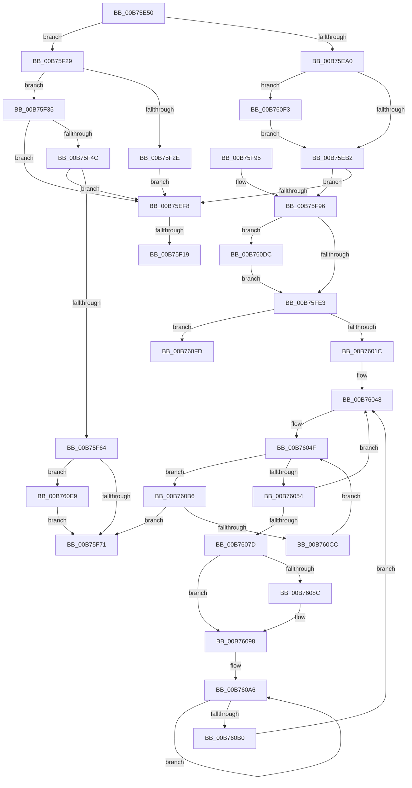

# PopEndMirroring

- RVA: `0x00B75E50`–`0x00B76108` (길이 `696` bytes)
- VA: `0x0000000140B75E50`
- 실행 섹션: `PAGELK`
- PDB 이름 있음: `예`; PDB Function 태그: `예`
- unwind 정보 RVA: `0x000A108C`
- 디코드: `173`개 명령, `696/696` bytes 표시
- 미해석 바이트: `0` (있으면 어셈블리에 `.byte`로 보존)

> 이 문서는 커널 이미지의 기계어와 PDB 기호를 분석해 생성했습니다. 4번과 5번은 함수 원형과 자료형을 바이너리 사용 방식에서 추정한 C 해석이며 원본 소스 복구 결과는 아닙니다.

## 1. Dependencies

- 직접 호출 지점: **14**; 고유 호출 대상: **12**
- 직접 호출자로 확인된 함수: **0**
- RIP 상대 이미지 참조: **21**

### Outgoing calls
- `0x00B75EBE` → [KeSetEvent](../../text/33/KeSetEvent_function_0033F310.md) (function, `0x0033F310`)
- `0x00B75EDB` → [KeWaitForSingleObject](../../text/20/KeWaitForSingleObject_function_0020E6B0.md) (function, `0x0020E6B0`)
- `0x00B75EE9` → [PopBuildMemoryImageHeader](../B6/PopBuildMemoryImageHeader_function_00B6CA20.md) (function, `0x00B6CA20`)
- `0x00B75F04` → [IoAddTriageDumpDataBlock](../../text/42/IoAddTriageDumpDataBlock_function_00428374.md) (function, `0x00428374`)
- `0x00B75F1E` → [IoAddTriageDumpDataBlock](../../text/42/IoAddTriageDumpDataBlock_function_00428374.md) (function, `0x00428374`)
- `0x00B75F41` → [PopBuildMemoryImageHeader](../B6/PopBuildMemoryImageHeader_function_00B6CA20.md) (function, `0x00B6CA20`)
- `0x00B75F59` → [PopInvokeSystemStateHandler](PopInvokeSystemStateHandler_function_00B76A6C.md) (function, `0x00B76A6C`)
- `0x00B75FC4` → [KeSetSystemGroupAffinityThread](../../text/39/KeSetSystemGroupAffinityThread_function_00399140.md) (function, `0x00399140`)
- `0x00B75FF0` → [memset](../../text/6C/memset_function_006C6C40.md) (function, `0x006C6C40`)
- `0x00B76038` → [KeInitializeDpc](../../text/45/KeInitializeDpc_function_0045BBD0.md) (function, `0x0045BBD0`)
- `0x00B760A1` → [KeInsertQueueDpc](../../text/20/KeInsertQueueDpc_function_00207C50.md) (function, `0x00207C50`)
- `0x00B760DF` → [KiRaiseIrqlProcessIrqlFlags](../../text/4F/KiRaiseIrqlProcessIrqlFlags_function_004F56FC.md) (function, `0x004F56FC`)
- `0x00B760F3` → [EtwKernelMemoryRundown](../../page/7B/EtwKernelMemoryRundown_function_007B7DEC.md) (function, `0x007B7DEC`)
- `0x00B76102` → [RtlRaiseStatus](../../text/2F/RtlRaiseStatus_function_002F6A50.md) (function, `0x002F6A50`)

### Direct callers
- 이 함수 시작 RVA로 연결되는 직접 call은 확인되지 않았습니다. 간접 호출은 완전히 역산할 수 없습니다.

### Static image references
- `0x00B75EA0` → RVA `0x00FC6B14` (`ALMOSTRO`; read)
- `0x00B75EB2` → RVA `0x00E676F0` (`.data`; read)
- `0x00B75EE0` → RVA `0x00F0BD90` (`.data`; read)
- `0x00B75EFD` → RVA `0x00F0BD40` (`.data`; read)
- `0x00B75F09` → RVA `0x00F0BD88` (`.data`; read)
- `0x00B75F53` → RVA `0x00E0B54C` (`.data`; read)
- `0x00B75F64` → RVA `0x00F0C680` (`.data`; read)
- `0x00B75F96` → RVA `0x00F231B0` (`.data`; read)
- `0x00B75FD6` → RVA `0x00FC6D20` (`ALMOSTRO`; read)
- `0x00B75FE5` → RVA `0x00E276C0` (`.data`; read)
- `0x00B75FF5` → RVA `0x00FC6A80` (`ALMOSTRO`; read)
- `0x00B75FFB` → RVA `0x00E276F0` (`.data`; write)
- `0x00B76001` → RVA `0x00E276FC` (`.data`; write)
- `0x00B76007` → RVA `0x00E27700` (`.data`; read)
- `0x00B7600E` → RVA `0x00E276F8` (`.data`; write)
- `0x00B76026` → RVA `0x00B77270` (`PopInvokeStateHandlerTargetProcessor`; read)
- `0x00B7602D` → RVA `0x00E27700` (`.data`; write)
- `0x00B7603D` → RVA `0x00FC7128` (`ALMOSTRO`; read)
- `0x00B76048` → RVA `0x00FC7120` (`ALMOSTRO`; read)
- `0x00B7606F` → RVA `0x00F231B8` (`.data`; read)
- `0x00B7607D` → RVA `0x00E276F4` (`.data`; read)

## 2. Other-region calls and transfers

- 다른 실행 섹션으로 향하는 call: **11**
  - `0x00B75EBE` → [KeSetEvent](../../text/33/KeSetEvent_function_0033F310.md) (`PAGELK` → `.text`)
  - `0x00B75EDB` → [KeWaitForSingleObject](../../text/20/KeWaitForSingleObject_function_0020E6B0.md) (`PAGELK` → `.text`)
  - `0x00B75F04` → [IoAddTriageDumpDataBlock](../../text/42/IoAddTriageDumpDataBlock_function_00428374.md) (`PAGELK` → `.text`)
  - `0x00B75F1E` → [IoAddTriageDumpDataBlock](../../text/42/IoAddTriageDumpDataBlock_function_00428374.md) (`PAGELK` → `.text`)
  - `0x00B75FC4` → [KeSetSystemGroupAffinityThread](../../text/39/KeSetSystemGroupAffinityThread_function_00399140.md) (`PAGELK` → `.text`)
  - `0x00B75FF0` → [memset](../../text/6C/memset_function_006C6C40.md) (`PAGELK` → `.text`)
  - `0x00B76038` → [KeInitializeDpc](../../text/45/KeInitializeDpc_function_0045BBD0.md) (`PAGELK` → `.text`)
  - `0x00B760A1` → [KeInsertQueueDpc](../../text/20/KeInsertQueueDpc_function_00207C50.md) (`PAGELK` → `.text`)
  - `0x00B760DF` → [KiRaiseIrqlProcessIrqlFlags](../../text/4F/KiRaiseIrqlProcessIrqlFlags_function_004F56FC.md) (`PAGELK` → `.text`)
  - `0x00B760F3` → [EtwKernelMemoryRundown](../../page/7B/EtwKernelMemoryRundown_function_007B7DEC.md) (`PAGELK` → `PAGE`)
  - `0x00B76102` → [RtlRaiseStatus](../../text/2F/RtlRaiseStatus_function_002F6A50.md) (`PAGELK` → `.text`)
- call이 아닌 외부 분기/꼬리 이동: **2**
  - `0x00B75F13` → [sub_00B802F8](../B8/Unknown_function_00B802F8.md) (`tail-transfer`)
  - `0x00B75F24` → [sub_00B802F8](../B8/Unknown_function_00B802F8.md) (`tail-transfer`)

## 3. Assembly (complete function range)

```asm
00B75E50  48 89 5C 24 10                  mov qword ptr [rsp + 0x10], rbx
00B75E55  48 89 74 24 18                  mov qword ptr [rsp + 0x18], rsi
00B75E5A  55                              push rbp
00B75E5B  57                              push rdi
00B75E5C  41 56                           push r14
00B75E5E  48 8D 6C 24 B9                  lea rbp, [rsp - 0x47]
00B75E63  48 81 EC A0 00 00 00            sub rsp, 0xa0
00B75E6A  33 C0                           xor eax, eax
00B75E6C  8B F1                           mov esi, ecx
00B75E6E  0F 57 C0                        xorps xmm0, xmm0
00B75E71  48 89 45 F7                     mov qword ptr [rbp - 9], rax
00B75E75  45 33 F6                        xor r14d, r14d
00B75E78  48 89 45 37                     mov qword ptr [rbp + 0x37], rax
00B75E7C  89 45 3F                        mov dword ptr [rbp + 0x3f], eax
00B75E7F  0F 57 C9                        xorps xmm1, xmm1
00B75E82  8B C1                           mov eax, ecx
00B75E84  0F 11 45 D7                     movups xmmword ptr [rbp - 0x29], xmm0
00B75E88  0F 11 4D E7                     movups xmmword ptr [rbp - 0x19], xmm1
00B75E8C  0F 11 45 07                     movups xmmword ptr [rbp + 7], xmm0
00B75E90  0F 11 45 17                     movups xmmword ptr [rbp + 0x17], xmm0
00B75E94  0F 11 45 27                     movups xmmword ptr [rbp + 0x27], xmm0
00B75E98  85 C9                           test ecx, ecx
00B75E9A  0F 85 89 00 00 00               jne 0x140b75f29
00B75EA0  8B 05 6E 0C 45 00               mov eax, dword ptr [rip + 0x450c6e]
00B75EA6  8D 79 01                        lea edi, [rcx + 1]
00B75EA9  40 84 C7                        test dil, al
00B75EAC  0F 85 41 02 00 00               jne 0x140b760f3
00B75EB2  48 8B 0D 37 18 2F 00            mov rcx, qword ptr [rip + 0x2f1837]
00B75EB9  44 8A C7                        mov r8b, dil
00B75EBC  33 D2                           xor edx, edx
00B75EBE  E8 4D 94 7C FF                  call 0x14033f310
00B75EC3  48 8B 0D 26 18 2F 00            mov rcx, qword ptr [rip + 0x2f1826]
00B75ECA  45 33 C9                        xor r9d, r9d
00B75ECD  48 83 C1 18                     add rcx, 0x18
00B75ED1  4C 89 74 24 20                  mov qword ptr [rsp + 0x20], r14
00B75ED6  45 33 C0                        xor r8d, r8d
00B75ED9  33 D2                           xor edx, edx
00B75EDB  E8 D0 87 69 FF                  call 0x14020e6b0
00B75EE0  48 8B 0D A9 5E 39 00            mov rcx, qword ptr [rip + 0x395ea9]
00B75EE7  33 D2                           xor edx, edx
00B75EE9  E8 32 6B FF FF                  call 0x140b6ca20
00B75EEE  8B D8                           mov ebx, eax
00B75EF0  85 C0                           test eax, eax
00B75EF2  0F 89 9E 00 00 00               jns 0x140b75f96
00B75EF8  BA E0 01 00 00                  mov edx, 0x1e0
00B75EFD  48 8D 0D 3C 5E 39 00            lea rcx, [rip + 0x395e3c]
00B75F04  E8 6B 24 8B FF                  call 0x140428374
00B75F09  48 8B 0D 78 5E 39 00            mov rcx, qword ptr [rip + 0x395e78]
00B75F10  48 85 C9                        test rcx, rcx
00B75F13  0F 84 DF A3 00 00               je 0x140b802f8
00B75F19  BA D8 01 00 00                  mov edx, 0x1d8
00B75F1E  E8 51 24 8B FF                  call 0x140428374
00B75F23  90                              nop
00B75F24  E9 CF A3 00 00                  jmp 0x140b802f8
00B75F29  83 F8 01                        cmp eax, 1
00B75F2C  74 07                           je 0x140b75f35
00B75F2E  BB 01 00 00 C0                  mov ebx, 0xc0000001
00B75F33  EB C3                           jmp 0x140b75ef8
00B75F35  48 8B 0D 54 5E 39 00            mov rcx, qword ptr [rip + 0x395e54]
00B75F3C  BA 01 00 00 00                  mov edx, 1
00B75F41  E8 DA 6A FF FF                  call 0x140b6ca20
00B75F46  8B D8                           mov ebx, eax
00B75F48  85 C0                           test eax, eax
00B75F4A  78 AC                           js 0x140b75ef8
00B75F4C  48 8B 15 3D 5E 39 00            mov rdx, qword ptr [rip + 0x395e3d]
00B75F53  8B 0D F3 55 29 00               mov ecx, dword ptr [rip + 0x2955f3]
00B75F59  E8 0E 0B 00 00                  call 0x140b76a6c
00B75F5E  8B D8                           mov ebx, eax
00B75F60  85 C0                           test eax, eax
00B75F62  78 94                           js 0x140b75ef8
00B75F64  44 38 35 15 67 39 00            cmp byte ptr [rip + 0x396715], r14b
00B75F6B  0F 85 78 01 00 00               jne 0x140b760e9
00B75F71  81 FB 94 02 00 40               cmp ebx, 0x40000294
00B75F77  4C 8D 9C 24 A0 00 00 00         lea r11, [rsp + 0xa0]
00B75F7F  49 8B 73 30                     mov rsi, qword ptr [r11 + 0x30]
00B75F83  41 0F 45 DE                     cmovne ebx, r14d
00B75F87  8B C3                           mov eax, ebx
00B75F89  49 8B 5B 28                     mov rbx, qword ptr [r11 + 0x28]
00B75F8D  49 8B E3                        mov rsp, r11
00B75F90  41 5E                           pop r14
00B75F92  5F                              pop rdi
00B75F93  5D                              pop rbp
00B75F94  C3                              ret
00B75F95  CC                              int3
00B75F96  48 8B 05 13 D2 3A 00            mov rax, qword ptr [rip + 0x3ad213]
00B75F9D  33 D2                           xor edx, edx
00B75F9F  8B 08                           mov ecx, dword ptr [rax]
00B75FA1  33 C0                           xor eax, eax
00B75FA3  89 45 E1                        mov dword ptr [rbp - 0x1f], eax
00B75FA6  66 89 45 E5                     mov word ptr [rbp - 0x1b], ax
00B75FAA  8B C1                           mov eax, ecx
00B75FAC  C1 E8 06                        shr eax, 6
00B75FAF  83 E1 3F                        and ecx, 0x3f
00B75FB2  66 89 45 DF                     mov word ptr [rbp - 0x21], ax
00B75FB6  48 8B C7                        mov rax, rdi
00B75FB9  48 D3 E0                        shl rax, cl
00B75FBC  48 8D 4D D7                     lea rcx, [rbp - 0x29]
00B75FC0  48 89 45 D7                     mov qword ptr [rbp - 0x29], rax
00B75FC4  E8 77 31 82 FF                  call 0x140399140
00B75FC9  44 0F 20 C1                     mov rcx, cr8
00B75FCD  BE 02 00 00 00                  mov esi, 2
00B75FD2  44 0F 22 C6                     mov cr8, rsi
00B75FD6  44 39 35 43 0D 45 00            cmp dword ptr [rip + 0x450d43], r14d
00B75FDD  0F 85 F9 00 00 00               jne 0x140b760dc
00B75FE3  33 D2                           xor edx, edx
00B75FE5  48 8D 0D D4 16 2B 00            lea rcx, [rip + 0x2b16d4]
00B75FEC  44 8D 42 50                     lea r8d, [rdx + 0x50]
00B75FF0  E8 4B 0C B5 FF                  call 0x1406c6c40
00B75FF5  8B 05 85 0A 45 00               mov eax, dword ptr [rip + 0x450a85]
00B75FFB  89 05 EF 16 2B 00               mov dword ptr [rip + 0x2b16ef], eax
00B76001  89 05 F5 16 2B 00               mov dword ptr [rip + 0x2b16f5], eax
00B76007  48 8D 05 F2 16 2B 00            lea rax, [rip + 0x2b16f2]
00B7600E  89 3D E4 16 2B 00               mov dword ptr [rip + 0x2b16e4], edi
00B76014  A8 0F                           test al, 0xf
00B76016  0F 85 E1 00 00 00               jne 0x140b760fd
00B7601C  0F 57 C0                        xorps xmm0, xmm0
00B7601F  4C 8D 05 9A 16 2B 00            lea r8, [rip + 0x2b169a]
00B76026  48 8D 15 43 12 00 00            lea rdx, [rip + 0x1243]
00B7602D  0F 29 05 CC 16 2B 00            movaps xmmword ptr [rip + 0x2b16cc], xmm0
00B76034  48 8D 4D 07                     lea rcx, [rbp + 7]
00B76038  E8 93 5B 8E FF                  call 0x14045bbd0
00B7603D  4C 8B 05 E4 10 45 00            mov r8, qword ptr [rip + 0x4510e4]
00B76044  40 88 75 08                     mov byte ptr [rbp + 8], sil
00B76048  0F B7 15 D1 10 45 00            movzx edx, word ptr [rip + 0x4510d1]
00B7604F  4D 85 C0                        test r8, r8
00B76052  74 62                           je 0x140b760b6
00B76054  0F B7 4D F7                     movzx ecx, word ptr [rbp - 9]
00B76058  49 0F BC D0                     bsf rdx, r8
00B7605C  C1 E1 06                        shl ecx, 6
00B7605F  0F B6 C2                        movzx eax, dl
00B76062  49 0F B3 C0                     btr r8, rax
00B76066  0F B6 C2                        movzx eax, dl
00B76069  03 C8                           add ecx, eax
00B7606B  4C 89 45 EF                     mov qword ptr [rbp - 0x11], r8
00B7606F  48 8B 05 42 D1 3A 00            mov rax, qword ptr [rip + 0x3ad142]
00B76076  8B 14 88                        mov edx, dword ptr [rax + rcx*4]
00B76079  85 D2                           test edx, edx
00B7607B  74 CB                           je 0x140b76048
00B7607D  8B 35 71 16 2B 00               mov esi, dword ptr [rip + 0x2b1671]
00B76083  48 8B 45 3F                     mov rax, qword ptr [rbp + 0x3f]
00B76087  48 85 C0                        test rax, rax
00B7608A  75 0C                           jne 0x140b76098
00B7608C  B8 00 08 00 00                  mov eax, 0x800
00B76091  66 03 D0                        add dx, ax
00B76094  66 89 55 09                     mov word ptr [rbp + 9], dx
00B76098  45 33 C0                        xor r8d, r8d
00B7609B  48 8D 4D 07                     lea rcx, [rbp + 7]
00B7609F  33 D2                           xor edx, edx
00B760A1  E8 AA 1B 69 FF                  call 0x140207c50
00B760A6  8B 05 48 16 2B 00               mov eax, dword ptr [rip + 0x2b1648]
00B760AC  3B F0                           cmp esi, eax
00B760AE  74 F6                           je 0x140b760a6
00B760B0  4C 8B 45 EF                     mov r8, qword ptr [rbp - 0x11]
00B760B4  EB 92                           jmp 0x140b76048
00B760B6  0F B7 45 F7                     movzx eax, word ptr [rbp - 9]
00B760BA  66 03 C7                        add ax, di
00B760BD  0F B7 C8                        movzx ecx, ax
00B760C0  66 89 4D F7                     mov word ptr [rbp - 9], cx
00B760C4  3B CA                           cmp ecx, edx
00B760C6  0F 83 A5 FE FF FF               jae 0x140b75f71
00B760CC  4C 8D 05 55 10 45 00            lea r8, [rip + 0x451055]
00B760D3  4D 8B 04 C8                     mov r8, qword ptr [r8 + rcx*8]
00B760D7  E9 73 FF FF FF                  jmp 0x140b7604f
00B760DC  40 8A D6                        mov dl, sil
00B760DF  E8 18 F6 97 FF                  call 0x1404f56fc
00B760E4  E9 FA FE FF FF                  jmp 0x140b75fe3
00B760E9  BB 94 02 00 40                  mov ebx, 0x40000294
00B760EE  E9 7E FE FF FF                  jmp 0x140b75f71
00B760F3  E8 F4 1C C4 FF                  call 0x1407b7dec
00B760F8  E9 B5 FD FF FF                  jmp 0x140b75eb2
00B760FD  B9 02 00 00 80                  mov ecx, 0x80000002
00B76102  E8 49 09 78 FF                  call 0x1402f6a50
00B76107  CC                              int3
```

## 4. C-style interpretation (structured pseudocode)

```c
__int64 __fastcall PopEndMirroring(__int64 a1, int a2, __int64 a3, int a4)
{
    __int64 result;
    __int64 v_r14;
    __int64 v_rbx;
    __int64 v_rsp;
    unsigned __int64 v_stack_m18;
    unsigned int v_stack_m20;
    unsigned __int64 v_stack_m28;
    unsigned __int64 v_stack_m38;
    unsigned __int64 v_stack_m48;
    unsigned __int16 v_stack_m56;
    unsigned __int8 v_stack_m57;
    unsigned __int64 v_stack_m58;
    unsigned __int64 v_stack_m5F;
    unsigned __int64 v_stack_m68;
    unsigned __int64 v_stack_m70;
    unsigned __int64 v_stack_m78;
    unsigned __int16 v_stack_m7A;
    unsigned int v_stack_m7E;
    unsigned __int16 v_stack_m80;
    unsigned __int64 v_stack_m88;
    unsigned __int64 v_stack_m98;
    unsigned __int64 v_stack_p10;
    unsigned __int64 v_stack_p18;

    v_stack_p10 = v_rbx;
    v_stack_p18 = v_rsi;
    v_rsp = (v_rsp) - (160);
    result = 0;
    v_stack_m68 = 0;
    v_r14 = 0;
    v_stack_m28 = 0;
    v_stack_m20 = 0;
    v_stack_m88 = v_xmm0;
    v_stack_m78 = v_xmm1;
    v_stack_m58 = v_xmm0;
    v_stack_m48 = v_xmm0;
    v_stack_m38 = v_xmm0;
    if ((unsigned int)(a1) != 0) goto loc_00B75F29;
    if ((((unsigned __int8)(a1 + 1)) & ((unsigned __int8)((unsigned int)(*(unsigned int *)(v_rip + 4525166))))) != 0) goto loc_00B760F3;
loc_00B75EB2:
    a2 = 0;
    result = KeSetEvent(*(unsigned __int64 *)(v_rip + 3086391), a2, (unsigned __int8)(a1 + 1), a4);
    a4 = 0;
    a1 = (*(unsigned __int64 *)(v_rip + 3086374)) + (24);
    v_stack_m98 = 0;
    a3 = 0;
    a2 = 0;
    result = KeWaitForSingleObject(a1, a2, a3, a4);
    a2 = 0;
    result = PopBuildMemoryImageHeader(*(unsigned __int64 *)(v_rip + 3759785), a2, a3, a4);
    if (!sign_flag) goto loc_00B75F96;
loc_00B75EF8:
    result = IoAddTriageDumpDataBlock(v_rip + 3759676, 480, a3, a4);
    result = IoAddTriageDumpDataBlock(*(unsigned __int64 *)(v_rip + 3759736), 472, a3, a4);
loc_00B75F29:
    if (((unsigned int)(result)) == 1) goto loc_00B75F35;
    goto loc_00B75EF8;
loc_00B75F35:
    result = PopBuildMemoryImageHeader(*(unsigned __int64 *)(v_rip + 3759700), 1, a3, a4);
    if (sign_flag) goto loc_00B75EF8;
    result = PopInvokeSystemStateHandler((unsigned int)(*(unsigned int *)(v_rip + 2708979)), *(unsigned __int64 *)(v_rip + 3759677), a3, a4);
    if (sign_flag) goto loc_00B75EF8;
    if ((*(unsigned __int8 *)(v_rip + 3761941)) != 0) goto loc_00B760E9;
loc_00B75F71:
    v_rbx = (unsigned int)((unsigned int)(result));
    if (((unsigned int)((unsigned int)((unsigned int)(result)))) != 0x40000294ULL) { v_rbx = 0; }
    return (unsigned int)((unsigned int)(v_rbx));
loc_00B75F96:
    a2 = 0;
    result = 0;
    v_stack_m7E = 0;
    v_stack_m7A = 0;
    result = (unsigned int)(((unsigned int)((unsigned int)((unsigned int)(*(unsigned int *)(*(unsigned __int64 *)(v_rip + 3854867)))))) >> (6));
    a1 = (unsigned int)(((unsigned int)(*(unsigned int *)(*(unsigned __int64 *)(v_rip + 3854867)))) & (63));
    v_stack_m80 = (unsigned __int16)(result);
    result = (a1 + 1) << ((unsigned __int8)(a1));
    v_stack_m88 = result;
    result = KeSetSystemGroupAffinityThread(v_stack_m88, a2, a3, a4);
    if ((*(unsigned int *)(v_rip + 4525379)) != 0) goto loc_00B760DC;
loc_00B75FE3:
    a2 = 0;
    result = memset(v_rip + 2823892, a2, a2 + 80, a4);
    *(unsigned int *)(v_rip + 2823919) = (unsigned int)((unsigned int)(*(unsigned int *)(v_rip + 4524677)));
    *(unsigned int *)(v_rip + 2823925) = (unsigned int)((unsigned int)(*(unsigned int *)(v_rip + 4524677)));
    *(unsigned int *)(v_rip + 2823908) = (unsigned int)(a1 + 1);
    if ((((unsigned __int8)(v_rip + 2823922)) & (15)) != 0) goto loc_00B760FD;
    *(unsigned __int64 *)(v_rip + 2823884) = v_xmm0;
    result = KeInitializeDpc(v_stack_m58, v_rip + 4675, v_rip + 2823834, a4);
    v_stack_m57 = 2;
loc_00B76048:
loc_00B7604F:
    if (*(unsigned __int64 *)(v_rip + 4526308) == 0) goto loc_00B760B6;
    a1 = (unsigned int)((v_stack_m68) << (6));
    a1 = (unsigned int)((a1) + ((unsigned int)((unsigned __int8)(*(unsigned __int16 *)(v_rip + 4526289)))));
    v_stack_m70 = *(unsigned __int64 *)(v_rip + 4526308);
    if ((unsigned int)((unsigned int)(*(unsigned int *)(*(unsigned __int64 *)(v_rip + 3854658) + a1 * 4))) == 0) goto loc_00B76048;
    result = v_stack_m20;
    if (v_stack_m20 == 0) {
        result = 0x800ULL;
        a2 = (unsigned __int16)(((unsigned int)(*(unsigned int *)(*(unsigned __int64 *)(v_rip + 3854658) + a1 * 4))) + ((unsigned __int16)(result)));
        v_stack_m56 = (unsigned __int16)(a2);
    }
    a3 = 0;
    a2 = 0;
    result = KeInsertQueueDpc(v_stack_m58, a2, a3, a4);
loc_00B760A6:
    if (((unsigned int)((unsigned int)(*(unsigned int *)(v_rip + 2823793)))) == ((unsigned int)((unsigned int)(*(unsigned int *)(v_rip + 2823752))))) goto loc_00B760A6;
    goto loc_00B76048;
loc_00B760B6:
    result = (unsigned __int16)((v_stack_m68) + ((unsigned __int16)(a1 + 1)));
    v_stack_m68 = (unsigned __int16)((unsigned __int16)(result));
    if (((unsigned int)((unsigned __int16)(result))) >= 0) goto loc_00B75F71;
    goto loc_00B7604F;
loc_00B760DC:
    result = KiRaiseIrqlProcessIrqlFlags((unsigned __int16)(result), (unsigned __int8)((unsigned int)(*(unsigned int *)(v_rip + 2823793))), *(unsigned __int64 *)(v_rip + 4526165 + (unsigned __int16)(result) * 8), a4);
    goto loc_00B75FE3;
loc_00B760E9:
    goto loc_00B75F71;
loc_00B760F3:
    result = EtwKernelMemoryRundown((unsigned __int16)(result), (unsigned __int8)((unsigned int)(*(unsigned int *)(v_rip + 2823793))), *(unsigned __int64 *)(v_rip + 4526165 + (unsigned __int16)(result) * 8), a4);
    goto loc_00B75EB2;
loc_00B760FD:
    result = RtlRaiseStatus((unsigned int)(0x80000002ULL), (unsigned __int8)((unsigned int)(*(unsigned int *)(v_rip + 2823793))), *(unsigned __int64 *)(v_rip + 4526165 + (unsigned __int16)(result) * 8), a4);
    return result;
}
```

## 5. (Beta) C Style

```c
int64_t PopEndMirroring(int64_t Arg1, int32_t Arg2, int64_t Arg3, int32_t Arg4)
{
    int64_t result;
    int64_t local_r14;
    int64_t local_rbx;
    int64_t local_rsp;
    uint64_t v_stack_m18;
    uint32_t v_stack_m20;
    uint64_t v_stack_m28;
    uint64_t v_stack_m38;
    uint64_t v_stack_m48;
    uint16_t v_stack_m56;
    uint8_t v_stack_m57;
    uint64_t v_stack_m58;
    uint64_t v_stack_m5F;
    uint64_t v_stack_m68;
    uint64_t v_stack_m70;
    uint64_t v_stack_m78;
    uint16_t v_stack_m7A;
    uint32_t v_stack_m7E;
    uint16_t v_stack_m80;
    uint64_t v_stack_m88;
    uint64_t v_stack_m98;
    uint64_t v_stack_p10;
    uint64_t v_stack_p18;

    v_stack_p10 = local_rbx;
    v_stack_p18 = local_rsi;
    local_rsp = (local_rsp) - (160);
    result = 0;
    v_stack_m68 = 0;
    local_r14 = 0;
    v_stack_m28 = 0;
    v_stack_m20 = 0;
    v_stack_m88 = v_xmm0;
    v_stack_m78 = v_xmm1;
    v_stack_m58 = v_xmm0;
    v_stack_m48 = v_xmm0;
    v_stack_m38 = v_xmm0;
    if ((uint32_t)(Arg1) != 0) goto loc_00B75F29;
    if ((((uint8_t)(Arg1 + 1)) & ((uint8_t)((uint32_t)(*(uint32_t *)(v_rip + 0x450C6E))))) != 0) goto loc_00B760F3;
loc_00B75EB2:
    Arg2 = 0;
    result = KeSetEvent(*(uint64_t *)(v_rip + 0x2F1837), Arg2, (uint8_t)(Arg1 + 1), Arg4);
    Arg4 = 0;
    Arg1 = (*(uint64_t *)(v_rip + 0x2F1826)) + (24);
    v_stack_m98 = 0;
    Arg3 = 0;
    Arg2 = 0;
    result = KeWaitForSingleObject(Arg1, Arg2, Arg3, Arg4);
    Arg2 = 0;
    result = PopBuildMemoryImageHeader(*(uint64_t *)(v_rip + 0x395EA9), Arg2, Arg3, Arg4);
    if (!sign_flag) goto loc_00B75F96;
loc_00B75EF8:
    result = IoAddTriageDumpDataBlock(v_rip + 3759676, 480, Arg3, Arg4);
    result = IoAddTriageDumpDataBlock(*(uint64_t *)(v_rip + 0x395E78), 472, Arg3, Arg4);
loc_00B75F29:
    if (((uint32_t)(result)) == 1) goto loc_00B75F35;
    goto loc_00B75EF8;
loc_00B75F35:
    result = PopBuildMemoryImageHeader(*(uint64_t *)(v_rip + 0x395E54), 1, Arg3, Arg4);
    if (sign_flag) goto loc_00B75EF8;
    result = PopInvokeSystemStateHandler((uint32_t)(*(uint32_t *)(v_rip + 0x2955F3)), *(uint64_t *)(v_rip + 0x395E3D), Arg3, Arg4);
    if (sign_flag) goto loc_00B75EF8;
    if ((*(uint8_t *)(v_rip + 0x396715)) != 0) goto loc_00B760E9;
loc_00B75F71:
    local_rbx = (uint32_t)((uint32_t)(result));
    if (((uint32_t)((uint32_t)((uint32_t)(result)))) != 0x40000294ULL) { local_rbx = 0; }
    return (uint32_t)((uint32_t)(local_rbx));
loc_00B75F96:
    Arg2 = 0;
    result = 0;
    v_stack_m7E = 0;
    v_stack_m7A = 0;
    result = (uint32_t)(((uint32_t)((uint32_t)((uint32_t)(*(uint32_t *)(*(uint64_t *)(v_rip + 0x3AD213)))))) >> (6));
    Arg1 = (uint32_t)(((uint32_t)(*(uint32_t *)(*(uint64_t *)(v_rip + 0x3AD213)))) & (63));
    v_stack_m80 = (uint16_t)(result);
    result = (Arg1 + 1) << ((uint8_t)(Arg1));
    v_stack_m88 = result;
    result = KeSetSystemGroupAffinityThread(v_stack_m88, Arg2, Arg3, Arg4);
    if ((*(uint32_t *)(v_rip + 0x450D43)) != 0) goto loc_00B760DC;
loc_00B75FE3:
    Arg2 = 0;
    result = memset(v_rip + 2823892, Arg2, Arg2 + 80, Arg4);
    *(uint32_t *)(v_rip + 0x2B16EF) = (uint32_t)((uint32_t)(*(uint32_t *)(v_rip + 0x450A85)));
    *(uint32_t *)(v_rip + 0x2B16F5) = (uint32_t)((uint32_t)(*(uint32_t *)(v_rip + 0x450A85)));
    *(uint32_t *)(v_rip + 0x2B16E4) = (uint32_t)(Arg1 + 1);
    if ((((uint8_t)(v_rip + 2823922)) & (15)) != 0) goto loc_00B760FD;
    *(uint64_t *)(v_rip + 0x2B16CC) = v_xmm0;
    result = KeInitializeDpc(v_stack_m58, v_rip + 4675, v_rip + 2823834, Arg4);
    v_stack_m57 = 2;
loc_00B76048:
loc_00B7604F:
    if (*(uint64_t *)(v_rip + 0x4510E4) == 0) goto loc_00B760B6;
    Arg1 = (uint32_t)((v_stack_m68) << (6));
    Arg1 = (uint32_t)((Arg1) + ((uint32_t)((uint8_t)(*(uint16_t *)(v_rip + 0x4510D1)))));
    v_stack_m70 = *(uint64_t *)(v_rip + 0x4510E4);
    if ((uint32_t)((uint32_t)(*(uint32_t *)(*(uint64_t *)(v_rip + 0x3AD142) + Arg1 * 4))) == 0) goto loc_00B76048;
    result = v_stack_m20;
    if (v_stack_m20 == 0) {
        result = 0x800ULL;
        Arg2 = (uint16_t)(((uint32_t)(*(uint32_t *)(*(uint64_t *)(v_rip + 0x3AD142) + Arg1 * 4))) + ((uint16_t)(result)));
        v_stack_m56 = (uint16_t)(Arg2);
    }
    Arg3 = 0;
    Arg2 = 0;
    result = KeInsertQueueDpc(v_stack_m58, Arg2, Arg3, Arg4);
loc_00B760A6:
    if (((uint32_t)((uint32_t)(*(uint32_t *)(v_rip + 0x2B1671)))) == ((uint32_t)((uint32_t)(*(uint32_t *)(v_rip + 0x2B1648))))) goto loc_00B760A6;
    goto loc_00B76048;
loc_00B760B6:
    result = (uint16_t)((v_stack_m68) + ((uint16_t)(Arg1 + 1)));
    v_stack_m68 = (uint16_t)((uint16_t)(result));
    if (((uint32_t)((uint16_t)(result))) >= 0) goto loc_00B75F71;
    goto loc_00B7604F;
loc_00B760DC:
    result = KiRaiseIrqlProcessIrqlFlags((uint16_t)(result), (uint8_t)((uint32_t)(*(uint32_t *)(v_rip + 0x2B1671))), *(uint64_t *)(v_rip + 0x451055 + (uint16_t)(result) * 8), Arg4);
    goto loc_00B75FE3;
loc_00B760E9:
    goto loc_00B75F71;
loc_00B760F3:
    result = EtwKernelMemoryRundown((uint16_t)(result), (uint8_t)((uint32_t)(*(uint32_t *)(v_rip + 0x2B1671))), *(uint64_t *)(v_rip + 0x451055 + (uint16_t)(result) * 8), Arg4);
    goto loc_00B75EB2;
loc_00B760FD:
    result = RtlRaiseStatus((uint32_t)(0x80000002ULL), (uint8_t)((uint32_t)(*(uint32_t *)(v_rip + 0x2B1671))), *(uint64_t *)(v_rip + 0x451055 + (uint16_t)(result) * 8), Arg4);
    return result;
}
```

## 6. Execution-region graph

[열기: 2D/3D 그래프와 함수 탐색 컨트롤 패널](../../../control-panel.html?section=pagelk&rva=0x00B75E50&view=graph)

- 2D 그래프는 위에서 아래로 흐르고, 3D 그래프는 빈 공간을 드래그해 회전합니다. Shift+드래그는 이동, 휠은 확대·축소, 함수 노드 선택은 대상 보고서 이동입니다.

### Static fallback


