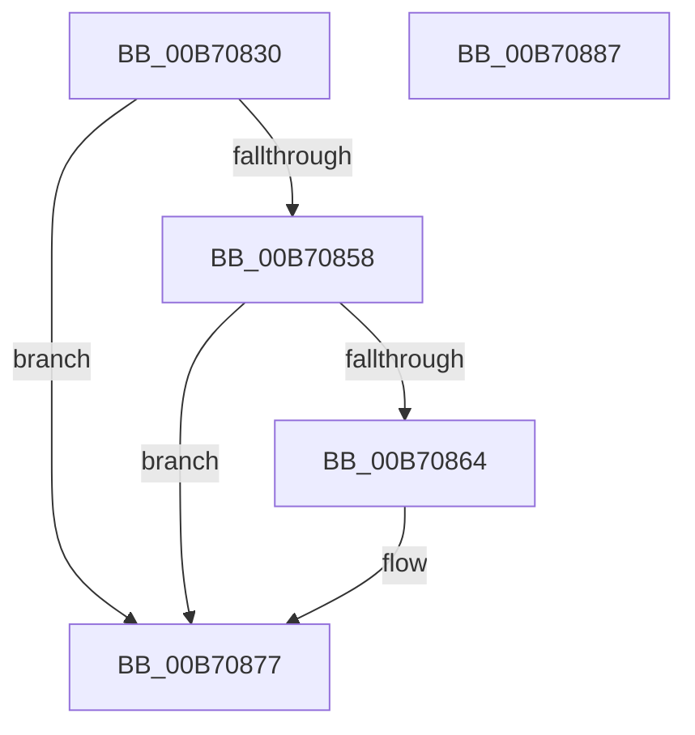

# PopFlushVolumeBlameResolverCallback

- RVA: `0x00B70830`–`0x00B70888` (길이 `88` bytes)
- VA: `0x0000000140B70830`
- 실행 섹션: `PAGELK`
- PDB 이름 있음: `예`; PDB Function 태그: `아니요`
- unwind 정보 RVA: `0x00060BC4`
- 디코드: `26`개 명령, `88/88` bytes 표시
- 미해석 바이트: `0` (있으면 어셈블리에 `.byte`로 보존)

> 이 문서는 커널 이미지의 기계어와 PDB 기호를 분석해 생성했습니다. 4번과 5번은 함수 원형과 자료형을 바이너리 사용 방식에서 추정한 C 해석이며 원본 소스 복구 결과는 아닙니다.

## 1. Dependencies

- 직접 호출 지점: **2**; 고유 호출 대상: **2**
- 직접 호출자로 확인된 함수: **0**
- RIP 상대 이미지 참조: **1**

### Outgoing calls
- `0x00B7084F` → [ExTryToAcquireFastMutex](../../text/44/ExTryToAcquireFastMutex_function_0044C2E0.md) (function, `0x0044C2E0`)
- `0x00B70868` → [IoThreadToProcess](../../text/44/IoThreadToProcess_function_00448540.md) (function, `0x00448540`)

### Direct callers
- 이 함수 시작 RVA로 연결되는 직접 call은 확인되지 않았습니다. 간접 호출은 완전히 역산할 수 없습니다.

### Static image references
- `0x00B7083F` → RVA `0x00F0CAA0` (`.data`; read)

## 2. Other-region calls and transfers

- 다른 실행 섹션으로 향하는 call: **2**
  - `0x00B7084F` → [ExTryToAcquireFastMutex](../../text/44/ExTryToAcquireFastMutex_function_0044C2E0.md) (`PAGELK` → `.text`)
  - `0x00B70868` → [IoThreadToProcess](../../text/44/IoThreadToProcess_function_00448540.md) (`PAGELK` → `.text`)
- 별도 외부 분기/꼬리 이동을 확인하지 못했습니다.

## 3. Assembly (complete function range)

```asm
00B70830  48 89 5C 24 08                  mov qword ptr [rsp + 8], rbx
00B70835  48 89 74 24 10                  mov qword ptr [rsp + 0x10], rsi
00B7083A  57                              push rdi
00B7083B  48 83 EC 20                     sub rsp, 0x20
00B7083F  48 8D 0D 5A C2 39 00            lea rcx, [rip + 0x39c25a]
00B70846  49 8B D9                        mov rbx, r9
00B70849  49 8B F8                        mov rdi, r8
00B7084C  48 8B F2                        mov rsi, rdx
00B7084F  E8 8C BA 8D FF                  call 0x14044c2e0
00B70854  84 C0                           test al, al
00B70856  74 1F                           je 0x140b70877
00B70858  48 8D 43 38                     lea rax, [rbx + 0x38]
00B7085C  48 8B 18                        mov rbx, qword ptr [rax]
00B7085F  48 3B D8                        cmp rbx, rax
00B70862  75 13                           jne 0x140b70877
00B70864  48 8B 4B 10                     mov rcx, qword ptr [rbx + 0x10]
00B70868  E8 D3 7C 8D FF                  call 0x140448540
00B7086D  48 89 06                        mov qword ptr [rsi], rax
00B70870  48 8B 43 10                     mov rax, qword ptr [rbx + 0x10]
00B70874  48 89 07                        mov qword ptr [rdi], rax
00B70877  48 8B 5C 24 30                  mov rbx, qword ptr [rsp + 0x30]
00B7087C  48 8B 74 24 38                  mov rsi, qword ptr [rsp + 0x38]
00B70881  48 83 C4 20                     add rsp, 0x20
00B70885  5F                              pop rdi
00B70886  C3                              ret
00B70887  CC                              int3
```

## 4. C-style interpretation (structured pseudocode)

```c
__int64 __fastcall PopFlushVolumeBlameResolverCallback(__int64 a1, __int64 a2, __int64 a3, __int64 a4)
{
    __int64 result;
    __int64 v_rsp;
    unsigned __int64 v_stack_p10;
    unsigned __int64 v_stack_p8;

    v_stack_p8 = v_rbx;
    v_stack_p10 = v_rsi;
    v_rsp = (v_rsp) - (32);
    result = ExTryToAcquireFastMutex(v_rip + 3785306, a2, a3, a4);
    if ((unsigned __int8)(result) == 0) goto loc_00B70877;
    result = a4 + 56;
    if ((*(unsigned __int64 *)(a4 + 56)) == (a4 + 56)) {
        a1 = *(unsigned __int64 *)(*(unsigned __int64 *)(a4 + 56) + 16);
        result = IoThreadToProcess(a1, a2, a3, a4);
        *(unsigned __int64 *)(a2) = result;
        result = *(unsigned __int64 *)(*(unsigned __int64 *)(a4 + 56) + 16);
        *(unsigned __int64 *)(a3) = result;
    }
    v_rsp = (v_rsp) + (32);
    return result;
}
```

## 5. (Beta) C Style

```c
int64_t PopFlushVolumeBlameResolverCallback(int64_t Arg1, void *Arg2, void *Arg3, void *Arg4)
{
    uint8_t *arg2 = (uint8_t *)Arg2;
    uint8_t *arg3 = (uint8_t *)Arg3;
    uint8_t *arg4 = (uint8_t *)Arg4;

    int64_t result;
    int64_t local_rsp;
    uint64_t v_stack_p10;
    uint64_t v_stack_p8;

    v_stack_p8 = local_rbx;
    v_stack_p10 = local_rsi;
    local_rsp = (local_rsp) - (32);
    result = ExTryToAcquireFastMutex(v_rip + 3785306, Arg2, Arg3, Arg4);
    if ((uint8_t)(result) == 0) goto loc_00B70877;
    result = Arg4 + 56;
    if ((*(uint64_t *)(arg4 + 0x38)) == (Arg4 + 56)) {
        Arg1 = *(uint64_t *)(*(uint64_t *)(arg4 + 0x38) + 0x10);
        result = IoThreadToProcess(Arg1, Arg2, Arg3, Arg4);
        *(uint64_t *)(arg2) = result;
        result = *(uint64_t *)(*(uint64_t *)(arg4 + 0x38) + 0x10);
        *(uint64_t *)(arg3) = result;
    }
    local_rsp = (local_rsp) + (32);
    return result;
}
```

### 관측된 메모리 오프셋

구조체 형식이 확인되지 않은 접근은 인자 기준의 오프셋으로만 기록했습니다.

| 기준 인자 | 오프셋 표현 | 폭 (bit) | 접근 |
|---|---:|---:|---|
| `Arg2` | `+ 0x0` | `64` | `W` |
| `Arg3` | `+ 0x0` | `64` | `W` |
| `Arg4` | `+ 0x0` | `64` | `R` |
| `Arg4` | `+ 0x38` | `64` | `R` |

## 6. Execution-region graph

[열기: 2D/3D 그래프와 함수 탐색 컨트롤 패널](../../../control-panel.html?section=pagelk&rva=0x00B70830&view=graph)

- 2D 그래프는 위에서 아래로 흐르고, 3D 그래프는 빈 공간을 드래그해 회전합니다. Shift+드래그는 이동, 휠은 확대·축소, 함수 노드 선택은 대상 보고서 이동입니다.

### Static fallback


