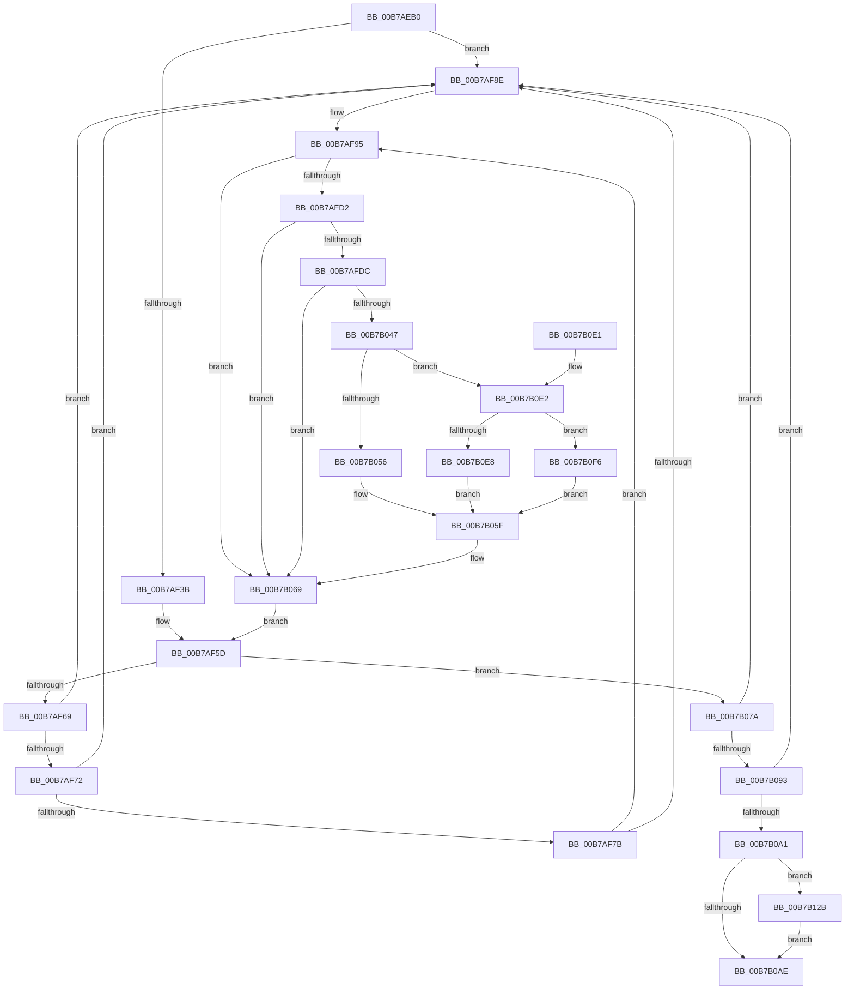

# PopFlushVolumeWorker

- RVA: `0x00B7AEB0`–`0x00B7B13E` (길이 `654` bytes)
- VA: `0x0000000140B7AEB0`
- 실행 섹션: `PAGELK`
- PDB 이름 있음: `예`; PDB Function 태그: `아니요`
- unwind 정보 RVA: `0x000B96B4`
- 디코드: `150`개 명령, `654/654` bytes 표시
- 미해석 바이트: `0` (있으면 어셈블리에 `.byte`로 보존)

> 이 문서는 커널 이미지의 기계어와 PDB 기호를 분석해 생성했습니다. 4번과 5번은 함수 원형과 자료형을 바이너리 사용 방식에서 추정한 C 해석이며 원본 소스 복구 결과는 아닙니다.

## 1. Dependencies

- 직접 호출 지점: **13**; 고유 호출 대상: **11**
- 직접 호출자로 확인된 함수: **1**
- RIP 상대 이미지 참조: **5**

### Outgoing calls
- `0x00B7AF10` → [memset](../../text/6C/memset_function_006C6C40.md) (function, `0x006C6C40`)
- `0x00B7AF1C` → [ExAcquireFastMutex](../../text/20/ExAcquireFastMutex_function_0020E5A0.md) (function, `0x0020E5A0`)
- `0x00B7AFAD` → [ExReleaseFastMutex](../../text/25/ExReleaseFastMutex_function_002519C0.md) (function, `0x002519C0`)
- `0x00B7AFC5` → [ObQueryNameString](../../page/8A/ObQueryNameString_function_008A7EB0.md) (function, `0x008A7EB0`)
- `0x00B7B03E` → [ZwCreateFile](../../text/6A/ZwCreateFile_function_006ADB70.md) (function, `0x006ADB70`)
- `0x00B7B05A` → [PopFlushAndHold](../../text/4D/PopFlushAndHold_function_004DF60C.md) (function, `0x004DF60C`)
- `0x00B7B064` → [ZwClose](../../text/6A/ZwClose_function_006AD2B0.md) (function, `0x006AD2B0`)
- `0x00B7B070` → [ExAcquireFastMutex](../../text/20/ExAcquireFastMutex_function_0020E5A0.md) (function, `0x0020E5A0`)
- `0x00B7B0B5` → [ExReleaseFastMutex](../../text/25/ExReleaseFastMutex_function_002519C0.md) (function, `0x002519C0`)
- `0x00B7B0C4` → [_security_check_cookie](../../text/6A/_security_check_cookie_function_006AC640.md) (function, `0x006AC640`)
- `0x00B7B0EC` → [ZwFlushBuffersFile](../../text/6A/ZwFlushBuffersFile_function_006ADA30.md) (function, `0x006ADA30`)
- `0x00B7B121` → [NtDeviceIoControlFile](../../page/8E/NtDeviceIoControlFile_function_008E9A60.md) (function, `0x008E9A60`)
- `0x00B7B134` → [KeSetEvent](../../text/33/KeSetEvent_function_0033F310.md) (function, `0x0033F310`)

### Direct callers
- [sub_00B80E6E](../B8/Unknown_function_00B80E6E.md) at `0x00B81017`

### Static image references
- `0x00B7AECD` → RVA `0x00E0A740` (`.data`; read)
- `0x00B7AF15` → RVA `0x00F0CAA0` (`.data`; read)
- `0x00B7AF4A` → RVA `0x00F0CEB0` (`.data`; read)
- `0x00B7AF82` → RVA `0x00F0CEB8` (`.data`; read)
- `0x00B7AFA6` → RVA `0x00F0CEB8` (`.data`; write)

## 2. Other-region calls and transfers

- 다른 실행 섹션으로 향하는 call: **13**
  - `0x00B7AF10` → [memset](../../text/6C/memset_function_006C6C40.md) (`PAGELK` → `.text`)
  - `0x00B7AF1C` → [ExAcquireFastMutex](../../text/20/ExAcquireFastMutex_function_0020E5A0.md) (`PAGELK` → `.text`)
  - `0x00B7AFAD` → [ExReleaseFastMutex](../../text/25/ExReleaseFastMutex_function_002519C0.md) (`PAGELK` → `.text`)
  - `0x00B7AFC5` → [ObQueryNameString](../../page/8A/ObQueryNameString_function_008A7EB0.md) (`PAGELK` → `PAGE`)
  - `0x00B7B03E` → [ZwCreateFile](../../text/6A/ZwCreateFile_function_006ADB70.md) (`PAGELK` → `.text`)
  - `0x00B7B05A` → [PopFlushAndHold](../../text/4D/PopFlushAndHold_function_004DF60C.md) (`PAGELK` → `.text`)
  - `0x00B7B064` → [ZwClose](../../text/6A/ZwClose_function_006AD2B0.md) (`PAGELK` → `.text`)
  - `0x00B7B070` → [ExAcquireFastMutex](../../text/20/ExAcquireFastMutex_function_0020E5A0.md) (`PAGELK` → `.text`)
  - `0x00B7B0B5` → [ExReleaseFastMutex](../../text/25/ExReleaseFastMutex_function_002519C0.md) (`PAGELK` → `.text`)
  - `0x00B7B0C4` → [_security_check_cookie](../../text/6A/_security_check_cookie_function_006AC640.md) (`PAGELK` → `.text`)
  - `0x00B7B0EC` → [ZwFlushBuffersFile](../../text/6A/ZwFlushBuffersFile_function_006ADA30.md) (`PAGELK` → `.text`)
  - `0x00B7B121` → [NtDeviceIoControlFile](../../page/8E/NtDeviceIoControlFile_function_008E9A60.md) (`PAGELK` → `PAGE`)
  - `0x00B7B134` → [KeSetEvent](../../text/33/KeSetEvent_function_0033F310.md) (`PAGELK` → `.text`)
- 별도 외부 분기/꼬리 이동을 확인하지 못했습니다.

## 3. Assembly (complete function range)

```asm
00B7AEB0  48 89 5C 24 10                  mov qword ptr [rsp + 0x10], rbx
00B7AEB5  48 89 74 24 18                  mov qword ptr [rsp + 0x18], rsi
00B7AEBA  55                              push rbp
00B7AEBB  57                              push rdi
00B7AEBC  41 57                           push r15
00B7AEBE  48 8D AC 24 20 FE FF FF         lea rbp, [rsp - 0x1e0]
00B7AEC6  48 81 EC E0 02 00 00            sub rsp, 0x2e0
00B7AECD  48 8B 05 6C F8 28 00            mov rax, qword ptr [rip + 0x28f86c]
00B7AED4  48 33 C4                        xor rax, rsp
00B7AED7  48 89 85 D0 01 00 00            mov qword ptr [rbp + 0x1d0], rax
00B7AEDE  0F 57 C0                        xorps xmm0, xmm0
00B7AEE1  33 C0                           xor eax, eax
00B7AEE3  48 8B F9                        mov rdi, rcx
00B7AEE6  48 89 45 B8                     mov qword ptr [rbp - 0x48], rax
00B7AEEA  33 F6                           xor esi, esi
00B7AEEC  89 45 C0                        mov dword ptr [rbp - 0x40], eax
00B7AEEF  48 8D 4D D0                     lea rcx, [rbp - 0x30]
00B7AEF3  89 74 24 68                     mov dword ptr [rsp + 0x68], esi
00B7AEF7  33 D2                           xor edx, edx
00B7AEF9  48 89 74 24 60                  mov qword ptr [rsp + 0x60], rsi
00B7AEFE  41 B8 00 02 00 00               mov r8d, 0x200
00B7AF04  0F 11 45 88                     movups xmmword ptr [rbp - 0x78], xmm0
00B7AF08  0F 11 45 98                     movups xmmword ptr [rbp - 0x68], xmm0
00B7AF0C  0F 11 45 A8                     movups xmmword ptr [rbp - 0x58], xmm0
00B7AF10  E8 2B BD B4 FF                  call 0x1406c6c40
00B7AF15  48 8D 0D 84 1B 39 00            lea rcx, [rip + 0x391b84]
00B7AF1C  E8 7F 36 69 FF                  call 0x14020e5a0
00B7AF21  65 48 8B 04 25 88 01 00 00      mov rax, qword ptr gs:[0x188]
00B7AF2A  48 89 45 80                     mov qword ptr [rbp - 0x80], rax
00B7AF2E  48 8D 47 38                     lea rax, [rdi + 0x38]
00B7AF32  48 8B 48 08                     mov rcx, qword ptr [rax + 8]
00B7AF36  48 39 01                        cmp qword ptr [rcx], rax
00B7AF39  75 53                           jne 0x140b7af8e
00B7AF3B  48 89 4C 24 78                  mov qword ptr [rsp + 0x78], rcx
00B7AF40  48 8D 54 24 70                  lea rdx, [rsp + 0x70]
00B7AF45  48 89 44 24 70                  mov qword ptr [rsp + 0x70], rax
00B7AF4A  4C 8D 3D 5F 1F 39 00            lea r15, [rip + 0x391f5f]
00B7AF51  48 89 11                        mov qword ptr [rcx], rdx
00B7AF54  48 8D 4C 24 70                  lea rcx, [rsp + 0x70]
00B7AF59  48 89 48 08                     mov qword ptr [rax + 8], rcx
00B7AF5D  48 8B 1F                        mov rbx, qword ptr [rdi]
00B7AF60  48 3B DF                        cmp rbx, rdi
00B7AF63  0F 84 11 01 00 00               je 0x140b7b07a
00B7AF69  48 8B 03                        mov rax, qword ptr [rbx]
00B7AF6C  48 39 58 08                     cmp qword ptr [rax + 8], rbx
00B7AF70  75 1C                           jne 0x140b7af8e
00B7AF72  48 8B 4B 08                     mov rcx, qword ptr [rbx + 8]
00B7AF76  48 39 19                        cmp qword ptr [rcx], rbx
00B7AF79  75 13                           jne 0x140b7af8e
00B7AF7B  48 89 01                        mov qword ptr [rcx], rax
00B7AF7E  48 89 48 08                     mov qword ptr [rax + 8], rcx
00B7AF82  48 8B 05 2F 1F 39 00            mov rax, qword ptr [rip + 0x391f2f]
00B7AF89  4C 39 38                        cmp qword ptr [rax], r15
00B7AF8C  74 07                           je 0x140b7af95
00B7AF8E  B9 03 00 00 00                  mov ecx, 3
00B7AF93  CD 29                           int 0x29
00B7AF95  4C 89 3B                        mov qword ptr [rbx], r15
00B7AF98  48 8D 0D 01 1B 39 00            lea rcx, [rip + 0x391b01]
00B7AF9F  48 89 43 08                     mov qword ptr [rbx + 8], rax
00B7AFA3  48 89 18                        mov qword ptr [rax], rbx
00B7AFA6  48 89 1D 0B 1F 39 00            mov qword ptr [rip + 0x391f0b], rbx
00B7AFAD  E8 0E 6A 6D FF                  call 0x1402519c0
00B7AFB2  48 8B 4B C8                     mov rcx, qword ptr [rbx - 0x38]
00B7AFB6  4C 8D 4C 24 68                  lea r9, [rsp + 0x68]
00B7AFBB  41 B8 00 02 00 00               mov r8d, 0x200
00B7AFC1  48 8D 55 D0                     lea rdx, [rbp - 0x30]
00B7AFC5  E8 E6 CE D2 FF                  call 0x1408a7eb0
00B7AFCA  85 C0                           test eax, eax
00B7AFCC  0F 88 97 00 00 00               js 0x140b7b069
00B7AFD2  48 39 75 D8                     cmp qword ptr [rbp - 0x28], rsi
00B7AFD6  0F 84 8D 00 00 00               je 0x140b7b069
00B7AFDC  89 74 24 50                     mov dword ptr [rsp + 0x50], esi
00B7AFE0  48 8D 45 D0                     lea rax, [rbp - 0x30]
00B7AFE4  48 89 74 24 48                  mov qword ptr [rsp + 0x48], rsi
00B7AFE9  4C 8D 4D 88                     lea r9, [rbp - 0x78]
00B7AFED  C7 44 24 40 20 00 00 00         mov dword ptr [rsp + 0x40], 0x20
00B7AFF5  4C 8D 45 98                     lea r8, [rbp - 0x68]
00B7AFF9  C7 44 24 38 01 00 00 00         mov dword ptr [rsp + 0x38], 1
00B7B001  48 8D 4C 24 60                  lea rcx, [rsp + 0x60]
00B7B006  C7 44 24 30 03 00 00 00         mov dword ptr [rsp + 0x30], 3
00B7B00E  0F 57 C0                        xorps xmm0, xmm0
00B7B011  C7 44 24 28 00 00 00 C0         mov dword ptr [rsp + 0x28], 0xc0000000
00B7B019  BA 03 00 10 00                  mov edx, 0x100003
00B7B01E  48 89 74 24 20                  mov qword ptr [rsp + 0x20], rsi
00B7B023  C7 45 98 30 00 00 00            mov dword ptr [rbp - 0x68], 0x30
00B7B02A  48 89 75 A0                     mov qword ptr [rbp - 0x60], rsi
00B7B02E  C7 45 B0 40 02 00 00            mov dword ptr [rbp - 0x50], 0x240
00B7B035  48 89 45 A8                     mov qword ptr [rbp - 0x58], rax
00B7B039  F3 0F 7F 45 B8                  movdqu xmmword ptr [rbp - 0x48], xmm0
00B7B03E  E8 2D 2B B3 FF                  call 0x1406adb70
00B7B043  85 C0                           test eax, eax
00B7B045  78 22                           js 0x140b7b069
00B7B047  48 8B 4C 24 60                  mov rcx, qword ptr [rsp + 0x60]
00B7B04C  40 38 77 30                     cmp byte ptr [rdi + 0x30], sil
00B7B050  0F 84 8C 00 00 00               je 0x140b7b0e2
00B7B056  48 8D 55 88                     lea rdx, [rbp - 0x78]
00B7B05A  E8 AD 45 96 FF                  call 0x1404df60c
00B7B05F  48 8B 4C 24 60                  mov rcx, qword ptr [rsp + 0x60]
00B7B064  E8 47 22 B3 FF                  call 0x1406ad2b0
00B7B069  48 8D 0D 30 1A 39 00            lea rcx, [rip + 0x391a30]
00B7B070  E8 2B 35 69 FF                  call 0x14020e5a0
00B7B075  E9 E3 FE FF FF                  jmp 0x140b7af5d
00B7B07A  48 8B 54 24 70                  mov rdx, qword ptr [rsp + 0x70]
00B7B07F  48 8D 4C 24 70                  lea rcx, [rsp + 0x70]
00B7B084  48 8B 44 24 78                  mov rax, qword ptr [rsp + 0x78]
00B7B089  48 39 4A 08                     cmp qword ptr [rdx + 8], rcx
00B7B08D  0F 85 FB FE FF FF               jne 0x140b7af8e
00B7B093  48 8D 4C 24 70                  lea rcx, [rsp + 0x70]
00B7B098  48 39 08                        cmp qword ptr [rax], rcx
00B7B09B  0F 85 ED FE FF FF               jne 0x140b7af8e
00B7B0A1  48 89 10                        mov qword ptr [rax], rdx
00B7B0A4  48 89 42 08                     mov qword ptr [rdx + 8], rax
00B7B0A8  83 6F 10 01                     sub dword ptr [rdi + 0x10], 1
00B7B0AC  74 7D                           je 0x140b7b12b
00B7B0AE  48 8D 0D EB 19 39 00            lea rcx, [rip + 0x3919eb]
00B7B0B5  E8 06 69 6D FF                  call 0x1402519c0
00B7B0BA  48 8B 8D D0 01 00 00            mov rcx, qword ptr [rbp + 0x1d0]
00B7B0C1  48 33 CC                        xor rcx, rsp
00B7B0C4  E8 77 15 B3 FF                  call 0x1406ac640
00B7B0C9  4C 8D 9C 24 E0 02 00 00         lea r11, [rsp + 0x2e0]
00B7B0D1  49 8B 5B 28                     mov rbx, qword ptr [r11 + 0x28]
00B7B0D5  49 8B 73 30                     mov rsi, qword ptr [r11 + 0x30]
00B7B0D9  49 8B E3                        mov rsp, r11
00B7B0DC  41 5F                           pop r15
00B7B0DE  5F                              pop rdi
00B7B0DF  5D                              pop rbp
00B7B0E0  C3                              ret
00B7B0E1  CC                              int3
00B7B0E2  40 38 77 31                     cmp byte ptr [rdi + 0x31], sil
00B7B0E6  75 0E                           jne 0x140b7b0f6
00B7B0E8  48 8D 55 88                     lea rdx, [rbp - 0x78]
00B7B0EC  E8 3F 29 B3 FF                  call 0x1406ada30
00B7B0F1  E9 69 FF FF FF                  jmp 0x140b7b05f
00B7B0F6  89 74 24 48                     mov dword ptr [rsp + 0x48], esi
00B7B0FA  48 8D 45 88                     lea rax, [rbp - 0x78]
00B7B0FE  48 89 74 24 40                  mov qword ptr [rsp + 0x40], rsi
00B7B103  45 33 C9                        xor r9d, r9d
00B7B106  89 74 24 38                     mov dword ptr [rsp + 0x38], esi
00B7B10A  45 33 C0                        xor r8d, r8d
00B7B10D  48 89 74 24 30                  mov qword ptr [rsp + 0x30], rsi
00B7B112  33 D2                           xor edx, edx
00B7B114  C7 44 24 28 04 C0 53 00         mov dword ptr [rsp + 0x28], 0x53c004
00B7B11C  48 89 44 24 20                  mov qword ptr [rsp + 0x20], rax
00B7B121  E8 3A E9 D6 FF                  call 0x1408e9a60
00B7B126  E9 34 FF FF FF                  jmp 0x140b7b05f
00B7B12B  48 8D 4F 18                     lea rcx, [rdi + 0x18]
00B7B12F  45 33 C0                        xor r8d, r8d
00B7B132  33 D2                           xor edx, edx
00B7B134  E8 D7 41 7C FF                  call 0x14033f310
00B7B139  E9 70 FF FF FF                  jmp 0x140b7b0ae
```

## 4. C-style interpretation (structured pseudocode)

```c
__int64 __fastcall PopFlushVolumeWorker(__int64 a1, int a2)
{
    __int64 result;
    __int64 v_rsi;
    __int64 v_rsp;
    unsigned __int64 v_stack_m18;
    unsigned __int64 v_stack_m1F8;
    unsigned __int64 v_stack_m220;
    unsigned __int64 v_stack_m228;
    unsigned int v_stack_m238;
    unsigned __int64 v_stack_m240;
    unsigned int v_stack_m248;
    unsigned __int64 v_stack_m250;
    unsigned __int64 v_stack_m258;
    unsigned __int64 v_stack_m260;
    unsigned __int64 v_stack_m270;
    unsigned __int64 v_stack_m278;
    unsigned __int64 v_stack_m28;
    unsigned __int64 v_stack_m280;
    unsigned __int64 v_stack_m288;
    unsigned int v_stack_m290;
    unsigned __int64 v_stack_m298;
    unsigned __int64 v_stack_m2A0;
    unsigned int v_stack_m2A8;
    unsigned __int64 v_stack_m2B0;
    unsigned int v_stack_m2B8;
    unsigned int v_stack_m2C0;
    unsigned int v_stack_m2C8;
    unsigned int v_stack_m2D0;
    unsigned __int64 v_stack_m2D8;
    unsigned __int64 v_stack_p10;
    unsigned __int64 v_stack_p18;

    v_stack_p10 = v_rbx;
    v_stack_p18 = v_rsi;
    v_rsp = (v_rsp) - (736);
    result = (*(unsigned __int64 *)(v_rip + 2685036)) ^ (v_rsp);
    v_stack_m28 = result;
    result = 0;
    v_stack_m240 = 0;
    v_rsi = 0;
    v_stack_m238 = 0;
    v_stack_m290 = 0;
    a2 = 0;
    v_stack_m298 = 0;
    v_stack_m270 = v_xmm0;
    v_stack_m260 = v_xmm0;
    v_stack_m250 = v_xmm0;
    result = memset(v_stack_m228, a2, 512, a4);
    result = ExAcquireFastMutex(v_rip + 3742596, a2, 512, a4);
    v_stack_m278 = *(unsigned __int64 *)(gs_base + (0 + 392));
    if ((*(unsigned __int64 *)(*(unsigned __int64 *)(a1 + 56 + 8))) != (a1 + 56)) goto loc_00B7AF8E;
    v_stack_m280 = *(unsigned __int64 *)(a1 + 56 + 8);
    v_stack_m288 = a1 + 56;
    *(unsigned __int64 *)(*(unsigned __int64 *)(a1 + 56 + 8)) = v_stack_m288;
    *(unsigned __int64 *)(a1 + 56 + 8) = v_stack_m288;
loc_00B7AF5D:
    if ((*(unsigned __int64 *)(a1)) == a1) goto loc_00B7B07A;
    if ((*(unsigned __int64 *)(*(unsigned __int64 *)(*(unsigned __int64 *)(a1)) + 8)) != (*(unsigned __int64 *)(a1))) goto loc_00B7AF8E;
    if ((*(unsigned __int64 *)(*(unsigned __int64 *)(*(unsigned __int64 *)(a1) + 8))) != (*(unsigned __int64 *)(a1))) goto loc_00B7AF8E;
    *(unsigned __int64 *)(*(unsigned __int64 *)(*(unsigned __int64 *)(a1) + 8)) = *(unsigned __int64 *)(*(unsigned __int64 *)(a1));
    *(unsigned __int64 *)(*(unsigned __int64 *)(*(unsigned __int64 *)(a1)) + 8) = *(unsigned __int64 *)(*(unsigned __int64 *)(a1) + 8);
    if ((*(unsigned __int64 *)(*(unsigned __int64 *)(v_rip + 3743535))) != (v_rip + 3743583)) {
        a1 = 3;
    }
    *(unsigned __int64 *)(*(unsigned __int64 *)(a1)) = v_rip + 3743583;
    *(unsigned __int64 *)(*(unsigned __int64 *)(a1) + 8) = *(unsigned __int64 *)(v_rip + 3743535);
    *(unsigned __int64 *)(*(unsigned __int64 *)(v_rip + 3743535)) = *(unsigned __int64 *)(a1);
    *(unsigned __int64 *)(v_rip + 3743499) = *(unsigned __int64 *)(a1);
    result = ExReleaseFastMutex(v_rip + 3742465, v_stack_m288, 512, a4);
    result = ObQueryNameString(*(unsigned __int64 *)(*(unsigned __int64 *)(a1) - 56), v_stack_m228, 512, v_stack_m290);
    if (sign_flag) goto loc_00B7B069;
    if (v_stack_m220 == 0) goto loc_00B7B069;
    v_stack_m2A8 = 0;
    v_stack_m2B0 = 0;
    v_stack_m2B8 = 32;
    v_stack_m2C0 = 1;
    v_stack_m2C8 = 3;
    v_stack_m2D0 = 0xC0000000ULL;
    v_stack_m2D8 = 0;
    v_stack_m260 = 48;
    v_stack_m258 = 0;
    v_stack_m248 = 576;
    v_stack_m250 = v_stack_m228;
    v_stack_m240 = v_xmm0;
    result = ZwCreateFile(v_stack_m298, (unsigned int)(0x100003ULL), v_stack_m260, v_stack_m270);
    if (sign_flag) goto loc_00B7B069;
    if ((*(unsigned __int8 *)(a1 + 48)) == 0) goto loc_00B7B0E2;
    result = PopFlushAndHold(v_stack_m298, v_stack_m270, v_stack_m260, v_stack_m270);
loc_00B7B05F:
    result = ZwClose(v_stack_m298, v_stack_m270, v_stack_m260, v_stack_m270);
loc_00B7B069:
    result = ExAcquireFastMutex(v_rip + 3742256, v_stack_m270, v_stack_m260, v_stack_m270);
    goto loc_00B7AF5D;
loc_00B7B07A:
    if ((*(unsigned __int64 *)(v_stack_m288 + 8)) != v_stack_m288) goto loc_00B7AF8E;
    if ((*(unsigned __int64 *)(v_stack_m280)) != v_stack_m288) goto loc_00B7AF8E;
    *(unsigned __int64 *)(v_stack_m280) = v_stack_m288;
    *(unsigned __int64 *)(v_stack_m288 + 8) = v_stack_m280;
    if ((*(unsigned __int64 *)(v_stack_m280)) == v_stack_m288) goto loc_00B7B12B;
loc_00B7B0AE:
    result = ExReleaseFastMutex(v_rip + 3742187, v_stack_m288, v_stack_m260, v_stack_m270);
    a1 = (v_stack_m28) ^ (v_rsp);
    result = _security_check_cookie(a1, v_stack_m288, v_stack_m260, v_stack_m270);
    return result;
loc_00B7B0E2:
    if ((*(unsigned __int8 *)(a1 + 49)) != ((unsigned __int8)(*(unsigned __int64 *)(v_stack_m18 + 48)))) goto loc_00B7B0F6;
    result = ZwFlushBuffersFile(a1, v_stack_m270, v_stack_m260, v_stack_m270);
    goto loc_00B7B05F;
loc_00B7B0F6:
    v_stack_m298 = (unsigned int)(*(unsigned __int64 *)(v_stack_m18 + 48));
    v_stack_m2A0 = *(unsigned __int64 *)(v_stack_m18 + 48);
    a4 = 0;
    v_stack_m2A8 = (unsigned int)(*(unsigned __int64 *)(v_stack_m18 + 48));
    a3 = 0;
    v_stack_m2B0 = *(unsigned __int64 *)(v_stack_m18 + 48);
    a2 = 0;
    v_stack_m2B8 = 0x53C004ULL;
    v_stack_m2C0 = v_stack_m270;
    result = NtDeviceIoControlFile(a1, a2, a3, a4);
    goto loc_00B7B05F;
loc_00B7B12B:
    a3 = 0;
    a2 = 0;
    result = KeSetEvent(a1 + 24, a2, a3, a4);
    goto loc_00B7B0AE;
}
```

## 5. (Beta) C Style

```c
int64_t PopFlushVolumeWorker(void *Arg1, int32_t Arg2)
{
    uint8_t *arg1 = (uint8_t *)Arg1;

    int64_t result;
    int64_t local_rsi;
    int64_t local_rsp;
    uint64_t v_stack_m18;
    uint64_t v_stack_m1F8;
    uint64_t v_stack_m220;
    uint64_t v_stack_m228;
    uint32_t v_stack_m238;
    uint64_t v_stack_m240;
    uint32_t v_stack_m248;
    uint64_t v_stack_m250;
    uint64_t v_stack_m258;
    uint64_t v_stack_m260;
    uint64_t v_stack_m270;
    uint64_t v_stack_m278;
    uint64_t v_stack_m28;
    uint64_t v_stack_m280;
    uint64_t v_stack_m288;
    uint32_t v_stack_m290;
    uint64_t v_stack_m298;
    uint64_t v_stack_m2A0;
    uint32_t v_stack_m2A8;
    uint64_t v_stack_m2B0;
    uint32_t v_stack_m2B8;
    uint32_t v_stack_m2C0;
    uint32_t v_stack_m2C8;
    uint32_t v_stack_m2D0;
    uint64_t v_stack_m2D8;
    uint64_t v_stack_p10;
    uint64_t v_stack_p18;

    v_stack_p10 = local_rbx;
    v_stack_p18 = local_rsi;
    local_rsp = (local_rsp) - (736);
    result = (*(uint64_t *)(v_rip + 0x28F86C)) ^ (local_rsp);
    v_stack_m28 = result;
    result = 0;
    v_stack_m240 = 0;
    local_rsi = 0;
    v_stack_m238 = 0;
    v_stack_m290 = 0;
    Arg2 = 0;
    v_stack_m298 = 0;
    v_stack_m270 = v_xmm0;
    v_stack_m260 = v_xmm0;
    v_stack_m250 = v_xmm0;
    result = memset(v_stack_m228, Arg2, 512, a4);
    result = ExAcquireFastMutex(v_rip + 3742596, Arg2, 512, a4);
    v_stack_m278 = *(uint64_t *)(gs_base + (0 + 0x188));
    if ((*(uint64_t *)(*(uint64_t *)(arg1 + 0x38 + 0x8))) != (Arg1 + 56)) goto loc_00B7AF8E;
    v_stack_m280 = *(uint64_t *)(arg1 + 0x38 + 0x8);
    v_stack_m288 = Arg1 + 56;
    *(uint64_t *)(*(uint64_t *)(arg1 + 0x38 + 0x8)) = v_stack_m288;
    *(uint64_t *)(arg1 + 0x38 + 0x8) = v_stack_m288;
loc_00B7AF5D:
    if ((*(uint64_t *)(arg1)) == Arg1) goto loc_00B7B07A;
    if ((*(uint64_t *)(*(uint64_t *)(*(uint64_t *)(arg1)) + 0x8)) != (*(uint64_t *)(arg1))) goto loc_00B7AF8E;
    if ((*(uint64_t *)(*(uint64_t *)(*(uint64_t *)(arg1) + 0x8))) != (*(uint64_t *)(arg1))) goto loc_00B7AF8E;
    *(uint64_t *)(*(uint64_t *)(*(uint64_t *)(arg1) + 0x8)) = *(uint64_t *)(*(uint64_t *)(arg1));
    *(uint64_t *)(*(uint64_t *)(*(uint64_t *)(arg1)) + 0x8) = *(uint64_t *)(*(uint64_t *)(arg1) + 0x8);
    if ((*(uint64_t *)(*(uint64_t *)(v_rip + 0x391F2F))) != (v_rip + 3743583)) {
        Arg1 = 3;
    }
    *(uint64_t *)(*(uint64_t *)(arg1)) = v_rip + 3743583;
    *(uint64_t *)(*(uint64_t *)(arg1) + 0x8) = *(uint64_t *)(v_rip + 0x391F2F);
    *(uint64_t *)(*(uint64_t *)(v_rip + 0x391F2F)) = *(uint64_t *)(arg1);
    *(uint64_t *)(v_rip + 0x391F0B) = *(uint64_t *)(arg1);
    result = ExReleaseFastMutex(v_rip + 3742465, v_stack_m288, 512, a4);
    result = ObQueryNameString(*(uint64_t *)(*(uint64_t *)(arg1) - 0x38), v_stack_m228, 512, v_stack_m290);
    if (sign_flag) goto loc_00B7B069;
    if (v_stack_m220 == 0) goto loc_00B7B069;
    v_stack_m2A8 = 0;
    v_stack_m2B0 = 0;
    v_stack_m2B8 = 32;
    v_stack_m2C0 = 1;
    v_stack_m2C8 = 3;
    v_stack_m2D0 = 0xC0000000ULL;
    v_stack_m2D8 = 0;
    v_stack_m260 = 48;
    v_stack_m258 = 0;
    v_stack_m248 = 576;
    v_stack_m250 = v_stack_m228;
    v_stack_m240 = v_xmm0;
    result = ZwCreateFile(v_stack_m298, (uint32_t)(0x100003ULL), v_stack_m260, v_stack_m270);
    if (sign_flag) goto loc_00B7B069;
    if ((*(uint8_t *)(arg1 + 0x30)) == 0) goto loc_00B7B0E2;
    result = PopFlushAndHold(v_stack_m298, v_stack_m270, v_stack_m260, v_stack_m270);
loc_00B7B05F:
    result = ZwClose(v_stack_m298, v_stack_m270, v_stack_m260, v_stack_m270);
loc_00B7B069:
    result = ExAcquireFastMutex(v_rip + 3742256, v_stack_m270, v_stack_m260, v_stack_m270);
    goto loc_00B7AF5D;
loc_00B7B07A:
    if ((*(uint64_t *)(v_stack_m288 + 0x8)) != v_stack_m288) goto loc_00B7AF8E;
    if ((*(uint64_t *)(v_stack_m280)) != v_stack_m288) goto loc_00B7AF8E;
    *(uint64_t *)(v_stack_m280) = v_stack_m288;
    *(uint64_t *)(v_stack_m288 + 0x8) = v_stack_m280;
    if ((*(uint64_t *)(v_stack_m280)) == v_stack_m288) goto loc_00B7B12B;
loc_00B7B0AE:
    result = ExReleaseFastMutex(v_rip + 3742187, v_stack_m288, v_stack_m260, v_stack_m270);
    Arg1 = (v_stack_m28) ^ (local_rsp);
    result = _security_check_cookie(Arg1, v_stack_m288, v_stack_m260, v_stack_m270);
    return result;
loc_00B7B0E2:
    if ((*(uint8_t *)(arg1 + 0x31)) != ((uint8_t)(*(uint64_t *)(v_stack_m18 + 0x30)))) goto loc_00B7B0F6;
    result = ZwFlushBuffersFile(Arg1, v_stack_m270, v_stack_m260, v_stack_m270);
    goto loc_00B7B05F;
loc_00B7B0F6:
    v_stack_m298 = (uint32_t)(*(uint64_t *)(v_stack_m18 + 0x30));
    v_stack_m2A0 = *(uint64_t *)(v_stack_m18 + 0x30);
    a4 = 0;
    v_stack_m2A8 = (uint32_t)(*(uint64_t *)(v_stack_m18 + 0x30));
    a3 = 0;
    v_stack_m2B0 = *(uint64_t *)(v_stack_m18 + 0x30);
    Arg2 = 0;
    v_stack_m2B8 = 0x53C004ULL;
    v_stack_m2C0 = v_stack_m270;
    result = NtDeviceIoControlFile(Arg1, Arg2, a3, a4);
    goto loc_00B7B05F;
loc_00B7B12B:
    a3 = 0;
    Arg2 = 0;
    result = KeSetEvent(Arg1 + 24, Arg2, a3, a4);
    goto loc_00B7B0AE;
}
```

### 관측된 메모리 오프셋

구조체 형식이 확인되지 않은 접근은 인자 기준의 오프셋으로만 기록했습니다.

| 기준 인자 | 오프셋 표현 | 폭 (bit) | 접근 |
|---|---:|---:|---|
| `Arg1` | `+ 0x0` | `64` | `R` |
| `Arg1` | `+ 0x8` | `64` | `R` |
| `Arg1` | `+ 0x8` | `64` | `W` |
| `Arg1` | `+ 0x10` | `32` | `R/W` |
| `Arg1` | `+ 0x18` | `64` | `R` |
| `Arg1` | `+ 0x30` | `8` | `R` |
| `Arg1` | `+ 0x31` | `8` | `R` |
| `Arg1` | `+ 0x38` | `64` | `R` |

## 6. Execution-region graph

[열기: 2D/3D 그래프와 함수 탐색 컨트롤 패널](../../../control-panel.html?section=pagelk&rva=0x00B7AEB0&view=graph)

- 2D 그래프는 위에서 아래로 흐르고, 3D 그래프는 빈 공간을 드래그해 회전합니다. Shift+드래그는 이동, 휠은 확대·축소, 함수 노드 선택은 대상 보고서 이동입니다.

### Static fallback


