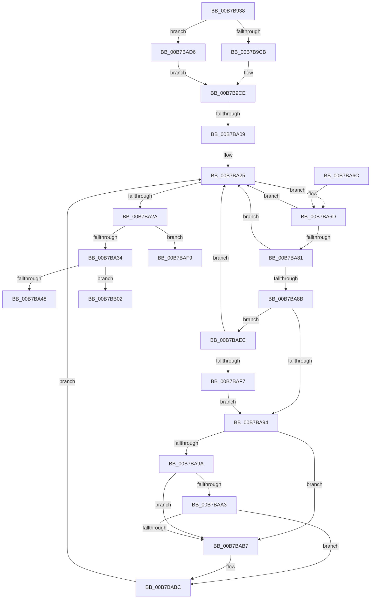

# PopFlushVolumes

- RVA: `0x00B7B938`–`0x00B7BB34` (길이 `508` bytes)
- VA: `0x0000000140B7B938`
- 실행 섹션: `PAGELK`
- PDB 이름 있음: `예`; PDB Function 태그: `예`
- unwind 정보 RVA: `0x000BA1CC`
- 디코드: `132`개 명령, `508/508` bytes 표시
- 미해석 바이트: `0` (있으면 어셈블리에 `.byte`로 보존)

> 이 문서는 커널 이미지의 기계어와 PDB 기호를 분석해 생성했습니다. 4번과 5번은 함수 원형과 자료형을 바이너리 사용 방식에서 추정한 C 해석이며 원본 소스 복구 결과는 아닙니다.

## 1. Dependencies

- 직접 호출 지점: **6**; 고유 호출 대상: **5**
- 직접 호출자로 확인된 함수: **1**
- RIP 상대 이미지 참조: **6**

### Outgoing calls
- `0x00B7B97A` → [PopDiagTraceEventNoPayload](../../text/49/PopDiagTraceEventNoPayload_function_004982F8.md) (function, `0x004982F8`)
- `0x00B7B989` → [memset](../../text/6C/memset_function_006C6C40.md) (function, `0x006C6C40`)
- `0x00B7B9B7` → [KeInitializeEvent](../../text/40/KeInitializeEvent_function_0040DD10.md) (function, `0x0040DD10`)
- `0x00B7BA12` → [ExAcquireFastMutex](../../text/20/ExAcquireFastMutex_function_0020E5A0.md) (function, `0x0020E5A0`)
- `0x00B7BA3B` → [ExReleaseFastMutex](../../text/25/ExReleaseFastMutex_function_002519C0.md) (function, `0x002519C0`)
- `0x00B7BA4F` → [PopDiagTraceEventNoPayload](../../text/49/PopDiagTraceEventNoPayload_function_004982F8.md) (function, `0x004982F8`)

### Direct callers
- [PopTransitionSystemPowerStateEx](PopTransitionSystemPowerStateEx_function_00B7E8C0.md) at `0x00B7F13A`

### Static image references
- `0x00B7B960` → RVA `0x0001C600` (`.rdata`; read)
- `0x00B7BA0B` → RVA `0x00F0CAA0` (`.data`; read)
- `0x00B7BA17` → RVA `0x00F0CEB0` (`.data`; read)
- `0x00B7BA48` → RVA `0x0001C610` (`.rdata`; read)
- `0x00B7BAD6` → RVA `0x00F0BF60` (`.data`; read)
- `0x00B7BADD` → RVA `0x00FC6F98` (`ALMOSTRO`; read)

## 2. Other-region calls and transfers

- 다른 실행 섹션으로 향하는 call: **6**
  - `0x00B7B97A` → [PopDiagTraceEventNoPayload](../../text/49/PopDiagTraceEventNoPayload_function_004982F8.md) (`PAGELK` → `.text`)
  - `0x00B7B989` → [memset](../../text/6C/memset_function_006C6C40.md) (`PAGELK` → `.text`)
  - `0x00B7B9B7` → [KeInitializeEvent](../../text/40/KeInitializeEvent_function_0040DD10.md) (`PAGELK` → `.text`)
  - `0x00B7BA12` → [ExAcquireFastMutex](../../text/20/ExAcquireFastMutex_function_0020E5A0.md) (`PAGELK` → `.text`)
  - `0x00B7BA3B` → [ExReleaseFastMutex](../../text/25/ExReleaseFastMutex_function_002519C0.md) (`PAGELK` → `.text`)
  - `0x00B7BA4F` → [PopDiagTraceEventNoPayload](../../text/49/PopDiagTraceEventNoPayload_function_004982F8.md) (`PAGELK` → `.text`)
- call이 아닌 외부 분기/꼬리 이동: **3**
  - `0x00B7BA03` → [sub_00B80E6E](../B8/Unknown_function_00B80E6E.md) (`tail-transfer`)
  - `0x00B7BAFD` → [sub_00B80E6E + 0xFF](../B8/Unknown_function_00B80E6E.md) (`tail-transfer`)
  - `0x00B7BB2F` → [sub_00B80E6E + 0x111](../B8/Unknown_function_00B80E6E.md) (`tail-transfer`)

## 3. Assembly (complete function range)

```asm
00B7B938  48 89 5C 24 08                  mov qword ptr [rsp + 8], rbx
00B7B93D  55                              push rbp
00B7B93E  57                              push rdi
00B7B93F  41 54                           push r12
00B7B941  41 55                           push r13
00B7B943  41 56                           push r14
00B7B945  48 8D 6C 24 C9                  lea rbp, [rsp - 0x37]
00B7B94A  48 81 EC D0 00 00 00            sub rsp, 0xd0
00B7B951  33 C0                           xor eax, eax
00B7B953  0F 57 C0                        xorps xmm0, xmm0
00B7B956  48 21 45 77                     and qword ptr [rbp + 0x77], rax
00B7B95A  8B D9                           mov ebx, ecx
00B7B95C  48 21 45 6F                     and qword ptr [rbp + 0x6f], rax
00B7B960  48 8D 0D 99 0C 4A FF            lea rcx, [rip - 0xb5f367]
00B7B967  0F 11 45 F7                     movups xmmword ptr [rbp - 9], xmm0
00B7B96B  48 89 45 17                     mov qword ptr [rbp + 0x17], rax
00B7B96F  0F 11 45 07                     movups xmmword ptr [rbp + 7], xmm0
00B7B973  89 45 1F                        mov dword ptr [rbp + 0x1f], eax
00B7B976  0F 11 45 27                     movups xmmword ptr [rbp + 0x27], xmm0
00B7B97A  E8 79 C9 91 FF                  call 0x1404982f8
00B7B97F  33 D2                           xor edx, edx
00B7B981  48 8D 4D A7                     lea rcx, [rbp - 0x59]
00B7B985  44 8D 42 48                     lea r8d, [rdx + 0x48]
00B7B989  E8 B2 B2 B4 FF                  call 0x1406c6c40
00B7B98E  48 8D 45 A7                     lea rax, [rbp - 0x59]
00B7B992  45 33 C0                        xor r8d, r8d
00B7B995  48 89 45 AF                     mov qword ptr [rbp - 0x51], rax
00B7B999  48 8D 4D BF                     lea rcx, [rbp - 0x41]
00B7B99D  48 8D 45 A7                     lea rax, [rbp - 0x59]
00B7B9A1  33 D2                           xor edx, edx
00B7B9A3  48 89 45 A7                     mov qword ptr [rbp - 0x59], rax
00B7B9A7  48 8D 45 DF                     lea rax, [rbp - 0x21]
00B7B9AB  48 89 45 E7                     mov qword ptr [rbp - 0x19], rax
00B7B9AF  48 8D 45 DF                     lea rax, [rbp - 0x21]
00B7B9B3  48 89 45 DF                     mov qword ptr [rbp - 0x21], rax
00B7B9B7  E8 54 23 89 FF                  call 0x14040dd10
00B7B9BC  41 BD 03 00 00 00               mov r13d, 3
00B7B9C2  83 FB 06                        cmp ebx, 6
00B7B9C5  0F 85 0B 01 00 00               jne 0x140b7bad6
00B7B9CB  8D 43 FC                        lea eax, [rbx - 4]
00B7B9CE  8B F8                           mov edi, eax
00B7B9D0  41 BE 01 00 00 00               mov r14d, 1
00B7B9D6  83 CF 10                        or edi, 0x10
00B7B9D9  83 FB 05                        cmp ebx, 5
00B7B9DC  0F 45 F8                        cmovne edi, eax
00B7B9DF  0F B6 45 D7                     movzx eax, byte ptr [rbp - 0x29]
00B7B9E3  40 F6 C7 04                     test dil, 4
00B7B9E7  41 0F 45 C6                     cmovne eax, r14d
00B7B9EB  88 45 D7                        mov byte ptr [rbp - 0x29], al
00B7B9EE  41 8D 46 07                     lea eax, [r14 + 7]
00B7B9F2  40 84 F8                        test al, dil
00B7B9F5  0F B6 45 D8                     movzx eax, byte ptr [rbp - 0x28]
00B7B9F9  41 0F 45 C6                     cmovne eax, r14d
00B7B9FD  88 45 D8                        mov byte ptr [rbp - 0x28], al
00B7BA00  41 84 FE                        test r14b, dil
00B7BA03  0F 85 65 54 00 00               jne 0x140b80e6e
00B7BA09  33 DB                           xor ebx, ebx
00B7BA0B  48 8D 0D 8E 10 39 00            lea rcx, [rip + 0x39108e]
00B7BA12  E8 89 2B 69 FF                  call 0x14020e5a0
00B7BA17  48 8B 0D 92 14 39 00            mov rcx, qword ptr [rip + 0x391492]
00B7BA1E  4C 8D 25 8B 14 39 00            lea r12, [rip + 0x39148b]
00B7BA25  49 3B CC                        cmp rcx, r12
00B7BA28  75 43                           jne 0x140b7ba6d
00B7BA2A  40 F6 C7 02                     test dil, 2
00B7BA2E  0F 84 C5 00 00 00               je 0x140b7baf9
00B7BA34  48 8D 0D 65 10 39 00            lea rcx, [rip + 0x391065]
00B7BA3B  E8 80 5F 6D FF                  call 0x1402519c0
00B7BA40  85 DB                           test ebx, ebx
00B7BA42  0F 85 BA 00 00 00               jne 0x140b7bb02
00B7BA48  48 8D 0D C1 0B 4A FF            lea rcx, [rip - 0xb5f43f]
00B7BA4F  E8 A4 C8 91 FF                  call 0x1404982f8
00B7BA54  48 8B 9C 24 00 01 00 00         mov rbx, qword ptr [rsp + 0x100]
00B7BA5C  48 81 C4 D0 00 00 00            add rsp, 0xd0
00B7BA63  41 5E                           pop r14
00B7BA65  41 5D                           pop r13
00B7BA67  41 5C                           pop r12
00B7BA69  5F                              pop rdi
00B7BA6A  5D                              pop rbp
00B7BA6B  C3                              ret
00B7BA6C  CC                              int3
00B7BA6D  4C 8B 41 C8                     mov r8, qword ptr [rcx - 0x38]
00B7BA71  48 8B D1                        mov rdx, rcx
00B7BA74  48 8B 09                        mov rcx, qword ptr [rcx]
00B7BA77  4D 8B 48 38                     mov r9, qword ptr [r8 + 0x38]
00B7BA7B  45 84 71 04                     test byte ptr [r9 + 4], r14b
00B7BA7F  74 A4                           je 0x140b7ba25
00B7BA81  41 F7 40 34 06 00 01 00         test dword ptr [r8 + 0x34], 0x10006
00B7BA89  75 9A                           jne 0x140b7ba25
00B7BA8B  49 8B 41 10                     mov rax, qword ptr [r9 + 0x10]
00B7BA8F  48 85 C0                        test rax, rax
00B7BA92  75 58                           jne 0x140b7baec
00B7BA94  48 39 51 08                     cmp qword ptr [rcx + 8], rdx
00B7BA98  75 1D                           jne 0x140b7bab7
00B7BA9A  48 8B 42 08                     mov rax, qword ptr [rdx + 8]
00B7BA9E  48 39 10                        cmp qword ptr [rax], rdx
00B7BAA1  75 14                           jne 0x140b7bab7
00B7BAA3  48 89 08                        mov qword ptr [rax], rcx
00B7BAA6  4C 8D 45 A7                     lea r8, [rbp - 0x59]
00B7BAAA  48 89 41 08                     mov qword ptr [rcx + 8], rax
00B7BAAE  48 8B 45 AF                     mov rax, qword ptr [rbp - 0x51]
00B7BAB2  4C 39 00                        cmp qword ptr [rax], r8
00B7BAB5  74 05                           je 0x140b7babc
00B7BAB7  49 8B CD                        mov rcx, r13
00B7BABA  CD 29                           int 0x29
00B7BABC  48 89 42 08                     mov qword ptr [rdx + 8], rax
00B7BAC0  4C 8D 45 A7                     lea r8, [rbp - 0x59]
00B7BAC4  4C 89 02                        mov qword ptr [rdx], r8
00B7BAC7  41 03 DE                        add ebx, r14d
00B7BACA  48 89 10                        mov qword ptr [rax], rdx
00B7BACD  48 89 55 AF                     mov qword ptr [rbp - 0x51], rdx
00B7BAD1  E9 4F FF FF FF                  jmp 0x140b7ba25
00B7BAD6  80 3D 83 04 39 00 00            cmp byte ptr [rip + 0x390483], 0
00B7BADD  8B 05 B5 B4 44 00               mov eax, dword ptr [rip + 0x44b4b5]
00B7BAE3  41 0F 45 C5                     cmovne eax, r13d
00B7BAE7  E9 E2 FE FF FF                  jmp 0x140b7b9ce
00B7BAEC  8B 40 34                        mov eax, dword ptr [rax + 0x34]
00B7BAEF  A8 04                           test al, 4
00B7BAF1  0F 85 2E FF FF FF               jne 0x140b7ba25
00B7BAF7  EB 9B                           jmp 0x140b7ba94
00B7BAF9  4C 8B 45 A7                     mov r8, qword ptr [rbp - 0x59]
00B7BAFD  E9 6B 54 00 00                  jmp 0x140b80f6d
00B7BB02  B8 08 00 00 00                  mov eax, 8
00B7BB07  C7 45 F7 30 00 00 00            mov dword ptr [rbp - 9], 0x30
00B7BB0E  3B D8                           cmp ebx, eax
00B7BB10  C7 45 0F 00 02 00 00            mov dword ptr [rbp + 0xf], 0x200
00B7BB17  0F 57 C0                        xorps xmm0, xmm0
00B7BB1A  0F 4F D8                        cmovg ebx, eax
00B7BB1D  48 83 65 FF 00                  and qword ptr [rbp - 1], 0
00B7BB22  48 83 65 07 00                  and qword ptr [rbp + 7], 0
00B7BB27  F3 0F 7F 45 17                  movdqu xmmword ptr [rbp + 0x17], xmm0
00B7BB2C  89 5D B7                        mov dword ptr [rbp - 0x49], ebx
00B7BB2F  E9 4B 54 00 00                  jmp 0x140b80f7f
```

## 4. C-style interpretation (structured pseudocode)

```c
__int64 __fastcall PopFlushVolumes(int a1, int a2)
{
    __int64 result;
    __int64 v_rbx;
    __int64 v_rdi;
    __int64 v_rsp;
    unsigned __int64 v_stack_m38;
    unsigned int v_stack_m40;
    unsigned __int64 v_stack_m48;
    unsigned int v_stack_m50;
    unsigned __int64 v_stack_m58;
    unsigned __int64 v_stack_m5F;
    unsigned __int64 v_stack_m60;
    unsigned __int64 v_stack_m68;
    unsigned __int64 v_stack_m78;
    unsigned __int64 v_stack_m80;
    unsigned __int8 v_stack_m87;
    unsigned __int8 v_stack_m88;
    unsigned __int64 v_stack_mA0;
    unsigned int v_stack_mA8;
    unsigned __int64 v_stack_mB0;
    unsigned __int64 v_stack_mB8;
    unsigned __int64 v_stack_p10;
    unsigned __int64 v_stack_p18;
    unsigned __int64 v_stack_p8;

    v_stack_p8 = v_rbx;
    v_rsp = (v_rsp) - (208);
    result = 0;
    v_stack_m68 = v_xmm0;
    v_stack_m48 = 0;
    v_stack_m58 = v_xmm0;
    v_stack_m40 = 0;
    v_stack_m38 = v_xmm0;
    result = PopDiagTraceEventNoPayload(v_rip - 11924327, a2, a3, a4);
    a2 = 0;
    result = memset(v_stack_mB8, a2, a2 + 72, a4);
    a3 = 0;
    v_stack_mB0 = v_stack_mB8;
    a2 = 0;
    v_stack_mB8 = v_stack_mB8;
    v_stack_m78 = v_stack_m80;
    v_stack_m80 = v_stack_m80;
    result = KeInitializeEvent(v_stack_mA0, a2, a3, a4);
    if (((unsigned int)((unsigned int)(a1))) != 6) goto loc_00B7BAD6;
loc_00B7B9CE:
    v_rdi = (unsigned int)(((unsigned int)((unsigned int)((unsigned int)(a1) - 4))) | (16));
    if (((unsigned int)((unsigned int)(a1))) != 5) { v_rdi = (unsigned int)((unsigned int)(a1) - 4); }
    result = v_stack_m88;
    if ((((unsigned __int8)(v_rdi)) & (4)) != 0) { result = 1; }
    v_stack_m88 = (unsigned __int8)(result);
    result = v_stack_m87;
    if ((((unsigned __int8)(1 + 7)) & ((unsigned __int8)(v_rdi))) != 0) { result = 1; }
    v_stack_m87 = (unsigned __int8)(result);
    v_rbx = 0;
    result = ExAcquireFastMutex(v_rip + 3739790, a2, a3, a4);
loc_00B7BA25:
    if ((*(unsigned __int64 *)(v_rip + 3740818)) != (v_rip + 3740811)) goto loc_00B7BA6D;
    if ((((unsigned __int8)(v_rdi)) & (2)) == 0) goto loc_00B7BAF9;
    result = ExReleaseFastMutex(v_rip + 3739749, a2, a3, a4);
    if (0 != 0) goto loc_00B7BB02;
    result = PopDiagTraceEventNoPayload(v_rip - 11924543, a2, a3, a4);
    v_rsp = (v_rsp) + (208);
    return result;
loc_00B7BA6D:
    if (((*(unsigned __int8 *)(*(unsigned __int64 *)(*(unsigned __int64 *)(v_rip - 11924543 - 56) + 56) + 4)) & (1)) == 0) goto loc_00B7BA25;
    if (((*(unsigned int *)(*(unsigned __int64 *)(v_rip - 11924543 - 56) + 52)) & (0x10006ULL)) != 0) goto loc_00B7BA25;
    if (*(unsigned __int64 *)(*(unsigned __int64 *)(*(unsigned __int64 *)(v_rip - 11924543 - 56) + 56) + 16) != 0) goto loc_00B7BAEC;
loc_00B7BA94:
    if ((*(unsigned __int64 *)(*(unsigned __int64 *)(v_rip - 11924543) + 8)) != (v_rip - 11924543)) goto loc_00B7BAB7;
    if ((*(unsigned __int64 *)(*(unsigned __int64 *)(v_rip - 11924543 + 8))) != (v_rip - 11924543)) goto loc_00B7BAB7;
    *(unsigned __int64 *)(*(unsigned __int64 *)(v_rip - 11924543 + 8)) = *(unsigned __int64 *)(v_rip - 11924543);
    *(unsigned __int64 *)(*(unsigned __int64 *)(v_rip - 11924543) + 8) = *(unsigned __int64 *)(v_rip - 11924543 + 8);
    if ((*(unsigned __int64 *)(v_stack_mB0)) != v_stack_mB8) {
        a1 = 3;
    }
    *(unsigned __int64 *)(v_rip - 11924543 + 8) = v_stack_mB0;
    *(unsigned __int64 *)(v_rip - 11924543) = v_stack_mB8;
    v_rbx = (unsigned int)((v_stack_p8) + (1));
    *(unsigned __int64 *)(v_stack_mB0) = v_rip - 11924543;
    v_stack_mB0 = v_rip - 11924543;
    goto loc_00B7BA25;
loc_00B7BAD6:
    result = (unsigned int)(*(unsigned int *)(v_rip + 4502709));
    if ((*(unsigned __int8 *)(v_rip + 3736707)) != 0) { result = 3; }
    goto loc_00B7B9CE;
loc_00B7BAEC:
    if ((((unsigned __int8)((unsigned int)(*(unsigned int *)(result + 52)))) & (4)) != 0) goto loc_00B7BA25;
    goto loc_00B7BA94;
loc_00B7BAF9:
loc_00B7BB02:
    v_stack_m68 = 48;
    v_stack_m50 = 512;
    if (((unsigned int)(v_rbx)) > 8) { v_rbx = 8; }
    v_stack_m48 = v_xmm0;
    v_stack_mA8 = (unsigned int)(v_rbx);
}
```

## 5. (Beta) C Style

```c
int64_t PopFlushVolumes(int32_t Arg1, int32_t Arg2)
{
    int64_t result;
    int64_t local_rbx;
    int64_t local_rdi;
    int64_t local_rsp;
    uint64_t v_stack_m38;
    uint32_t v_stack_m40;
    uint64_t v_stack_m48;
    uint32_t v_stack_m50;
    uint64_t v_stack_m58;
    uint64_t v_stack_m5F;
    uint64_t v_stack_m60;
    uint64_t v_stack_m68;
    uint64_t v_stack_m78;
    uint64_t v_stack_m80;
    uint8_t v_stack_m87;
    uint8_t v_stack_m88;
    uint64_t v_stack_mA0;
    uint32_t v_stack_mA8;
    uint64_t v_stack_mB0;
    uint64_t v_stack_mB8;
    uint64_t v_stack_p10;
    uint64_t v_stack_p18;
    uint64_t v_stack_p8;

    v_stack_p8 = local_rbx;
    local_rsp = (local_rsp) - (208);
    result = 0;
    v_stack_m68 = v_xmm0;
    v_stack_m48 = 0;
    v_stack_m58 = v_xmm0;
    v_stack_m40 = 0;
    v_stack_m38 = v_xmm0;
    result = PopDiagTraceEventNoPayload(v_rip - 11924327, Arg2, a3, a4);
    Arg2 = 0;
    result = memset(v_stack_mB8, Arg2, Arg2 + 72, a4);
    a3 = 0;
    v_stack_mB0 = v_stack_mB8;
    Arg2 = 0;
    v_stack_mB8 = v_stack_mB8;
    v_stack_m78 = v_stack_m80;
    v_stack_m80 = v_stack_m80;
    result = KeInitializeEvent(v_stack_mA0, Arg2, a3, a4);
    if (((uint32_t)((uint32_t)(Arg1))) != 6) goto loc_00B7BAD6;
loc_00B7B9CE:
    local_rdi = (uint32_t)(((uint32_t)((uint32_t)((uint32_t)(Arg1) - 4))) | (16));
    if (((uint32_t)((uint32_t)(Arg1))) != 5) { local_rdi = (uint32_t)((uint32_t)(Arg1) - 4); }
    result = v_stack_m88;
    if ((((uint8_t)(local_rdi)) & (4)) != 0) { result = 1; }
    v_stack_m88 = (uint8_t)(result);
    result = v_stack_m87;
    if ((((uint8_t)(1 + 7)) & ((uint8_t)(local_rdi))) != 0) { result = 1; }
    v_stack_m87 = (uint8_t)(result);
    local_rbx = 0;
    result = ExAcquireFastMutex(v_rip + 3739790, Arg2, a3, a4);
loc_00B7BA25:
    if ((*(uint64_t *)(v_rip + 0x391492)) != (v_rip + 3740811)) goto loc_00B7BA6D;
    if ((((uint8_t)(local_rdi)) & (2)) == 0) goto loc_00B7BAF9;
    result = ExReleaseFastMutex(v_rip + 3739749, Arg2, a3, a4);
    if (0 != 0) goto loc_00B7BB02;
    result = PopDiagTraceEventNoPayload(v_rip - 11924543, Arg2, a3, a4);
    local_rsp = (local_rsp) + (208);
    return result;
loc_00B7BA6D:
    if (((*(uint8_t *)(*(uint64_t *)(*(uint64_t *)(v_rip - 0xB5F43F - 0x38) + 0x38) + 0x4)) & (1)) == 0) goto loc_00B7BA25;
    if (((*(uint32_t *)(*(uint64_t *)(v_rip - 0xB5F43F - 0x38) + 0x34)) & (0x10006ULL)) != 0) goto loc_00B7BA25;
    if (*(uint64_t *)(*(uint64_t *)(*(uint64_t *)(v_rip - 0xB5F43F - 0x38) + 0x38) + 0x10) != 0) goto loc_00B7BAEC;
loc_00B7BA94:
    if ((*(uint64_t *)(*(uint64_t *)(v_rip - 0xB5F43F) + 0x8)) != (v_rip - 11924543)) goto loc_00B7BAB7;
    if ((*(uint64_t *)(*(uint64_t *)(v_rip - 0xB5F43F + 0x8))) != (v_rip - 11924543)) goto loc_00B7BAB7;
    *(uint64_t *)(*(uint64_t *)(v_rip - 0xB5F43F + 0x8)) = *(uint64_t *)(v_rip - 0xB5F43F);
    *(uint64_t *)(*(uint64_t *)(v_rip - 0xB5F43F) + 0x8) = *(uint64_t *)(v_rip - 0xB5F43F + 0x8);
    if ((*(uint64_t *)(v_stack_mB0)) != v_stack_mB8) {
        Arg1 = 3;
    }
    *(uint64_t *)(v_rip - 0xB5F43F + 0x8) = v_stack_mB0;
    *(uint64_t *)(v_rip - 0xB5F43F) = v_stack_mB8;
    local_rbx = (uint32_t)((v_stack_p8) + (1));
    *(uint64_t *)(v_stack_mB0) = v_rip - 11924543;
    v_stack_mB0 = v_rip - 11924543;
    goto loc_00B7BA25;
loc_00B7BAD6:
    result = (uint32_t)(*(uint32_t *)(v_rip + 0x44B4B5));
    if ((*(uint8_t *)(v_rip + 0x390483)) != 0) { result = 3; }
    goto loc_00B7B9CE;
loc_00B7BAEC:
    if ((((uint8_t)((uint32_t)(*(uint32_t *)(result + 0x34)))) & (4)) != 0) goto loc_00B7BA25;
    goto loc_00B7BA94;
loc_00B7BAF9:
loc_00B7BB02:
    v_stack_m68 = 48;
    v_stack_m50 = 512;
    if (((uint32_t)(local_rbx)) > 8) { local_rbx = 8; }
    v_stack_m48 = v_xmm0;
    v_stack_mA8 = (uint32_t)(local_rbx);
}
```

## 6. Execution-region graph

[열기: 2D/3D 그래프와 함수 탐색 컨트롤 패널](../../../control-panel.html?section=pagelk&rva=0x00B7B938&view=graph)

- 2D 그래프는 위에서 아래로 흐르고, 3D 그래프는 빈 공간을 드래그해 회전합니다. Shift+드래그는 이동, 휠은 확대·축소, 함수 노드 선택은 대상 보고서 이동입니다.

### Static fallback


