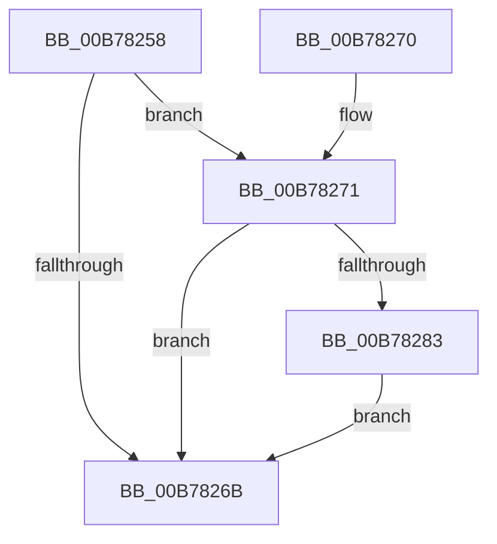

# PopHiberCheckForDebugBreak

- RVA: `0x00B78258`–`0x00B78291` (길이 `57` bytes)
- VA: `0x0000000140B78258`
- 실행 섹션: `PAGELK`
- PDB 이름 있음: `예`; PDB Function 태그: `아니요`
- unwind 정보 RVA: `0x000848A4`
- 디코드: `16`개 명령, `57/57` bytes 표시
- 미해석 바이트: `0` (있으면 어셈블리에 `.byte`로 보존)

> 이 문서는 커널 이미지의 기계어와 PDB 기호를 분석해 생성했습니다. 4번과 5번은 함수 원형과 자료형을 바이너리 사용 방식에서 추정한 C 해석이며 원본 소스 복구 결과는 아닙니다.

## 1. Dependencies

- 직접 호출 지점: **2**; 고유 호출 대상: **2**
- 직접 호출자로 확인된 함수: **7**
- RIP 상대 이미지 참조: **2**

### Outgoing calls
- `0x00B78283` → [KdCheckForDebugBreak](../../text/39/KdCheckForDebugBreak_function_0039DED8.md) (function, `0x0039DED8`)
- `0x00B7828A` → [KeQueryPerformanceCounter](../../text/37/KeQueryPerformanceCounter_function_0037E7E0.md) (function, `0x0037E7E0`)

### Direct callers
- [ConsumerGetBuffer](../B6/ConsumerGetBuffer_function_00B6C6E8.md) at `0x00B6C71A`
- [ConsumerGetBuffer](../B6/ConsumerGetBuffer_function_00B6C6E8.md) at `0x00B6C766`
- [ConsumerGetBuffer](../B6/ConsumerGetBuffer_function_00B6C6E8.md) at `0x00B6C798`
- [PopDecompressHiberBlocks](../B6/PopDecompressHiberBlocks_function_00B6D074.md) at `0x00B6D0E9`
- [PopRequestRead](../B6/PopRequestRead_function_00B6E6DC.md) at `0x00B6E877`
- [PopWriteHiberImage](../B6/PopWriteHiberImage_function_00B6FE30.md) at `0x00B6FE8C`
- [ProducerConsumerBufferComplete](ProducerConsumerBufferComplete_function_00B704E4.md) at `0x00B70519`
- [ProducerConsumerBufferComplete](ProducerConsumerBufferComplete_function_00B704E4.md) at `0x00B70558`
- [ProducerConsumerBufferComplete](ProducerConsumerBufferComplete_function_00B704E4.md) at `0x00B70567`
- [ProducerGetBuffer](ProducerGetBuffer_function_00B706C8.md) at `0x00B706FC`
- [ProducerGetBuffer](ProducerGetBuffer_function_00B706C8.md) at `0x00B7072D`
- [ProducerGetBuffer](ProducerGetBuffer_function_00B706C8.md) at `0x00B70743`
- [ConsumerPeekAndConsumeBuffer](ConsumerPeekAndConsumeBuffer_function_00B78124.md) at `0x00B7818A`
- [ConsumerPeekAndConsumeBuffer](ConsumerPeekAndConsumeBuffer_function_00B78124.md) at `0x00B781BC`
- [ConsumerPeekAndConsumeBuffer](ConsumerPeekAndConsumeBuffer_function_00B78124.md) at `0x00B781CC`

### Static image references
- `0x00B78271` → RVA `0x00E676FC` (`.data`; read)
- `0x00B78279` → RVA `0x00E676FC` (`.data`; write)

## 2. Other-region calls and transfers

- 다른 실행 섹션으로 향하는 call: **2**
  - `0x00B78283` → [KdCheckForDebugBreak](../../text/39/KdCheckForDebugBreak_function_0039DED8.md) (`PAGELK` → `.text`)
  - `0x00B7828A` → [KeQueryPerformanceCounter](../../text/37/KeQueryPerformanceCounter_function_0037E7E0.md) (`PAGELK` → `.text`)
- 별도 외부 분기/꼬리 이동을 확인하지 못했습니다.

## 3. Assembly (complete function range)

```asm
00B78258  48 83 EC 28                     sub rsp, 0x28
00B7825C  65 48 8B 04 25 20 00 00 00      mov rax, qword ptr gs:[0x20]
00B78265  83 78 24 00                     cmp dword ptr [rax + 0x24], 0
00B78269  74 06                           je 0x140b78271
00B7826B  48 83 C4 28                     add rsp, 0x28
00B7826F  C3                              ret
00B78270  CC                              int3
00B78271  8B 05 85 F4 2E 00               mov eax, dword ptr [rip + 0x2ef485]
00B78277  FF C0                           inc eax
00B78279  89 05 7D F4 2E 00               mov dword ptr [rip + 0x2ef47d], eax
00B7827F  A8 3F                           test al, 0x3f
00B78281  75 E8                           jne 0x140b7826b
00B78283  E8 50 5C 82 FF                  call 0x14039ded8
00B78288  33 C9                           xor ecx, ecx
00B7828A  E8 51 65 80 FF                  call 0x14037e7e0
00B7828F  EB DA                           jmp 0x140b7826b
```

## 4. C-style interpretation (structured pseudocode)

```c
__int64 __fastcall PopHiberCheckForDebugBreak(int a1)
{
    __int64 result;
    __int64 v_rsp;

    v_rsp = (v_rsp) - (40);
    if ((*(unsigned int *)(*(unsigned __int64 *)(gs_base + (0 + 32)) + 36)) == 0) goto loc_00B78271;
loc_00B7826B:
    v_rsp = (v_rsp) + (40);
    return *(unsigned __int64 *)(gs_base + (0 + 32));
loc_00B78271:
    result = (unsigned int)(((unsigned int)(*(unsigned int *)(v_rip + 3077253))) + 1);
    *(unsigned int *)(v_rip + 3077245) = (unsigned int)(result);
    if ((((unsigned __int8)(result)) & (63)) != 0) goto loc_00B7826B;
    result = KdCheckForDebugBreak(a1, a2, a3, a4);
    a1 = 0;
    result = KeQueryPerformanceCounter(a1, a2, a3, a4);
    goto loc_00B7826B;
}
```

## 5. (Beta) C Style

```c
int64_t PopHiberCheckForDebugBreak(int32_t Arg1)
{
    int64_t result;
    int64_t local_rsp;

    local_rsp = (local_rsp) - (40);
    if ((*(uint32_t *)(*(uint64_t *)(gs_base + (0 + 0x20)) + 0x24)) == 0) goto loc_00B78271;
loc_00B7826B:
    local_rsp = (local_rsp) + (40);
    return *(uint64_t *)(gs_base + (0 + 0x20));
loc_00B78271:
    result = (uint32_t)(((uint32_t)(*(uint32_t *)(v_rip + 0x2EF485))) + 1);
    *(uint32_t *)(v_rip + 0x2EF47D) = (uint32_t)(result);
    if ((((uint8_t)(result)) & (63)) != 0) goto loc_00B7826B;
    result = KdCheckForDebugBreak(Arg1, a2, a3, a4);
    Arg1 = 0;
    result = KeQueryPerformanceCounter(Arg1, a2, a3, a4);
    goto loc_00B7826B;
}
```

## 6. Execution-region graph

[열기: 2D/3D 그래프와 함수 탐색 컨트롤 패널](../../../control-panel.html?section=pagelk&rva=0x00B78258&view=graph)

- 2D 그래프는 위에서 아래로 흐르고, 3D 그래프는 빈 공간을 드래그해 회전합니다. Shift+드래그는 이동, 휠은 확대·축소, 함수 노드 선택은 대상 보고서 이동입니다.

### Static fallback


