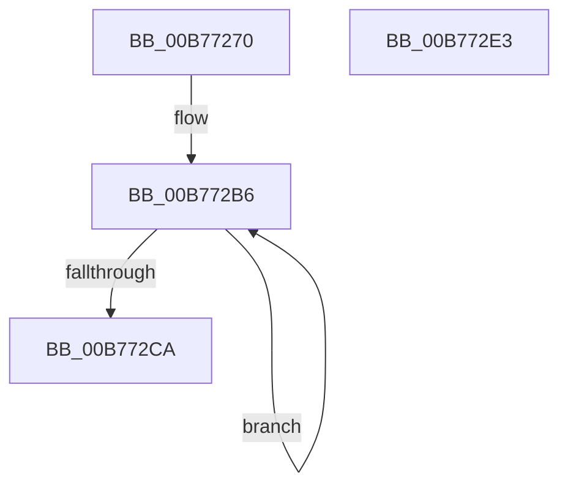

# PopInvokeStateHandlerTargetProcessor

- RVA: `0x00B77270`–`0x00B772E4` (길이 `116` bytes)
- VA: `0x0000000140B77270`
- 실행 섹션: `PAGELK`
- PDB 이름 있음: `예`; PDB Function 태그: `아니요`
- unwind 정보 RVA: `0x000A1158`
- 디코드: `26`개 명령, `116/116` bytes 표시
- 미해석 바이트: `0` (있으면 어셈블리에 `.byte`로 보존)

> 이 문서는 커널 이미지의 기계어와 PDB 기호를 분석해 생성했습니다. 4번과 5번은 함수 원형과 자료형을 바이너리 사용 방식에서 추정한 C 해석이며 원본 소스 복구 결과는 아닙니다.

## 1. Dependencies

- 직접 호출 지점: **4**; 고유 호출 대상: **4**
- 직접 호출자로 확인된 함수: **0**
- RIP 상대 이미지 참조: **1**

### Outgoing calls
- `0x00B7729B` → [memset](../../text/6C/memset_function_006C6C40.md) (function, `0x006C6C40`)
- `0x00B772B1` → [ExpInterlockedPushEntrySList](../../text/6B/ExpInterlockedPushEntrySList_function_006BA5B0.md) (function, `0x006BA5B0`)
- `0x00B772BE` → [PopHandleNextState](PopHandleNextState_function_00B77350.md) (function, `0x00B77350`)
- `0x00B772D5` → [_security_check_cookie](../../text/6A/_security_check_cookie_function_006AC640.md) (function, `0x006AC640`)

### Direct callers
- 이 함수 시작 RVA로 연결되는 직접 call은 확인되지 않았습니다. 간접 호출은 완전히 역산할 수 없습니다.

### Static image references
- `0x00B77279` → RVA `0x00E0A740` (`.data`; read)

## 2. Other-region calls and transfers

- 다른 실행 섹션으로 향하는 call: **3**
  - `0x00B7729B` → [memset](../../text/6C/memset_function_006C6C40.md) (`PAGELK` → `.text`)
  - `0x00B772B1` → [ExpInterlockedPushEntrySList](../../text/6B/ExpInterlockedPushEntrySList_function_006BA5B0.md) (`PAGELK` → `.text`)
  - `0x00B772D5` → [_security_check_cookie](../../text/6A/_security_check_cookie_function_006AC640.md) (`PAGELK` → `.text`)
- 별도 외부 분기/꼬리 이동을 확인하지 못했습니다.

## 3. Assembly (complete function range)

```asm
00B77270  40 53                           push rbx
00B77272  48 81 EC D0 00 00 00            sub rsp, 0xd0
00B77279  48 8B 05 C0 34 29 00            mov rax, qword ptr [rip + 0x2934c0]
00B77280  48 33 C4                        xor rax, rsp
00B77283  48 89 84 24 C0 00 00 00         mov qword ptr [rsp + 0xc0], rax
00B7728B  48 8B DA                        mov rbx, rdx
00B7728E  48 8D 4C 24 24                  lea rcx, [rsp + 0x24]
00B77293  33 D2                           xor edx, edx
00B77295  41 B8 9C 00 00 00               mov r8d, 0x9c
00B7729B  E8 A0 F9 B4 FF                  call 0x1406c6c40
00B772A0  83 64 24 20 00                  and dword ptr [rsp + 0x20], 0
00B772A5  48 8D 4B 40                     lea rcx, [rbx + 0x40]
00B772A9  48 8D 94 24 B0 00 00 00         lea rdx, [rsp + 0xb0]
00B772B1  E8 FA 32 B4 FF                  call 0x1406ba5b0
00B772B6  48 8D 54 24 20                  lea rdx, [rsp + 0x20]
00B772BB  48 8B CB                        mov rcx, rbx
00B772BE  E8 8D 00 00 00                  call 0x140b77350
00B772C3  83 7C 24 20 10                  cmp dword ptr [rsp + 0x20], 0x10
00B772C8  75 EC                           jne 0x140b772b6
00B772CA  48 8B 8C 24 C0 00 00 00         mov rcx, qword ptr [rsp + 0xc0]
00B772D2  48 33 CC                        xor rcx, rsp
00B772D5  E8 66 53 B3 FF                  call 0x1406ac640
00B772DA  48 81 C4 D0 00 00 00            add rsp, 0xd0
00B772E1  5B                              pop rbx
00B772E2  C3                              ret
00B772E3  CC                              int3
```

## 4. C-style interpretation (structured pseudocode)

```c
__int64 __fastcall PopInvokeStateHandlerTargetProcessor(__int64 a1, __int64 a2)
{
    __int64 result;
    __int64 v_rsp;
    unsigned __int64 v_stack_m18;
    unsigned __int64 v_stack_m28;
    unsigned __int64 v_stack_mB4;
    unsigned int v_stack_mB8;

    v_rsp = (v_rsp) - (208);
    result = (*(unsigned __int64 *)(v_rip + 2700480)) ^ (v_rsp);
    v_stack_m18 = result;
    a2 = 0;
    result = memset(v_stack_mB4, a2, 156, a4);
    result = ExpInterlockedPushEntrySList(a2 + 64, v_stack_m28, 156, a4);
loc_00B772B6:
    result = PopHandleNextState(0, v_stack_mB8, 156, a4);
    if (v_stack_mB8 != 16) goto loc_00B772B6;
    a1 = (v_stack_m18) ^ (v_rsp);
    result = _security_check_cookie(a1, v_stack_mB8, 156, a4);
    v_rsp = (v_rsp) + (208);
    return result;
}
```

## 5. (Beta) C Style

```c
int64_t PopInvokeStateHandlerTargetProcessor(int64_t Arg1, void *Arg2)
{
    uint8_t *arg2 = (uint8_t *)Arg2;

    int64_t result;
    int64_t local_rsp;
    uint64_t v_stack_m18;
    uint64_t v_stack_m28;
    uint64_t v_stack_mB4;
    uint32_t v_stack_mB8;

    local_rsp = (local_rsp) - (208);
    result = (*(uint64_t *)(v_rip + 0x2934C0)) ^ (local_rsp);
    v_stack_m18 = result;
    Arg2 = 0;
    result = memset(v_stack_mB4, Arg2, 156, a4);
    result = ExpInterlockedPushEntrySList(Arg2 + 64, v_stack_m28, 156, a4);
loc_00B772B6:
    result = PopHandleNextState(0, v_stack_mB8, 156, a4);
    if (v_stack_mB8 != 16) goto loc_00B772B6;
    Arg1 = (v_stack_m18) ^ (local_rsp);
    result = _security_check_cookie(Arg1, v_stack_mB8, 156, a4);
    local_rsp = (local_rsp) + (208);
    return result;
}
```

### 관측된 메모리 오프셋

구조체 형식이 확인되지 않은 접근은 인자 기준의 오프셋으로만 기록했습니다.

| 기준 인자 | 오프셋 표현 | 폭 (bit) | 접근 |
|---|---:|---:|---|
| `Arg2` | `+ 0x40` | `64` | `R` |

## 6. Execution-region graph

[열기: 2D/3D 그래프와 함수 탐색 컨트롤 패널](../../../control-panel.html?section=pagelk&rva=0x00B77270&view=graph)

- 2D 그래프는 위에서 아래로 흐르고, 3D 그래프는 빈 공간을 드래그해 회전합니다. Shift+드래그는 이동, 휠은 확대·축소, 함수 노드 선택은 대상 보고서 이동입니다.

### Static fallback


