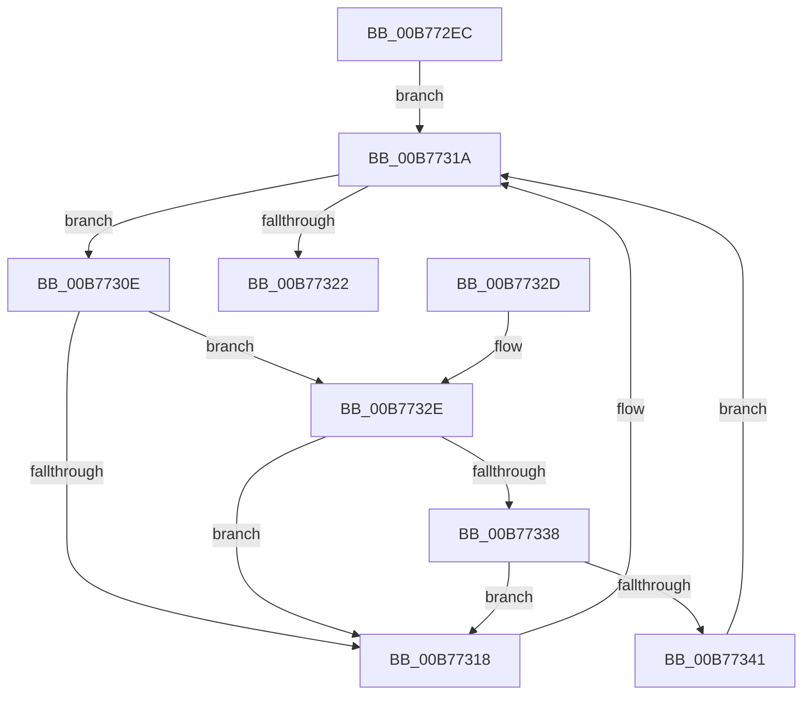

# PopIssueNextState

- RVA: `0x00B772EC`–`0x00B7734A` (길이 `94` bytes)
- VA: `0x0000000140B772EC`
- 실행 섹션: `PAGELK`
- PDB 이름 있음: `예`; PDB Function 태그: `아니요`
- unwind 정보 RVA: `0x0005D394`
- 디코드: `32`개 명령, `94/94` bytes 표시
- 미해석 바이트: `0` (있으면 어셈블리에 `.byte`로 보존)

> 이 문서는 커널 이미지의 기계어와 PDB 기호를 분석해 생성했습니다. 4번과 5번은 함수 원형과 자료형을 바이너리 사용 방식에서 추정한 C 해석이며 원본 소스 복구 결과는 아닙니다.

## 1. Dependencies

- 직접 호출 지점: **3**; 고유 호출 대상: **3**
- 직접 호출자로 확인된 함수: **1**
- RIP 상대 이미지 참조: **2**

### Outgoing calls
- `0x00B77305` → [PopHandleNextState](PopHandleNextState_function_00B77350.md) (function, `0x00B77350`)
- `0x00B77338` → [KiCheckVpBackingLongSpinWaitHypercall](../../text/30/KiCheckVpBackingLongSpinWaitHypercall_function_0030F490.md) (function, `0x0030F490`)
- `0x00B77343` → [HvlNotifyLongSpinWait](../../text/30/HvlNotifyLongSpinWait_function_0030F460.md) (function, `0x0030F460`)

### Direct callers
- [PopInvokeSystemStateHandler](PopInvokeSystemStateHandler_function_00B76A6C.md) at `0x00B76D0C`
- [PopInvokeSystemStateHandler](PopInvokeSystemStateHandler_function_00B76A6C.md) at `0x00B76D1E`
- [PopInvokeSystemStateHandler](PopInvokeSystemStateHandler_function_00B76A6C.md) at `0x00B76DAA`
- [PopInvokeSystemStateHandler](PopInvokeSystemStateHandler_function_00B76A6C.md) at `0x00B76DFA`
- [PopInvokeSystemStateHandler](PopInvokeSystemStateHandler_function_00B76A6C.md) at `0x00B76E2A`
- [PopInvokeSystemStateHandler](PopInvokeSystemStateHandler_function_00B76A6C.md) at `0x00B76E57`
- [PopInvokeSystemStateHandler](PopInvokeSystemStateHandler_function_00B76A6C.md) at `0x00B76E73`
- [PopInvokeSystemStateHandler](PopInvokeSystemStateHandler_function_00B76A6C.md) at `0x00B76EB5`
- [PopInvokeSystemStateHandler](PopInvokeSystemStateHandler_function_00B76A6C.md) at `0x00B76EC7`
- [PopInvokeSystemStateHandler](PopInvokeSystemStateHandler_function_00B76A6C.md) at `0x00B76EF5`
- [PopInvokeSystemStateHandler](PopInvokeSystemStateHandler_function_00B76A6C.md) at `0x00B76F3D`
- [PopInvokeSystemStateHandler](PopInvokeSystemStateHandler_function_00B76A6C.md) at `0x00B76F75`
- [PopInvokeSystemStateHandler](PopInvokeSystemStateHandler_function_00B76A6C.md) at `0x00B77010`
- [PopInvokeSystemStateHandler](PopInvokeSystemStateHandler_function_00B76A6C.md) at `0x00B77092`
- [PopInvokeSystemStateHandler](PopInvokeSystemStateHandler_function_00B76A6C.md) at `0x00B771A4`
- [PopInvokeSystemStateHandler](PopInvokeSystemStateHandler_function_00B76A6C.md) at `0x00B771B6`
- [PopInvokeSystemStateHandler](PopInvokeSystemStateHandler_function_00B76A6C.md) at `0x00B771C8`

### Static image references
- `0x00B77310` → RVA `0x00FC52AC` (`ALMOSTRO`; reference)
- `0x00B7732E` → RVA `0x00FC6AB8` (`ALMOSTRO`; read)

## 2. Other-region calls and transfers

- 다른 실행 섹션으로 향하는 call: **2**
  - `0x00B77338` → [KiCheckVpBackingLongSpinWaitHypercall](../../text/30/KiCheckVpBackingLongSpinWaitHypercall_function_0030F490.md) (`PAGELK` → `.text`)
  - `0x00B77343` → [HvlNotifyLongSpinWait](../../text/30/HvlNotifyLongSpinWait_function_0030F460.md) (`PAGELK` → `.text`)
- 별도 외부 분기/꼬리 이동을 확인하지 못했습니다.

## 3. Assembly (complete function range)

```asm
00B772EC  48 89 5C 24 08                  mov qword ptr [rsp + 8], rbx
00B772F1  57                              push rdi
00B772F2  48 83 EC 20                     sub rsp, 0x20
00B772F6  33 C0                           xor eax, eax
00B772F8  48 8B F9                        mov rdi, rcx
00B772FB  87 41 34                        xchg dword ptr [rcx + 0x34], eax
00B772FE  44 87 41 38                     xchg dword ptr [rcx + 0x38], r8d
00B77302  83 22 00                        and dword ptr [rdx], 0
00B77305  E8 46 00 00 00                  call 0x140b77350
00B7730A  33 DB                           xor ebx, ebx
00B7730C  EB 0C                           jmp 0x140b7731a
00B7730E  FF C3                           inc ebx
00B77310  85 1D 96 DF 44 00               test dword ptr [rip + 0x44df96], ebx
00B77316  74 16                           je 0x140b7732e
00B77318  F3 90                           pause
00B7731A  8B 47 34                        mov eax, dword ptr [rdi + 0x34]
00B7731D  3B 47 30                        cmp eax, dword ptr [rdi + 0x30]
00B77320  75 EC                           jne 0x140b7730e
00B77322  48 8B 5C 24 30                  mov rbx, qword ptr [rsp + 0x30]
00B77327  48 83 C4 20                     add rsp, 0x20
00B7732B  5F                              pop rdi
00B7732C  C3                              ret
00B7732D  CC                              int3
00B7732E  8B 05 84 F7 44 00               mov eax, dword ptr [rip + 0x44f784]
00B77334  A8 40                           test al, 0x40
00B77336  74 E0                           je 0x140b77318
00B77338  E8 53 81 79 FF                  call 0x14030f490
00B7733D  84 C0                           test al, al
00B7733F  74 D7                           je 0x140b77318
00B77341  8B CB                           mov ecx, ebx
00B77343  E8 18 81 79 FF                  call 0x14030f460
00B77348  EB D0                           jmp 0x140b7731a
```

## 4. C-style interpretation (structured pseudocode)

```c
__int64 __fastcall PopIssueNextState(__int64 a1, __int64 a2, int a3)
{
    __int64 result;
    __int64 v_rbx;
    __int64 v_rsp;
    unsigned __int64 v_stack_p8;

    v_stack_p8 = v_rbx;
    v_rsp = (v_rsp) - (32);
    result = 0;
    result = PopHandleNextState(a1, a2, a3, a4);
    v_rbx = 0;
    goto loc_00B7731A;
loc_00B7730E:
    v_rbx = (unsigned int)((v_rbx) + 1);
    if (((*(unsigned int *)(v_rip + 4513686)) & ((unsigned int)(v_rbx))) == 0) goto loc_00B7732E;
loc_00B77318:
loc_00B7731A:
    if (((unsigned int)((unsigned int)(*(unsigned int *)(a1 + 52)))) != (*(unsigned int *)(a1 + 48))) goto loc_00B7730E;
    v_rsp = (v_rsp) + (32);
    return (unsigned int)(*(unsigned int *)(a1 + 52));
loc_00B7732E:
    if ((((unsigned __int8)((unsigned int)(*(unsigned int *)(v_rip + 4519812)))) & (64)) == 0) goto loc_00B77318;
    result = KiCheckVpBackingLongSpinWaitHypercall(a1, a2, a3, a4);
    if ((unsigned __int8)(result) == 0) goto loc_00B77318;
    result = HvlNotifyLongSpinWait((unsigned int)((unsigned int)(v_stack_p8)), a2, a3, a4);
    goto loc_00B7731A;
}
```

## 5. (Beta) C Style

```c
int64_t PopIssueNextState(void *Arg1, void *Arg2, int32_t Arg3)
{
    uint8_t *arg1 = (uint8_t *)Arg1;
    uint8_t *arg2 = (uint8_t *)Arg2;

    int64_t result;
    int64_t local_rbx;
    int64_t local_rsp;
    uint64_t v_stack_p8;

    v_stack_p8 = local_rbx;
    local_rsp = (local_rsp) - (32);
    result = 0;
    result = PopHandleNextState(Arg1, Arg2, Arg3, a4);
    local_rbx = 0;
    goto loc_00B7731A;
loc_00B7730E:
    local_rbx = (uint32_t)((local_rbx) + 1);
    if (((*(uint32_t *)(v_rip + 0x44DF96)) & ((uint32_t)(local_rbx))) == 0) goto loc_00B7732E;
loc_00B77318:
loc_00B7731A:
    if (((uint32_t)((uint32_t)(*(uint32_t *)(arg1 + 0x34)))) != (*(uint32_t *)(arg1 + 0x30))) goto loc_00B7730E;
    local_rsp = (local_rsp) + (32);
    return (uint32_t)(*(uint32_t *)(arg1 + 0x34));
loc_00B7732E:
    if ((((uint8_t)((uint32_t)(*(uint32_t *)(v_rip + 0x44F784)))) & (64)) == 0) goto loc_00B77318;
    result = KiCheckVpBackingLongSpinWaitHypercall(Arg1, Arg2, Arg3, a4);
    if ((uint8_t)(result) == 0) goto loc_00B77318;
    result = HvlNotifyLongSpinWait((uint32_t)((uint32_t)(v_stack_p8)), Arg2, Arg3, a4);
    goto loc_00B7731A;
}
```

### 관측된 메모리 오프셋

구조체 형식이 확인되지 않은 접근은 인자 기준의 오프셋으로만 기록했습니다.

| 기준 인자 | 오프셋 표현 | 폭 (bit) | 접근 |
|---|---:|---:|---|
| `Arg1` | `+ 0x30` | `32` | `R` |
| `Arg1` | `+ 0x34` | `32` | `R` |
| `Arg1` | `+ 0x34` | `32` | `R/W` |
| `Arg1` | `+ 0x38` | `32` | `R/W` |
| `Arg2` | `+ 0x0` | `32` | `R/W` |

## 6. Execution-region graph

[열기: 2D/3D 그래프와 함수 탐색 컨트롤 패널](../../../control-panel.html?section=pagelk&rva=0x00B772EC&view=graph)

- 2D 그래프는 위에서 아래로 흐르고, 3D 그래프는 빈 공간을 드래그해 회전합니다. Shift+드래그는 이동, 휠은 확대·축소, 함수 노드 선택은 대상 보고서 이동입니다.

### Static fallback


