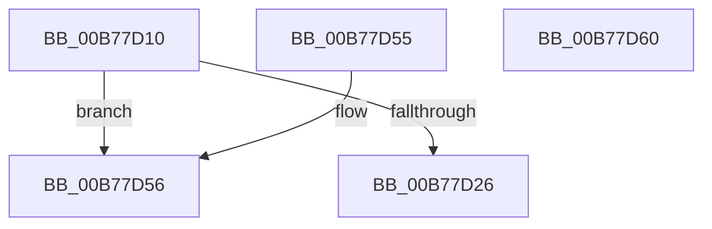

# PopMirrorPhysicalMemory

- RVA: `0x00B77D10`–`0x00B77D61` (길이 `81` bytes)
- VA: `0x0000000140B77D10`
- 실행 섹션: `PAGELK`
- PDB 이름 있음: `예`; PDB Function 태그: `아니요`
- unwind 정보 RVA: `0x000767E0`
- 디코드: `23`개 명령, `81/81` bytes 표시
- 미해석 바이트: `0` (있으면 어셈블리에 `.byte`로 보존)

> 이 문서는 커널 이미지의 기계어와 PDB 기호를 분석해 생성했습니다. 4번과 5번은 함수 원형과 자료형을 바이너리 사용 방식에서 추정한 C 해석이며 원본 소스 복구 결과는 아닙니다.

## 1. Dependencies

- 직접 호출 지점: **1**; 고유 호출 대상: **1**
- 직접 호출자로 확인된 함수: **2**
- RIP 상대 이미지 참조: **1**

### Outgoing calls
- `0x00B77D49` → [RtlClearBits](../../text/3E/RtlClearBits_function_003E1A90.md) (function, `0x003E1A90`)

### Direct callers
- [MiMirrorPerformBlackWrites](../../text/43/MiMirrorPerformBlackWrites_function_00432EF0.md) at `0x004330DF`
- [MiMirrorPerformBrownWrites](../../text/45/MiMirrorPerformBrownWrites_function_0045C560.md) at `0x0045C7AE`

### Static image references
- `0x00B77D1A` → RVA `0x00F0BD90` (`.data`; read)

## 2. Other-region calls and transfers

- 다른 실행 섹션으로 향하는 call: **1**
  - `0x00B77D49` → [RtlClearBits](../../text/3E/RtlClearBits_function_003E1A90.md) (`PAGELK` → `.text`)
- 별도 외부 분기/꼬리 이동을 확인하지 못했습니다.

## 3. Assembly (complete function range)

```asm
00B77D10  48 83 EC 28                     sub rsp, 0x28
00B77D14  48 8B C2                        mov rax, rdx
00B77D17  48 8B D1                        mov rdx, rcx
00B77D1A  48 8B 0D 6F 40 39 00            mov rcx, qword ptr [rip + 0x39406f]
00B77D21  48 85 C9                        test rcx, rcx
00B77D24  74 30                           je 0x140b77d56
00B77D26  48 05 FF 0F 00 00               add rax, 0xfff
00B77D2C  4C 8B C8                        mov r9, rax
00B77D2F  49 C1 E9 0C                     shr r9, 0xc
00B77D33  48 3D 00 10 00 00               cmp rax, 0x1000
00B77D39  45 8D 41 01                     lea r8d, [r9 + 1]
00B77D3D  45 0F 43 C1                     cmovae r8d, r9d
00B77D41  48 C1 EA 0C                     shr rdx, 0xc
00B77D45  48 83 C1 40                     add rcx, 0x40
00B77D49  E8 42 9D 86 FF                  call 0x1403e1a90
00B77D4E  33 C0                           xor eax, eax
00B77D50  48 83 C4 28                     add rsp, 0x28
00B77D54  C3                              ret
00B77D55  CC                              int3
00B77D56  B8 9A 00 00 C0                  mov eax, 0xc000009a
00B77D5B  48 83 C4 28                     add rsp, 0x28
00B77D5F  C3                              ret
00B77D60  CC                              int3
```

## 4. C-style interpretation (structured pseudocode)

```c
__int64 __fastcall PopMirrorPhysicalMemory(__int64 a1, __int64 a2)
{
    __int64 result;
    __int64 v_rsp;

    v_rsp = (v_rsp) - (40);
    if (*(unsigned __int64 *)(v_rip + 3752047) == 0) goto loc_00B77D56;
    result = (a2) + (0xFFFULL);
    a4 = (result) >> (12);
    a3 = a4 + 1;
    if (result >= 0x1000ULL) { a3 = (unsigned int)(a4); }
    a2 = (a1) >> (12);
    a1 = (*(unsigned __int64 *)(v_rip + 3752047)) + (64);
    result = RtlClearBits(a1, a2, a3, a4);
    result = 0;
    v_rsp = (v_rsp) + (40);
    return result;
loc_00B77D56:
    v_rsp = (v_rsp) + (40);
    return (unsigned int)(0xC000009AULL);
}
```

## 5. (Beta) C Style

```c
int64_t PopMirrorPhysicalMemory(int64_t Arg1, int64_t Arg2)
{
    int64_t result;
    int64_t local_rsp;

    local_rsp = (local_rsp) - (40);
    if (*(uint64_t *)(v_rip + 0x39406F) == 0) goto loc_00B77D56;
    result = (Arg2) + (0xFFFULL);
    a4 = (result) >> (12);
    a3 = a4 + 1;
    if (result >= 0x1000ULL) { a3 = (uint32_t)(a4); }
    Arg2 = (Arg1) >> (12);
    Arg1 = (*(uint64_t *)(v_rip + 0x39406F)) + (64);
    result = RtlClearBits(Arg1, Arg2, a3, a4);
    result = 0;
    local_rsp = (local_rsp) + (40);
    return result;
loc_00B77D56:
    local_rsp = (local_rsp) + (40);
    return (uint32_t)(0xC000009AULL);
}
```

## 6. Execution-region graph

[열기: 2D/3D 그래프와 함수 탐색 컨트롤 패널](../../../control-panel.html?section=pagelk&rva=0x00B77D10&view=graph)

- 2D 그래프는 위에서 아래로 흐르고, 3D 그래프는 빈 공간을 드래그해 회전합니다. Shift+드래그는 이동, 휠은 확대·축소, 함수 노드 선택은 대상 보고서 이동입니다.

### Static fallback


