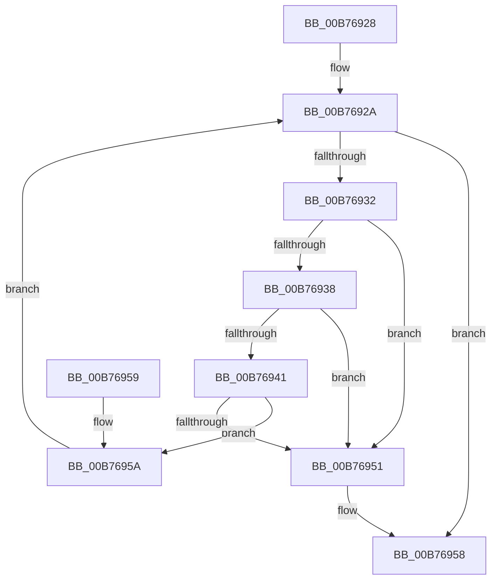

# PopMoveList

- RVA: `0x00B76928`–`0x00B7696A` (길이 `66` bytes)
- VA: `0x0000000140B76928`
- 실행 섹션: `PAGELK`
- PDB 이름 있음: `예`; PDB Function 태그: `아니요`
- unwind 정보 RVA: `0x000DB714`
- 디코드: `23`개 명령, `66/66` bytes 표시
- 미해석 바이트: `0` (있으면 어셈블리에 `.byte`로 보존)

> 이 문서는 커널 이미지의 기계어와 PDB 기호를 분석해 생성했습니다. 4번과 5번은 함수 원형과 자료형을 바이너리 사용 방식에서 추정한 C 해석이며 원본 소스 복구 결과는 아닙니다.

## 1. Dependencies

- 직접 호출 지점: **0**; 고유 호출 대상: **0**
- 직접 호출자로 확인된 함수: **1**
- RIP 상대 이미지 참조: **0**

### Outgoing calls
- 직접 디코드된 call 명령이 없습니다.

### Direct callers
- [PopSetupSleepNotifies](PopSetupSleepNotifies_function_00B76850.md) at `0x00B76884`
- [PopSetupSleepNotifies](PopSetupSleepNotifies_function_00B76850.md) at `0x00B76894`
- [PopSetupSleepNotifies](PopSetupSleepNotifies_function_00B76850.md) at `0x00B768A4`

### Static image references
- 디코드된 RIP-relative 메모리 참조가 없습니다.

## 2. Other-region calls and transfers

- 다른 실행 섹션으로 향하는 call: **0**
- 별도 외부 분기/꼬리 이동을 확인하지 못했습니다.

## 3. Assembly (complete function range)

```asm
00B76928  66 90                           nop
00B7692A  48 8B 02                        mov rax, qword ptr [rdx]
00B7692D  48 3B C2                        cmp rax, rdx
00B76930  74 26                           je 0x140b76958
00B76932  48 39 50 08                     cmp qword ptr [rax + 8], rdx
00B76936  75 19                           jne 0x140b76951
00B76938  4C 8B 00                        mov r8, qword ptr [rax]
00B7693B  49 39 40 08                     cmp qword ptr [r8 + 8], rax
00B7693F  75 10                           jne 0x140b76951
00B76941  4C 89 02                        mov qword ptr [rdx], r8
00B76944  49 89 50 08                     mov qword ptr [r8 + 8], rdx
00B76948  4C 8B 41 08                     mov r8, qword ptr [rcx + 8]
00B7694C  49 39 08                        cmp qword ptr [r8], rcx
00B7694F  74 09                           je 0x140b7695a
00B76951  B9 03 00 00 00                  mov ecx, 3
00B76956  CD 29                           int 0x29
00B76958  C3                              ret
00B76959  CC                              int3
00B7695A  48 89 08                        mov qword ptr [rax], rcx
00B7695D  4C 89 40 08                     mov qword ptr [rax + 8], r8
00B76961  49 89 00                        mov qword ptr [r8], rax
00B76964  48 89 41 08                     mov qword ptr [rcx + 8], rax
00B76968  EB C0                           jmp 0x140b7692a
```

## 4. C-style interpretation (structured pseudocode)

```c
__int64 __fastcall PopMoveList(__int64 a1, __int64 a2)
{
loc_00B7692A:
    if ((*(unsigned __int64 *)(a2)) == a2) goto loc_00B76958;
    if ((*(unsigned __int64 *)(*(unsigned __int64 *)(a2) + 8)) != a2) goto loc_00B76951;
    if ((*(unsigned __int64 *)(*(unsigned __int64 *)(*(unsigned __int64 *)(a2)) + 8)) != (*(unsigned __int64 *)(a2))) goto loc_00B76951;
    *(unsigned __int64 *)(a2) = *(unsigned __int64 *)(*(unsigned __int64 *)(a2));
    *(unsigned __int64 *)(*(unsigned __int64 *)(*(unsigned __int64 *)(a2)) + 8) = a2;
    if ((*(unsigned __int64 *)(*(unsigned __int64 *)(a1 + 8))) == a1) goto loc_00B7695A;
loc_00B76951:
loc_00B76958:
    return *(unsigned __int64 *)(a2);
loc_00B7695A:
    *(unsigned __int64 *)(*(unsigned __int64 *)(a2)) = 3;
    *(unsigned __int64 *)(*(unsigned __int64 *)(a2) + 8) = *(unsigned __int64 *)(a1 + 8);
    *(unsigned __int64 *)(*(unsigned __int64 *)(a1 + 8)) = *(unsigned __int64 *)(a2);
    *(unsigned __int64 *)(3 + 8) = *(unsigned __int64 *)(a2);
    goto loc_00B7692A;
}
```

## 5. (Beta) C Style

```c
int64_t PopMoveList(void *Arg1, void *Arg2)
{
    uint8_t *arg1 = (uint8_t *)Arg1;
    uint8_t *arg2 = (uint8_t *)Arg2;

loc_00B7692A:
    if ((*(uint64_t *)(arg2)) == Arg2) goto loc_00B76958;
    if ((*(uint64_t *)(*(uint64_t *)(arg2) + 0x8)) != Arg2) goto loc_00B76951;
    if ((*(uint64_t *)(*(uint64_t *)(*(uint64_t *)(arg2)) + 0x8)) != (*(uint64_t *)(arg2))) goto loc_00B76951;
    *(uint64_t *)(arg2) = *(uint64_t *)(*(uint64_t *)(arg2));
    *(void **)(*(uint64_t *)(*(uint64_t *)(arg2)) + 0x8) = Arg2;
    if ((*(uint64_t *)(*(uint64_t *)(arg1 + 0x8))) == Arg1) goto loc_00B7695A;
loc_00B76951:
loc_00B76958:
    return *(uint64_t *)(arg2);
loc_00B7695A:
    *(uint64_t *)(*(uint64_t *)(arg2)) = 3;
    *(uint64_t *)(*(uint64_t *)(arg2) + 0x8) = *(uint64_t *)(arg1 + 0x8);
    *(uint64_t *)(*(uint64_t *)(arg1 + 0x8)) = *(uint64_t *)(arg2);
    *(uint64_t *)(3 + 0x8) = *(uint64_t *)(arg2);
    goto loc_00B7692A;
}
```

### 관측된 메모리 오프셋

구조체 형식이 확인되지 않은 접근은 인자 기준의 오프셋으로만 기록했습니다.

| 기준 인자 | 오프셋 표현 | 폭 (bit) | 접근 |
|---|---:|---:|---|
| `Arg1` | `+ 0x8` | `64` | `R` |
| `Arg1` | `+ 0x8` | `64` | `W` |
| `Arg2` | `+ 0x0` | `64` | `R` |
| `Arg2` | `+ 0x0` | `64` | `W` |

## 6. Execution-region graph

[열기: 2D/3D 그래프와 함수 탐색 컨트롤 패널](../../../control-panel.html?section=pagelk&rva=0x00B76928&view=graph)

- 2D 그래프는 위에서 아래로 흐르고, 3D 그래프는 빈 공간을 드래그해 회전합니다. Shift+드래그는 이동, 휠은 확대·축소, 함수 노드 선택은 대상 보고서 이동입니다.

### Static fallback


