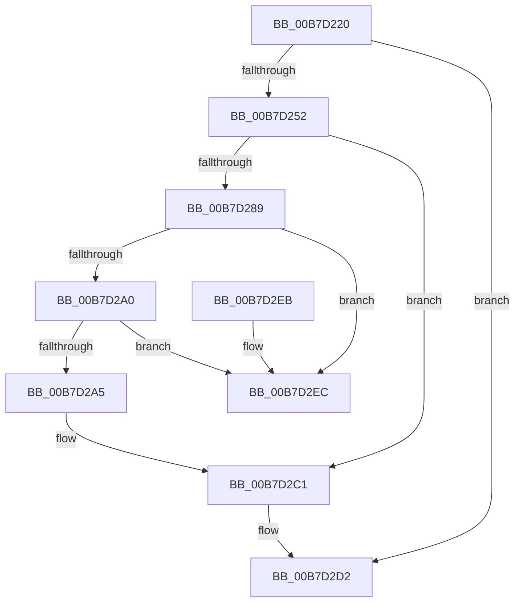

# PopNewWakeInfo

- RVA: `0x00B7D220`–`0x00B7D2F3` (길이 `211` bytes)
- VA: `0x0000000140B7D220`
- 실행 섹션: `PAGELK`
- PDB 이름 있음: `예`; PDB Function 태그: `아니요`
- unwind 정보 RVA: `0x000B492C`
- 디코드: `50`개 명령, `211/211` bytes 표시
- 미해석 바이트: `0` (있으면 어셈블리에 `.byte`로 보존)

> 이 문서는 커널 이미지의 기계어와 PDB 기호를 분석해 생성했습니다. 4번과 5번은 함수 원형과 자료형을 바이너리 사용 방식에서 추정한 C 해석이며 원본 소스 복구 결과는 아닙니다.

## 1. Dependencies

- 직접 호출 지점: **5**; 고유 호출 대상: **5**
- 직접 호출자로 확인된 함수: **1**
- RIP 상대 이미지 참조: **9**

### Outgoing calls
- `0x00B7D241` → [ExAllocatePool2](../../poolcode/B8/ExAllocatePool2_function_00B820F0.md) (function, `0x00B820F0`)
- `0x00B7D274` → [PopAcquireWakeSourceSpinLock](../../text/4C/PopAcquireWakeSourceSpinLock_function_004C75D4.md) (function, `0x004C75D4`)
- `0x00B7D2B6` → [PopWakeInfoDereference](../../text/4C/PopWakeInfoDereference_function_004C74AC.md) (function, `0x004C74AC`)
- `0x00B7D2CD` → [PopReleaseWakeSourceSpinLock](../../text/4D/PopReleaseWakeSourceSpinLock_function_004D4464.md) (function, `0x004D4464`)
- `0x00B7D2D9` → [KeResetEvent](../../text/24/KeResetEvent_function_00248350.md) (function, `0x00248350`)

### Direct callers
- [PopTransitionSystemPowerStateEx](PopTransitionSystemPowerStateEx_function_00B7E8C0.md) at `0x00B7F692`

### Static image references
- `0x00B7D279` → RVA `0x00F0DEA0` (`.data`; read)
- `0x00B7D280` → RVA `0x00F0DEB0` (`.data`; write)
- `0x00B7D289` → RVA `0x00F0DE98` (`.data`; read)
- `0x00B7D290` → RVA `0x00F0DE90` (`.data`; read)
- `0x00B7D2A5` → RVA `0x00F0DE98` (`.data`; write)
- `0x00B7D2BB` → RVA `0x00F0DEA0` (`.data`; read/write)
- `0x00B7D2C1` → RVA `0x00F0DEF0` (`.data`; read/write)
- `0x00B7D2D2` → RVA `0x00F0DEC0` (`.data`; read)
- `0x00B7D2DE` → RVA `0x00F0DEF4` (`.data`; read/write)

## 2. Other-region calls and transfers

- 다른 실행 섹션으로 향하는 call: **5**
  - `0x00B7D241` → [ExAllocatePool2](../../poolcode/B8/ExAllocatePool2_function_00B820F0.md) (`PAGELK` → `POOLCODE`)
  - `0x00B7D274` → [PopAcquireWakeSourceSpinLock](../../text/4C/PopAcquireWakeSourceSpinLock_function_004C75D4.md) (`PAGELK` → `.text`)
  - `0x00B7D2B6` → [PopWakeInfoDereference](../../text/4C/PopWakeInfoDereference_function_004C74AC.md) (`PAGELK` → `.text`)
  - `0x00B7D2CD` → [PopReleaseWakeSourceSpinLock](../../text/4D/PopReleaseWakeSourceSpinLock_function_004D4464.md) (`PAGELK` → `.text`)
  - `0x00B7D2D9` → [KeResetEvent](../../text/24/KeResetEvent_function_00248350.md) (`PAGELK` → `.text`)
- 별도 외부 분기/꼬리 이동을 확인하지 못했습니다.

## 3. Assembly (complete function range)

```asm
00B7D220  40 53                           push rbx
00B7D222  48 83 EC 40                     sub rsp, 0x40
00B7D226  33 C0                           xor eax, eax
00B7D228  0F 57 C0                        xorps xmm0, xmm0
00B7D22B  41 B8 4D 65 6D 20               mov r8d, 0x206d654d
00B7D231  48 89 44 24 30                  mov qword ptr [rsp + 0x30], rax
00B7D236  0F 11 44 24 20                  movups xmmword ptr [rsp + 0x20], xmm0
00B7D23B  8D 50 58                        lea edx, [rax + 0x58]
00B7D23E  8D 48 40                        lea ecx, [rax + 0x40]
00B7D241  E8 AA 4E 00 00                  call 0x140b820f0
00B7D246  48 8B D8                        mov rbx, rax
00B7D249  48 85 C0                        test rax, rax
00B7D24C  0F 84 80 00 00 00               je 0x140b7d2d2
00B7D252  C7 40 10 01 00 00 00            mov dword ptr [rax + 0x10], 1
00B7D259  48 8D 48 18                     lea rcx, [rax + 0x18]
00B7D25D  C6 40 50 01                     mov byte ptr [rax + 0x50], 1
00B7D261  48 89 40 08                     mov qword ptr [rax + 8], rax
00B7D265  48 89 00                        mov qword ptr [rax], rax
00B7D268  48 89 49 08                     mov qword ptr [rcx + 8], rcx
00B7D26C  48 89 09                        mov qword ptr [rcx], rcx
00B7D26F  48 8D 4C 24 20                  lea rcx, [rsp + 0x20]
00B7D274  E8 5B A3 94 FF                  call 0x1404c75d4
00B7D279  83 3D 20 0C 39 00 01            cmp dword ptr [rip + 0x390c20], 1
00B7D280  48 89 1D 29 0C 39 00            mov qword ptr [rip + 0x390c29], rbx
00B7D287  75 38                           jne 0x140b7d2c1
00B7D289  48 8B 0D 08 0C 39 00            mov rcx, qword ptr [rip + 0x390c08]
00B7D290  48 8D 15 F9 0B 39 00            lea rdx, [rip + 0x390bf9]
00B7D297  48 8B 41 08                     mov rax, qword ptr [rcx + 8]
00B7D29B  48 39 11                        cmp qword ptr [rcx], rdx
00B7D29E  75 4C                           jne 0x140b7d2ec
00B7D2A0  48 39 08                        cmp qword ptr [rax], rcx
00B7D2A3  75 47                           jne 0x140b7d2ec
00B7D2A5  48 89 05 EC 0B 39 00            mov qword ptr [rip + 0x390bec], rax
00B7D2AC  48 89 10                        mov qword ptr [rax], rdx
00B7D2AF  48 89 49 08                     mov qword ptr [rcx + 8], rcx
00B7D2B3  48 89 09                        mov qword ptr [rcx], rcx
00B7D2B6  E8 F1 A1 94 FF                  call 0x1404c74ac
00B7D2BB  FF 0D DF 0B 39 00               dec dword ptr [rip + 0x390bdf]
00B7D2C1  83 25 28 0C 39 00 00            and dword ptr [rip + 0x390c28], 0
00B7D2C8  48 8D 4C 24 20                  lea rcx, [rsp + 0x20]
00B7D2CD  E8 92 71 95 FF                  call 0x1404d4464
00B7D2D2  48 8D 0D E7 0B 39 00            lea rcx, [rip + 0x390be7]
00B7D2D9  E8 72 B0 6C FF                  call 0x140248350
00B7D2DE  83 25 0F 0C 39 00 00            and dword ptr [rip + 0x390c0f], 0
00B7D2E5  48 83 C4 40                     add rsp, 0x40
00B7D2E9  5B                              pop rbx
00B7D2EA  C3                              ret
00B7D2EB  CC                              int3
00B7D2EC  B9 03 00 00 00                  mov ecx, 3
00B7D2F1  CD 29                           int 0x29
```

## 4. C-style interpretation (structured pseudocode)

```c
__int64 __fastcall PopNewWakeInfo(void)
{
    __int64 result;
    __int64 v_rsp;
    unsigned __int64 v_stack_m18;
    unsigned __int64 v_stack_m28;

    v_rsp = (v_rsp) - (64);
    result = 0;
    v_stack_m18 = 0;
    v_stack_m28 = v_xmm0;
    result = ExAllocatePool2(result + 64, result + 88, (unsigned int)(0x206D654DULL), a4);
    if (result == 0) goto loc_00B7D2D2;
    *(unsigned int *)(result + 16) = 1;
    *(unsigned __int8 *)(result + 80) = 1;
    *(unsigned __int64 *)(result + 8) = result;
    *(unsigned __int64 *)(result) = result;
    *(unsigned __int64 *)(result + 24 + 8) = result + 24;
    *(unsigned __int64 *)(result + 24) = result + 24;
    result = PopAcquireWakeSourceSpinLock(v_stack_m28, result + 88, (unsigned int)(0x206D654DULL), a4);
    *(unsigned __int64 *)(v_rip + 3738665) = result;
    if ((*(unsigned int *)(v_rip + 3738656)) != 1) goto loc_00B7D2C1;
    if ((*(unsigned __int64 *)(*(unsigned __int64 *)(v_rip + 3738632))) != (v_rip + 3738617)) goto loc_00B7D2EC;
    if ((*(unsigned __int64 *)(*(unsigned __int64 *)(*(unsigned __int64 *)(v_rip + 3738632) + 8))) != (*(unsigned __int64 *)(v_rip + 3738632))) goto loc_00B7D2EC;
    *(unsigned __int64 *)(v_rip + 3738604) = *(unsigned __int64 *)(*(unsigned __int64 *)(v_rip + 3738632) + 8);
    *(unsigned __int64 *)(*(unsigned __int64 *)(*(unsigned __int64 *)(v_rip + 3738632) + 8)) = v_rip + 3738617;
    *(unsigned __int64 *)(*(unsigned __int64 *)(v_rip + 3738632) + 8) = *(unsigned __int64 *)(v_rip + 3738632);
    *(unsigned __int64 *)(*(unsigned __int64 *)(v_rip + 3738632)) = *(unsigned __int64 *)(v_rip + 3738632);
    result = PopWakeInfoDereference(*(unsigned __int64 *)(v_rip + 3738632), v_rip + 3738617, (unsigned int)(0x206D654DULL), a4);
loc_00B7D2C1:
    result = PopReleaseWakeSourceSpinLock(v_stack_m28, v_rip + 3738617, (unsigned int)(0x206D654DULL), a4);
loc_00B7D2D2:
    result = KeResetEvent(v_rip + 3738599, v_rip + 3738617, (unsigned int)(0x206D654DULL), a4);
    v_rsp = (v_rsp) + (64);
    return result;
loc_00B7D2EC:
    return result;
}
```

## 5. (Beta) C Style

```c
void PopNewWakeInfo(void)
{
    int64_t result;
    int64_t local_rsp;
    uint64_t v_stack_m18;
    uint64_t v_stack_m28;

    local_rsp = (local_rsp) - (64);
    result = 0;
    v_stack_m18 = 0;
    v_stack_m28 = v_xmm0;
    result = ExAllocatePool2(result + 64, result + 88, (uint32_t)(0x206D654DULL), a4);
    if (result == 0) goto loc_00B7D2D2;
    *(uint32_t *)(result + 0x10) = 1;
    *(uint8_t *)(result + 0x50) = 1;
    *(uint64_t *)(result + 0x8) = result;
    *(uint64_t *)(result) = result;
    *(uint64_t *)(result + 0x18 + 0x8) = result + 24;
    *(uint64_t *)(result + 0x18) = result + 24;
    result = PopAcquireWakeSourceSpinLock(v_stack_m28, result + 88, (uint32_t)(0x206D654DULL), a4);
    *(uint64_t *)(v_rip + 0x390C29) = result;
    if ((*(uint32_t *)(v_rip + 0x390C20)) != 1) goto loc_00B7D2C1;
    if ((*(uint64_t *)(*(uint64_t *)(v_rip + 0x390C08))) != (v_rip + 3738617)) goto loc_00B7D2EC;
    if ((*(uint64_t *)(*(uint64_t *)(*(uint64_t *)(v_rip + 0x390C08) + 0x8))) != (*(uint64_t *)(v_rip + 0x390C08))) goto loc_00B7D2EC;
    *(uint64_t *)(v_rip + 0x390BEC) = *(uint64_t *)(*(uint64_t *)(v_rip + 0x390C08) + 0x8);
    *(uint64_t *)(*(uint64_t *)(*(uint64_t *)(v_rip + 0x390C08) + 0x8)) = v_rip + 3738617;
    *(uint64_t *)(*(uint64_t *)(v_rip + 0x390C08) + 0x8) = *(uint64_t *)(v_rip + 0x390C08);
    *(uint64_t *)(*(uint64_t *)(v_rip + 0x390C08)) = *(uint64_t *)(v_rip + 0x390C08);
    result = PopWakeInfoDereference(*(uint64_t *)(v_rip + 0x390C08), v_rip + 3738617, (uint32_t)(0x206D654DULL), a4);
loc_00B7D2C1:
    result = PopReleaseWakeSourceSpinLock(v_stack_m28, v_rip + 3738617, (uint32_t)(0x206D654DULL), a4);
loc_00B7D2D2:
    result = KeResetEvent(v_rip + 3738599, v_rip + 3738617, (uint32_t)(0x206D654DULL), a4);
    local_rsp = (local_rsp) + (64);
    return result;
loc_00B7D2EC:
    return result;
}
```

## 6. Execution-region graph

[열기: 2D/3D 그래프와 함수 탐색 컨트롤 패널](../../../control-panel.html?section=pagelk&rva=0x00B7D220&view=graph)

- 2D 그래프는 위에서 아래로 흐르고, 3D 그래프는 빈 공간을 드래그해 회전합니다. Shift+드래그는 이동, 휠은 확대·축소, 함수 노드 선택은 대상 보고서 이동입니다.

### Static fallback


